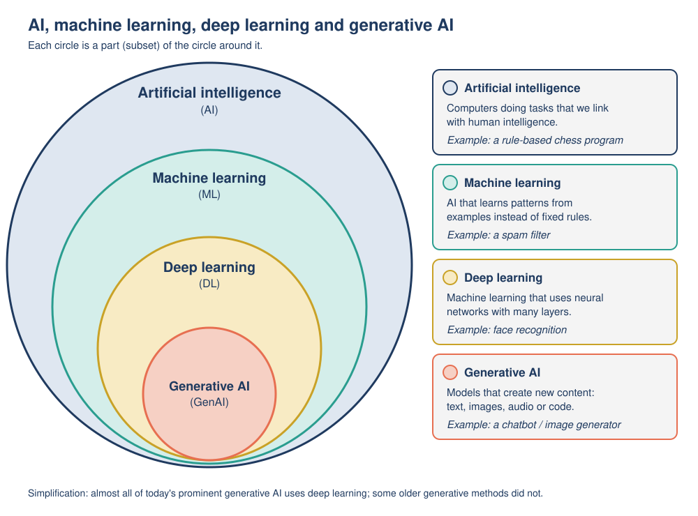

# 01: What is AI?

**Module:** AI Overview · **Version:** 2.0 · **Status:** drafted (self-checked) · **Last updated:** 2026-11-06

## Learning goals

After this topic, you should be able to:

- **Explain** in your own words what artificial intelligence (AI) is, using the idea of a system that turns **inputs** into **outputs** such as predictions, recommendations, decisions or content.
- **Distinguish** between human intelligence and today's AI systems, giving at least two differences.
- **Recognize** AI in at least five everyday tools, and **justify** why a given tool does or does not count as AI.
- **Explain** the "AI effect" and use it to explain why people disagree about what counts as AI.
- **Apply** the input-to-output description to a new AI system you meet in daily life.

## Prerequisites

- None. This is the first topic in the module. You only need basic computer skills (for example, using a phone app, a web browser and email).

## Key terms

| Term | Plain-English definition |
|---|---|
| Artificial intelligence (AI) | Computer systems that perform tasks we would normally say need human intelligence, such as recognizing patterns, understanding language, making decisions or creating content. Also the name of the field of study that builds such systems. |
| AI system | A particular piece of AI technology (for example, a spam filter or a chatbot) that receives **inputs** and produces **outputs**. |
| Input | The information an AI system receives: text you type, a photo, a sound recording, sensor readings, your clicks. |
| Output | What the AI system produces: a prediction, a recommendation, a decision, or new content. |
| Prediction | A best guess about something unknown, for example "this email is probably spam" or "traffic will be heavy at 5 pm". In AI, "prediction" does not have to be about the future. |
| Algorithm | A precise, step-by-step set of instructions a computer follows to solve a problem or complete a task. |
| Model | The part of an AI system that actually turns inputs into outputs. In many modern systems the model is produced automatically from examples (you will meet this properly in [Topic 02](02-how-ai-operates.md)). |
| Machine learning (ML) | A branch of AI in which a system learns patterns from examples (data) instead of following only rules written by a person. Introduced here; explained in Topics 02 and 03. |
| Generative AI | AI that creates new content, such as text, images, audio or computer code. Explained in [Topic 04](04-generative-ai-and-llms.md). |
| AI effect | The tendency for people to stop calling something "AI" once it works well and becomes ordinary. |

## Explanation

### 1. A working definition of AI

There is no single definition of AI that every expert agrees on, but most definitions share the same core idea. IBM's beginner explanation describes AI as "technology that enables computers and machines to simulate human learning, comprehension, problem solving, decision making, creativity and autonomy" [1]. In this module we use a shorter version:

> **Artificial intelligence (AI)** is computer technology that performs tasks we would normally say need human intelligence, such as recognizing patterns, understanding language, making decisions or creating content.

Notice two important words:

- **Simulate** (or "perform tasks that need intelligence"): AI produces results that look intelligent. That does not mean the computer thinks, understands or feels the way a person does. We return to this point below and again in Topic 09.
- **Tasks**: today's AI systems are built for particular jobs. A system that is excellent at recognizing faces cannot, on its own, also write a poem or drive a car.

### 2. A more precise definition: inputs, inference and outputs

Governments and international organizations need a definition precise enough to write laws and policies. The Organisation for Economic Co-operation and Development (OECD), a group of 38 member countries, agreed an updated definition in late 2023. In simplified form, it says that an AI system is a machine-based system that, for objectives set by people (stated or implied), **infers from the input it receives how to generate outputs** such as predictions, content, recommendations or decisions that can influence physical or virtual environments. It also says AI systems differ in how independently they act (their **autonomy**) and in whether they keep adapting after they are put into use [2].

The key word is **infers**. To infer means to work something out from evidence rather than being told it directly. A pocket calculator does not infer anything: it applies one fixed procedure to your numbers. An AI system, by contrast, has to work out a good output for an input it may never have seen before, such as a brand-new email or a photo taken in unusual light.

You can describe almost any AI system with this simple chain:

```
INPUT  -->  [ AI system: infers / works out an answer ]  -->  OUTPUT  -->  effect on the world
```

| Everyday AI system | Input | Type of output | Example output | Effect on the world |
|---|---|---|---|---|
| Email spam filter | A new email (words, sender, links) | Prediction / classification | "Spam" | Email goes to the spam folder |
| Navigation app | Your location, destination, live traffic data | Prediction + recommendation | "Take the ring road; arrive 08:42" | You drive a different route |
| Streaming service | What you and similar viewers watched | Recommendation | "Because you watched..." list | You choose what to watch next |
| Phone face unlock | Camera image of a face | Classification / decision | "Owner: unlock" | Phone unlocks |
| Predictive text | The words you have typed so far | Prediction | Next-word suggestions | You type faster (or accept a wrong word!) |
| Chatbot (for example, ChatGPT) | Your typed question or instruction (a **prompt**) | Generated content | A paragraph of text | You read, use or share the text |
| Online translator | A sentence in one language | Generated content | The sentence in another language | You understand a sign or a message |

A **classification** is a special kind of prediction in which the output is one of a fixed set of categories (spam / not spam; cat / dog / bird). A **recommendation** is a suggestion ranked for a particular person. A **decision** is an output that directly triggers an action (unlocking the phone). **Generated content** is new material such as text or images. These output words will come up again and again in the module.

### 3. Intelligence versus artificial intelligence

What is "intelligence" in the first place? Psychologists and philosophers have argued about this for over a century. For our purposes, human intelligence includes abilities such as learning from experience, reasoning, solving new problems, understanding language, perceiving the world through the senses, using common sense, and understanding other people's feelings and intentions.

Today's AI systems can match or beat people on some specific tasks (for example, playing chess, or sorting millions of emails per second), but they differ from human intelligence in important ways:

| | Human intelligence | Today's AI systems |
|---|---|---|
| Breadth | One person can cook, chat, drive, comfort a friend and learn a new game in the same day. | Each system is usually built for one task or a narrow family of tasks. |
| Learning | People can often learn from just a few examples ("this is a giraffe"). | Most AI learns from very large numbers of examples (thousands to billions). |
| Understanding and common sense | People connect words to real experience of the world. | AI processes patterns in data; whether it "understands" anything is debated, and it can make mistakes no human would make. |
| Feelings and awareness | People have experiences, feelings and goals of their own. | There is no accepted evidence that any current AI system has feelings or awareness. |
| Speed and scale | Limited; people get tired. | Extremely fast; can process enormous amounts of data without tiring. |

So "artificial intelligence" names the **behavior** (doing tasks that would need intelligence if a person did them), not a claim that the machine has a mind. Russell and Norvig's widely used university textbook frames AI around **agents**: systems that perceive their environment and act in it to achieve goals as well as possible [3]. That framing focuses on what the system does, which is the same practical view we take in this module.

### 4. Everyday examples, and how to tell whether something is AI

AI is already inside many tools you use without thinking about it. Gmail, for example, uses machine learning that also learns from user feedback (such as people marking messages as spam) to keep spam out of inboxes; Google reports that it blocks more than 99.9% of spam, phishing and malware [4]. Other common examples include navigation apps, recommendations on video and music services, photo apps that group pictures by face, voice assistants, online translators, fraud alerts from your bank and chatbots.

Not every piece of software is AI. A helpful test uses the definition above. Ask three questions:

1. **What is the input and what is the output?**
2. **Does the system have to infer (work out) a good output for new, varied inputs**, for example by recognizing patterns, or does it simply apply one fixed procedure that a person wrote out completely in advance?
3. **Could a person write down an exact recipe for every possible input?** If yes, it is probably ordinary software. If the task needs judgement about messy, varied inputs (faces, speech, handwriting, unusual emails), it is more likely to use AI.

| System | AI? | Reason |
|---|---|---|
| Calculator app | No | It follows fixed arithmetic rules; nothing is inferred. |
| Alarm clock that rings at 07:00 | No | One fixed rule set by a person. |
| Photo app that finds "all photos of my dog" | Yes | It must recognize a dog in photos it has never seen, from any angle and in any light. |
| Spell checker that only looks up words in a dictionary list | Borderline / usually no | A simple lookup. (Modern spell checkers that suggest the most likely intended word from context do use AI.) |

Borderline cases are normal. The boundary of "AI" is fuzzy, and that leads to the AI effect.

### 5. The "AI effect": why the meaning of AI keeps moving

When a computer first does something that seemed to need intelligence, people call it AI. Once it becomes reliable and ordinary, many people stop calling it AI and say "that's just a program". This pattern is called the **AI effect**. One famous version is "Tesler's Theorem", recorded by Douglas Hofstadter in 1979: "AI is whatever hasn't been done yet." A similar remark is often attributed to John McCarthy ("As soon as it works, no one calls it AI any more"), but researchers who traced the quotation found the attribution to him is second-hand and appeared only in 2011; the earliest verified version of the idea dates from 1971 [5].

Examples: route-finding in maps, beating a world champion at chess, and recognizing handwritten postal codes on envelopes were all once headline AI achievements. Today most people think of them as normal computer features. They still use AI techniques; they simply stopped feeling magical.

Why this matters for you:

- When you read "AI-powered" in an advert, it may describe a very simple feature. When you read "it's not real AI", the speaker may be moving the goalposts.
- Use the input-to-output description from section 2 to decide for yourself, rather than relying on the label.

### 6. A map of the terms you will meet

AI is the big umbrella. Inside it are several families of techniques, which the next topics explain step by step:

- **Machine learning (ML)** is the part of AI where systems learn patterns from data rather than following only hand-written rules ([Topic 02](02-how-ai-operates.md), [Topic 03](03-ml-neural-networks-deep-learning.md)).
- **Deep learning** is the part of ML that uses large, many-layered **neural networks** (computing structures loosely inspired by brain cells) ([Topic 03](03-ml-neural-networks-deep-learning.md)).
- **Generative AI** creates new content; almost all of today's prominent generative AI systems, including chatbots built on **large language models (LLMs)**, use deep learning ([Topic 04](04-generative-ai-and-llms.md)).

Not all AI is machine learning. Some AI systems follow rules written by experts, or search through possible moves to find a solution; these are explained in [Topic 02](02-how-ai-operates.md).

## Worked example

**Task:** Decide whether a supermarket's self-checkout camera that recognizes loose fruit and vegetables (so you don't have to type a code for "bananas") counts as AI, and describe it with the input-to-output chain.

**Step 1: Identify the input.** A camera image of whatever is on the scale, plus the weight from the scale.

**Step 2: Identify the output and its type.** A suggested product, for example "Bananas (loose)". This is a **classification**: the system picks one category from a fixed list of products. It may show its top three guesses, which is a ranked **recommendation**.

**Step 3: Does it infer?** Yes. Bananas can be green or yellow, in a bag or loose, placed at any angle, under different lighting. No one could write an exact rule for every possible image. The system must work out the most likely product from patterns it has learned from many example images.

**Step 4: Effect on the world.** The product and price are added to your bill (after you confirm). If the output is wrong, you could be charged for the wrong item, so the system asks you to confirm. This is a sensible design for a system that will sometimes make mistakes.

**Step 5: Compare with intelligence.** A child can recognize a banana after seeing a few. The checkout system needed many example images and cannot do anything else: it cannot tell you whether the banana is ripe enough for banana bread unless it was specifically built to do that.

**Conclusion:** It is an AI system (input: image and weight; output: classification of the product; it infers from varied inputs), and it is built for one specific task.

| Chain step | Self-checkout produce recognition |
|---|---|
| Input | Camera image + weight |
| AI system infers | Most likely product from patterns learned from example images |
| Output (type) | "Bananas (loose)" (classification; top-3 list = recommendation) |
| Effect | Item and price added to bill after customer confirms |

## Visual



*Figure: How AI, machine learning, deep learning and generative AI relate. Each inner circle is one part of the circle around it. Read it as a map for Topics 02 to 04. Note that the innermost circle is a simplification: almost all of today's prominent generative AI uses deep learning, but some older generative methods did not (see [Topic 04](04-generative-ai-and-llms.md)).* (Original diagram created for this module.)

## Common mistakes

1. **"AI means robots."** Most AI has no body at all. It runs inside apps, websites and data centers (spam filters, recommendations, translators). Robots may use AI, but AI and robotics are different things.
2. **"If it is called AI, it must think like a person."** "Intelligence" in AI describes the task being done, not a mind. Today's AI systems recognize patterns and produce outputs; there is no accepted evidence that they have feelings or awareness (see Topic 09).
3. **"All computer programs are AI."** A calculator or an alarm clock follows fixed rules for every case and infers nothing. Use the three-question test in section 4.
4. **"AI and machine learning are the same thing."** Machine learning is one part of AI. Some AI systems use hand-written rules or search instead (Topic 02).

## Try it yourself

### Activity 1: AI or not? Justify it (apply + justify)

For each system below, (a) name the input and output, (b) say whether it is AI, not AI, or borderline, and (c) justify your answer using the three questions in section 4.

1. A music app that builds a "Discover Weekly" playlist of songs you have never played, based on your listening history and that of similar listeners.
2. A microwave that switches off when its timer reaches zero.
3. A banking app that sends you an alert: "Unusual payment detected - was this you?"
4. A heating thermostat with one fixed rule: "If the room is below 19 °C, turn the heating on."
5. A phone keyboard that suggests the next word as you type.
6. A website form that rejects an email address with no "@" in it.

### Activity 2: Spot the AI effect (explain)

Read the conversation and answer the questions.

> **Sam:** "Map apps aren't AI. They just find the shortest route. Real AI is the chatbot I used yesterday."
> **Lee:** "Twenty years from now, people will probably say chatbots aren't real AI either."

a) Explain how Sam's first statement is an example of the AI effect.
b) Use the input-to-output description to argue that a map app's route-finding is AI.
c) Do you think Lee's prediction is reasonable? Give one reason.

### Activity 3: "AI in Your Day" (apply to your own life)

**Goal:** Notice where AI already appears in your daily life and judge how much to trust it.

**Instructions:** Over the next 24 hours (or by thinking back over yesterday), find **three** moments when you used or were affected by an AI system. Copy and fill in this table for each moment:

| Question | Your answer |
|---|---|
| 1. What were you doing? | |
| 2. What was the AI system's **input**? | |
| 3. What was its **output**, and which type was it (prediction, classification, recommendation, decision, generated content)? | |
| 4. How sure are you that it is AI? Use the three-question test. | |
| 5. Was the system built for **one specific task**, or could it do many different things? | |
| 6. If the system made a mistake, what would happen? Low stakes or high stakes? | |
| 7. Given your answer to 6, how much would you check its output before relying on it? | |

Finish with two or three sentences: Which of your examples would you trust most, and why?

## Answers

<details>
<summary>Show answers</summary>

**Activity 1**

1. **Music playlist: AI.** Input: your listening history and other listeners' histories. Output: a ranked list of recommended songs (recommendation). It must infer what you might like from patterns across millions of listeners; no one could hand-write a rule for every listener.
2. **Microwave timer: not AI.** Input: time set; output: switch off. One fixed rule, nothing to infer.
3. **Bank fraud alert: AI (usually).** Input: details of the payment (amount, place, time, shop) compared with your normal behavior. Output: a prediction or classification ("probably unusual / possibly fraud") that triggers an alert. Banks typically use systems that learn what "normal" looks like for each customer, because fraud patterns vary and change. (If the bank used only one fixed rule such as "alert on any payment over 1,000", that part would not be AI, which is why this case says "usually".)
4. **Fixed-rule thermostat: not AI.** It applies one rule written completely in advance. (A "smart" thermostat that learns your schedule and predicts when you will come home would be AI.)
5. **Next-word suggestions: AI.** Input: words typed so far. Output: predicted next words. The system infers likely continuations from patterns in very large amounts of text. (This is a small cousin of the chatbots in Topic 04.)
6. **Form check for "@": not AI.** A single exact rule that a person can write down completely.

A good justification mentions *inferring from varied inputs* versus *one fixed rule written in advance*. Borderline answers are acceptable if they are justified, for example "a thermostat is not AI unless it learns or predicts".

**Activity 2**

a) Route-finding was once a showcase of AI research. Because it now works reliably and everyone uses it, Sam no longer counts it as AI. That is the AI effect: things stop being called AI once they become ordinary.
b) Input: your location, destination, the road map and live traffic data. Output: a recommended route and a predicted arrival time (prediction and recommendation). The app must work out a good route among a huge number of possibilities and predict traffic it cannot see directly, so it infers its output; it is not one fixed rule for every journey. That fits the definition of an AI system. (In Topic 02 you will see that searching through possibilities is one of the classic AI techniques.)
c) Reasonable. The AI effect has happened repeatedly (chess, route-finding, handwriting recognition), so it is likely that chatbots will feel ordinary too. A thoughtful counter-argument also earns credit: for example, "chatbots do such a wide range of tasks that people may keep calling them AI."

**Activity 3: expected outcome**

Answers will differ. A strong response looks like this:

| Question | Example moment A | Example moment B |
|---|---|---|
| 1. Doing | Driving to an unfamiliar address with a navigation app | Reading a test result from a hospital scan reviewed with AI assistance |
| 2. Input | My location, destination, live traffic | The medical image |
| 3. Output and type | Recommended route + predicted arrival time (prediction, recommendation) | Highlighted areas that might be abnormal (classification) |
| 4. Sure it is AI? | Yes: it infers traffic and the best route from huge, changing data | Yes: it recognizes patterns in images that vary from patient to patient |
| 5. One task or many? | One specific task (routes) | One specific task (one type of scan) |
| 6. Mistake? | A slower route: annoying but low stakes and easy to correct | A missed problem (false negative) could delay treatment; a false alarm (false positive) could cause worry and extra tests: high stakes |
| 7. How much to check? | Little: I glance at the route | A lot: I would expect a qualified doctor to review the output and explain it |

*Expected insight:* AI is already part of ordinary routines; every example you find is built for a specific task (Topic 05 names this "narrow AI"); and the amount you check an AI output should depend on **how serious a mistake would be**, not on how clever the system seems. Topics 08 and 09 build on this idea.

Common weaknesses to fix: listing a device ("my phone") instead of a specific AI function ("face unlock"); calling every app feature AI without applying the three-question test; giving no consequence of error.

</details>

## Optional extension

*Optional: not required for later topics.*

1. Look up the full OECD definition of an AI system [2] and compare it with the IBM definition [1]. Which words does the OECD use that IBM does not (for example, "objectives", "autonomy", "adaptiveness")? Why might lawmakers need these extra words?
2. Search your phone's settings or an app's help pages for the words "AI", "machine learning" or "smart". Pick one feature and describe it with the input-to-output chain. Does the label match what the feature actually does?

## Connections

- **Next:** [Topic 02: How AI operates](02-how-ai-operates.md) explains *how* the AI system in the middle of the input-to-output chain works out its answer: by following rules, by searching, or by learning from data.
- **Later:** [Topic 03](03-ml-neural-networks-deep-learning.md) and [Topic 04](04-generative-ai-and-llms.md) zoom into the inner circles of the nested diagram. [Topic 05](05-types-of-ai.md) gives names to the observation that all today's examples are task-specific. Topics 08 and 09 return to the question of trust raised by "AI in Your Day".

## Sources

1. IBM (n.d.). *What is artificial intelligence (AI)?* IBM Think. https://www.ibm.com/think/topics/artificial-intelligence (accessed 2026-11-06). Supports: beginner definition of AI ("simulate human learning, comprehension, problem solving..."); AI, ML, deep learning and generative AI presented as nested concepts.
2. OECD.AI (2023, 29 November). *Updates to the OECD's definition of an AI system explained.* OECD.AI Policy Observatory. https://oecd.ai/en/wonk/ai-system-definition-update (accessed 2026-11-06). Supports: the updated OECD definition (machine-based system; objectives; infers from input how to generate outputs such as predictions, content, recommendations or decisions; varying autonomy and adaptiveness).
3. Russell, S. & Norvig, P. (2021). *Artificial Intelligence: A Modern Approach* (4th ed.). Pearson. Book website: https://aima.cs.berkeley.edu/ (accessed 2026-11-06). Supports: framing of AI around intelligent agents that perceive and act (Chapter 2, "Intelligent Agents"). Checked via the official book website's table of contents and university lecture notes summarizing Chapter 1; the book text itself was not re-read for this revision.
4. Kumaran, N. (2022, 28 May). *Understanding Gmail's spam filters.* Google Workspace Blog. https://workspace.google.com/blog/identity-and-security/an-overview-of-gmails-spam-filters (accessed 2026-11-06). Supports: Gmail uses machine learning powered by user feedback; blocks more than 99.9% of spam, phishing and malware (Google's own figure).
5. O'Toole, G. (2024, 20 June). *Quote origin: As soon as it works, no one calls it AI anymore.* Quote Investigator. https://quoteinvestigator.com/2024/06/20/not-ai/ (accessed 2026-11-06). Supports: history of the AI effect; Tesler's Theorem recorded by Hofstadter (1979); earliest verified version (Raphael, 1971); McCarthy attribution is second-hand (2011).
