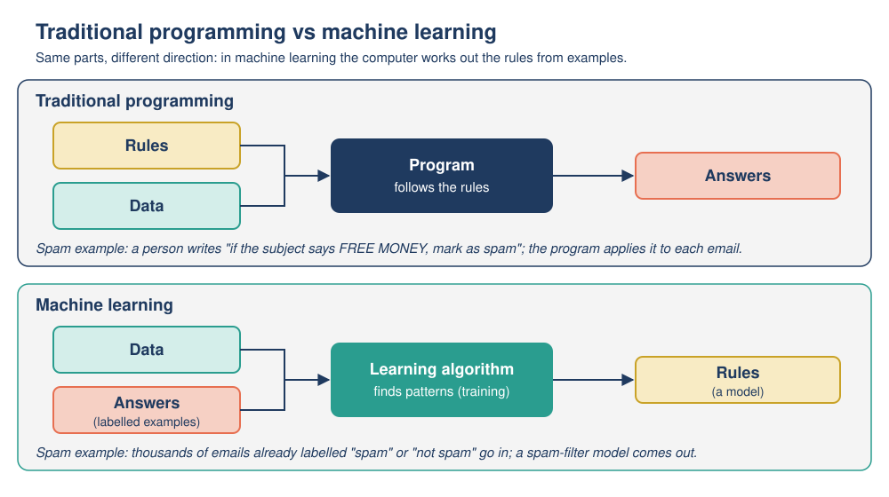
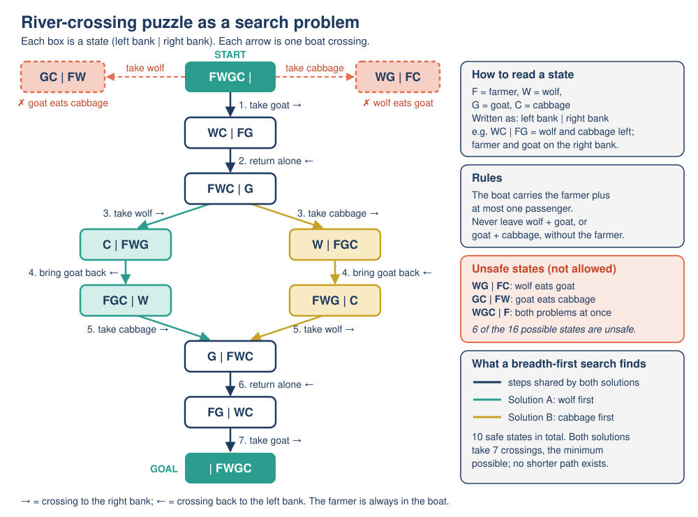

# 02: How AI operates

**Module:** AI Overview · **Version:** 2.0 · **Status:** drafted (self-checked) · **Last updated:** 2026-11-06

## Learning goals

After this topic, you should be able to:

- **Explain** the roles of **data**, **algorithms** and **models** in an AI system.
- **Distinguish** rule-based ("symbolic") AI from learning-based AI (machine learning), and **justify** which approach suits a given task.
- **Trace** a simple search through possible states to solve a puzzle, as classic rule-based AI does.
- **Distinguish** training from inference, and **trace** how a simple spam filter is trained from labeled examples and then used on new emails.
- **Predict** how changing a model's settings (such as its threshold) changes its outputs and its mistakes.

## Prerequisites

- [Topic 01: What is AI?](01-what-is-ai.md): the definition of AI, and the idea that an AI system turns **inputs** into **outputs** (predictions, classifications, recommendations, decisions, generated content).
- The terms **algorithm** and **model** were introduced briefly in Topic 01; this topic explains them properly.

## Key terms

| Term | Plain-English definition |
|---|---|
| Data | Recorded information a computer can process: text, numbers, images, sounds, clicks, sensor readings. |
| Algorithm | A precise, step-by-step procedure a computer follows to solve a problem or complete a task. |
| Model | The part of an AI system that turns an input into an output. In machine learning, the model is *produced by training* on data and stores the patterns that were learned. |
| Rule-based AI (symbolic AI) | AI in which people write the knowledge down as explicit rules and symbols (for example "IF ... THEN ..."), and the computer reasons or searches with them. Sometimes called "traditional" or "old-style" AI. |
| Expert system | A rule-based AI system that stores the knowledge of human experts as many IF-THEN rules. |
| Search (in AI) | Solving a problem by systematically exploring possible states and actions until a goal is found. |
| State | A snapshot of a situation at one moment (for example, who is on which side of a river). |
| Machine learning (ML) | AI in which a learning algorithm finds patterns in example data and produces a model, instead of a person writing all the rules. |
| Training | The process of running a learning algorithm on example data so that it produces (or improves) a model. |
| Training data | The examples used for training. |
| Feature | A measurable property of an input that the model uses, for example "the email contains the word *free*". |
| Label | The correct answer attached to a training example, for example "spam" or "not spam". |
| Parameters (weights) | The adjustable numbers inside a model that are set during training. They control how much each feature counts. |
| Inference (prediction) | Using a trained model on a new input to produce an output. |
| Threshold | A cut-off value: if a score is at or above it, the model gives one answer; below it, the other answer. |
| False positive / false negative | A false positive is a wrong "yes" (a genuine email sent to spam). A false negative is a wrong "no" (a spam email that reaches the inbox). |

## Explanation

### 1. Three ingredients: data, algorithms and models

Every AI system you met in Topic 01 has three ingredients.

- **Data** is the raw material. A spam filter needs emails; a face-unlock system needs images of faces; a navigation app needs maps and traffic reports.
- An **algorithm** is a precise recipe of steps. All computer programs are built from algorithms. In AI, two kinds matter most: algorithms that *reason or search* using knowledge people wrote down, and **learning algorithms** that *find patterns in data*.
- A **model** is the thing that actually maps an input to an output. Think of it as the finished "decision-maker" inside the system. In rule-based AI, the model is the set of rules people wrote. In machine learning, the model is *created by* a learning algorithm from data, and it contains numbers called **parameters** (or **weights**) that capture what was learned.

A useful kitchen comparison: the data is the ingredients, the learning algorithm is the recipe for *practicing*, and the model is the trained cook who can now make the dish without the recipe book open. (Like all analogies, this one is imperfect: a model does not "know" it is cooking.)

There are two broad ways to build the model: **write the knowledge in by hand** (rule-based AI) or **learn it from examples** (machine learning). Both are AI, and both are still used today.

### 2. Approach 1: rule-based (symbolic) AI

From the 1950s to the 1980s, most AI research built systems by **writing knowledge down explicitly**. Because the knowledge is stored as human-readable symbols and rules, this is often called **symbolic AI**. Two important kinds are expert systems and search.

**Expert systems.** An expert system stores the knowledge of human specialists as many IF-THEN rules. A famous early example is MYCIN, developed at Stanford in the early 1970s to help doctors identify bacterial blood infections and choose antibiotics. It used roughly 600 rules of the form "IF the organism is gram-negative AND rod-shaped AND anaerobic, THEN there is suggestive evidence that it is *Bacteroides*" [1]. MYCIN could explain its conclusions by showing which rules it had used, a big strength of rule-based systems. Its weaknesses were typical too: every rule had to be written and checked by hand with experts, and the system could not handle situations its rules did not cover. (MYCIN was tested on real cases but was not put into routine clinical use [1].)

**Search.** Many problems can be solved by exploring possibilities step by step until you reach the goal. To use search, you describe the problem with:

1. A **start state** (the situation now).
2. **Actions** that change one state into another.
3. **Rules** saying which states are allowed.
4. A **goal state** (what "solved" looks like).

The computer then explores states systematically. One simple strategy, **breadth-first search**, checks every state reachable in 1 move, then every state reachable in 2 moves, and so on, so the first solution it finds uses the fewest moves. Search powers route-finding in maps, puzzle solvers and game-playing programs.

#### Mini-trace: the farmer, wolf, goat and cabbage puzzle

*The puzzle:* A farmer must take a wolf, a goat and a cabbage across a river. The boat holds the farmer plus **at most one** other item. If left alone together (without the farmer), the wolf will eat the goat, and the goat will eat the cabbage. How can the farmer get everything across safely?

*As a search problem:*

- **State:** who is on the left bank and who is on the right bank. We write it as `left bank | right bank`, using F = farmer, W = wolf, G = goat, C = cabbage. Start: `FWGC | -`. Goal: `- | FWGC`.
- **Actions:** the farmer crosses alone, or with one item from his side.
- **Rule (safe states only):** never leave W with G, or G with C, on a bank without F.

Each crossing has at most four options (alone, with W, with G, with C), and the search checks each option against the rule. Here is the breadth-first trace (an "X" marks an option that is rejected):

| Move | From state | Options tried (resulting state) | Kept |
|---|---|---|---|
| 1 | `FWGC \| -` | alone (`WGC \| F`) X wolf eats goat; with W (`GC \| FW`) X goat eats cabbage; **with G (`WC \| FG`) safe**; with C (`WG \| FC`) X wolf eats goat | `WC \| FG` |
| 2 | `WC \| FG` | **alone back (`FWC \| G`) safe**; with G back = start state (already seen, skip) | `FWC \| G` |
| 3 | `FWC \| G` | **with W (`C \| FWG`) safe**; **with C (`W \| FGC`) safe**; alone = already seen | two branches |
| 4 | `C \| FWG` | **bring G back (`FGC \| W`) safe**; alone back (`FC \| WG`) X wolf eats goat | `FGC \| W` |
| 4 | `W \| FGC` | **bring G back (`FWG \| C`) safe**; alone back (`FW \| GC`) X goat eats cabbage | `FWG \| C` |
| 5 | `FGC \| W` | **with C (`G \| FWC`) safe**; with G = already seen; alone X | `G \| FWC` |
| 5 | `FWG \| C` | **with W (`G \| FWC`) safe** (same state as the other branch); with G = already seen; alone (`WG \| FC`) X wolf eats goat | `G \| FWC` |
| 6 | `G \| FWC` | **alone back (`FG \| WC`) safe**; with W or C back = already seen | `FG \| WC` |
| 7 | `FG \| WC` | **with G (`- \| FWGC`) GOAL** | solved |

**Solution (7 crossings):** take the goat over; return alone; take the wolf over; bring the goat back; take the cabbage over; return alone; take the goat over. (Swapping "wolf" and "cabbage" in crossings 3 and 5 gives the only other 7-crossing solution.) Of the 16 possible arrangements of four characters on two banks, only 10 are safe, and no solution uses fewer than 7 crossings. We checked this with a short breadth-first search program written for this module.

The key point: **the computer did not learn anything**. A person described the states, actions and rules; the algorithm simply searched. That is rule-based (symbolic) AI.

### 3. Approach 2: learning-based AI (machine learning)

Rules work well when the knowledge is clear and stable. But try writing exact rules to recognize a face, understand speech, or spot every spam email. The rules would be endless, and spammers change their tricks every week ("FR3E M0NEY!!"). Machine learning turns the problem around.

- **Traditional programming:** a person writes the **rules**; the computer applies them to **data** to produce **answers**.
- **Machine learning:** we give the computer **data together with the answers** (labeled examples); a learning algorithm works out the **rules** itself, in the form of a **model**. The model is then used to produce answers for new data.

Google described exactly this shift for Gmail: after about a decade of rule-based filtering, it began in 2014 to use machine learning to generate its spam-filtering rules, and it uses machine learning to "continually regenerate the 'spam filter'" because "machine learning finds new patterns and adapts far quicker than previous manual systems" [2]. Today Gmail's filters use "machine learning powered by user feedback" [3].

Machine learning has two separate phases:

1. **Training.** A learning algorithm processes the **training data**. Each example has **features** (measurable properties of the input) and, in the common case, a **label** (the correct answer). The algorithm adjusts the model's **parameters** (weights) so that its outputs match the labels as closely as possible. Training is done before the system is used, and repeated now and then with fresh data.
2. **Inference** (also called **prediction**). The trained model receives a *new* input that it has never seen, and produces an output. This happens every time someone uses the system, often millions of times a day.

Before a model is deployed, it is **tested** on labeled examples that were **kept aside** and not used in training (a **test set**). This shows how well it works on new data, not just on the examples it practised on. Topic 03 explains why this matters.

### 4. Comparing the two approaches

| | Rule-based (symbolic) AI | Learning-based AI (machine learning) |
|---|---|---|
| Where the knowledge comes from | People (experts, programmers) write rules | A learning algorithm finds patterns in example data |
| Main requirement | Expert knowledge and careful rule-writing | Lots of good-quality data (often labeled) and computing power |
| Explaining a decision | Usually easy: show which rules fired | Often harder, especially for large models |
| New or unusual situations | Fails if no rule covers the case | Can handle new cases that resemble the training data; can fail on cases very unlike it |
| Keeping it up to date | Edit rules by hand | Retrain with new data |
| Best suited to | Clear, stable rules: tax calculations, eligibility checks, puzzles, route search | Messy patterns: images, speech, spam, recommendations, language |
| Examples | MYCIN expert system; puzzle solvers; route search | Gmail spam filtering; face unlock; recommendations; chatbots |

The terms "old" and "new" AI are a rough guide only. Rule-based AI dominated early research and machine learning dominates today's headlines, but both are used today, and many systems combine them. For example, DeepMind's AlphaGo, which beat a top professional Go player in 2016, "combines deep neural networks with advanced search algorithms" [4].

## Worked example

**Training and using a spam filter (illustrative (made-up) figures).** All numbers in this example are invented for teaching; they are not taken from any real email service. Real spam filters use many more features and more refined mathematics (for example, probabilities), but the core idea is the same: the weights come from patterns counted in labeled data.

**Step 1: Collect labeled data.** We gather 12,000 emails that people have already labeled "spam" or "not spam". We put 2,000 aside as a **test set** and use the other 10,000 as **training data**: 4,000 spam and 6,000 not spam.

**Step 2: Choose features.** The model cannot read like a person. Each email is turned into yes/no **features**: Does it contain "free"? "urgent"? "meeting"? "invoice"? Does it have 3 or more links?

**Step 3: Train (count patterns and set the weights).** The learning algorithm counts how often each feature appears in spam and in not-spam emails (illustrative (made-up) figures):

| Feature | Spam emails with it (of 4,000) | Not-spam emails with it (of 6,000) | % of spam | % of not-spam | Pattern |
|---|---|---|---|---|---|
| contains "free" | 2,400 | 300 | 60% | 5% | 12 times more common in spam |
| contains "urgent" | 1,600 | 120 | 40% | 2% | 20 times more common in spam |
| contains "meeting" | 80 | 1,800 | 2% | 30% | 15 times more common in not-spam |
| contains "invoice" | 400 | 480 | 10% | 8% | about the same (1.25 times) |
| 3 or more links | 2,000 | 1,200 | 50% | 20% | 2.5 times more common in spam |

Our simple learning algorithm turns each pattern into a **weight** (points) using this recipe:

- at least 5 times more common in spam: **+2**
- 2 to 5 times more common in spam: **+1**
- less than 2 times more common either way: **0**
- 2 to 5 times more common in not-spam: **-1**
- at least 5 times more common in not-spam: **-2**

That gives the learned weights: "free" **+2**, "urgent" **+2**, "meeting" **-2**, "invoice" **0**, 3+ links **+1**. The designers also choose a **threshold**: a total score of **2 or more** means "spam".

Notice what happened: **no person wrote the rule** "meeting emails are usually genuine". The weights came out of the data. These weights and the threshold are the model's **parameters**. A real filter has thousands or millions of them.

**Step 4: Inference on new emails.** Now new emails arrive. For each one, the model adds up the weights of the features present and compares the total with the threshold.

| New email | Features present | Score | Score at least 2? | Output |
|---|---|---|---|---|
| A: "URGENT: claim your FREE prize" (4 links) | free +2, urgent +2, 3+ links +1 | 5 | yes | spam |
| B: "Team meeting moved to 3pm" (no links) | meeting -2 | -2 | no | not spam |
| C: "Free pizza at the team meeting today!" (no links) | free +2, meeting -2 | 0 | no | not spam |

Email C shows features working together: "free" pushes toward spam, but "meeting" pulls back.

**Step 5: Test before deployment.** We run the model on the 2,000 test emails it never saw during training (800 spam, 1,200 not spam). Illustrative (made-up) results:

- It catches 720 of the 800 spam emails; 80 spam emails get through (**false negatives**).
- It wrongly sends 60 of the 1,200 genuine emails to spam (**false positives**); 1,140 are correctly left in the inbox.
- Correct answers: 720 + 1,140 = 1,860 out of 2,000 = **93% accuracy**.

**Step 6: Decide and improve.** Is 93% good enough? It depends on the cost of each mistake. A genuine job offer lost in the spam folder (false positive) may be worse than one extra spam email in the inbox. If results are not good enough, the team improves the data or features (for example, adding "prize") and **trains again**. After deployment, user actions such as "Report spam" become new labeled data for the next round of training.

## Visual

*Figure: Traditional programming versus machine learning. The same parts appear in both, but in machine learning the computer works out the rules (the model) from labeled examples.* (Original diagram created for this module.)

*Figure: The machine learning pipeline. Training happens before use (and now and then afterwards); inference happens every time someone uses the model.* (Original diagram created for this module.)

*Figure: The farmer, wolf, goat and cabbage puzzle as a search problem. Each box is a safe state; each arrow is a crossing; the highlighted path is a shortest solution.* (Original diagram created for this module.)

## Common mistakes

1. **"An AI model is a list of rules that programmers typed in."** That is true of rule-based AI only. In machine learning, the model's parameters are set automatically during training; no person writes the rule "meeting emails are usually genuine".
2. **"The model keeps learning every time I use it."** Usually not. Inference (using the model) and training (changing the model) are separate. Many systems are retrained regularly using new data such as user feedback, but a single prediction does not normally change the model.
3. **"Rule-based AI is obsolete."** Rule-based reasoning and search are still widely used (route planning, scheduling, many business systems), often combined with machine learning, as in AlphaGo.
4. **"High accuracy means no problems."** A 93% accurate filter still made 140 mistakes in our 2,000 test emails. Which mistakes it makes (false positives or false negatives) and who is affected matters as much as the overall percentage.

## Try it yourself

### Activity 1: Be the spam filter (trace + predict)

Use the learned weights from the worked example: "free" +2, "urgent" +2, "meeting" -2, "invoice" 0, 3 or more links +1. Threshold: a score of 2 or more means "spam". (A feature counts if the word appears anywhere, in any capitals.)

| Email | Text | Links |
|---|---|---|
| E1 | "Urgent: meeting room changed to B12" | 0 |
| E2 | "Your invoice is attached. FREE delivery on your next order!" (from a shop you really used) | 3 |
| E3 | "Claim your prize now!!!" (a real scam) | 5 |
| E4 | "FREE gift - URGENT, offer ends today" | 1 |

a) Calculate each email's score and the model's output.
b) Which output is a false positive and which is a false negative? Explain.
c) **Predict:** if the designers lowered the threshold from 2 to 1, which outputs would change? What is the trade-off?
d) Suggest how the false negative could be fixed *using machine learning* rather than by writing a rule by hand.

### Activity 2: Rules or learning? Training or inference? (compare + justify)

**Part A.** For each task, choose **rule-based** or **machine learning**, and justify your choice in one sentence using the comparison table.

1. Calculating sales tax at 8% on a shopping bill.
2. Recognizing spoken commands ("Call Mom") from many different voices and accents.
3. Checking that a new password has at least 8 characters.
4. Suggesting films a viewer might enjoy.
5. Finding the shortest sequence of moves to solve a sliding-tile puzzle.

**Part B.** Label each event as **training** or **inference**.

1. An email service runs its learning algorithm overnight on last week's millions of "Report spam" clicks.
2. Your phone unlocks when it sees your face.
3. A company feeds 50,000 labeled photos of ripe and unripe tomatoes into a learning algorithm.
4. A translation app turns your sentence into Spanish.

### Activity 3: Search the river (find and fix the error)

A classmate proposes this plan for the farmer, wolf, goat and cabbage puzzle (rules as in the Explanation):

1. Farmer takes the goat across.
2. Farmer returns alone.
3. Farmer takes the cabbage across.
4. Farmer returns alone.
5. Farmer takes the wolf across.
6. Farmer returns alone.
7. Farmer takes the goat across.

a) Trace the plan, writing the state `left | right` after each step. At which step does it first fail, and why?
b) Correct the plan with the smallest possible change.
c) The plan in the Explanation takes the wolf over at crossing 3. Write out the other shortest solution.

## Answers

Show answers

**Activity 1**

a)

| Email | Calculation | Score | Output |
|---|---|---|---|
| E1 | urgent +2, meeting -2, links 0 | 0 | not spam |
| E2 | free +2, invoice 0, 3+ links +1 | 3 | spam |
| E3 | no listed words; 3+ links +1 | 1 | not spam |
| E4 | free +2, urgent +2; only 1 link so no link points | 4 | spam |

b) **E2 is a false positive**: a genuine email from a shop you used was sent to spam. **E3 is a false negative**: a real scam reached the inbox, because "prize" is not one of the model's features, so only the links gave it points. (E1 and E4 are probably correct.)

c) With threshold 1: E3 (score 1) would now be marked spam, which fixes that false negative. E1 (0) stays "not spam", and E2 and E4 stay "spam". The trade-off: a lower threshold catches more spam but also sends more genuine emails to spam (any genuine email with 3 or more links and nothing else would now be blocked), so false positives rise. A higher threshold does the opposite.

d) Collect more labeled examples, including scams like E3 (for example, from users clicking "Report spam"), add useful features such as "contains *prize*", and **retrain**, so that the learning algorithm sets a new weight for "prize" from the data. Writing "IF prize THEN spam" by hand would be the rule-based approach.

**Activity 2**

Part A (other well-justified answers may be accepted):

1. **Rule-based.** The rule is exact and stable (multiply by 0.08); learning it from data would be pointless and less reliable.
2. **Machine learning.** Voices vary endlessly; no one could write rules for every voice, so the system must learn patterns from many recorded examples.
3. **Rule-based.** One simple, exact rule that never changes.
4. **Machine learning.** Tastes are messy and change; patterns are found in what many viewers watched.
5. **Rule-based (search).** The states, moves and goal are fully known, so the computer can search for the shortest solution, like the river-crossing puzzle.

Part B: 1 **training** (the model is being updated from labeled data); 2 **inference** (an existing model is used on a new input); 3 **training**; 4 **inference**.

**Activity 3**

a)

| After step | State (left \| right) | Safe? |
|---|---|---|
| 1 | `WC \| FG` | yes |
| 2 | `FWC \| G` | yes |
| 3 | `W \| FGC` | yes (farmer is with goat and cabbage) |
| 4 | `FW \| GC` | **no: goat eats cabbage** |

The plan fails at **step 4**: the farmer leaves the goat and the cabbage alone on the right bank.

b) Change step 4 to "Farmer **brings the goat back**". The states then become: 4 `FWG | C`; 5 take wolf: `G | FWC`; 6 return alone: `FG | WC`; 7 take goat: `- | FWGC`. Solved in 7 crossings.

c) Take goat over; return alone; take **cabbage** over; bring goat back; take **wolf** over; return alone; take goat over. (This is exactly the corrected plan from part b.)

## Optional extension

*Optional: not required for later topics.*

- **Count the states yourself.** Four characters, each on one of two banks, give 2 × 2 × 2 × 2 = 16 possible arrangements. List them and cross out the unsafe ones. You should be left with 10 safe states. Then check the trace table in the Explanation: does every one of your 10 safe states appear in it? (It should: this puzzle is small enough that the search visits every safe state.)
- **Rules versus learning in your inbox.** Many email apps let you create your own "filters" (for example, "messages from this address go to the Newsletters folder"). These are hand-written rules running *alongside* the provider's machine-learning spam filter. Find this setting in your own email app and note one rule you could write and one job that is better left to machine learning.

## Connections

- **Previous:** [Topic 01](01-what-is-ai.md) described AI from the outside (input to output). This topic opened the box: rules, search, or a model learned from data.
- **Next:** [Topic 03](03-ml-neural-networks-deep-learning.md) looks closer at machine learning: different ways of learning (supervised, unsupervised, reinforcement), why we test on unseen data (overfitting), and how neural networks compute with weights.
- **Later:** [Topic 04](04-generative-ai-and-llms.md) shows how the same training-then-inference idea produces chatbots. The idea that a model learns whatever patterns are in its training data returns in Topic 08 (bias) and Topic 09 (limitations).

## Sources

1. Yale University, Department of Computer Science (2015). *Expert Systems* (lecture notes, CS 458). https://zoo.cs.yale.edu/classes/cs458/lectures/old2015/ExpertSystems.html (accessed 2026-11-06). Supports: MYCIN developed by Edward Shortliffe at Stanford in the early 1970s; about 600 IF-THEN rules; example rule about *Bacteroides*; tested on real cases but not used in practice.
2. Google (2017, 4 May). *How machine learning in G Suite makes people more productive.* The Keyword (Google blog). https://blog.google/products-and-platforms/products/workspace/how-machine-learning-g-suite-makes-people-more-productive/ (accessed 2026-11-06). Supports: Gmail moved from about a decade of rule-based filtering to machine-learning-generated rules from 2014; ML "continually regenerate[s] the spam filter" and "adapts far quicker than previous manual systems".
3. Kumaran, N. (2022, 28 May). *Understanding Gmail's spam filters.* Google Workspace Blog. https://workspace.google.com/blog/identity-and-security/an-overview-of-gmails-spam-filters (accessed 2026-11-06). Supports: Gmail filters use "machine learning powered by user feedback"; user actions such as marking spam feed learning.
4. Google DeepMind (n.d.). *AlphaGo.* https://deepmind.google/research/breakthroughs/alphago/ (accessed 2026-11-06). Supports: AlphaGo "combines deep neural networks with advanced search algorithms"; 2016 match in Seoul.
5. Google for Developers (n.d.). *Supervised Learning* (Introduction to Machine Learning course). https://developers.google.com/machine-learning/intro-to-ml/supervised (accessed 2026-11-06). Supports: definitions of features, labels, labeled examples, training, evaluation, and inference ("use the model to make predictions, called inferences").
6. Microsoft (n.d.). *AI for Beginners: 12 Weeks, 24 Lessons.* GitHub. https://github.com/microsoft/AI-For-Beginners (accessed 2026-11-06). Supports: symbolic AI (knowledge representation and expert systems) and neural-network approaches treated as the two major strands of AI in a beginner curriculum.
7. River-crossing facts (16 arrangements, 10 safe states, minimum 7 crossings, exactly 2 shortest solutions) were checked with a breadth-first search program written for this module (not an external source).
