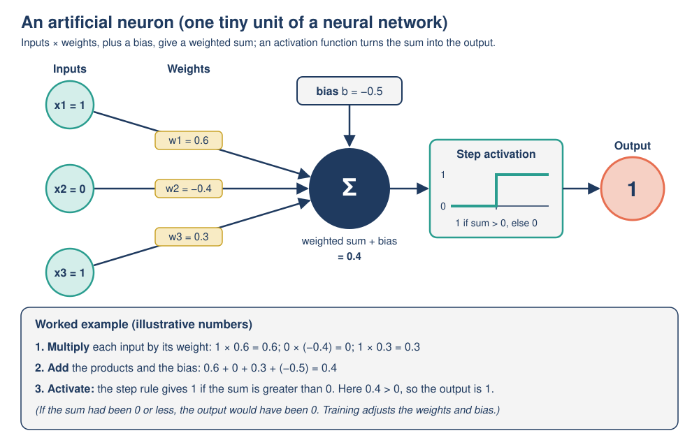
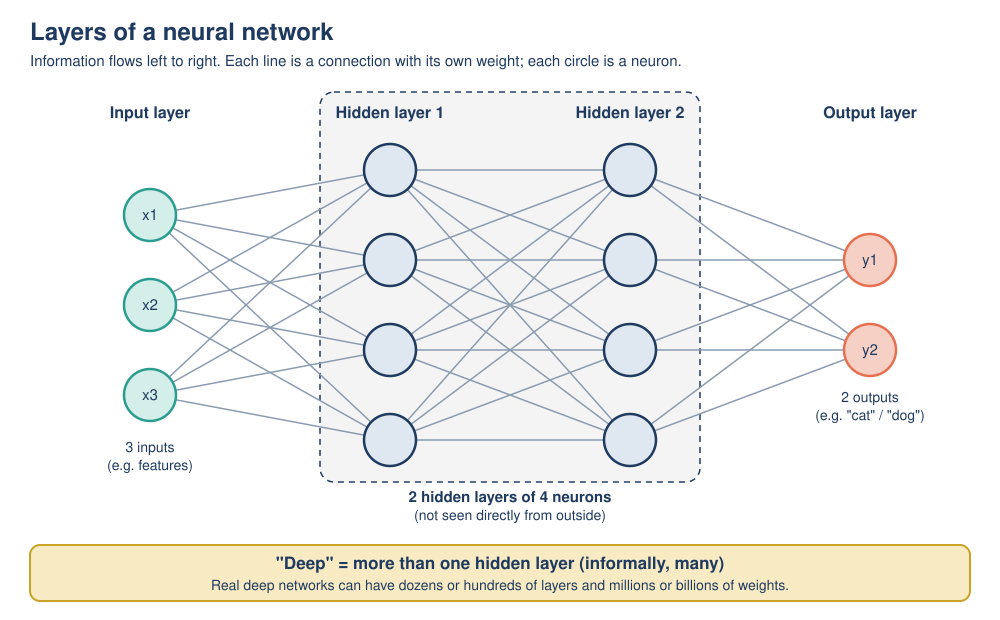

# 03: Machine learning, neural networks and deep learning

**Module:** AI Overview · **Version:** 2.0 · **Status:** drafted (self-checked) · **Last updated:** 2026-11-06

## Learning goals

After this topic, you should be able to:

- **Distinguish** supervised, unsupervised and reinforcement learning, and **classify** a new scenario as one of them with a reason.
- **Identify** the features and labels in a dataset, and **explain** why a model is tested on data kept aside from training.
- **Explain** overfitting in plain language and **recognize** it from training and test results.
- **Trace** the calculation of a single artificial neuron (inputs, weights, bias, activation) with small numbers.
- **Explain** what layers are in a neural network and what makes learning "deep".

## Prerequisites

- [Topic 01: What is AI?](01-what-is-ai.md): AI systems turn inputs into outputs; the nested map of AI, machine learning (ML), deep learning and generative AI.
- [Topic 02: How AI operates](02-how-ai-operates.md): data, algorithm, model; rule-based AI versus machine learning; **training** versus **inference**; **features**, **labels**, **parameters (weights)**, **threshold**; the spam-filter worked example and its test set.

## Key terms

| Term | Plain-English definition |
|---|---|
| Supervised learning | Machine learning from examples that come with the correct answers (labels). |
| Unsupervised learning | Machine learning from examples *without* labels; the algorithm looks for structure such as groups of similar items. |
| Reinforcement learning | Machine learning by trial and error: an agent takes actions in an environment and receives rewards or penalties. |
| Agent / environment | In reinforcement learning, the agent is the learner that acts; the environment is the world (or game) it acts in. |
| Classification / regression | Two kinds of supervised task. Classification predicts a category (spam / not spam). Regression predicts a number (a house price). |
| Clustering | An unsupervised task: grouping similar examples together without being told the groups. |
| Training set / test set | The training set is the data the model learns from. The test set is labeled data kept aside and used only to check how well the model works on examples it has never seen. |
| Generalization | A model's ability to work well on new data, not just on its training data. |
| Overfitting | When a model fits its training data so closely (even memorizing it) that it does badly on new data. |
| Neural network | A model made of many simple connected units (artificial neurons) arranged in layers, loosely inspired by brain cells. |
| Artificial neuron | One unit of a neural network: it multiplies each input by a weight, adds them up with a bias, and passes the result through an activation function. |
| Bias (in a neuron) | An extra number added to a neuron's weighted sum that shifts how easily it "fires". (Not the same as *unfair* bias, covered in Topic 08.) |
| Activation function | A simple rule that turns a neuron's weighted sum into its output (for example, "output 1 if the sum is greater than 0, otherwise 0"). |
| Layer (input, hidden, output) | A group of neurons at the same stage. The input layer receives the features; hidden layers are in between; the output layer gives the result. |
| Deep learning | Machine learning using neural networks with many layers (in particular, more than one hidden layer). |

## Explanation

### 1. Machine learning: a quick recap

In [Topic 02](02-how-ai-operates.md) you saw the key idea: instead of a person writing every rule, a **learning algorithm** studies **training data** and produces a **model**, whose **parameters (weights)** capture the patterns it found. Google's machine learning course puts it simply: "ML is the process of training a piece of software, called a model, to make useful predictions" [1]. Machine learning comes in three main styles, depending on what kind of feedback the learner gets.

### 2. Three ways to learn

**Supervised learning: learning with an answer key.** Each training example has **features** (the information the model uses) and a **label** (the correct answer). Google defines features as "the values that a supervised model uses to predict the label" and the label as "the 'answer', or the value we want the model to predict" [2]. The spam filter in Topic 02 was supervised: every training email was labeled "spam" or "not spam".

- **Classification** predicts a category: spam / not spam, cat / dog, ripe / unripe.
- **Regression** predicts a number: the price of a house from its size and location; tomorrow's electricity demand.

Supervised learning is the most widely used kind, but labels can be expensive: often people must label thousands of examples by hand, and mistakes in the labels become mistakes in the model.

**Unsupervised learning: finding structure without answers.** The examples have features but **no labels**. The algorithm looks for patterns on its own: "An unsupervised learning model aims to identify meaningful patterns in a dataset" [1]. A common task is **clustering**: grouping similar items. For example, a shop could give an algorithm the purchase histories of 100,000 customers and let it discover groups such as "weekend bulk buyers" and "late-night snack buyers", without anyone deciding the groups in advance. People still choose the data and interpret the groups afterwards, so "unsupervised" does not mean "no humans involved".

**Reinforcement learning: learning from rewards.** An **agent** acts in an **environment** and receives **rewards** or **penalties**; over many attempts it learns which actions lead to the most reward. Google describes it as models that "make predictions by getting rewards or penalties based on actions performed within an environment" [1]. Examples: a program learning to play a video game (reward = points), or a simulated robot learning to walk (reward = distance traveled without falling). Nobody tells the agent the correct move at each step; it only finds out, sometimes much later, whether things went well.

| | Supervised | Unsupervised | Reinforcement |
|---|---|---|---|
| Training data | Examples **with** labels | Examples **without** labels | No fixed dataset; experience from acting |
| Feedback | The correct answer for each example | None; finds structure itself | Rewards or penalties, often delayed |
| Typical tasks | Classification, regression | Clustering, finding unusual items | Games, robot control, step-by-step decisions |
| Example | Spam filter trained on labeled emails | Grouping customers by buying habits | Game-playing program rewarded for winning |

### 3. Features, labels and the training/test split

A dataset for supervised learning is usually a table: each row is one **example**, the columns are **features**, and one column is the **label**.

Imagine we want a model that looks at a fruit on a conveyor belt and says "apple" or "orange". Possible features: weight in grams, skin texture (smooth or bumpy), color. The label is the fruit's real name.

Before training, we **split** the labeled data:

- the **training set**, which the learning algorithm learns from; and
- the **test set**, which is kept aside and used only at the end to check the model.

Why? A model could do well on its training data simply by memorizing it, the way a student could memorize the answers to last year's exam without understanding anything. The test set is like a new exam: it shows whether the model has learned patterns that **generalize** to new examples. Google's course recommends shuffling the data before splitting so that both parts are similar, and gives an example split of 70% training, 15% validation and 15% test (the **validation set** is a second held-back set used while adjusting the model) [3]. In this module we keep it simple: training set and test set.

### 4. Overfitting: memorizing instead of learning

**Overfitting** happens when a model matches its training data so closely that it "fails to make correct predictions on new data"; Google compares an overfit model to "an invention that performs well in the lab but is worthless in the real world" [3]. The tell-tale sign is a big gap: **excellent results on the training set, much worse results on the test set**.

The opposite problem, **underfitting**, is when a model is too simple to capture the real pattern, so it does poorly even on its training data. The worked example below shows both.

Ways people reduce overfitting (intuition only): use more and more varied training data; prefer simpler models when they work about as well; and always judge a model on data it has not seen.

### 5. Neural networks: the artificial neuron

A **neural network** is one particular kind of model, used for many of today's most impressive AI systems. Its building block is the **artificial neuron**, an idea that goes back to Frank Rosenblatt's **perceptron**, published in 1958 [4]. Despite the name, an artificial neuron is just a small calculation, only loosely inspired by brain cells.

An artificial neuron does three things:

1. **Multiply** each input by its **weight**. A weight says how much that input matters, and in which direction: a positive weight pushes toward "yes", a negative weight pushes toward "no", a weight near 0 means "ignore this".
2. **Add** all the results together, plus a **bias**. The bias shifts the starting point: a large negative bias means the neuron needs strong evidence before it "fires".
3. Apply an **activation function** to the sum to get the output. The simplest is a **step function**: output 1 if the sum is greater than 0, otherwise output 0. Modern networks usually use smoother activation functions such as the **sigmoid** (squashes any number into a value between 0 and 1) or **ReLU** (outputs 0 for negative sums and the sum itself otherwise) [5].

The weights and the bias are the neuron's **parameters**. **Training** a neural network means repeatedly adjusting these numbers, a tiny amount at a time, so that the network's outputs get closer to the labels in the training data. You can see a by-hand calculation in Part B of the worked example.

### 6. Layers

One neuron can only make a very simple decision. Power comes from connecting many neurons in **layers**:

- The **input layer** receives the features (for an image, for example, the brightness of each pixel).
- One or more **hidden layers** sit in the middle. Each neuron takes all the outputs of the previous layer as its inputs, with its own weights. They are "hidden" because we never see their outputs directly.
- The **output layer** produces the final result, for example one output for "cat" and one for "dog".

Each layer can build on what the previous layer worked out. In an image-recognition network, early layers tend to respond to simple patterns such as edges and patches of color; later layers combine these into shapes and parts; the last layers combine those into whole objects. IBM describes this as learning **hierarchical features**, from broad patterns in early layers to finer ones in deeper layers [6]. Nobody programs these intermediate patterns: they emerge as training adjusts the weights.

The activation function matters here. Without it, stacking layers would add no extra power, because, as Google's course puts it, "linear operations performed on linear operations are still linear" [5]. The activation function's small "bend" at each neuron is what lets a many-layered network capture complicated patterns.

### 7. What makes learning "deep"?

**Deep learning** is "a subset of machine learning driven by multilayered neural networks" [6]. "Deep" refers to the **number of layers**, not to deep understanding. A common rule of thumb in this module: a network is deep when it has **more than one hidden layer**; IBM's explainer describes deep learning as training models with "at least 4 layers" (counting input and output layers, that is the same as at least two hidden layers) [6]. Real deep networks often have dozens or hundreds of layers and millions or billions of weights.

Why does depth matter?

- **Deep networks can learn their own features.** In older machine learning, people often had to design the features by hand (as we did for the spam filter: "contains *free*", "3 or more links"). A deep network given raw pixels or raw text can discover useful features itself in its hidden layers [6].
- **They need a lot of data and computing power.** Billions of weights require huge amounts of training data and specialized hardware such as graphics processing units (GPUs). The growth of both since the 2000s is a big reason deep learning took off around 2012 ([Topic 06](06-history-of-ai.md) tells that story).
- **They are hard to explain.** With millions of weights spread across many layers, it is very difficult to say exactly why a deep network gave a particular answer. IBM notes that deep models are often called "black boxes" [6]. This matters for accountability (Topic 08).

Putting it together, the nested picture from Topic 01 now makes sense: **neural networks are one kind of machine learning model, and deep learning is machine learning with many-layered neural networks.** Not all machine learning is deep (the spam filter in Topic 02 had no neural network at all), and not all AI is machine learning (the river-crossing search in Topic 02 learned nothing).

## Worked example

### Part A: Supervised learning, a train/test split and overfitting

All data below are **illustrative (made-up) figures** for teaching.

**Training set** (8 labeled examples; features: weight, skin, color; label: fruit):

| # | Weight (g) | Skin | Color | Label |
|---|---|---|---|---|
| 1 | 150 | smooth | red | apple |
| 2 | 170 | smooth | green | apple |
| 3 | 130 | smooth | red | apple |
| 4 | 160 | smooth | red | apple |
| 5 | 200 | bumpy | orange | orange |
| 6 | 180 | bumpy | orange | orange |
| 7 | 220 | bumpy | orange | orange |
| 8 | 175 | bumpy | green | orange |

**Test set** (4 labeled examples, kept aside; the models never see them during training):

| # | Weight (g) | Skin | Color | True label |
|---|---|---|---|---|
| T1 | 165 | smooth | green | apple |
| T2 | 185 | bumpy | orange | orange |
| T3 | 210 | smooth | red | apple (a big apple) |
| T4 | 160 | bumpy | green | orange (a small, unripe orange) |

Three different learning approaches produce three different models from the same training set:

- **Model A (skin rule):** "bumpy skin means orange; smooth skin means apple."
- **Model B (memorizer):** stores every training example exactly. If a new fruit has *exactly* the same weight as a training fruit, it copies that fruit's label; otherwise it guesses "apple".
- **Model C (weight rule):** "heavier than 165 g means orange; otherwise apple."

**Step 1: Score each model on the training set.**

- Model A: every smooth fruit (1 to 4) is an apple and every bumpy fruit (5 to 8) is an orange, so **8 / 8 correct**.
- Model B: every training weight is stored with its label, so **8 / 8 correct**.
- Model C: fruit 2 (170 g, apple) is heavier than 165 g, so it is wrongly called an orange; all others are right: **7 / 8 correct**.

**Step 2: Score each model on the test set.**

| Test fruit | True label | Model A (skin) | Model B (memorizer) | Model C (weight > 165 g) |
|---|---|---|---|---|
| T1 165 g, smooth | apple | apple (right) | 165 not stored, guess apple (right) | 165 is not > 165, apple (right) |
| T2 185 g, bumpy | orange | orange (right) | 185 not stored, guess apple (**wrong**) | orange (right) |
| T3 210 g, smooth | apple | apple (right) | 210 not stored, guess apple (right) | orange (**wrong**) |
| T4 160 g, bumpy | orange | orange (right) | 160 matches fruit 4 (an apple), apple (**wrong**) | apple (**wrong**) |
| **Test score** | | **4 / 4** | **2 / 4** | **2 / 4** |

**Step 3: Interpret.**

| Model | Training score | Test score | Diagnosis |
|---|---|---|---|
| A | 8 / 8 | 4 / 4 | Found a pattern that **generalizes**. |
| B | 8 / 8 | 2 / 4 | **Overfitting**: perfect on training data, poor on new data. It memorized instead of learning. |
| C | 7 / 8 | 2 / 4 | **Underfitting / weak feature**: weight alone does not separate apples from oranges well. |

If we had judged the models only on the training set, Model B would have looked as good as Model A. Only the test set reveals the difference. (A real test set would contain hundreds or thousands of examples; four is just enough to show the idea.)

### Part B: One artificial neuron, by hand

This neuron is a tiny spam detector, reusing ideas from Topic 02. Numbers are **illustrative (made-up)**; they match the artificial-neuron figure in the Visual section.

| Input | Meaning | Value for this email | Weight |
|---|---|---|---|
| x1 | Email contains "free" (1 = yes, 0 = no) | 1 | w1 = 0.6 |
| x2 | Sender is in your contacts (1 = yes, 0 = no) | 0 | w2 = -0.4 |
| x3 | Email has 3 or more links (1 = yes, 0 = no) | 1 | w3 = 0.3 |
| bias | | | b = -0.5 |

Activation: **step function**, output 1 ("spam") if the sum is greater than 0, otherwise 0 ("not spam").

**Step 1: Multiply each input by its weight.** 1 × 0.6 = 0.6; 0 × (-0.4) = 0; 1 × 0.3 = 0.3.

**Step 2: Add the products and the bias.** 0.6 + 0 + 0.3 + (-0.5) = **0.4**.

**Step 3: Activate.** 0.4 is greater than 0, so the output is **1: spam**.

**What if the sender *is* in your contacts?** Now x2 = 1: 0.6 + (-0.4) + 0.3 + (-0.5) = **0.0**. The step rule needs a sum *greater than* 0, and 0.0 is not, so the output is **0: not spam**. The negative weight on "sender in contacts" pulled the decision back, exactly on the boundary.

**Other activation functions on the same sum (0.4):** a sigmoid gives about 0.60 (which can be read as "60% spam-like"), and ReLU gives 0.4. The weighted-sum step is identical; only the final squashing rule differs.

**Where do the weights come from?** Not from a person. During training, the learning algorithm starts with rough weights and nudges them, example after example, to reduce the neuron's mistakes on the labeled training data. A network is thousands to billions of these neurons, all tuned together the same way.

## Visual

*Figure: An artificial neuron. Inputs are multiplied by weights, added together with a bias, and passed through an activation function. The numbers are the same illustrative (made-up) values as in Part B of the worked example.* (Original diagram created for this module.)

*Figure: Layers of a small neural network. Each line is a connection with its own weight. With two hidden layers, this network counts as "deep" under the rule of thumb used in this module (more than one hidden layer); real deep networks are vastly larger.* (Original diagram created for this module.)

## Common mistakes

1. **"A neural network is a computer brain."** Artificial neurons are small arithmetic steps (multiply, add, apply a simple rule), only loosely inspired by biology. Real brain cells are far more complex, and a neural network has no awareness of what it is computing.
2. **"Deep learning means the AI understands deeply."** "Deep" only means *many layers*. A deep network can still make basic mistakes and has no understanding in the human sense.
3. **"100% accuracy on the training data means the model is excellent."** It may mean the model has memorized the training data (overfitting, like Model B). Only results on unseen test data show how it will perform on new inputs.
4. **"Unsupervised learning means no humans are involved."** It means the training examples have no labels. People still collect the data, choose the method and decide what the discovered groups mean.

## Try it yourself

### Activity 1: Which kind of learning? (classify + justify)

For each scenario, say whether it is **supervised**, **unsupervised** or **reinforcement** learning, and give the clue that tells you.

1. A model predicts the selling price of a house from its size, number of rooms and location, trained on 20,000 past sales with their final prices.
2. A music service groups millions of listeners into "taste communities" without being given any community names in advance.
3. A simulated robot dog gets +1 point for every meter it walks and -10 points when it falls over. After thousands of tries, it walks smoothly.
4. A photo app learns to recognize "beach" photos from 50,000 photos that people tagged "beach" or "not beach".
5. A bank's system looks through millions of transactions, with no fraud labels, and flags ones that are very unlike all the others for a human to check.
6. A game-playing program plays millions of games against itself and is rewarded only for winning.

### Activity 2: Be the neuron (trace + predict)

Use the neuron from Part B of the worked example: w1 = 0.6 ("free"), w2 = -0.4 (sender in contacts), w3 = 0.3 (3 or more links), bias b = -0.5, step activation (output 1 = spam if the sum is greater than 0; otherwise 0 = not spam).

a) Calculate the weighted sum and output for each email:

| Email | x1 (free) | x2 (contact) | x3 (links) |
|---|---|---|---|
| P | 0 | 1 | 1 |
| Q | 1 | 1 | 0 |
| R | 1 | 0 | 0 |
| S | 0 | 0 | 1 |

b) Email S is actually a scam (label: spam). What did the neuron output? **Predict** the smallest value of w3, to one decimal place, that would make the neuron output 1 for email S (keep all other numbers the same).
c) Training would make changes like the one in (b) automatically. Why should it not simply make w3 enormous (say 100)? Think about email P.

### Activity 3: Find and fix the errors (evaluate a claim)

A start-up writes this in its report. Find **three** errors or misleading claims and correct each one.

> "We trained our deep learning model on 1,000 labeled chest X-rays and then tested it on **the same 1,000 X-rays**. It scored **100%**, so it will **never make mistakes** in hospitals. Because it is a neural network with many layers, it **understands X-rays the way a doctor does**."

## Answers

Show answers

**Activity 1**

1. **Supervised** (regression): every example has a label, the final price, and the output is a number.
2. **Unsupervised** (clustering): no labels; the algorithm discovers groups itself.
3. **Reinforcement**: learning by trial and error from rewards (+1 per meter) and penalties (-10 for falling).
4. **Supervised** (classification): photos come with human labels "beach" / "not beach".
5. **Unsupervised**: no fraud labels; it finds unusual items that do not fit the patterns of the rest. (People then check the flagged items.)
6. **Reinforcement**: the only feedback is a reward for winning, received at the end of each game.

**Activity 2**

a)

| Email | Calculation | Sum | Output |
|---|---|---|---|
| P | 0 + (-0.4) + 0.3 + (-0.5) | -0.6 | 0 (not spam) |
| Q | 0.6 + (-0.4) + 0 + (-0.5) | -0.3 | 0 (not spam) |
| R | 0.6 + 0 + 0 + (-0.5) | 0.1 | 1 (spam) |
| S | 0 + 0 + 0.3 + (-0.5) | -0.2 | 0 (not spam) |

b) The neuron output **0 (not spam)** for S: a **false negative**. We need w3 × 1 + (-0.5) to be greater than 0, so w3 must be greater than 0.5. To one decimal place, the smallest value is **w3 = 0.6** (sum = 0.6 - 0.5 = 0.1, which is greater than 0, so output 1).

c) Changing one weight affects **every** email, not just S. With w3 = 100, any email with 3 or more links would be called spam regardless of the other inputs: email P (from a known contact) would get 0 - 0.4 + 100 - 0.5 = 99.1 and be wrongly flagged (a false positive). Training therefore makes small adjustments and checks the effect across many examples, aiming to reduce the total number of mistakes, not to fix one example at any cost.

**Activity 3**

1. **Tested on the training data.** Testing on the same 1,000 X-rays only shows how well the model *remembers* them; it may be overfitting. *Fix:* keep a separate test set of X-rays the model never saw in training (ideally from different hospitals and machines) and report the score on that.
2. **"Will never make mistakes."** Even a high test score is measured on a limited sample; new patients, scanners and conditions can differ from the test data, and no model is perfect. *Fix:* report the test accuracy, the kinds of errors (false negatives and false positives) and keep a qualified doctor reviewing the outputs.
3. **"Understands X-rays the way a doctor does."** "Deep" means many layers, not deep understanding; the network detects statistical patterns in pixels and has no medical knowledge or understanding of the patient. *Fix:* "It detects patterns in X-ray images that are associated with the labels it was trained on."

(Also acceptable: "1,000 X-rays is a small dataset for a deep learning model", which makes overfitting more likely.)

## Optional extension

*Optional: not required for later topics. Contains a little more arithmetic.*

**Watch a neuron learn.** The perceptron learning rule nudges each weight after a mistake: *new weight = old weight + (learning rate × error × input)*, where *error* = (correct label - output), and the bias is updated in the same way as if its input were always 1. Take the Part B neuron and email S (inputs 0, 0, 1; correct label 1), with a learning rate of 0.1.

- Round 1: output 0, error = 1 - 0 = 1. w1 and w2 do not change (their inputs are 0). w3 = 0.3 + 0.1 × 1 × 1 = **0.4**; b = -0.5 + 0.1 × 1 × 1 = **-0.4**. New sum for S: 0.4 - 0.4 = 0.0, output still 0.
- Round 2: error is still 1. w3 = **0.5**, b = **-0.3**. New sum for S: 0.5 - 0.3 = 0.2, output **1**: correct.

Now recheck the original Part B email (1, 0, 1) with the new numbers: 0.6 + 0 + 0.5 - 0.3 = 0.8, still spam. Try email P (0, 1, 1): 0 - 0.4 + 0.5 - 0.3 = -0.2, still not spam. Training on one example changed the neuron's answers in a controlled way. Real training repeats this over many examples, many times. (Modern networks use a more refined method called gradient descent, but the idea of small corrective nudges is the same.)

**Explore further:** Microsoft's free *AI for Beginners* curriculum has lessons on the perceptron and multi-layer networks [7].

## Connections

- **Previous:** [Topic 02](02-how-ai-operates.md) introduced training, inference, features, labels and the spam filter's weights. This topic showed three ways of learning, why we test on unseen data, and how a neural network computes with weights.
- **Next:** [Topic 04](04-generative-ai-and-llms.md) uses very large, deep neural networks trained on huge amounts of text to *generate* content: large language models.
- **Later:** [Topic 05](05-types-of-ai.md) classifies AI systems by capability and by functionality. [Topic 06](06-history-of-ai.md) explains when perceptrons, neural networks and deep learning appeared and why deep learning took off. Overfitting and "black box" models return in Topics 08 and 09.

## Sources

1. Google for Developers (n.d.). *What is machine learning?* (Introduction to Machine Learning course). https://developers.google.com/machine-learning/intro-to-ml/what-is-ml (accessed 2026-11-06). Supports: definitions of ML, supervised, unsupervised and reinforcement learning.
2. Google for Developers (n.d.). *Supervised Learning* (Introduction to Machine Learning course). https://developers.google.com/machine-learning/intro-to-ml/supervised (accessed 2026-11-06). Supports: definitions of features, label, labeled examples, training, evaluation and inference.
3. Google for Developers (n.d.). *Overfitting* (Machine Learning Crash Course). https://developers.google.com/machine-learning/crash-course/overfitting/overfitting (accessed 2026-11-06). Supports: definition of overfitting; lab-invention analogy; training, validation and test sets; shuffling before splitting; example 70/15/15 split.
4. Rosenblatt, F. (1958). The perceptron: A probabilistic model for information storage and organization in the brain. *Psychological Review*, 65(6), 386-408. https://doi.org/10.1037/h0042519 (bibliographic details checked via PubMed record PMID 13602029 search listing, accessed 2026-11-06). Supports: the perceptron published in 1958.
5. Google for Developers (n.d.). *Neural networks: Activation functions* (Machine Learning Crash Course). https://developers.google.com/machine-learning/crash-course/neural-networks/activation-functions (accessed 2026-11-06). Supports: sigmoid (output between 0 and 1) and ReLU definitions; activation functions add non-linearity ("linear operations performed on linear operations are still linear").
6. IBM (n.d.). *What is deep learning?* IBM Think. https://www.ibm.com/think/topics/deep-learning (accessed 2026-11-06). Supports: deep learning as "a subset of machine learning driven by multilayered neural networks"; "at least 4 layers"; hidden layers learn hierarchical features; "black boxes"; contrast with manual feature engineering.
7. Microsoft (n.d.). *AI for Beginners: 12 Weeks, 24 Lessons.* GitHub. https://github.com/microsoft/AI-For-Beginners (accessed 2026-11-06). Supports: optional further study (lessons on the perceptron and multi-layer perceptrons).
