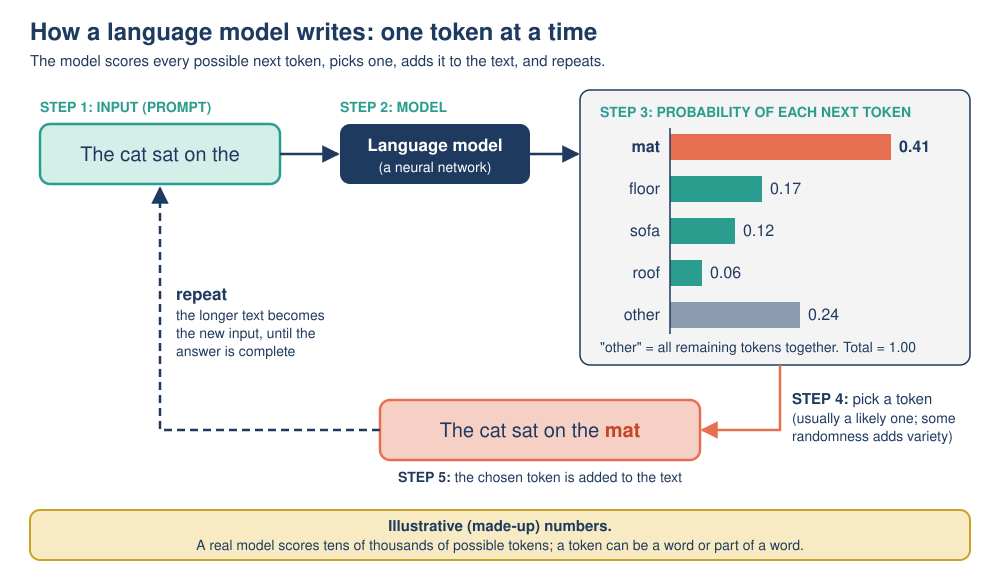
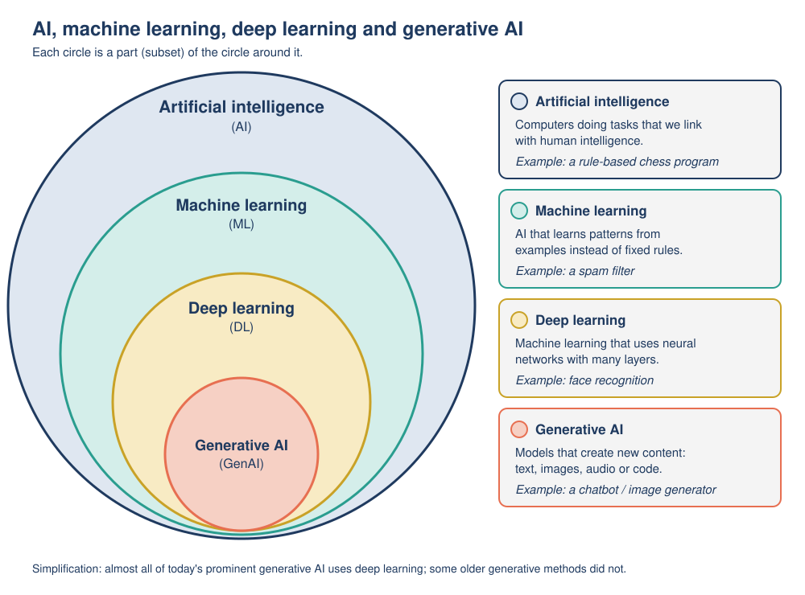

# 04: Generative AI and large language models

**Module:** AI Overview · **Version:** 2.0 · **Status:** drafted (self-checked) · **Last updated:** 2026-11-06

## Learning goals

After this topic, you should be able to:

- **Distinguish** generative AI from discriminative (predictive) AI, and **classify** a new task as one or the other.
- **Explain** what a token is and **trace** how a large language model (LLM) builds a reply one token at a time by next-token prediction.
- **Describe** in plain language the main stages of training an LLM (pre-training, fine-tuning, learning from human feedback).
- **Explain** why the same prompt can give different answers (sampling and temperature) and **predict** the effect of a low or high temperature.
- **Explain** why "all generative AI is deep learning" is a simplification.

## Prerequisites

- [Topic 01](01-what-is-ai.md): AI systems turn inputs into outputs; "generated content" as a type of output; the nested map of AI, machine learning (ML), deep learning and generative AI.
- [Topic 02](02-how-ai-operates.md): **model**, **training**, **training data**, **inference (prediction)**, **parameters (weights)**; the spam-filter example.
- [Topic 03](03-ml-neural-networks-deep-learning.md): supervised and reinforcement learning; **labels**; **neural networks**, layers and **deep learning**.

## Key terms

| Term | Plain-English definition |
|---|---|
| Generative AI | AI that creates new content, such as text, images, audio, video or computer code, usually in response to a prompt. |
| Discriminative (predictive) model | A model that sorts or scores an input rather than creating new content, for example spam / not spam. |
| Prompt | The text (or image, or other input) a person gives a generative AI system to tell it what to produce. |
| Language model | A model that gives probabilities for what text comes next. |
| Large language model (LLM) | A very large deep-learning language model, trained on enormous amounts of text, that generates text by repeatedly predicting the next token. |
| Token | The unit of text an LLM works with: a whole word, part of a word, a punctuation mark or a single character. |
| Next-token prediction | The core job of an LLM: given the text so far, work out the probability of each possible next token. |
| Probability | A number from 0 (impossible) to 1 (certain) saying how likely something is; 0.41 means 41%. |
| Sampling | Choosing the next token at random, but in proportion to the probabilities, so likely tokens are chosen more often. |
| Temperature | A setting that controls how much randomness sampling uses: low temperature means more predictable, high temperature means more varied. |
| Pre-training | The first, largest stage of LLM training: learning to predict the next token on a huge collection of text. |
| Fine-tuning | Further training of a pre-trained model on a smaller, carefully chosen set of examples to make it better at a particular job, such as following instructions. |
| RLHF | Reinforcement learning from human feedback: people compare or rank the model's answers, and the model is trained to produce answers people prefer. |
| Transformer | The neural-network design used by most current LLMs, introduced in 2017. |
| Context window | The maximum amount of text (measured in tokens) a model can take into account at once. |
| Hallucination | A generated output that sounds plausible but is false or made up. |

## Explanation

### 1. Generative versus discriminative AI

Most of the AI you have met so far **sorts or scores** inputs. The spam filter in Topic 02 looks at an email and outputs "spam" or "not spam". Google's machine learning course calls this kind of model **discriminative**: "Discriminative models discriminate between different kinds of data instances", for example telling a dog from a cat. In everyday language people also call these **predictive** models. A **generative** model does something different: "Generative models can generate new data instances", for example creating new photos of animals that look like real animals [1].

| | Discriminative (predictive) | Generative |
|---|---|---|
| Question it answers | "Which category is this?" or "What number goes with this?" | "What new content fits this request?" |
| Output | A label, score or number | New text, images, audio, video or code |
| Example | Spam filter; face unlock; fraud alert | Chatbot writing an email; image generator; AI voice |

**Generative AI** is the name for systems that create content. IBM defines it as AI "that can create original content such as text, images, video, audio or software code in response to a user's prompt" [2]. A **prompt** is the request you give it: "Write a polite email asking to move our meeting to Friday", or "A watercolor painting of a lighthouse at dawn".

### 2. Is all generative AI deep learning? (A useful simplification)

The nested diagram in Topic 01 places generative AI inside deep learning. That is accurate for the systems people usually mean today: **almost all of today's prominent generative AI systems use deep learning**. Chatbots such as ChatGPT, Claude and Gemini are built on LLMs, which are deep neural networks, and modern image generators also use deep neural networks [2].

But it is a **simplification**. Earlier generative methods did not use deep learning. For example, **Markov-chain text generators** produce new text by choosing each next word using only counts of which words followed which in some example text. Claude Shannon demonstrated this idea in 1948, building a sample of English-like text where "the word transition probabilities are correct but no further structure is included" [3]. The result looked like English in short stretches but made no overall sense. You will run a tiny Markov-chain generator by hand in Activity 1. Rule-based chatbots such as ELIZA (mid-1960s) also produced text, using hand-written pattern-matching scripts rather than learning [2].

### 3. What is a large language model?

A **language model** gives probabilities for what text comes next. A **large language model (LLM)** is a language model that is:

- **a deep neural network**, almost always using the **transformer** design introduced by Vaswani and colleagues in 2017 in a paper titled "Attention Is All You Need" [4]. (A transformer's key trick, called *attention*, lets the model weigh up all the earlier words in the text, near and far, when predicting the next one. You do not need the details for this module.)
- **large** in two ways: it has a huge number of **parameters (weights)**, and it is trained on a huge amount of text. For example, OpenAI's GPT-3 model, described in 2020, had 175 billion parameters [8]. Compare that with the 5 weights of the spam filter in Topic 02.

### 4. Tokens: how an LLM sees text

LLMs do not read letters or whole words the way people do. Text is first split into **tokens**. Google's introduction to LLMs explains that "a token could be a word, a subword (a subset of a word), or even a single character" [6]. Common words are often a single token; longer or rarer words are split into pieces. As a rough rule of thumb for English, one token is about three-quarters of a word, so 100 tokens is about 75 words [6][7].

Illustrative example (actual splits differ between models):

```
Text:    "Unbelievably, the cat sat."
Tokens:  [Un] [believ] [ably] [,] [ the] [ cat] [ sat] [.]      -> 8 tokens
```

Each token is turned into numbers, because a neural network can only compute with numbers.

### 5. Next-token prediction: how an LLM writes

Here is the central idea of this topic. An LLM generates text by repeating one small step:

1. **Input:** take all the text so far (your prompt plus anything already generated).
2. **Predict:** the neural network outputs a **probability** for every token in its vocabulary (tens of thousands of possible tokens) of being the next one. A language model "determines the probabilities of different tokens or sequences of tokens" to continue the text [6].
3. **Choose:** pick one token, usually a likely one (see section 7).
4. **Append:** add the chosen token to the end of the text.
5. **Repeat** from step 1 with the longer text, until the model produces a special "end" token or reaches a length limit.

So a 300-word answer is built from roughly 400 of these steps, one token at a time. The model does not plan the whole answer and then type it out; it does not look the answer up in a database; each token is chosen based on patterns learned during training and on the text so far. This explains both the strengths of LLMs (fluent, relevant-sounding text on almost any topic) and some weaknesses (an answer can sound confident and still be wrong). The **context window** limits how many tokens of earlier text the model can take into account at once.

### 6. How an LLM is trained

Training an LLM connects directly to the kinds of learning in Topic 03. The stages below summarize how IBM describes generative AI training [2] and how OpenAI described training its InstructGPT models in a 2022 research paper [5].

**Stage 1: Pre-training (learning to predict the next token).** The model is shown an enormous amount of text (books, websites, articles, code) and, at each position, it predicts the next token. It then checks the real next token, and its weights are nudged to make the right token a little more likely next time. This is repeated billions of times. No one has to label the data by hand, because **the text itself supplies the answer**: the real next token acts as the label. (This is why it is often called *self-supervised* learning.) Pre-training is extremely expensive in computing power and energy. The result predicts text well but is not yet a helpful assistant: asked a question, it might just continue with more questions, because that is a common pattern in text.

**Stage 2: Fine-tuning (learning to follow instructions).** The pre-trained model is trained further on a much smaller set of examples written or chosen by people: prompts paired with good responses. This is ordinary **supervised learning** (Topic 03): the good response is the label.

**Stage 3: Learning from human feedback (RLHF).** People compare several answers the model gave to the same prompt and rank them from best to worst. These rankings are used to train the model, through **reinforcement learning**, to produce the kinds of answers people prefer: more helpful, more accurate, less harmful. In OpenAI's 2022 study, people preferred the outputs of a 1.3-billion-parameter model trained this way over those of the original 175-billion-parameter GPT-3, even though it had over 100 times fewer parameters [5].

After training, the model is **deployed**, and every conversation is **inference**: the weights stay fixed while the model generates replies. (A provider may later train a new version using new data.)

### 7. Why the same prompt can give different answers

If you ask a chatbot the same question twice, you often get two different answers. The main reason is **sampling**.

At step 3 of next-token prediction, the system could always pick the single most likely token. That is predictable but tends to give repetitive, dull text. Instead, most systems **sample**: they choose at random, but weighted by the probabilities. A token with probability 0.41 is chosen about 41% of the time; a token with probability 0.06 about 6% of the time. Imagine a spinner divided into slices, with each token's slice as big as its probability. Because one different early choice changes all the text that follows, two runs can drift into quite different answers.

**Temperature** is a setting that controls how adventurous the sampling is:

- **Low temperature**: the probabilities are "sharpened", so the most likely token wins even more often. Output is more predictable and repetitive. Useful for factual summaries or code.
- **High temperature**: the probabilities are "flattened", so less likely tokens get picked more often. Output is more varied and surprising, but also more likely to wander off-topic or into errors. Sometimes useful for brainstorming or creative writing.

Even at the lowest temperature, outputs are not always perfectly identical, and answers can also change because the provider updated the model, because the earlier conversation (the context) is different, or because of other hidden settings. The practical lesson: **an LLM's answer is one sample from many possible answers, not the single "correct" output.**

### 8. Hallucinations: plausible is not the same as true

Because an LLM generates text that is *likely* given patterns in its training data, it can produce statements that sound right but are false, such as made-up quotations, references or facts. IBM describes a **hallucination** as output that is nonsensical or inaccurate but appears plausible, and gives the well-known example of a lawyer who submitted made-up case citations produced by a generative AI tool [2]. Training with human feedback and connecting models to trusted sources can reduce hallucinations, but not eliminate them. [Topic 09](09-limitations-and-misconceptions.md) looks at this limitation in detail.

## Worked example

**Next-token prediction and sampling, step by step.** All probabilities below are **illustrative (made-up) figures** chosen to show the idea; a real model scores tens of thousands of possible tokens. They match the next-token figure in the Visual section.

**Prompt:** `The cat sat on the`

**Step 1: The model outputs probabilities for the next token.**

| Next token | Probability | Spinner slice (cumulative range) |
|---|---|---|
| mat | 0.41 | 0.00 up to 0.41 |
| floor | 0.17 | 0.41 up to 0.58 |
| sofa | 0.12 | 0.58 up to 0.70 |
| roof | 0.06 | 0.70 up to 0.76 |
| all other tokens together | 0.24 | 0.76 up to 1.00 |
| **Total** | **1.00** | |

The cumulative ranges lay the slices end to end between 0 and 1 (for example, floor starts where mat ends: 0.41 + 0.17 = 0.58). "Up to" means up to but not including the upper number.

**Step 2a: Choose by always taking the most likely token ("greedy" choice).** "mat" has the highest probability (0.41), so the text becomes `The cat sat on the mat`.

**Step 2b: Or choose by sampling.** The computer draws a random number between 0 and 1 and sees which slice it lands in.

| Run | Random number | Lands in slice | Text after this step |
|---|---|---|---|
| 1 | 0.27 | mat (0.00 up to 0.41) | The cat sat on the mat |
| 2 | 0.63 | sofa (0.58 up to 0.70) | The cat sat on the sofa |
| 3 | 0.45 | floor (0.41 up to 0.58) | The cat sat on the floor |

Same prompt, same model, three different continuations. Over many runs, "mat" would appear about 41% of the time.

**Step 3: Append and repeat.** Take run 1. The new input is `The cat sat on the mat`, and the model produces a new table (illustrative (made-up) figures):

| Next token | Probability |
|---|---|
| . | 0.52 |
| and | 0.20 |
| , | 0.15 |
| while | 0.05 |
| all other tokens together | 0.08 |
| **Total** | **1.00** |

If "." is chosen, the text is `The cat sat on the mat.`, and the model might then produce the special end token. If "and" is chosen instead, the sentence continues (`... mat and purred`), and every later step is different. This is how small random choices early on lead to very different final answers.

**Step 4: See the effect of temperature.** Illustrative (made-up) probabilities for the first step, at three temperature settings:

| Next token | Low temperature | Normal (as in Step 1) | High temperature |
|---|---|---|---|
| mat | 0.80 | 0.41 | 0.26 |
| floor | 0.09 | 0.17 | 0.18 |
| sofa | 0.05 | 0.12 | 0.15 |
| roof | 0.01 | 0.06 | 0.09 |
| all other tokens together | 0.05 | 0.24 | 0.32 |
| **Total** | **1.00** | **1.00** | **1.00** |

At low temperature, "mat" is chosen about 80% of the time: predictable. At high temperature, the probabilities are flatter, and unusual tokens (the "all other tokens" group, which includes odd choices such as "keyboard" or "moon") are picked about a third of the time: more variety, and more risk of nonsense.

## Visual



*Figure: Next-token prediction. The model scores possible next tokens, one token is picked (usually a likely one, with some randomness), it is added to the text, and the longer text becomes the new input. Illustrative (made-up) numbers.* (Original diagram created for this module.)



*Figure: Where generative AI sits. Almost all of today's prominent generative AI uses deep learning, but earlier generative methods (such as Markov-chain text generators) did not.* (Original diagram created for this module.)

## Common mistakes

1. **"A chatbot looks up answers in a database of facts."** An LLM generates each token from learned patterns and the text so far. It can be connected to search tools or documents, but the core model is not a fact database, which is why it can hallucinate.
2. **"Different answers to the same prompt mean the AI is broken."** Variation is expected: most systems sample from probabilities on purpose. Check important facts in any answer, whichever version you got.
3. **"Generative AI and deep learning are the same thing."** Deep learning is a technique; generative AI is a kind of task (creating content). Most deep learning systems are not generative (face unlock, image classification), and some generative methods are not deep learning (Markov-chain text generators).
4. **"Tokens are the same as words."** A token can be a whole word, part of a word, a punctuation mark or a character. On average, an English token is about three-quarters of a word.

## Try it yourself

### Activity 1: Run a generative model by hand (trace + compare)

This tiny **Markov-chain text generator** is a real generative model, but it uses no neural network.

**Training text** (treat "." as a word):

```
the cat sat on the mat . the dog sat on the rug . the cat ran .
```

a) **Train the model.** For each word, list which words follow it in the training text, and how often. Turn the counts into probabilities. (Start with "the": it appears 5 times.)

b) **Generate.** Start with the word "the". At each step, look at the current word's followers. If there is only one follower, take it (no random number needed). If there are several, use the next random number from the list and the cumulative ranges from your table (lay out the followers in the order they first appear in the training text). Stop when you generate ".".

- Run 1 random numbers: 0.65, 0.90
- Run 2 random numbers: 0.70, 0.30, 0.80

Write out each generated sentence.

c) Which generated sentence never appears in the training text? Is it sensible? Explain what this shows about a model that only looks at **one** previous word, and how an LLM differs.

### Activity 2: Spin the next token (trace + predict + justify)

Use the Step 1 table from the worked example (mat 0.00 up to 0.41; floor 0.41 up to 0.58; sofa 0.58 up to 0.70; roof 0.70 up to 0.76; all other tokens 0.76 up to 1.00).

a) Which token is chosen for each random number: 0.35, 0.72, 0.95, 0.50?
b) Out of 100 runs, about how many times would you **predict** "sofa" to be chosen at normal temperature? And "mat" at low temperature (use the Step 4 table)?
c) Choose **low** or **high** temperature for each task and justify: (i) summarizing a rental agreement for a friend; (ii) brainstorming 20 possible names for a new cafe.
d) A friend says: "I asked the chatbot the same question twice and got two different answers, so it's broken." Write a two- or three-sentence reply explaining what is going on.

### Activity 3: Generative or not? Then find the error (classify + correct)

a) Label each system **generative** or **discriminative (predictive)**, with a reason:

1. An email spam filter.
2. A tool that writes a product description from a list of features.
3. A photo app that tags whether a picture contains a dog.
4. A tool that creates an image from the text "a red bicycle on the moon".
5. A model that predicts tomorrow's maximum temperature.
6. A voice assistant feature that speaks its reply in a synthetic voice.

b) Find and correct the error in each statement:

1. "ChatGPT is generative AI, and all generative AI has always used deep learning."
2. "An LLM writes its whole answer at once, then shows it to you."
3. "Pre-training needs millions of people to label every sentence with the right answer."

## Answers

<details>
<summary>Show answers</summary>

**Activity 1**

a) Follower table (in order of first appearance):

| Word | Followers (count) | Probabilities and cumulative ranges |
|---|---|---|
| the | cat (2), mat (1), dog (1), rug (1) | cat 0.4 (0.00 up to 0.40); mat 0.2 (0.40 up to 0.60); dog 0.2 (0.60 up to 0.80); rug 0.2 (0.80 up to 1.00) |
| cat | sat (1), ran (1) | sat 0.5 (0.00 up to 0.50); ran 0.5 (0.50 up to 1.00) |
| sat | on (2) | on 1.0 |
| on | the (2) | the 1.0 |
| mat | . (1) | . 1.0 |
| dog | sat (1) | sat 1.0 |
| rug | . (1) | . 1.0 |
| ran | . (1) | . 1.0 |

("the" appears 5 times: before cat, mat, dog, rug and cat.)

b)
- **Run 1:** the → (0.65: dog) dog → sat → on → the → (0.90: rug) rug → . = **"the dog sat on the rug ."**
- **Run 2:** the → (0.70: dog) dog → sat → on → the → (0.30: cat) cat → (0.80: ran) ran → . = **"the dog sat on the cat ran ."**

c) Run 2's sentence, "the dog sat on the cat ran .", never appears in the training text: the model **generated something new**. But it does not make sense, because each word was chosen by looking only at the single previous word ("the" can be followed by "cat"; "cat" can be followed by "ran"), with no view of the sentence as a whole. An LLM is far more capable because it is a deep neural network with billions of learned parameters that takes into account a long stretch of earlier text (its context window), not just one word. This activity also shows why "all generative AI is deep learning" is a simplification: this generator is generative but uses no neural network.

**Activity 2**

a) 0.35 → **mat**; 0.72 → **roof**; 0.95 → **all other tokens** (some less likely token); 0.50 → **floor**.

b) "sofa": about **12** times out of 100 (probability 0.12). "mat" at low temperature: about **80** times out of 100 (probability 0.80). Because the choices are random, the actual counts in one batch of 100 runs would be close to, but not exactly, these numbers.

c) (i) **Low**: you want accurate, predictable wording and no inventive additions in a legal summary (and you should still check it against the agreement). (ii) **High**: you want variety and unexpected ideas; odd suggestions are harmless because you will pick the best.

d) Example: "That's normal. The chatbot builds its answer one token at a time and usually picks each token with a bit of randomness, weighted toward likely tokens, so different runs can take different paths. It's not broken, but it does mean you should check important facts rather than trusting either version automatically."

**Activity 3**

a)
1. **Discriminative**: sorts emails into categories.
2. **Generative**: creates new text.
3. **Discriminative**: outputs a label (dog / no dog).
4. **Generative**: creates a new image.
5. **Discriminative (predictive)**: outputs a number, not new content (this is regression, Topic 03).
6. **Generative**: creates new audio (a synthetic voice). (The part that decides *what* to say may also be generative if it is an LLM.)

b)
1. Correct version: "Almost all of today's prominent generative AI, including ChatGPT, uses deep learning; earlier generative methods such as Markov-chain text generators did not."
2. Correct version: "An LLM generates its answer one token at a time, each time predicting the next token from the text so far." (Some apps show the text only when it is complete, but it was still generated token by token.)
3. Correct version: "Pre-training needs no hand labels: the real next token in the text acts as the label (self-supervised learning). Human-written examples and human rankings are used later, in fine-tuning and RLHF, on a much smaller scale."

</details>

## Optional extension

*Optional: not required for later topics.*

1. **Count tokens.** Many AI providers offer free online "tokenizer" tools that show how a sentence is split into tokens. Paste in a sentence in English and the same sentence in another language you know. Which uses more tokens? Why might that matter for cost and context-window limits?
2. **Temperature experiment.** If you have access to a chatbot or AI tool that lets you change the temperature (some developer "playground" tools do), ask for "a one-sentence opening for a mystery story" five times at the lowest and five times at the highest setting. Record how similar the answers are. If you cannot change the temperature, ask the same prompt three times in fresh conversations and compare.
3. **Read the original.** The abstract of "Attention Is All You Need" [4] is short. Find the sentence that says what the transformer is "based solely on".

## Connections

- **Previous:** [Topic 02](02-how-ai-operates.md) and [Topic 03](03-ml-neural-networks-deep-learning.md) explained training, inference, labels, neural networks and deep learning. LLMs use all of these: a deep neural network, pre-trained with the text itself as labels, then fine-tuned (supervised) and improved with human feedback (reinforcement).
- **Next:** [Topic 05](05-types-of-ai.md) asks how capable systems like LLMs really are: are they "narrow" or "general" AI?
- **Later:** [Topic 06](06-history-of-ai.md) places the 2017 transformer and the 2022 launch of ChatGPT in AI's history. Hallucinations, deepfakes, energy use and copyright questions about training data are covered in Topics 08 and 09.

## Sources

1. Google for Developers (n.d.). *Background: What is a generative model?* (Generative Adversarial Networks course). https://developers.google.com/machine-learning/gan/generative (accessed 2026-11-06). Supports: definitions and examples of generative versus discriminative models; next-word predictors as generative.
2. IBM (n.d.). *What is generative AI?* IBM Think. https://www.ibm.com/think/topics/generative-ai (accessed 2026-11-06). Supports: definition of generative AI; reliance on deep learning; ELIZA as an early pattern-matching chatbot; training stages (pre-training a foundation model, tuning, RLHF); hallucination definition and the lawyer example.
3. Shannon, C. E. (1948). A mathematical theory of communication. *Bell System Technical Journal*, 27, 379-423 and 623-656. PDF: https://people.math.harvard.edu/~ctm/home/text/others/shannon/entropy/entropy.pdf (accessed 2026-11-06; Section 3, "The series of approximations to English", read directly). Supports: Markov-style word-level text generation in 1948 ("the word transition probabilities are correct but no further structure is included").
4. Vaswani, A., Shazeer, N., Parmar, N., Uszkoreit, J., Jones, L., Gomez, A. N., Kaiser, L. & Polosukhin, I. (2017). *Attention Is All You Need.* arXiv:1706.03762. https://arxiv.org/abs/1706.03762 (accessed 2026-11-06). Supports: the transformer introduced in 2017, "based solely on attention mechanisms".
5. Ouyang, L., Wu, J., Jiang, X., Almeida, D., Wainwright, C. L., et al. (2022). *Training language models to follow instructions with human feedback.* arXiv:2203.02155. https://arxiv.org/abs/2203.02155 (accessed 2026-11-06). Supports: fine-tuning GPT-3 with human demonstrations, then RLHF from rankings; GPT-3 has 175B parameters; 1.3B InstructGPT preferred over 175B GPT-3 despite 100x fewer parameters.
6. Google for Developers (n.d.). *Introduction to Large Language Models.* https://developers.google.com/machine-learning/resources/intro-llms (accessed 2026-11-06). Supports: definition of a token (word, subword or character); a token is roughly three-quarters of an English word; a language model assigns probabilities to tokens that complete text.
7. OpenAI (n.d.). *What are tokens and how to count them?* OpenAI Help Center. https://help.openai.com/en/articles/4936856-what-are-tokens-and-how-to-count-them (accessed 2026-11-06; page blocked direct fetching, content confirmed via search-result extracts). Supports: rules of thumb for English: 1 token ≈ 4 characters ≈ three-quarters of a word; 100 tokens ≈ 75 words.
8. Brown, T. B., et al. (2020). *Language Models are Few-Shot Learners.* arXiv:2005.14165. https://arxiv.org/abs/2005.14165 (accessed 2026-11-06). Supports: GPT-3 described in May 2020 as a language model with 175 billion parameters.
