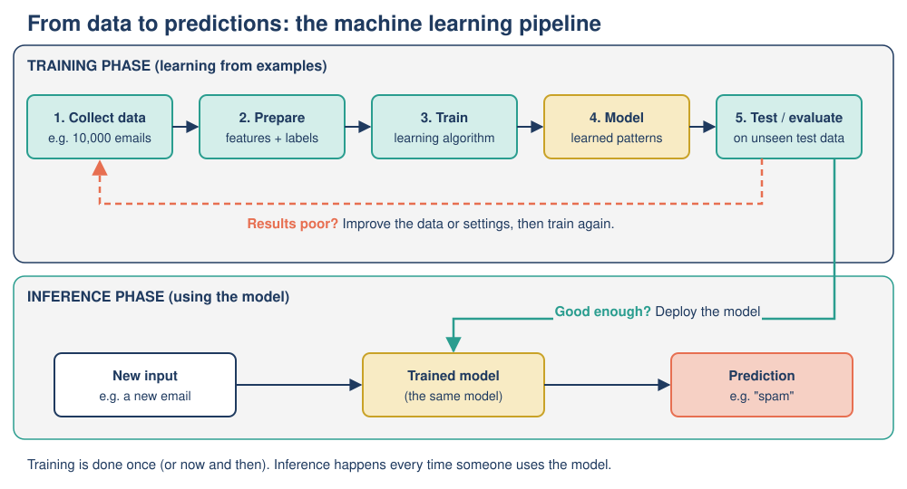

# 07: Real-World Applications of AI

**Module:** AI Overview · **Version:** 2.0 · **Status:** drafted (self-checked) · **Last updated:** 2026-11-06

## Learning goals

After this topic, you should be able to:

- **Describe** how AI is used in recommendation systems, healthcare and transportation, naming the input and output of each system.
- **Identify** which kind of AI an application uses (rule-based, machine learning, deep learning or generative AI) and justify your choice.
- **Trace** how a simple recommendation system turns past ratings into a recommendation.
- **Evaluate** an application's benefits, risks and the level of human oversight it needs, based on the consequences of an error.
- **Apply** the same six-part analysis framework to an AI application you have not seen before.

## Prerequisites

- [Topic 01: What is AI?](01-what-is-ai.md): AI systems turn inputs into outputs.
- [Topic 02: How AI operates](02-how-ai-operates.md): rule-based vs learning-based AI; training vs inference.
- [Topic 03: ML, neural networks and deep learning](03-ml-neural-networks-deep-learning.md): supervised learning, features, labels, deep learning.
- [Topic 04: Generative AI and LLMs](04-generative-ai-and-llms.md): what generative AI produces.
- [Topic 06: History of AI](06-history-of-ai.md): useful background on why these applications appeared after about 2012.

## Key terms

| Term | Plain-English definition |
|---|---|
| Application | A real-world use of AI to do a job for people, e.g. suggesting films or reading X-rays. |
| Recommendation system (recommender) | AI that predicts which items (films, songs, products, posts) a person is likely to want, and shows those first. |
| Collaborative filtering | A recommendation method based on the idea "people who liked similar things in the past will like similar things in future". |
| Personalization | Changing what each user sees based on data about that user. |
| Medical imaging | Pictures of the inside of the body, such as X-rays, CT scans, MRI scans and photos of the retina (back of the eye). |
| Sensitivity | Of all the people who really *have* a condition, the share that a test correctly flags. Low sensitivity means missed cases. |
| Specificity | Of all the people who really *do not* have a condition, the share that a test correctly clears. Low specificity means false alarms. |
| False positive / false negative | A false positive is a wrong alarm ("spam" for a real email); a false negative is a missed case ("not spam" for actual spam). |
| Computer vision | AI that interprets images or video, e.g. finding pedestrians in a camera feed. Today it is mostly done with deep learning. |
| Autonomous vehicle | A vehicle that can drive itself without a human driver in some or all situations. A robotaxi is an autonomous vehicle used as a taxi. |
| Human oversight | People monitoring, checking or being able to override an AI system's outputs. "Human-in-the-loop" means a person must approve each decision. |
| Stakes | How serious the consequences are if the AI gets it wrong. |

## Explanation

### 1. A framework for analyzing any AI application

AI is not one machine; it is many different systems doing very different jobs. To understand any application, ask the same six questions. We will use this **six-part framework** throughout the topic:

| # | Question | What to look for |
|---|---|---|
| 1 | **Input**: what data goes in? | Clicks, photos, sensor readings, text, numbers |
| 2 | **Output**: what comes out? | A prediction, a ranking, a label, a decision, new content |
| 3 | **AI type**: how does it work? | Rule-based (humans wrote the rules), machine learning (learned patterns from training data), deep learning (ML with many-layered neural networks, common for images, sound and language), generative AI (creates new content) |
| 4 | **Benefit**: who gains, and how? | Time saved, more accurate, available to more people, cheaper |
| 5 | **Risk**: what can go wrong, and for whom? | Errors, bias, privacy loss, over-reliance, safety |
| 6 | **Human oversight**: who checks it? | None needed? Spot checks? Human approves every decision? |

Two reminders from earlier topics:

- The AI types are **nested** (see [Topic 03](03-ml-neural-networks-deep-learning.md)): deep learning is a kind of machine learning, and nearly all current generative AI is deep learning. When you classify an application, choose the **most specific** type that fits, and justify it.
- Real products often **combine** types. A self-driving car uses deep learning to *see*, but also rule-based safety logic ("never exceed the speed limit") and search-style route planning.

A useful rule of thumb for question 6: **the higher the stakes, the more human oversight is needed.** A bad film suggestion wastes an evening; a missed tumor can cost a life.

### 2. Recommendation systems

**Where you meet them:** streaming services (what to watch or listen to next), online shops ("customers who bought this also bought..."), social media feeds, news apps, video platforms.

**How they work (simplified).** A recommender has a huge catalog and a limited screen. Its job is to **rank** items: which ones should this person see first? It learns from **behavioral data**: what you watched, how long you watched, what you skipped, what you rated, what you searched for, and what *millions of other users* did.

The classic idea is **collaborative filtering**: if you and another user have agreed on many items in the past, you will probably agree on items you haven't seen yet. Modern systems go further, using machine learning (and often deep learning) on many **features** at once, such as time of day, device, genre and how recent an item is. They are trained to predict a **label** like "will this user watch at least half of this show?".

**How important are they?** In a 2015 paper, two Netflix leaders, Carlos Gomez-Uribe and Neil Hunt, wrote that the Netflix recommender system "influences choice for about 80% of hours streamed", with the rest coming from search, and that personalization and recommendations save the company more than $1 billion per year by reducing cancellations. (These are the company's own figures from 2015.)

**Six-part analysis: a streaming recommender**

| Question | Answer |
|---|---|
| Input | Your viewing history, ratings, searches, time of day and device, plus the behavior of millions of other users |
| Output | A personalized, ranked list of titles (the rows on your home screen) |
| AI type | **Machine learning** (often deep learning): it learns patterns from behavioral data; nobody writes a rule for each film |
| Benefit | Helps people find things they enjoy in a huge catalog; keeps subscribers; helps smaller titles find an audience |
| Risk | **Filter bubbles** (you see only more of the same); designed to maximize time spent, which may not match your well-being; **privacy** (detailed profile of your habits); popular items get more popular |
| Human oversight | Low stakes per decision, so no human checks each recommendation; humans set the goals (what is the system rewarded for?) and test changes on groups of users |

**A key point about goals.** A recommender optimizes whatever it is told to optimize. If the goal is "maximize watch time" or "maximize clicks", it may learn that sensational or extreme content keeps people watching. The AI is not "trying" to do harm; it is pursuing the measurable target humans chose. Choosing that target is a human decision with ethical consequences (see [Topic 08](08-ethics-risks-social-impact.md)).

### 3. Healthcare

AI is used across healthcare: reading medical images, predicting which patients are at risk, helping with paperwork, and speeding up drug research. We focus on **medical imaging**, the largest area.

**Medical imaging.** A deep-learning model is trained on thousands of labeled images, e.g. retina photos labeled by eye specialists as "disease" or "no disease". During training it learns which visual patterns go with each label. During inference (use), it looks at a new patient's image and outputs a prediction.

The US Food and Drug Administration (FDA) keeps a public list of AI-enabled medical devices authorized for sale in the United States. By the end of 2025 it contained well over a thousand devices, and independent analyses of the list found that about three-quarters of them are in **radiology** (medical imaging).

**A landmark example: autonomous eye screening.** In April 2018 the FDA authorized **IDx-DR**, software that checks retina photos of adults with diabetes for **diabetic retinopathy**, an eye disease that can cause blindness. It was the first AI device authorized to give a screening result **without a specialist interpreting the image**, so it could be used in a family doctor's office. The result is simple: "more than mild disease detected: refer to an eye specialist" or "rescreen in 12 months". In the clinical study reported by the FDA, it correctly identified about 87% of patients who had the disease (sensitivity) and about 90% of those who did not (specificity).

Notice what those numbers mean: roughly 13 in every 100 patients with the disease were *missed* in the study. That is why the device is a **screening** tool, used to decide who needs a specialist, rather than a final diagnosis, and why its use is limited to the situation it was tested in.

**Six-part analysis: AI eye-disease screening**

| Question | Answer |
|---|---|
| Input | Photos of the patient's retinas taken with a specific camera |
| Output | A screening result: refer to a specialist, or rescreen later |
| AI type | **Deep learning** (computer vision trained on labeled images) |
| Benefit | Screening in ordinary clinics, faster results, more patients screened, especially where eye specialists are scarce |
| Risk | Missed cases (false negatives) delay treatment; false positives cause worry and extra appointments; may work less well on patients or cameras unlike those in the training data |
| Human oversight | High stakes: regulated by the FDA; positive results go to a specialist; limited to the tested patient group; performance should be monitored after deployment |

**A warning example: biased predictions.** Not all healthcare AI is about images. In 2019 Ziad Obermeyer and colleagues published a study in *Science* of a widely used commercial algorithm that predicted which patients needed extra care. It used **past healthcare costs** as a stand-in for **health needs**. Because less money had historically been spent on Black patients with the same level of illness, the algorithm judged them healthier than they were. The researchers estimated this cut the number of Black patients identified for extra care by more than half. When the algorithm was changed to predict health needs directly, much of the bias disappeared. The lesson: **what you ask the AI to predict matters as much as the data** (more in [Topic 08](08-ethics-risks-social-impact.md)).

**Generative AI in healthcare.** Hospitals are also trying LLM-based tools that draft clinical notes from a recorded doctor–patient conversation. These save typing time, but LLMs can **hallucinate** (invent plausible-sounding details; see [Topic 09](09-limitations-and-misconceptions.md)), so a clinician must check every note.

### 4. Transportation

**Navigation and traffic prediction.** Map apps predict how long each road will take using anonymous location data from many phones, historical traffic patterns and reported incidents. The **prediction** (travel time) is machine learning; finding the fastest route through the road network is a **search** problem, the same idea as the river-crossing puzzle in [Topic 02](02-how-ai-operates.md), just much bigger.

**Driver-assistance features.** Many cars have automatic emergency braking, lane-keeping and adaptive cruise control. These use cameras and radar, with **deep learning** to recognize cars, people and lane markings. The human driver remains responsible and must stay alert.

**Robotaxis (autonomous vehicles).** Some companies now run taxis with **no human driver** in certain cities. Waymo reports that its vehicles had driven about 271 million "rider-only" miles (no human driver on board) in five US metro areas by June 2026. Comparing its crash data with human-driver benchmarks for the same areas, Waymo reports about 82% fewer crashes with any reported injury. These are **company-reported figures**: the comparison depends on assumptions (for example, how many human crashes are never reported to police), and the cities chosen have little snow. Independent studies are the best way to confirm such claims.

Autonomous driving also shows the hardest problem in real-world AI: **rare situations**. A car may handle millions of ordinary miles and still meet something it was never trained on: unusual road works, a person in a costume, a fallen tree. In March 2018 a self-driving test car operated by Uber struck and killed a pedestrian, Elaine Herzberg, in Tempe, Arizona, widely reported as the first pedestrian death involving a self-driving car. The US National Transportation Safety Board (NTSB) later found that the system failed to correctly identify her until about a second before impact, that the human safety driver was distracted by her phone, and that Uber's safety culture and the oversight by regulators were inadequate. The case raised hard questions about **accountability**: who is responsible when an AI system and a human share control?

**Six-part analysis: a robotaxi**

| Question | Answer |
|---|---|
| Input | Live data from cameras, radar and lidar (laser distance sensors); detailed maps; GPS |
| Output | Driving actions: steer, brake, accelerate; the route |
| AI type | **Deep learning** for perception and prediction (what is around me, what will it do next?), combined with planning/search and rule-based safety constraints |
| Benefit | Potentially fewer crashes caused by tiredness, distraction or drink-driving; mobility for people who cannot drive |
| Risk | Rare situations not in the training data; a single software fault can affect a whole fleet; cyber-attack; unclear accountability; job losses for drivers |
| Human oversight | Very high stakes: government permits; remote assistance staff; incident reporting; companies must be able to pause fleets |

### 5. Brief tour: other applications

| Application | Input → Output | Main AI type | One benefit / one risk |
|---|---|---|---|
| Spam filter | Email text and sender details → "spam" / "not spam" | Machine learning (see [Topic 02](02-how-ai-operates.md)) | Saves time / a real email lost in the spam folder |
| Card fraud detection | Transaction details (amount, place, time) → "suspicious" score | Machine learning | Stops theft quickly / genuine purchases blocked while traveling |
| Machine translation | Text in one language → text in another | Deep learning (transformers) | Breaks language barriers / subtle errors in legal or medical text |
| Voice assistants | Spoken audio → text → action or answer | Deep learning (speech) + generative AI | Hands-free help / always-listening microphones and privacy |
| Writing and coding assistants | A prompt → drafted text or code | Generative AI (LLMs) | Faster first drafts / hallucinated facts or buggy code |
| Crop-disease apps | Photo of a leaf → likely disease name | Deep learning (computer vision) | Advice for farmers far from experts / wrong diagnosis wastes money |
| Board-game opponents (classic) | Board position → move | Rule-based search (like Deep Blue) | Strong, explainable play / cannot adapt to new games without reprogramming |

## Worked example

**Tracing a simple recommendation system (collaborative filtering)**

*All names and ratings below are illustrative (made-up) figures.*

A tiny streaming service has three users and four films (A, B, C, D). Ratings are from 1 (hated it) to 5 (loved it). A dash means "not watched".

| User | Film A | Film B | Film C | Film D |
|---|---|---|---|---|
| Sam | 5 | 4 | 1 | – |
| Priya | 5 | 5 | 1 | 5 |
| Leo | 1 | 2 | 5 | 1 |

**Question:** Should the service recommend Film D to Sam?

**Step 1: Compare Sam with each other user on films they have both rated.** A simple way: add up the differences between their ratings (ignore minus signs). A smaller total means more similar taste.

| Comparison | Film A | Film B | Film C | Total difference |
|---|---|---|---|---|
| Sam vs Priya | 5 − 5 = 0 | 5 − 4 = 1 | 1 − 1 = 0 | **1** (very similar) |
| Sam vs Leo | 5 − 1 = 4 | 4 − 2 = 2 | 5 − 1 = 4 | **10** (very different) |

**Step 2: Find the most similar user.** Priya (difference 1) is far more similar to Sam than Leo (difference 10).

**Step 3: Look at what the similar user thought of the unseen film.** Priya rated Film D **5**. (Leo rated it 1, but Leo's taste is the opposite of Sam's, so his low rating is not a warning.)

**Step 4: Predict and act.** Predicted rating for Sam on Film D ≈ 5 → **recommend Film D**, near the top of Sam's list.

**Step 5: Learn from the result.** If Sam watches Film D and rates it, that new rating becomes training data and future comparisons improve. This feedback loop is what makes recommenders *learning* systems.

**How real systems differ:** Real recommenders compare millions of users and items, use many more signals than star ratings (watch time, skips, searches), and learn the best way to combine them using machine learning rather than our hand-written "add up the differences" rule. But the core idea, *find patterns in what similar people liked*, is the same.

**Spotting a risk in the trace:** Suppose Film D is a new film that nobody has rated yet. Collaborative filtering has nothing to compare, so it cannot recommend it. This is the **cold-start problem**, and it is one reason popular items tend to get even more popular.

## Visual

*Figure: The six-part framework applied to three applications, showing how stakes rise and human oversight rises with them.* (Original table created for this module.)

| | Streaming recommender | AI eye-disease screening | Robotaxi |
|---|---|---|---|
| **Input** | Viewing history, ratings, others' behavior | Retina photos | Camera, radar, lidar, maps |
| **Output** | Ranked list of titles | Refer / rescreen | Steering, braking, route |
| **AI type** | Machine learning (often deep learning) | Deep learning (computer vision) | Deep learning + planning + safety rules |
| **Main benefit** | Find enjoyable content | Screening without a specialist on site | Fewer human-error crashes (company-reported) |
| **Main risk** | Filter bubbles, privacy | Missed disease | Rare situations, accountability |
| **Stakes of one error** | Low | High | Very high |
| **Human oversight** | Goal-setting and testing | Specialist follow-up, regulator | Permits, remote staff, incident reporting |

For how a learning-based application is built and then used, see the training-vs-inference pipeline diagram from [Topic 02](02-how-ai-operates.md):

*Figure: The machine-learning pipeline behind most applications in this topic: training happens first on historical data; inference (prediction) happens each time the application is used.* (Original diagram created for this module.)

## Common mistakes

1. **"If it's a modern app, it must be generative AI."** Correction: most everyday AI (recommenders, spam filters, fraud detection, medical image screening) is **predictive** machine learning: it picks, ranks or labels, it does not create new content. Generative AI is only one branch.
2. **"High accuracy means no human is needed."** Correction: even about 87% sensitivity means some patients are missed. Whether a human is needed depends on the **stakes** of an error and on how well the system was tested on the people it is used with, not on a single accuracy number.
3. **"Recommendations show what is best for me."** Correction: a recommender shows what it predicts you will engage with, according to a goal set by the company (e.g. watch time). That can differ from what is best for you.
4. **"Self-driving cars are either totally safe or totally unsafe."** Correction: evidence so far is mixed and depends on conditions. Company data suggest fewer injury crashes in some cities; rare situations remain hard. Judge claims by who measured them and how.

## Try it yourself

### Activity 1: Analyze a new application (apply the framework)

Read this description, then complete the six-part framework table for it.

> **LeafCheck** is a free phone app for small-scale farmers. The farmer photographs a diseased-looking plant leaf. The app was trained on 50,000 leaf photos, each labeled by plant scientists with the disease shown (or "healthy"). Most training photos were taken in good daylight on one type of farm in one country. The app shows the most likely disease and a suggested treatment (for example, a particular spray). Farmers may buy and use the spray without talking to anyone. *(LeafCheck and its figures are fictional, made up for this activity.)*

| Question | Your answer |
|---|---|
| Input | |
| Output | |
| AI type (justify) | |
| Benefit | |
| Risk (at least two) | |
| Human oversight you would recommend | |

### Activity 2: Rank by stakes and decide the oversight (compare + justify)

Four AI applications:

- W. A music app's "song you might like" suggestion.
- X. An AI that decides which job applicants are invited to interview.
- Y. A spam filter for a personal email account.
- Z. An AI that flags possible lung cancer on chest scans.

1. Rank them from **lowest** to **highest** stakes (consequence of one error).
2. For the two highest-stakes applications, say what kind of human oversight you would require, and **justify** it in one or two sentences each.
3. One of them affects people who are *not the user* of the system. Which, and why does that matter?

### Activity 3: Find and fix the errors (error correction)

A classmate analyzed a navigation app. Find **four** errors in their table and correct each one.

| Question | Classmate's answer |
|---|---|
| Input | Live location data from many phones, past traffic patterns, road map |
| Output | A new poem describing the journey |
| AI type | Generative AI, because it creates a route |
| Benefit | Shorter journeys; avoids traffic jams |
| Risk | None, because maps are always accurate |
| Human oversight | A human must approve every route before it is shown, because the stakes are as high as medical diagnosis |

## Answers

Show answers

**Activity 1: LeafCheck** (model answer)

| Question | Model answer |
|---|---|
| Input | A photo of a plant leaf taken by the farmer's phone |
| Output | The most likely disease (a label) and a suggested treatment |
| AI type | **Deep learning (computer vision), supervised learning.** It learned from 50,000 photos with labels from experts; image recognition is a typical deep-learning task. It is *not* generative AI: it chooses a label, it does not create new content. |
| Benefit | Fast, free advice for farmers who live far from plant experts; could save crops |
| Risk | (1) **Unrepresentative training data**: photos were mostly daylight, one farm type, one country; it may be wrong for other crops, regions, lighting or phone cameras. (2) **Wrong diagnosis → wrong spray**: wasted money, crop loss, unnecessary chemicals in the environment. (3) Over-trust: farmers may not seek a second opinion. |
| Human oversight | Show a confidence level and say "unsure" when confidence is low; recommend checking with an agricultural advisor before buying expensive or strong chemicals; collect feedback and new labeled photos from other regions; test accuracy in each new region before launching there. |

Why: The key insight is linking the **training data description** to the **risk**. A model is only reliable on data similar to what it was trained on.

**Activity 2**

1. Lowest to highest: **W** (music suggestion) → **Y** (spam filter) → **X** (job applicants) → **Z** (lung cancer). Accept X and Z in either order if well justified: Z can cost a life; X can unfairly change someone's career and affects many people at scale.
2. Oversight:
   - **Z (lung cancer flags):** a qualified radiologist reviews the scans, and the AI acts as a second reader, not the final decision-maker, because a missed cancer (false negative) can be fatal and the patient cannot check the result themselves.
   - **X (job applicants):** humans review rejected and accepted applicants, the system is tested for bias across groups (e.g. gender, age, disability) before use, and applicants can ask for a human review, because the decision affects people's livelihoods and the training data (past hiring) may contain past bias. (In the EU such systems are classed as high-risk; see [Topic 10](10-future-of-ai.md).)
3. **X** (and also Z for patients) affects people who are not the user: the employer uses the system, but the **applicants** bear the consequences and usually cannot see or question how it works. When the person harmed is not the person choosing to use the tool, stronger outside protections are needed.

Why spam (Y) is above music (W): losing a real email (e.g. a job offer) to the spam folder can matter more than a bad song suggestion, but you can usually check the spam folder yourself.

**Activity 3: four errors**

1. **Output**: wrong. A navigation app outputs a **route and a predicted travel time**, not a poem.
2. **AI type**: wrong. Finding the route is **search/optimization** (an algorithm exploring paths through the road network), and predicting travel times is **machine learning** from traffic data. It is not generative AI: it chooses among existing roads rather than creating new content.
3. **Risk**: wrong. Risks include out-of-date maps (closed roads), wrong travel-time predictions, sending heavy traffic down quiet residential streets, and **privacy** (location data).
4. **Human oversight**: wrong. Stakes per route are low to moderate and the driver can see the road, so per-route approval is unnecessary and impossible at scale. Suitable oversight: drivers stay responsible and follow road signs; companies monitor accuracy and fix map errors that users report.

(The Input and Benefit rows are correct.)

## Optional extension

*Optional: not required for the core module.*

- Open a streaming or shopping app you use. Find a recommendation and look for any "Why am I seeing this?" explanation. What input data does it say it used? Does that match what you learned?
- Pick one application from the brief tour table and complete a full six-part analysis for it.
- Investigate the cold-start problem: how might a service recommend a brand-new film nobody has rated yet? (Hint: think about using the film's **features**, such as genre, actors and length, instead of user ratings.)

## Connections

- **Back to [Topic 02](02-how-ai-operates.md) and [Topic 03](03-ml-neural-networks-deep-learning.md):** every learning-based application here was trained on labeled or behavioral data and is used for inference on new inputs.
- **Back to [Topic 06](06-history-of-ai.md):** these applications became practical after the deep-learning comeback (data + GPUs + algorithms).
- **Forward to [Topic 08](08-ethics-risks-social-impact.md):** the risks column (bias, privacy, accountability, jobs) is explored in depth.
- **Forward to [Topic 09](09-limitations-and-misconceptions.md):** brittleness on rare situations and hallucinations limit where these systems can be trusted.
- **Forward to [Topic 10](10-future-of-ai.md):** the EU AI Act sorts applications like these into risk tiers that match the "stakes" idea used here.

## Sources

1. Gomez-Uribe, C. A. & Hunt, N. (2015). The Netflix Recommender System: Algorithms, Business Value, and Innovation. *ACM Transactions on Management Information Systems*, 6(4), Article 13. Copy at https://gwern.net/doc/reinforcement-learning/exploration/2015-gomezuribe.pdf (fetched and text checked, accessed 2026-11-06). Supports: "influences choice for about 80% of hours streamed"; "more than $1B per year"; 2 of every 3 hours discovered on the homepage.
2. US Food and Drug Administration. *Artificial Intelligence-Enabled Medical Devices* (list). https://www.fda.gov/medical-devices/artificial-intelligence-enabled-medical-devices/list-artificial-intelligence-enabled-medical-devices (fetched, accessed 2026-11-06). Supports: existence and purpose of the list; radiology dominates entries; list "not a comprehensive resource".
3. AuntMinnie (2026). *Radiology dominates thirty years of FDA AI device approvals*. https://www.auntminnie.com/imaging-informatics/artificial-intelligence/article/15830219/radiology-dominates-thirty-years-of-fda-ai-device-approvals (search result, accessed 2026-11-06). Supports: ~1,430 AI devices on the list by end of 2025, ~76% radiology (secondary analysis).
4. FDA permits marketing of IDx-DR (April 2018), as reported by MobiHealthNews: https://www.mobihealthnews.com/news/fda-permits-marketing-ai-software-autonomously-detects-diabetic-retinopathy and BioSpace: https://www.biospace.com/fda-permits-marketing-of-idx-dr-for-automated-detection-of-diabetic-retinopathy-in-primary-care (search results, accessed 2026-11-06). Supports: first AI device giving a screening decision without clinician interpretation; ~87.4% / ~89.5% correct identification in the FDA-reported study.
5. Obermeyer, Z., Powers, B., Vogeli, C. & Mullainathan, S. (2019). Dissecting racial bias in an algorithm used to manage the health of populations. *Science*, 366(6464), 447–453. Summary: UC Berkeley Center for Health and Machine Intelligence, https://chmi.berkeley.edu/news/dissecting-racial-bias-in-an-algorithm-used-to-manage-the-health-of-populations (fetched, accessed 2026-11-06). Supports: cost used as proxy for need; Black patients identified for extra care cut by more than half; reformulation removes much of the bias.
6. Waymo. *Safety Impact* data hub. https://waymo.com/safety/impact/ (fetched, accessed 2026-11-06). Supports: 271.3 million rider-only miles through June 2026 in five metro areas; ~82% fewer any-injury-reported crashes vs human benchmark; methodology caveats (underreporting adjustment, no snow, etc.).
7. Russell, S. & Norvig, P. (2021). *Artificial Intelligence: A Modern Approach* (4th ed.). Pearson. Known stable reference (not fetched). Supports: general descriptions of recommender systems, search for route planning, and autonomous-vehicle perception/planning. Not used for specific figures.
8. CNN (2019, 19 November). *NTSB: Uber self-driving crash* coverage of the NTSB final findings. https://www.cnn.com/2019/11/19/tech/uber-crash-ntsb ; Engadget (2019). *NTSB blames Uber's 'inadequate safety culture' for self-driving fatality*. https://www.engadget.com/2019/11/20/ntsb-blames-uber-s-inadequate-safety-culture-for-self-driving/ (search results, accessed 2026-11-06). Supports: March 2018 Tempe fatality; distracted safety driver; late detection; inadequate safety culture and regulation.
