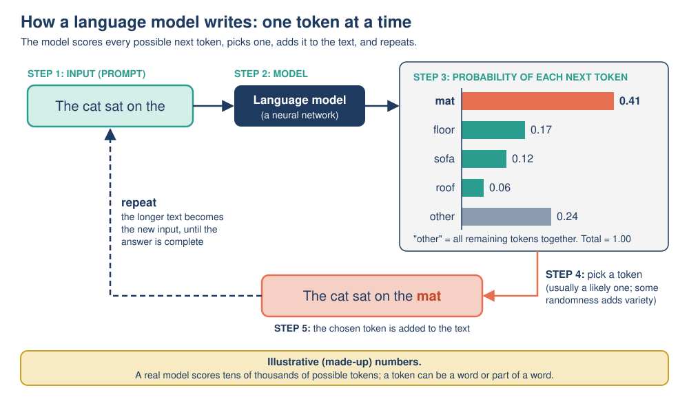

# 09: Limitations and Common Misconceptions

**Module:** AI Overview · **Version:** 2.0 · **Status:** drafted (self-checked) · **Last updated:** 2026-11-06

## Learning goals

After this topic, you should be able to:

- **Distinguish** a *limitation* (something AI genuinely cannot do well) from a *misconception* (a false belief people hold about AI).
- **Explain** in plain language why large language models (LLMs) can produce fluent but false text (hallucinations).
- **Identify and correct** six common misconceptions about AI, supporting each correction with evidence.
- **Predict** when an AI system is likely to fail because a situation differs from its training data (brittleness).
- **Apply** a four-step checking routine to spot a hallucination in a chatbot answer.

## Prerequisites

- [Topic 03: ML, neural networks and deep learning](03-ml-neural-networks-deep-learning.md): training data, overfitting, how models learn patterns.
- [Topic 04: Generative AI and LLMs](04-generative-ai-and-llms.md): tokens and next-token prediction (essential for the hallucination section).
- [Topic 05: Types of AI](05-types-of-ai.md): narrow AI vs AGI; "self-aware AI" as a hypothetical category.
- [Topic 06: History of AI](06-history-of-ai.md): the ELIZA effect and hype cycles.
- [Topic 08: Ethics, risks and social impact](08-ethics-risks-social-impact.md): bias cases and the WEF jobs figures.

## Key terms

| Term | Plain-English definition |
|---|---|
| Limitation | A real weakness of current AI, e.g. inventing facts or failing on unusual inputs. |
| Misconception | A widespread false belief about AI, e.g. "AI is conscious" or "AI is always objective". |
| Hallucination | When a generative AI system, especially an LLM, produces content that sounds confident and fluent but is false or made up, such as a fake quotation or a non-existent reference. |
| Token | A small chunk of text (a word, part of a word, a punctuation mark or a single character) that an LLM reads and produces, one at a time. |
| Next-token prediction | How an LLM generates text: given all the text so far, it works out the probability of each possible next token, picks one (usually a likely one), adds it to the text and repeats. |
| Grounding | Connecting an AI's answer to a reliable source of facts (e.g. a document or search result) instead of relying only on patterns learned in training. |
| Knowledge cutoff | The date after which a model has no training data, so it doesn't "know" later events unless given them. |
| Brittleness | When a system works well on familiar inputs but fails, often badly and confidently, on inputs that differ slightly from its training data. |
| Distribution shift | When the data a model meets in use differ from the data it was trained on (e.g. night photos for a model trained on day photos). |
| Adversarial example | An input deliberately altered, often in ways humans can't notice, to make an AI system give a wrong answer. |
| ELIZA effect | People's tendency to believe a computer understands them because it produces human-like responses. |
| Anthropomorphism | Treating a non-human thing as if it had human thoughts and feelings. |

## Explanation

### 1. Limitations vs misconceptions

Two different things go wrong when people think about AI:

- **Limitations** are real weaknesses of the technology. They are problems to manage: check the outputs, add human oversight, use the tool for suitable tasks.
- **Misconceptions** are false beliefs held by people. They are problems to correct: replace the belief with an accurate one.

Both matter. Overestimating AI (misconceptions such as "it's always right") leads to over-trust. Underestimating it (misconceptions such as "it's just autocomplete, it can't do anything useful") leads people to ignore real benefits and real risks.

### 2. Key limitations of current AI

#### 2.1 Hallucinations: fluent but false

**What it looks like.** You ask a chatbot for three books about the history of AI. It lists three titles with authors and years. Two are real; the third sounds completely plausible but **does not exist**. Or it gives a quotation that nobody ever said, a statistic with no source, or a court case that never happened. In 2023, US lawyers were fined after submitting a court brief with six non-existent cases generated by ChatGPT (see [Topic 08](08-ethics-risks-social-impact.md)).

**Why it happens: step by step.** Recall from [Topic 04](04-generative-ai-and-llms.md) how an LLM works:

1. During **training**, the model reads enormous amounts of text and learns which tokens tend to follow which other tokens.
2. During **inference** (when you use it), it generates an answer one token at a time, each time choosing a likely next token based on everything so far.
3. The model is trained to produce text that is **likely** (that looks like the text it learned from), not to check whether the text is **true**. There is no built-in fact database it looks things up in.
4. For common, well-documented facts ("Paris is the capital of France"), the likely answer and the true answer are usually the same, so the model is usually right.
5. For **rare** facts (an obscure book, an exact page number, a small company's founding date), the model has seen little or no data. But it still produces the *kind* of text that usually appears in that position: a title-shaped title, an author-shaped name, a year-shaped number. The result is **fluent and confident, but invented**.
6. A 2025 research paper by Kalai and colleagues argues that training and testing methods often **reward guessing over admitting uncertainty**: on many benchmarks, a confident guess can score points while "I don't know" scores zero, so models learn to guess.

A useful comparison: an LLM is like a student who has read a whole library but has no notes in the exam. When they remember, they answer well. When they don't, they write something that *sounds like* an answer, because a blank page scores nothing.

**Important:** hallucination is not lying. Lying requires intending to deceive; the model has no intention. It is a side effect of how the text is generated.

**What reduces hallucinations (but does not remove them):**

- **Grounding**: connecting the model to search results or trusted documents and asking it to answer only from them.
- Asking for sources, then **checking that the sources exist and say what is claimed**.
- Using AI for tasks where errors are easy to spot (brainstorming, drafting) rather than for unchecked facts in high-stakes situations.

#### 2.2 Brittleness and distribution shift

A model learns from its training data and is reliable mainly on inputs **similar** to that data. When the situation changes (**distribution shift**), performance can drop sharply, often without any warning:

- a crop-disease app trained on daylight photos fails on photos taken at dusk;
- a medical model trained on one hospital's scanners performs worse on another hospital's scanners;
- a self-driving car meets an unusual situation (road works, a person in a costume) not covered by its training data.

Worse, models are usually **confidently** wrong: they do not reliably "know when they don't know".

**Adversarial examples** are an extreme form of brittleness. In 2013, Szegedy and colleagues showed that changing an image in tiny ways, invisible to humans, could make a neural network misclassify it, and that the same altered image often fooled other networks too. A human would never mistake the picture; the network does.

#### 2.3 Other limitations to know

- **Knowledge cutoff.** An LLM has no information about events after its training data ends, unless it is connected to search. It may still answer confidently about recent events, which can be a hallucination.
- **Limited common sense and reasoning reliability.** Models can solve hard-looking problems yet fail at simple variations, such as a familiar puzzle with one detail changed, because they lean on patterns seen in training.
- **Token-level blind spots.** Because LLMs process text as tokens (chunks), not individual letters, tasks like counting letters in a word or reversing a word can trip them up. These look trivially easy to humans.
- **Black box.** It is hard to know *why* a large neural network produced a particular output (see [Topic 08](08-ethics-risks-social-impact.md)). If you ask an LLM to explain its reasoning, its explanation is itself generated text and may not reflect what actually happened inside the model.
- **Dependence on data quality.** "Garbage in, garbage out": a model trained on biased, outdated or wrong data reproduces those problems.

### 3. Six common misconceptions, and the corrections

Each misconception is stated first, then corrected with evidence.

#### Misconception 1: "AI is alive, conscious or has feelings."

**Why people believe it:** chatbots write "I think", "I feel", "I'm happy to help". People naturally read minds into anything that talks like a person (the **ELIZA effect**: in the 1960s, people became emotionally attached to ELIZA, a simple rule-based program; see [Topic 06](06-history-of-ai.md)).

**Correction:** Current AI systems are software that transforms inputs into outputs using learned patterns. An LLM writes "I feel happy" because that phrase is a likely continuation of human-written text, not because it is reporting an inner feeling. It has no body, no needs and no continuous experience; between your messages, nothing is "waiting" or "thinking". There is **no scientific evidence** that current AI systems are conscious. Philosophers and scientists do debate whether some future machine *could* be conscious, and how we would even tell, but that is an open question about the future, not a description of today's tools. In the functionality classification of [Topic 05](05-types-of-ai.md), "self-aware AI" is a **hypothetical** category.

**Why it matters:** believing an AI cares about you can lead to over-trust, emotional dependence, or sharing private information.

#### Misconception 2: "AI understands things the way humans do."

**Correction:** AI systems can produce impressively useful outputs, but they get there differently from humans. They learn statistical patterns from huge amounts of data, rather than learning from experience of the world, so they can:

- succeed on a hard exam question yet fail when a familiar puzzle is changed slightly;
- be fooled by adversarial examples that would never fool a person;
- produce a perfect-sounding explanation of a fact that is false (a hallucination).

**Nuance:** whether an LLM "understands" anything at all is genuinely debated by researchers, partly because "understanding" is hard to define. The practical point for users: **do not assume human-like understanding; judge the system by how reliably it performs on the task you need, and check the outputs.**

#### Misconception 3: "AI is always objective, because computers have no opinions."

**Correction:** AI learns from data produced by people and is designed by people, so it can reflect and scale up human bias. Evidence from [Topic 08](08-ethics-risks-social-impact.md):

- **Gender Shades (2018):** commercial gender classifiers had error rates of up to 34.7% for darker-skinned women but at most 0.8% for lighter-skinned men.
- **Hiring (2018):** an experimental resume-screening tool learned to penalize the word "women's" from ten years of mostly male resumes.
- **Healthcare (2019):** an algorithm using healthcare *costs* as a proxy for *need* under-identified Black patients for extra care.

A computer applies its learned pattern **consistently**, but consistently applying a biased pattern is not the same as being fair.

#### Misconception 4: "AI will take all our jobs."

**Correction:** The evidence points to **large disruption, not total replacement**.

- The WEF *Future of Jobs Report 2025* projects that between 2025 and 2030 about **92 million jobs will be displaced** but about **170 million created**, a **net gain of about 78 million**, driven by several trends including, but not only, technology and AI.
- AI mostly automates **tasks**, not whole jobs. Most jobs combine many tasks (talking to people, judgment, physical work, responsibility), and only some can be automated.
- Earlier waves of automation (factory machines, computers, the internet) eliminated some jobs and created new ones that hadn't existed before.

**Nuance (the part that *is* true):** this does **not** mean "nobody needs to worry". 92 million displaced jobs means many real people losing work; the new jobs are often in different places and need different skills; and some occupations made mostly of routine, automatable tasks are at high risk. Projections can also be wrong. The accurate statement is: **"AI is likely to change most jobs and displace some; the outcome for workers depends a lot on retraining, policy and how organizations choose to use AI."**

#### Misconception 5: "More data always fixes the problem."

**Correction:** more data helps only if it is the **right** data.

- More data **of the same biased kind** gives a model *more confidence* in the same biased pattern. Adding a million more resumes from the same male-dominated history would not have fixed the hiring tool.
- If the model is predicting the **wrong target** (the healthcare *cost* proxy), more data just predicts the wrong thing more precisely. The fix was changing *what* was predicted.
- Data must be **representative** of the people and situations where the model will be used, **accurately labeled**, and **up to date**. Quality, coverage and the choice of target matter as much as quantity.

#### Misconception 6: "If an AI answer sounds confident and detailed, it must be correct."

**Correction:** fluency is not accuracy. Because LLMs are trained to produce likely-sounding text (Section 2.1), **a hallucination sounds exactly as confident as a true answer**. Detailed references, precise numbers and a professional tone are *not* evidence of truth. In *Mata v. Avianca* (2023), the invented court cases came with realistic names, citations and quotations. When it matters, **verify with an independent, reliable source.**

### 4. A routine for checking AI outputs

When an AI answer matters, use the **four-step check**:

1. **Split** the answer into separate factual claims (names, dates, numbers, quotes, sources).
2. **Prioritize** the claims that matter most and the ones most likely to be hallucinated: rare facts, exact numbers, quotations, references.
3. **Verify** each important claim in an independent, reliable source (an official site, a textbook, the original paper). Check that cited sources *exist* and *say what is claimed*.
4. **Decide**: keep verified claims, correct wrong ones, and remove anything you cannot verify, or clearly label it as unverified.

## Worked example

**Spotting a hallucination with the four-step check**

A learner asks a chatbot: *"Briefly, how did AI start?"* The chatbot answers *(this answer was written for this example and deliberately contains errors)*:

> "AI began in 1950 when Alan Turing published 'Computing Machinery and Intelligence', proposing the imitation game. The term 'artificial intelligence' was first used at the Dartmouth workshop in 1962, organized by John McCarthy. The first chatbot, ELIZA, created by Joseph Weizenbaum, understood users' emotions and gave therapy. According to Weizenbaum's 1966 book *Machines That Feel*, over 90% of users believed ELIZA was human."

**Step 1: Split into claims.**

| # | Claim |
|---|---|
| C1 | Turing published "Computing Machinery and Intelligence" in 1950 |
| C2 | The paper proposed the imitation game |
| C3 | "Artificial intelligence" was first used at the Dartmouth workshop in **1962** |
| C4 | The workshop was organized by John McCarthy |
| C5 | ELIZA was created by Joseph Weizenbaum |
| C6 | ELIZA **understood users' emotions and gave therapy** |
| C7 | Weizenbaum's 1966 **book *Machines That Feel*** says **over 90%** of users believed ELIZA was human |

**Step 2: Prioritize.** C3 (exact date), C6 (a claim about understanding) and C7 (a named source plus a precise statistic) are the riskiest.

**Step 3: Verify** (using Topic 06 and its sources).

| Claim | Check | Verdict |
|---|---|---|
| C1, C2 | Turing's paper appeared in *Mind* in 1950 and introduces the "imitation game" | Correct |
| C3 | The term appears in the **1955** proposal; the workshop was in **summer 1956** | **Wrong date (hallucination)** |
| C4 | McCarthy was a lead organizer (with Minsky, Rochester and Shannon on the proposal) | Correct (simplified) |
| C5 | Weizenbaum created ELIZA | Correct |
| C6 | ELIZA used simple pattern-matching rules and had **no understanding**; its DOCTOR script *imitated* a therapist | **Wrong (misconception about understanding)** |
| C7 | Weizenbaum's 1966 publication was a **journal paper** in *Communications of the ACM*, not a book called *Machines That Feel*. No such book or 90% statistic can be found | **Invented source and statistic (hallucination)** |

**Step 4: Decide and rewrite.**

> "AI's roots go back to 1950, when Alan Turing published 'Computing Machinery and Intelligence', proposing the imitation game. The term 'artificial intelligence' first appeared in a 1955 proposal by John McCarthy and colleagues for a workshop held at Dartmouth in summer 1956. In 1966 Joseph Weizenbaum published a paper describing ELIZA, a rule-based program that imitated a therapist by pattern-matching, without any real understanding, though some users still became emotionally attached to it."

**What to notice:** the false claims were mixed in with true ones and written in exactly the same confident style. The invented source (C7) is the most dangerous, because a reference makes a claim *look* checked.

## Visual

*Figure: An LLM chooses each next token by probability. The model picks what is likely given its training data, not what is verified as true, which is why fluent text can still be false.* (Original diagram created for this module.)

**Summary table: limitations vs misconceptions**

| Type | Statement | Accurate version |
|---|---|---|
| Limitation | LLMs hallucinate | They generate likely text, not checked facts; verify important claims |
| Limitation | Models are brittle | Reliable mainly on inputs similar to the training data |
| Limitation | Knowledge cutoff | No knowledge of later events unless connected to current sources |
| Misconception | "AI is conscious" | No evidence current AI is conscious; human-like words come from human-written training text |
| Misconception | "AI understands like us" | It learns statistical patterns; whether that counts as understanding is debated; judge it by reliability |
| Misconception | "AI is objective" | It can learn and scale human bias (Gender Shades, hiring, healthcare cases) |
| Misconception | "AI will take all jobs" | Projected: 92M displaced, 170M created by 2030 (WEF 2025); big disruption, not total replacement |
| Misconception | "More data always fixes it" | Only representative, well-labeled data with the right target helps |
| Misconception | "Confident means correct" | Hallucinations sound just as confident as true answers |

## Common mistakes

1. **Calling every AI error a "hallucination".** Correction: the term is used mainly for *generative* AI inventing content. A spam filter misclassifying an email is an ordinary prediction error (a false positive), not a hallucination.
2. **Thinking hallucinations are rare bugs that will soon be fully fixed.** Correction: they follow from how LLMs generate text (likely tokens rather than verified facts). Grounding and better training reduce them, but users should still expect and check for them.
3. **Overcorrecting: "AI is useless because it makes mistakes."** Correction: humans make mistakes too. The right question is whether the AI's error rate and type of error are acceptable *for this task with this level of checking*. AI can be very useful for drafting, summarizing and pattern-finding when outputs are checked.
4. **Asking the chatbot whether its own answer is correct, and trusting the reply.** Correction: the check is generated by the same process and can also be wrong. Verify with an **independent** source.

## Try it yourself

### Activity 1: Find and fix the error (error correction)

Each statement below contains a misconception or error. For each one: (a) say what is wrong, (b) rewrite it as an accurate statement, and (c) name one piece of evidence from this module that supports your correction.

1. "The chatbot told me it was lonely, so it must have feelings."
2. "Facial recognition is a computer, so it treats everyone equally."
3. "AI will take all jobs by 2030, according to the World Economic Forum."
4. "The medical AI was trained on 2 million scans from one hospital, so it will be accurate in every hospital in the world."
5. "The chatbot gave me a reference with an author, title and page number, so the fact must be real."
6. "To fix a biased hiring model, just feed it ten times more past hiring data from the same company."

### Activity 2: Spot the hallucination (apply the four-step check)

A student asks a chatbot about AI milestones. The answer is below *(written for this activity; it contains exactly three false claims)*. Use this **reference fact box** (taken from Topic 06) to check it.

> **Reference fact box:** Deep Blue beat Garry Kasparov in May 1997, 3.5–2.5, using fast search of about 200 million positions per second, not machine learning. AlexNet won the 2012 ImageNet competition with a 15.3% top-5 error vs 26.2% for the second-best entry. AlphaGo beat Lee Sedol 4–1 in Seoul in March 2016. The transformer was introduced in the 2017 paper "Attention Is All You Need". ChatGPT was released on 30 November 2022.

> **Chatbot answer:** "In 1997, IBM's Deep Blue beat Garry Kasparov by learning chess from millions of human games using deep learning. In 2012, AlexNet won the ImageNet competition with a 15.3% top-5 error rate. AlphaGo defeated Lee Sedol 5–0 in 2016. The transformer architecture, introduced in the 2017 paper 'Attention Is All You Need', made modern LLMs possible. ChatGPT was released in November 2020."

1. Split the answer into claims (Step 1).
2. Use the fact box to label each claim *correct* or *false* (Step 3).
3. Rewrite the answer correctly (Step 4).
4. Which false claim is a **misconception about how the system worked**, rather than a wrong number? Why is that kind of error especially easy to miss?

### Activity 3: Predict the failure (predict + explain)

For each situation, **predict** whether the AI is likely to perform well or poorly, name the **limitation** involved, and explain why in one or two sentences.

1. A dog-breed photo classifier trained only on professional, well-lit studio photos is used on blurry phone photos taken at night.
2. An LLM with a training cutoff in early 2025 is asked, without internet access, "Who won the 2026 football World Cup?"
3. An LLM is asked to explain what photosynthesis is, in simple terms.
4. An LLM is asked: "Give me the exact quote on page 212 of a little-known 1974 local history book about my small town."
5. A spam filter trained only on English emails is used for an inbox that receives mostly Spanish emails.

## Answers

Show answers

**Activity 1**

1. (a) Anthropomorphism / the ELIZA effect: human-like words are treated as evidence of feelings. (b) "The chatbot produced the words 'I am lonely' because they were a likely continuation based on human-written text; there is no evidence current AI systems have feelings." (c) ELIZA (1966) caused similar beliefs using only simple rules; LLMs generate text by next-token prediction.
2. (a) Assumes computers are automatically neutral. (b) "Facial analysis systems can be less accurate for some groups, depending on their training data and testing." (c) Gender Shades: error up to 34.7% for darker-skinned women vs at most 0.8% for lighter-skinned men.
3. (a) Misquotes the WEF and overstates the impact. (b) "The WEF *Future of Jobs Report 2025* projects about 92 million jobs displaced and 170 million created between 2025 and 2030, a net gain of about 78 million, though many workers will need to change roles or retrain." (c) WEF 2025 figures (Topic 08).
4. (a) Ignores distribution shift; one hospital's scanners, patients and procedures may differ from others. (b) "The model may perform well on scans like those from its training hospital, but must be tested in each new hospital before being relied on." (c) Brittleness/distribution shift; the FDA-authorized eye-screening AI is limited to the patients and camera it was tested with (Topic 07).
5. (a) Fluency and detail are mistaken for accuracy. (b) "A reference must be checked: confirm the source exists and says what is claimed." (c) *Mata v. Avianca*: six fake cases with realistic citations.
6. (a) "More data always fixes it": more data of the same biased kind reinforces the bias. (b) "Fixing bias requires more representative data, a fairer target label, removing proxy features and testing results separately for each group." (c) The Amazon tool learned bias *from* ten years of past hiring data; the healthcare proxy case was fixed by changing the target, not by adding data.

**Activity 2**

1. Claims: (A) Deep Blue beat Kasparov in 1997. (B) Deep Blue learned chess from human games using deep learning. (C) AlexNet won ImageNet in 2012 with 15.3% top-5 error. (D) AlphaGo beat Lee Sedol 5–0 in 2016. (E) The transformer was introduced in "Attention Is All You Need" in 2017. (F) The transformer made modern LLMs possible. (G) ChatGPT was released in November 2020.
2. A correct; **B false** (Deep Blue used fast search, not machine learning); C correct; **D false** (the score was 4–1); E correct; F correct (consistent with Topic 06); **G false** (30 November **2022**).
3. Corrected answer: "In May 1997, IBM's Deep Blue beat Garry Kasparov 3.5–2.5 using very fast search (about 200 million positions per second), not machine learning. In 2012, AlexNet won the ImageNet competition with a 15.3% top-5 error rate, compared with 26.2% for the next-best entry. In March 2016, AlphaGo defeated Lee Sedol 4–1 in Seoul. The transformer, introduced in the 2017 paper 'Attention Is All You Need', made modern LLMs possible. ChatGPT was released on 30 November 2022."
4. Claim **B** is the misconception about *how* Deep Blue worked. It is easy to miss because it *sounds* plausible ("modern AI learns from data") and contains no number you could quickly check against a date list. You need to understand the difference between search-based and learning-based AI ([Topic 02](02-how-ai-operates.md), [Topic 06](06-history-of-ai.md)) to catch it.

**Activity 3**

1. **Poorly.** Brittleness / distribution shift: blurry night-time phone photos look very different from the studio training photos.
2. **Poorly (likely hallucination or refusal).** Knowledge cutoff: the event is after its training data. It may say it doesn't know, or it may confidently invent a winner.
3. **Well (usually).** Photosynthesis is a common, well-documented topic that appears many times in training data, so the likely answer and the true answer usually match. Still worth a quick check for important uses.
4. **Poorly (high hallucination risk).** Rare fact plus exact quote: the model has almost certainly never seen this page, but it may still produce a quote-shaped answer. Only the book itself can confirm it.
5. **Poorly.** Distribution shift: the patterns it learned (English words linked to spam) don't match Spanish emails, so many spam emails may get through and real emails may be misclassified.

## Optional extension

*Optional: not required for the core module.*

- Ask a chatbot for three books (with authors and years) about a narrow topic you know well, then verify each one in a library catalog. Record how many were real, partly wrong, or invented. (Do not use this to test high-stakes facts.)
- Research one way developers reduce hallucinations, such as **retrieval-augmented generation** (RAG: the model first retrieves relevant documents, then answers using them). Explain it in two sentences.
- Discuss: if a future AI claimed to be conscious, what evidence (if any) would convince you? Why is this question hard?

## Connections

- **Back to [Topic 03](03-ml-neural-networks-deep-learning.md):** brittleness is closely related to overfitting: learning the training data's quirks instead of general patterns.
- **Back to [Topic 04](04-generative-ai-and-llms.md):** hallucinations follow directly from next-token prediction.
- **Back to [Topic 05](05-types-of-ai.md):** "AI is conscious" confuses today's narrow AI with hypothetical self-aware AI.
- **Back to [Topic 06](06-history-of-ai.md):** the ELIZA effect and hype cycles explain why misconceptions spread.
- **Back to [Topic 08](08-ethics-risks-social-impact.md):** the evidence for correcting "AI is objective" and "AI will take all jobs".
- **Forward to [Topic 10](10-future-of-ai.md):** these limitations are why AGI timelines are debated and why laws require transparency and human oversight.

## Sources

1. Kalai, A. T., Nachum, O., Vempala, S. S. & Zhang, E. (2025). Why Language Models Hallucinate. arXiv:2509.04664. https://arxiv.org/abs/2509.04664 (fetched, accessed 2026-11-06). Supports: training and evaluation reward guessing over admitting uncertainty; hallucinations arise from statistical pressures.
2. Szegedy, C. et al. (2013/2014). Intriguing properties of neural networks. arXiv:1312.6199. https://arxiv.org/abs/1312.6199 (fetched, accessed 2026-11-06). Supports: imperceptible perturbations cause misclassification (adversarial examples) and transfer across networks.
3. *Mata v. Avianca, Inc.* (S.D.N.Y. 2023), sanctions reported by Bloomberg Law: https://news.bloomberglaw.com/financial-accounting/fake-chatgpt-cases-costs-lawyers-5-000-plus-embarrassment (search result, accessed 2026-11-06). Supports: six non-existent ChatGPT-generated cases; $5,000 sanction.
4. Weizenbaum, J. (1966). ELIZA: A computer program for the study of natural language communication between man and machine. *Communications of the ACM*, 9(1), 36–45. Hosted copy: https://courses.cs.umbc.edu/331/papers/eliza.html (search result, accessed 2026-11-06). Supports: ELIZA was a 1966 journal paper; pattern-matching; DOCTOR script.
5. Buolamwini, J. & Gebru, T. (2018). Gender Shades. PMLR 81:77–91. https://proceedings.mlr.press/v81/buolamwini18a.html (fetched, accessed 2026-11-06). Supports: 34.7% vs 0.8% error rates (Misconception 3).
6. World Economic Forum (2025). *Future of Jobs Report 2025* press release. https://www.weforum.org/press/2025/01/future-of-jobs-report-2025-78-million-new-job-opportunities-by-2030-but-urgent-upskilling-needed-to-prepare-workforces/ (403 to automated fetch; figures verified via search results, accessed 2026-11-06). Supports: 170M created, 92M displaced, net 78M (Misconception 4).
7. Dastin, J. (2018). Amazon scraps secret AI recruiting tool that showed bias against women. Reuters, via CNBC: https://www.cnbc.com/2018/10/10/amazon-scraps-a-secret-ai-recruiting-tool-that-showed-bias-against-women.html (search result, accessed 2026-11-06). Supports: hiring bias example (Misconceptions 3 and 5).
8. Obermeyer, Z. et al. (2019). *Science*, 366(6464), 447–453; summary at https://chmi.berkeley.edu/news/dissecting-racial-bias-in-an-algorithm-used-to-manage-the-health-of-populations (fetched, accessed 2026-11-06). Supports: wrong-target (proxy) bias fixed by changing the target (Misconception 5).
9. IBM. *Deep Blue*. https://www.ibm.com/history/deep-blue (fetched, accessed 2026-11-06). Supports: Activity 2 fact box (1997, 3.5–2.5, 200 million positions per second).
10. Google DeepMind. *AlphaGo*. https://deepmind.google/research/breakthroughs/alphago/ (fetched, accessed 2026-11-06). Supports: Activity 2 fact box (4–1, Seoul, March 2016).
