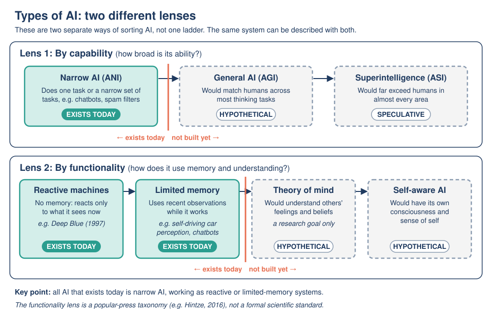

# 10: The Future of AI

**Module:** AI Overview · **Version:** 2.0 · **Status:** drafted (self-checked) · **Last updated:** 2026-11-06

## Learning goals

After this topic, you should be able to:

- **Explain** what artificial general intelligence (AGI) means, why there is no agreed definition or timeline, and summarize the main viewpoints fairly.
- **Describe** the risk-based approach of the EU AI Act and its four risk tiers, with examples of each.
- **Classify** example AI systems into EU AI Act risk tiers and justify each classification.
- **Trace** the EU AI Act timeline to work out which rules already apply on a given date, including the 2026 changes.
- **Compare** the purpose of the EU AI Act (binding law), the OECD AI Principles and the UNESCO Recommendation on the Ethics of AI (non-binding guidance), and plan your own responsible use of AI.

## Prerequisites

- [Topic 05: Types of AI](05-types-of-ai.md): narrow AI (ANI), general AI (AGI), superintelligence (ASI).
- [Topic 06: History of AI](06-history-of-ai.md): hype cycles and failed predictions.
- [Topic 07: Real-world applications](07-real-world-applications.md): stakes and human oversight.
- [Topic 08: Ethics, risks and social impact](08-ethics-risks-social-impact.md): bias, privacy, accountability, transparency, deepfakes.
- [Topic 09: Limitations and misconceptions](09-limitations-and-misconceptions.md): hallucinations, brittleness.

## Key terms

| Term | Plain-English definition |
|---|---|
| Artificial general intelligence (AGI) | A hypothetical AI that could learn and perform a very wide range of intellectual tasks at least as well as a skilled human, rather than one narrow task. There is no single agreed definition. |
| Superintelligence (ASI) | A hypothetical AI far more capable than the best humans in almost every area. |
| Forecast | A prediction about the future, often with a probability ("50% chance by year X"). |
| Regulation | Laws and rules made by governments that organizations must follow, with penalties if they don't. |
| Governance | All the ways society steers a technology: laws, standards, company policies, international agreements, oversight bodies. |
| EU AI Act | The European Union's law on artificial intelligence, Regulation (EU) 2024/1689. It sorts AI systems by risk and sets rules for each level. |
| Risk-based approach | Regulating more strictly where the potential harm is greater, and lightly or not at all where it is small. |
| Provider / deployer | Under the EU AI Act, the *provider* develops an AI system and puts it on the market; the *deployer* is an organization that uses it (e.g. an employer using a hiring tool). |
| General-purpose AI (GPAI) model | A model, such as a large LLM, that can be used for many different tasks and built into many products. The EU AI Act has separate rules for these. |
| Digital Omnibus on AI | An EU law that amended the AI Act in 2026, mainly delaying the high-risk rules and adding a new prohibition. |
| Soft law | Non-binding principles and recommendations (e.g. OECD, UNESCO) that guide governments but cannot directly fine anyone. |
| AI literacy | The knowledge and skills to understand, use and critically judge AI systems. |

## Explanation

### 1. Thinking about the future carefully

Predictions about AI have a mixed record. In the 1950s and 1960s, researchers expected human-level AI within a generation, and the result was two AI winters ([Topic 06](06-history-of-ai.md)). On the other hand, few people in 2015 predicted how fluent chatbots would be by 2023. So when thinking about the future, keep two habits:

1. **Separate evidence from prediction.** "This system scored X on this test" is evidence. "This means human-level AI by 2030" is a prediction.
2. **Notice who is speaking and why.** Companies raising money, researchers, journalists and campaigners may all have different incentives.

This topic covers two big questions about the future: **Will we build AGI?** and **How will society govern AI?** It ends with what *you* can do.

### 2. Artificial general intelligence (AGI)

**What AGI means.** All AI in use today is **narrow AI**: each system is built or trained for particular kinds of tasks ([Topic 05](05-types-of-ai.md)). Even an LLM that can chat about many subjects has the limitations from [Topic 09](09-limitations-and-misconceptions.md): it hallucinates, it is brittle in unfamiliar situations, and it cannot reliably learn new skills on its own from a few experiences the way people do. **AGI** refers to a hypothetical system with human-like *generality*: able to learn and do most intellectual tasks a skilled person can.

**Are today's chatbots AGI?** As in [Topic 05](05-types-of-ai.md): the **mainstream view is that current large language models are not AGI**. This is debated (some researchers argue that the most advanced LLMs already show early general intelligence), and **there is no agreed test or definition** that would settle the question.

**Why there is no agreed definition.** Different groups define AGI differently:

- some focus on **tasks**: matching humans at "most" or "every" intellectual or economically valuable task;
- some focus on **learning ability**: picking up new skills as efficiently as a person;
- some include **physical abilities** (robots), others don't.

In 2023 researchers at Google DeepMind (Morris and colleagues) proposed "Levels of AGI", judging systems by **performance** (from "Emerging" through "Competent", "Expert" and "Virtuoso" to "Superhuman") and **generality** (narrow vs general). Under their scheme, the chatbots of 2023 counted only as "Emerging AGI". That is one proposal among many, not an official standard. Because definitions differ, two people can disagree about whether AGI is "close" simply because they mean different things.

**Is there a timeline? Researchers' forecasts.** The largest survey of AI researchers so far (Grace and colleagues, published 2024) asked 2,778 researchers who had published at top AI conferences. Their combined forecast gave:

- a **10% chance** that machines could outperform humans at every task by **2027**, and a **50% chance by 2047**;
- the 2047 estimate was **13 years earlier** than in the same survey one year before, showing how quickly opinions shifted after ChatGPT;
- a 50% chance that **all human occupations** could be fully automated only by **2116**;
- **very wide disagreement** between individual respondents.

These are **opinions about the future**, not measurements. Experts' forecasts have been wrong before in both directions.

**Main viewpoints (presented fairly):**

| Viewpoint | Core argument | What would change their mind? |
|---|---|---|
| **"AGI could arrive soon"** | Capabilities have improved fast as models, data and compute have grown; continuing this trend could reach general ability within years | Progress stalling despite more data and compute |
| **"Current methods are not enough"** | Today's models still hallucinate, are brittle, and need far more data than humans to learn; new scientific ideas will be needed, so AGI is likely decades away or more | Models overcoming these limitations with current methods |
| **"Prepare for serious risks"** | Whenever it comes, very capable AI could be misused or behave in unintended ways; safety research and oversight should be built now | Strong evidence that such systems can be reliably controlled |
| **"Focus on today's harms"** | Talk of AGI can distract from present problems: bias, privacy, misinformation, jobs, energy use; and "AGI" is too vague to guide policy | Clear, measurable definitions of AGI and evidence of its approach |

These views are not all mutually exclusive: many people hold parts of several. A reasonable summary in 2026 is: **there is no consensus on what AGI is, whether current methods can reach it, or when it might arrive.** What is not in doubt is that today's narrow AI already raises real issues that need managing now.

### 3. Rules for AI: why regulate?

AI can cause harm through bias, privacy loss, unsafe decisions and deception ([Topic 08](08-ethics-risks-social-impact.md)). Regulation aims to:

- protect people's **safety and fundamental rights**;
- make clear **who is accountable**;
- require **transparency**, so people know when AI is used;
- build **trust**, so beneficial AI can be adopted;
- avoid stifling useful innovation (a constant balancing act).

Governments take different approaches. Below are three of the most important international frameworks: one binding law (the EU AI Act) and two sets of non-binding principles (OECD and UNESCO).

### 4. The EU AI Act

**What it is.** The EU AI Act (Regulation (EU) 2024/1689) is the world's first comprehensive law on AI. It was adopted on 13 June 2024, published in the EU's *Official Journal* on 12 July 2024, and **entered into force on 1 August 2024**. It applies to organizations that place AI systems on the EU market or use them in the EU, **even if the company is based outside the EU**.

**The risk-based approach: four tiers.** Instead of regulating "AI" as one thing, the Act sets rules according to the **risk** a use poses:

| Tier | What happens | Examples (from the European Commission) |
|---|---|---|
| **1. Unacceptable risk** | **Banned** | Social scoring; harmful manipulation or deception; exploiting people's vulnerabilities; predicting that an individual will commit a crime based only on profiling; untargeted scraping of internet or CCTV images to build face-recognition databases; emotion recognition in workplaces and schools; biometric categorization to infer sensitive traits; real-time remote biometric identification in public spaces for law enforcement (with narrow exceptions); and (added in 2026) AI that generates non-consensual intimate images or child sexual abuse material |
| **2. High risk** | **Allowed, with strict obligations**: risk management, high-quality data, documentation, logging, human oversight, accuracy and cybersecurity, registration | AI in education (e.g. exam scoring), employment (e.g. CV sorting), access to essential services (e.g. credit scoring), law enforcement, migration and border control, justice and democratic processes, critical infrastructure; AI safety components of regulated products (e.g. medical devices) |
| **3. Transparency risk** (often called "limited risk") | **Disclosure duties** | Chatbots must make clear you are talking to an AI; deepfakes and certain AI-generated content must be labeled |
| **4. Minimal or no risk** | **No specific new obligations** | Spam filters; AI in video games |

**General-purpose AI models.** Separately from the four tiers, the Act sets rules for **providers of general-purpose AI models** (like the LLMs behind popular chatbots), such as technical documentation and information for downstream developers, with extra obligations for the most powerful models.

**Penalties.** Breaking the bans can lead to fines of up to **€35 million or 7% of a company's worldwide annual turnover**, whichever is higher; most other breaches up to €15 million or 3%.

**The timeline (staged application).** The Act applies in stages so organizations have time to prepare. In 2026 the EU amended the timeline through the **Digital Omnibus on AI** (proposed by the European Commission on 19 November 2025, politically agreed in May 2026, and in force from 27 July 2026, according to the Commission). The resulting schedule:

| Date | What applies |
|---|---|
| 1 Aug 2024 | Act enters into force (no obligations yet) |
| 2 Feb 2025 | **Bans** on unacceptable-risk practices; AI literacy provisions |
| 2 Aug 2025 | Rules for **general-purpose AI models**; governance (national authorities, EU AI Office) |
| 2 Aug 2026 | Act **generally applies**, including **transparency** duties (chatbot disclosure, deepfake labeling) |
| 2 Dec 2026 | New ban on AI generating non-consensual intimate content or child sexual abuse material; end of a grace period for marking AI-generated content for systems already on the market before 2 Aug 2026 (added/changed by the Omnibus) |
| 2 Dec 2027 | **High-risk** obligations for stand-alone high-risk uses (education, employment, credit, etc.); **originally 2 Aug 2026**, delayed by the Omnibus |
| 2 Aug 2028 | High-risk obligations for AI built into regulated products (e.g. medical devices, machinery); **originally 2 Aug 2027**, delayed by the Omnibus |

> **Uncertainty note (as of 6 November 2026):** The Omnibus changes are recent. Our summary is based on the European Commission's AI Act page and law-firm summaries of the agreed text; secondary sources differ slightly on some details (e.g. whether political agreement was reached on 6 or 7 May 2026). The Omnibus also softened the AI literacy duty: according to these summaries, it now emphasizes the Commission and Member States promoting AI literacy rather than a strict obligation on every company. For legal decisions, always check the current consolidated text on EUR-Lex.

**What this means today (6 November 2026):** the bans, the GPAI rules and the transparency duties already apply; the main high-risk obligations do **not yet** apply and are due from December 2027 and August 2028.

### 5. International principles: OECD and UNESCO

Not all governance is binding law. Two widely adopted sets of principles guide many countries' policies:

**OECD AI Principles (2019, updated May 2024).** The Organisation for Economic Co-operation and Development's principles were the first intergovernmental standard on AI. By 2026, 47 countries and organizations adhere to them. They contain five **values-based principles**:

1. Inclusive growth, sustainable development and well-being
2. Human rights and democratic values, including fairness and privacy
3. Transparency and explainability
4. Robustness, security and safety
5. Accountability

and five **recommendations for governments**: invest in AI research and development; foster an inclusive AI ecosystem; create an enabling, interoperable governance environment; build human capacity and prepare for labor-market change; and co-operate internationally. The 2024 update addressed issues raised by generative AI, such as misinformation.

**UNESCO Recommendation on the Ethics of Artificial Intelligence (November 2021).** Adopted by all 193 UNESCO member states, it is described by UNESCO as the first global standard on AI ethics. It is built on **four core values** (human rights and human dignity; living in peaceful, just and interconnected societies; diversity and inclusion; and a healthy environment and ecosystems) and **ten principles**, including proportionality and "do no harm", privacy, human oversight, transparency and explainability, fairness and non-discrimination, sustainability, and awareness and literacy. It also sets out policy areas (such as gender, education, data and the environment) where governments should act.

**Binding vs non-binding.** The EU AI Act can **fine** companies. The OECD and UNESCO frameworks **cannot**; they work by guiding national laws and shaping international expectations. Some binding international agreements are also emerging: for example, the Council of Europe's **Framework Convention on Artificial Intelligence** (opened for signature in September 2024) is described as the first legally binding international treaty on AI and human rights.

| Framework | Type | Who | Year | Main approach |
|---|---|---|---|---|
| EU AI Act | **Binding law** with fines | EU (applies to anyone selling/using AI in the EU) | 2024 (in force); staged to 2028 | Risk-based tiers |
| OECD AI Principles | Non-binding recommendation | 47 adherents | 2019; updated 2024 | Values + policy recommendations |
| UNESCO Recommendation | Non-binding recommendation | 193 member states | 2021 | Values, principles, policy areas; human rights focus |

### 6. What can you do? AI literacy and critical use

You don't need to be an engineer to shape AI's future. Using what you've learned in this module:

1. **Verify before you trust.** Check important AI outputs against reliable sources, especially facts, numbers, quotes and references ([Topic 09](09-limitations-and-misconceptions.md)).
2. **Match trust to stakes.** Low stakes (brainstorming, film suggestions) need little checking; high stakes (health, money, law, other people's lives) need verification and human judgment ([Topic 07](07-real-world-applications.md)).
3. **Protect privacy.** Don't share personal, other people's or confidential information with AI tools unless you know how it will be used ([Topic 08](08-ethics-risks-social-impact.md)).
4. **Be open about AI use.** Follow your school's or workplace's rules, and say when you've used AI to create work.
5. **Watch for deepfakes and manipulation.** Be skeptical of surprising audio, video or urgent requests; confirm through a second channel.
6. **Ask the governance questions.** Who built this? What data does it use? Who is accountable if it's wrong? Can I ask a human?
7. **Keep learning.** AI changes fast; the concepts in this module (data, training, inference, bias, hallucination, risk) will help you understand whatever comes next.

## Worked example

**Classifying an AI system under the EU AI Act: a step-by-step method**

Use these questions **in order**:

1. **Is it a banned practice?** (Check the unacceptable-risk list.) If yes → **Unacceptable: prohibited.**
2. **Is it used in a high-risk area** (education, employment, essential services such as credit, law enforcement, migration, justice, critical infrastructure, biometrics) **or a safety component of a regulated product?** If yes → **High risk.**
3. **Does it interact directly with people, or generate synthetic content (text, images, audio, video)?** If yes → **Transparency duties** apply. (These can apply *in addition* to high-risk rules.)
4. **None of the above?** → **Minimal risk**: no specific new obligations (voluntary codes encouraged).

**Example A: A university uses AI to grade students' final exams, and the grades decide whether students pass.**

- Step 1: Not on the banned list (it is not social scoring, manipulation, etc.).
- Step 2: Education is a high-risk area, and the system determines students' results, which affect their futures. → **High risk.**
- Result: The provider must manage risks, use high-quality and representative training data, document the system, log its operation, ensure accuracy, and design it for **human oversight**; the university must use it as instructed with human oversight. Timeline: these obligations apply from **2 December 2027** (after the Omnibus delay).
- *Why this makes sense:* a biased or inaccurate grading model could unfairly fail students, a high-stakes harm (compare the bias cases in [Topic 08](08-ethics-risks-social-impact.md)).

**Example B: An online shop's customer-service chatbot answers questions about deliveries.**

- Step 1: Not banned.
- Step 2: Customer service for deliveries is not a listed high-risk area.
- Step 3: It interacts directly with people. → **Transparency risk**: customers must be told they are chatting with an AI (applies from **2 August 2026**, i.e. already).
- *Why:* the main risk is people being misled about whether they're talking to a human; the stakes of a wrong delivery answer are low.

**Example C: An employer installs software that reads employees' facial expressions on webcams to judge whether they're "engaged" at work.**

- Step 1: Emotion recognition in the **workplace** is on the banned list. → **Unacceptable: prohibited** (since **2 February 2025**).
- *Why:* emotion recognition is scientifically unreliable, and using it on employees creates a big power imbalance and privacy intrusion.

## Visual

*Figure: The EU AI Act's four risk tiers as a pyramid: the higher the risk, the stricter the rules, and the fewer systems fall into the tier.* (Original table created for this module.)

| Pyramid level | Tier | Rule | Example |
|---|---|---|---|
| Top (fewest systems) | **Unacceptable** | Banned | Social scoring; emotion recognition at work or school |
| Upper middle | **High** | Strict obligations, human oversight | CV sorting for hiring; exam scoring; credit scoring |
| Lower middle | **Transparency** | Must disclose / label | Chatbots; deepfakes |
| Base (most systems) | **Minimal** | No specific new obligations | Spam filters; video-game AI |

For where the capability categories (ANI, AGI, ASI) discussed in Section 2 fit, see the two-lenses diagram from Topic 05:

*Figure: AGI and superintelligence sit on the capability lens and remain hypothetical; all current systems are narrow AI.* (Original diagram created for this module.)

## Common mistakes

1. **"AGI is already here" or "AGI is impossible", stated as fact.** Correction: there is no agreed definition, and experts disagree widely on whether and when. The accurate statement is that AGI is hypothetical and its timeline is uncertain.
2. **"The EU AI Act bans AI" or "regulates all AI the same way."** Correction: most AI systems (e.g. spam filters) fall into the minimal-risk tier with no new obligations. Only a small set of practices is banned; high-risk uses must meet strict requirements.
3. **"All EU AI Act rules started on 1 August 2024."** Correction: that was entry into force. Obligations apply in stages: bans from February 2025, GPAI rules from August 2025, most rules including transparency from August 2026, and high-risk rules (after the 2026 Omnibus delay) from December 2027 and August 2028.
4. **"OECD and UNESCO principles are laws that can fine companies."** Correction: they are non-binding recommendations ("soft law") that guide governments. The EU AI Act is binding law with fines.

## Try it yourself

### Activity 1: Classify the systems (apply + justify)

Using the four-step method from the worked example, place each system in an EU AI Act tier (**Unacceptable / High / Transparency / Minimal**). Justify each answer in one or two sentences, naming the step that decided it. One system has obligations in **two** tiers.

1. A recommendation system suggesting songs on a music app.
2. A bank's AI that decides whether people get a loan, based on a credit score it calculates.
3. A city system that gives citizens a "trustworthiness score" based on their social behavior, used to decide access to public services.
4. A tool that generates realistic videos of real people for marketing.
5. A company uses AI to sort job applicants' CVs and reject some automatically.
6. An AI-powered email spam filter.
7. A school uses cameras with emotion recognition to check whether pupils are paying attention.
8. A chatbot that a company uses as part of its CV-screening process, asking applicants interview questions and scoring their answers.

### Activity 2: What applies on which date? (trace a timeline)

Use the timeline table in Section 4. For each date, list which EU AI Act obligations already apply.

1. 1 September 2024
2. 1 March 2025
3. 6 November 2026 (today, for this module)
4. 1 January 2028

Then answer: **A company says in early 2026, "Our CV-sorting AI must meet all high-risk requirements by 2 August 2026."** Was that correct at the time, and is it correct now? Explain.

### Activity 3: Evaluate claims about AGI (compare + justify)

Read the four statements. For each, decide whether it is mainly **evidence**, a **prediction**, or a **definition dispute**, and say which viewpoint from the AGI table (Section 2) it best fits.

- A. "In a 2024 survey, AI researchers gave a combined 50% chance that machines will outperform humans at every task by 2047."
- B. "Chatbots still invent fake references, so they clearly lack something essential; we will need new ideas, not just bigger models."
- C. "By my definition, a system that beats most people on most exams already counts as AGI."
- D. "We should spend more on fixing bias in today's hiring tools than on debating AGI."

Finally, write **two or three sentences** giving your own view on how close AGI is, using at least one piece of evidence and acknowledging one opposing view.

## Answers

Show answers

**Activity 1**

1. **Minimal.** Step 4: entertainment recommendation isn't banned, isn't in a high-risk area, and doesn't itself pose transparency issues like a chatbot or deepfake. (It still has the general concerns from [Topic 07](07-real-world-applications.md), such as filter bubbles.)
2. **High.** Step 2: access to essential private services; credit scoring that can deny loans is listed as high-risk. A biased model could unfairly deny people money.
3. **Unacceptable (banned).** Step 1: this is **social scoring**, a prohibited practice.
4. **Transparency.** Step 3: it generates synthetic video of real people (deepfakes), which must be labeled as AI-generated.
5. **High.** Step 2: employment: CV sorting is listed as high-risk. Bias here affects people's livelihoods (see the hiring case in [Topic 08](08-ethics-risks-social-impact.md)).
6. **Minimal.** Step 4: the European Commission gives spam filters as an example of minimal risk.
7. **Unacceptable (banned).** Step 1: emotion recognition in **education institutions** is prohibited.
8. **High + Transparency (two tiers).** Step 2: it is used in employment (scoring applicants) → high risk; Step 3: it interacts directly with people → applicants must be told they are talking to an AI. This shows tiers are not always exclusive.

**Activity 2**

1. **1 Sep 2024:** The Act is in force, but **no obligations apply yet**.
2. **1 Mar 2025:** **Bans** on unacceptable-risk practices and the AI literacy provisions.
3. **6 Nov 2026:** Bans; **GPAI model rules** and governance (since Aug 2025); **general application including transparency duties** (since 2 Aug 2026). The new ban on generating non-consensual intimate content and child sexual abuse material is **not yet** in effect (from 2 Dec 2026). High-risk obligations: **not yet**.
4. **1 Jan 2028:** Everything in (3) plus the Dec 2026 ban, and **high-risk obligations for stand-alone high-risk systems** such as education, employment and credit (from 2 Dec 2027). High-risk rules for AI in regulated products (e.g. medical devices) **not yet** (from 2 Aug 2028).

**CV-sorting claim:** In early 2026, the claim matched the **original** timeline (stand-alone high-risk obligations from 2 August 2026), though the Omnibus proposal to delay them was already under discussion. **Now** it is not correct: after the Digital Omnibus on AI (in force from 27 July 2026), these obligations apply from **2 December 2027**. This shows why you must check the *current* version of a law.

**Activity 3**

- **A: Evidence** (of expert *opinion*: it is real survey data, but what it measures is a set of predictions). Best fits no single viewpoint; it is used by "AGI could arrive soon" supporters, though the survey also showed wide disagreement.
- **B: Prediction** supported by evidence of a limitation (hallucination). Fits **"Current methods are not enough"**.
- **C: Definition dispute.** It shows how disagreement about AGI often comes from different definitions. (Might be used by "AGI could arrive soon" / "already here" voices.)
- **D: Value judgment / priority claim**, closest to a prediction about what matters most. Fits **"Focus on today's harms"**.

**Own view (example):** "I think AGI is not close enough to plan around yet. Today's LLMs still hallucinate and fail on unfamiliar problems (Topic 09), which suggests something important is missing. However, the 2024 survey showed researchers moved their forecasts 13 years earlier in a single year, so progress could be faster than I expect, and it makes sense to prepare safeguards anyway." (Any view is acceptable if it uses evidence and acknowledges an opposing view.)

## Optional extension

*Optional: not required for the core module.*

- Look up whether your own country has an AI law, strategy or set of principles. Is it binding? Which tier system (if any) does it use?
- Read the OECD AI Principles page (link in Sources) and pick the principle you think is hardest to achieve in practice. Explain why with an example from this module.
- Explore the EU AI Act Service Desk or the Commission's AI Act page and find one question that businesses commonly ask.

## Connections

- **Back to [Topic 05](05-types-of-ai.md):** AGI and ASI are the hypothetical categories in the capability lens.
- **Back to [Topic 06](06-history-of-ai.md):** past over-confident predictions are a reason for caution about AGI timelines.
- **Back to [Topic 07](07-real-world-applications.md):** the EU AI Act's risk tiers formalize the "stakes → oversight" idea.
- **Back to [Topic 08](08-ethics-risks-social-impact.md) and [Topic 09](09-limitations-and-misconceptions.md):** regulation and principles respond directly to bias, privacy, accountability, transparency, deepfakes and hallucinations.
- **Module wrap-up:** you can now define AI ([Topic 01](01-what-is-ai.md)), explain how it works (Topics 02–04), classify it (Topic 05), place it in history (Topic 06), analyze its uses and risks (Topics 07–09) and discuss its future and governance (this topic).

## Sources

1. European Commission. *AI Act* (Shaping Europe's digital future: regulatory framework for AI). https://digital-strategy.ec.europa.eu/en/policies/regulatory-framework-ai (fetched twice, accessed 2026-11-06). Supports: entry into force 1 Aug 2024; four risk levels and examples (spam filters, video games minimal; chatbots, deepfakes transparency; CV sorting, credit scoring, exam scoring high-risk; nine prohibited practices); application dates; AI Omnibus adopted (proposed) 19 Nov 2025, political agreement 7 May 2026, in force 27 July 2026; high-risk delays to 2 Dec 2027 / 2 Aug 2028; nudification/CSAM ban Dec 2026.
2. European Union (2024). Regulation (EU) 2024/1689 of the European Parliament and of the Council of 13 June 2024 laying down harmonised rules on artificial intelligence (Artificial Intelligence Act). OJ L, 12.7.2024. https://eur-lex.europa.eu/eli/reg/2024/1689/oj/eng (fetched first part, accessed 2026-11-06). Supports: official title, adoption date, publication date.
3. Future of Life Institute. *EU Artificial Intelligence Act: Article 99 (Penalties)* and *Article 113 (Entry into force and application)*, consolidated text explorer. https://artificialintelligenceact.eu/article/99/ ; https://artificialintelligenceact.eu/article/113/ (fetched, accessed 2026-11-06; unofficial consolidated text). Supports: €35M/7% and €15M/3% fines; amended application dates (2 Dec 2026, 2 Dec 2027, 2 Aug 2028, 27 July 2026).
4. Gibson Dunn (2026, 27 May). *EU AI Act Omnibus Agreement: Postponed High-Risk Deadlines and Other Key Changes*. https://www.gibsondunn.com/eu-ai-act-omnibus-agreement-postponed-high-risk-deadlines-and-other-key-changes/ (fetched, accessed 2026-11-06). Supports: original vs new high-risk dates; Article 50 transparency on original schedule; watermarking grace period to 2 Dec 2026; AI literacy softened; new prohibition.
5. Sidley Austin, Data Matters (2026, 22 June). *EU Lawmakers Reach Provisional Agreement to Delay Key EU AI Act Obligations*. https://datamatters.sidley.com/2026/06/22/eu-lawmakers-reach-provisional-agreement-to-delay-key-eu-ai-act-obligations/ (fetched, accessed 2026-11-06). Supports: Parliament vote 16 June 2026; adoption steps; dates consistent with source 4.
6. OECD.AI. *OECD AI Principles overview*. https://oecd.ai/en/ai-principles (fetched, accessed 2026-11-06). Supports: adopted 2019, updated May 2024; five values-based principles and five recommendations; 47 adherents.
7. UNESCO. *Recommendation on the Ethics of Artificial Intelligence*. https://www.unesco.org/en/artificial-intelligence/recommendation-ethics (fetched, accessed 2026-11-06). Supports: adopted November 2021 by 193 member states; first global standard; four values; ten principles; policy areas.
8. Grace, K. et al. (2024). Thousands of AI Authors on the Future of AI. arXiv:2401.02843. https://arxiv.org/abs/2401.02843 (fetched, accessed 2026-11-06). Supports: 2,778 respondents; 10% by 2027 / 50% by 2047 for HLMI; 13 years earlier than previous survey; full automation of labor 50% by 2116; wide disagreement.
9. Morris, M. R. et al. (2023). Levels of AGI: Operationalizing Progress on the Path to AGI. arXiv:2311.02462. https://arxiv.org/abs/2311.02462 (verified via search results and coverage, accessed 2026-11-06). Supports: performance/generality levels; 2023 chatbots classed as "Emerging AGI"; no single agreed definition.
10. Council of Europe (2024). *Council of Europe opens first ever global treaty on AI for signature*. https://www.coe.int/it/web/portal/-/council-of-europe-opens-first-ever-global-treaty-on-ai-for-signature ; JURIST (2024): https://www.jurist.org/news/2024/09/council-of-europe-opens-worlds-first-global-ai-treaty-for-signature (search results, accessed 2026-11-06). Supports: Framework Convention opened for signature 5 Sept 2024; adopted 17 May 2024; first legally binding international AI treaty.
