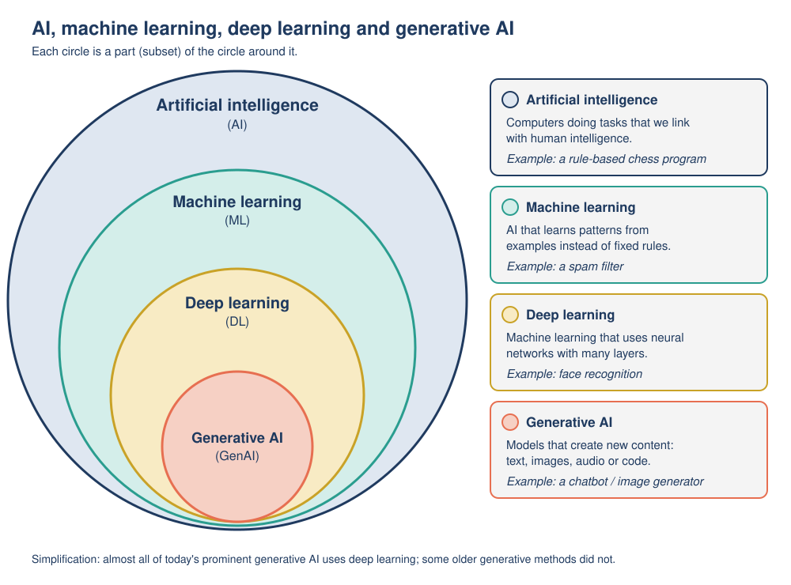

# Mission 01: Is It AI?

**Pixel's AI Field Guide: Missions for Curious Humans** · Version 1.0 (2026-11-06)
**Covers:** Topic 01, [What is AI?](../../task-1/topics/01-what-is-ai.md) · **Time:** about 50 minutes (core, including a 6-minute video segment)
**Navigation:** [Start here](00-start-here.md) · Next: [Mission 02](mission-02-the-river-problem.md) · [Glossary](glossary.md) · [Resources](resources.md)

---

## [MISSION BRIEF] Pixel's sticker spree

On its first morning at the Curiosity Lab, Pixel is handed a roll of stickers that say "AI INSIDE" and told to label every AI system in the building. By lunchtime the toaster, the wall clock, the calculator and Pixel itself are covered in stickers. "I am a robot," Pixel explains, "so obviously I am AI." Dr. Ada Okafor peels a sticker off the toaster and asks the question this mission is about: **how do you actually tell whether something is AI?**

### Learning goals

By the end of this mission you should be able to:

- **Explain** in your own words what AI is, using the chain *input → the system works out (infers) an answer → output*.
- **Sort** everyday tools into "AI", "not AI" and "borderline", and **justify** each choice with the three-question test.
- **Name** at least two differences between human intelligence and today's AI.
- **Explain** the "AI effect" and why it makes people disagree about what counts as AI.

---

## [PREDICT] Before you start (2 minutes)

Write down your answers. You will check them at the end of the mission.

1. Finish the sentence in your own words: "Something counts as AI when ..."
2. Is a pocket calculator AI? Is a phone keyboard that suggests your next word AI? Is a wind-up toy robot AI? (Yes / No / Not sure for each.)

---

## [TRY IT] Activity 1.1: The AI-or-not card sort

**Goal:** Practice deciding whether a tool is AI by looking at what it *does* (its input and output), not at what it looks like or what it is called.

**Preparation:** Paper and a pen. Either cut out the 12 cards below (write each one on a sticky note or scrap of paper) or simply copy the table. Make three piles or columns: **AI**, **NOT AI**, **BORDERLINE (it depends)**. Works alone, in pairs, or as a class. No device needed.

| Card | Tool | What it does |
|---|---|---|
| 1 | Calculator app | Shows 12 × 7 = 84 when you press the keys. |
| 2 | Phone keyboard | Suggests the next word while you type a message. |
| 3 | Alarm clock | Rings at 07:00 every weekday. |
| 4 | Photo app | Finds "all photos of my dog" in a gallery of 5,000 pictures. |
| 5 | Basic thermostat | "If the room is below 19 °C, turn the heating on." |
| 6 | Email spam filter | Moves suspicious emails to the spam folder. |
| 7 | Banking app | Sends "Unusual payment detected - was this you?" |
| 8 | Website form | Rejects an email address that has no "@" in it. |
| 9 | Navigation app | Suggests a route and predicts "arrive 08:42" using live traffic. |
| 10 | Wind-up toy robot | Walks forward and waves its arms when you wind it up. |
| 11 | Simple spell checker | Underlines any word that is not in its dictionary list. |
| 12 | Chatbot | Writes a paragraph answering your typed question. |

**Task:**

1. Sort the 12 cards into the three piles. Go with your first instinct; this is a prediction.
2. Now take each card in turn and ask Pixel's **three questions** (Dr. Okafor wrote them on the lab whiteboard):
   - **Q1. What is the input and what is the output?**
   - **Q2. Does it have to work out (infer) a good output for new, varied inputs, or does it apply one fixed procedure a person wrote out completely in advance?**
   - **Q3. Could a person write down an exact recipe for every possible input?** (If yes, it is probably ordinary software.)
3. Move any card whose pile changed. Mark moved cards with an arrow.

**Observation:** For each card, write one line: *input → output → pile → reason*. For example: *"Card 3: the time → ringing → NOT AI → one fixed rule set by a person."* Count how many cards you moved after using the questions.

**Reflection:**
- Which card was hardest? What extra information would settle it?
- Pixel put card 10 (the toy robot) in the AI pile "because it is a robot". What would you say to Pixel?

**Feedback:**

<details>
<summary>[DEBRIEF] Expected sort and reasoning (open after you have sorted)</summary>

| Card | Expected pile | Input → output | Why |
|---|---|---|---|
| 1 Calculator | NOT AI | keys pressed → result | Fixed arithmetic rules. Nothing is inferred. |
| 2 Next-word keyboard | AI | words typed so far → predicted next words | It infers likely continuations from patterns learned from huge amounts of text. A small cousin of the chatbots in Mission 06. |
| 3 Alarm clock | NOT AI | time → ring | One fixed rule set by a person. |
| 4 Dog-finding photo app | AI | photos → "dog / not dog" (classification) | It must recognize a dog it has never seen before, at any angle and in any light. Nobody can write a recipe for every possible photo. |
| 5 Basic thermostat | NOT AI | temperature → heating on/off | One rule written completely in advance. (A "smart" thermostat that *learns* your schedule and predicts when you will come home would be AI.) |
| 6 Spam filter | AI | email → "spam / not spam" (classification) | Spam keeps changing, so the filter infers from patterns. Gmail, for example, uses machine learning powered by user feedback. |
| 7 Fraud alert | AI (usually) | payment details → "probably unusual" (prediction) | Banks typically use systems that learn what "normal" looks like for each customer. If the bank used only one rule such as "alert on any payment over 1,000", that part would not be AI. That is why it says "usually". |
| 8 "@" form check | NOT AI | typed address → accept / reject | A single exact rule. |
| 9 Navigation app | AI | location, destination, live traffic → route + arrival time (recommendation + prediction) | It searches a huge number of possible routes and predicts traffic it cannot see directly. Many people no longer call this AI: that is the **AI effect** (see [EXPLAIN]). |
| 10 Wind-up toy robot | NOT AI | winding → fixed movements | The same movements every time; no input is analyzed at all. **Looking like a robot does not make something AI.** |
| 11 Dictionary spell checker | BORDERLINE / usually NOT AI | word → "in the list or not" | A simple lookup. Modern spell checkers that suggest the most likely intended word *from context* do use AI. |
| 12 Chatbot | AI | your prompt → generated text (generated content) | It generates new text it has never seen, one piece at a time (Mission 06). |

**What a good answer contains:** the words *infers from varied inputs* versus *one fixed rule written in advance*. A different pile is fine **if** your reason uses the three questions, for example "I put card 7 in BORDERLINE because I don't know whether the bank uses a fixed rule or a learned pattern."

**Common mistakes:**
- **"Electronic = AI" (Pixel's toaster mistake).** Most software follows fixed rules. Ask Q2.
- **"Robot = AI" (Pixel's mistake about itself and card 10).** Most AI has no body at all: it runs in apps and data centers. Robots *may* use AI, but AI and robotics are different things.
- **"It's clever, so it's AI."** A calculator is extremely good at arithmetic but infers nothing. "Intelligent-looking" is not the test; *inferring outputs for new, varied inputs* is.
</details>

---

## [TRY IT] Activity 1.2: AI in Your Day

**Goal:** Notice where AI already shows up in your daily life, and decide how much to trust it based on what happens if it gets something wrong.

**Preparation:** The three questions from Activity 1.1. A copy of the table below (paper or a document). About 15 minutes now, or spread over a day.

**Task:** Over the next 24 hours, or by thinking back over yesterday, find **three** moments when you used, or were affected by, an AI system. Name a specific *function* ("face unlock"), not just a device ("my phone"). Fill in one column per moment:

| Question | Moment 1 | Moment 2 | Moment 3 |
|---|---|---|---|
| 1. What were you doing? | | | |
| 2. What was the AI system's **input**? | | | |
| 3. What was its **output**, and which type (prediction, classification, recommendation, decision, generated content)? | | | |
| 4. How sure are you that it is AI? (Use the three questions.) | | | |
| 5. Was it built for **one specific task**, or could it do many different things? | | | |
| 6. If it made a mistake, what would happen? Low or high stakes? | | | |
| 7. Given your answer to 6, how much would you check its output before relying on it? | | | |

**Observation:** Finish with two or three sentences: which of your examples would you trust most, and why?

**Reflection:** Did the amount of checking you chose depend on how clever the system seemed, or on how bad a mistake would be? Which *should* it depend on?

**Feedback:**

<details>
<summary>[DEBRIEF] A strong example answer and common weaknesses</summary>

Answers will differ. A strong response looks like this:

| Question | Example moment A | Example moment B |
|---|---|---|
| 1. Doing | Driving to an unfamiliar address with a navigation app | Reading a test result from a hospital scan reviewed with AI assistance |
| 2. Input | My location, destination, live traffic | The medical image |
| 3. Output and type | Recommended route + predicted arrival time (prediction, recommendation) | Highlighted areas that might be abnormal (classification) |
| 4. Sure it is AI? | Yes: it infers traffic and the best route from huge, changing data | Yes: it recognizes patterns in images that vary from patient to patient |
| 5. One task or many? | One specific task (routes) | One specific task (one type of scan) |
| 6. Mistake? | A slower route: annoying but low stakes and easy to correct | A missed problem (a **false negative**) could delay treatment; a false alarm (a **false positive**) could cause worry and extra tests: high stakes |
| 7. How much to check? | Little: I glance at the route | A lot: I would expect a qualified doctor to review the output and explain it |

**Key insight:** every example you find is built for a specific task (Mission 07 gives this a name: "narrow AI"), and **the amount you check an AI output should depend on how serious a mistake would be, not on how clever the system seems.** Missions 10 and 11 build on this.

**Common weaknesses:** listing a device ("my phone") instead of an AI function ("face unlock"); calling every app feature AI without applying the three questions; giving no consequence of error in row 6.
</details>

---

## [OBSERVE] What did the AI cards have in common?

Look back at your AI pile from Activity 1.1 and your table from Activity 1.2. Before reading on, write one sentence that describes **what all the AI examples share** and that **none of the NOT AI examples** do.

*(Hint: think about the inputs. Were they always the same, or new and messy every time?)*

---

## [EXPLAIN] What AI is (and isn't)

### A working definition

There is no single definition of AI that every expert agrees on, but most share one core idea. This guide uses the same definition as the module:

> **Artificial intelligence (AI)** is computer technology that performs tasks we would normally say need human intelligence, such as recognizing patterns, understanding language, making decisions or creating content.

IBM's beginner explanation says something similar: AI is technology that enables computers and machines to "simulate human learning, comprehension, problem solving, decision making, creativity and autonomy". Two words matter:

- **Simulate / perform tasks:** AI produces results that *look* intelligent. That does not mean the computer thinks, understands or feels as a person does.
- **Tasks:** today's AI systems are built for particular jobs. A face recognizer cannot, on its own, also write a poem or drive a car.

### The input → infer → output chain

The OECD (an organization of 38 member countries) agreed an updated definition in late 2023 that lawmakers use. Simplified: an AI system, for objectives set by people, **infers from the input it receives how to generate outputs** such as predictions, content, recommendations or decisions that can influence physical or virtual environments.

The key word is **infers**: works something out from evidence instead of being told directly. A calculator does not infer anything. A spam filter has to work out an answer for an email it has never seen before.

```
INPUT  -->  [ AI system: infers / works out an answer ]  -->  OUTPUT  -->  effect on the world
```

| Output type | Meaning | Example from the card sort |
|---|---|---|
| Prediction | A best guess about something unknown (not necessarily the future) | "Arrive 08:42"; next-word suggestions |
| Classification | A prediction that picks one of a fixed set of categories | spam / not spam; dog / not dog |
| Recommendation | A suggestion ranked for a particular person | a route; a playlist |
| Decision | An output that directly triggers an action | phone unlocks |
| Generated content | New material such as text or images | the chatbot's paragraph |

### The three-question test (this is what you used in Activity 1.1)

1. What is the input and what is the output?
2. Does the system infer a good output for **new, varied inputs**, or apply **one fixed procedure** written out in advance?
3. Could a person write an exact recipe for **every** possible input? If yes, it is probably ordinary software.

The boundary is fuzzy, so **borderline cases are normal**. A justified "it depends" is a good answer.

### Intelligence versus artificial intelligence

| | Human intelligence | Today's AI systems |
|---|---|---|
| Breadth | One person can cook, chat, drive and learn a new game in the same day. | Each system is usually built for one task or a narrow family of tasks. |
| Learning | People often learn from just a few examples. | Most AI learns from very large numbers of examples (thousands to billions). |
| Understanding and common sense | People connect words to real experience of the world. | AI processes patterns in data; whether it "understands" anything is debated, and it can make mistakes no human would make. |
| Feelings and awareness | People have experiences, feelings and goals of their own. | There is no accepted evidence that any current AI system has feelings or awareness. |
| Speed and scale | Limited; people get tired. | Extremely fast; does not tire. |

So "artificial intelligence" names the **behavior** (doing tasks that would need intelligence if a person did them), not a claim that the machine has a mind. Russell and Norvig's widely used textbook frames AI around **agents**: systems that perceive their environment and act in it to achieve goals.

> **Playful analogy:** Pixel's three questions work like a sieve. Things that always do exactly the same thing (alarm clocks, toasters, wind-up toys) fall straight through. Things that must cope with new, messy inputs (faces, voices, unusual emails) get caught.
>
> **Technically speaking:** there is no physical "AI detector". The test applies the OECD idea that an AI system *infers* outputs from inputs. Because "infer" covers everything from a learned spam filter to a route-searching map app, experts can still disagree about borderline systems.

### The AI effect: why the meaning of AI keeps moving

When a computer first does something that seemed to need intelligence, people call it AI. Once it becomes reliable and ordinary, many people stop calling it AI. This is the **AI effect**. A famous version is "Tesler's Theorem", recorded by Douglas Hofstadter in 1979: "AI is whatever hasn't been done yet." (A similar line is often credited to John McCarthy, but researchers who traced it found that attribution is second-hand; the earliest verified version of the idea dates from 1971.)

Route-finding, beating a chess champion and reading handwritten postal codes were all once headline AI. They still use AI techniques; they just stopped feeling magical. **Lesson:** don't trust the label ("AI-powered!" or "that's not real AI"); apply the input → infer → output test yourself.

### A map of the terms you will meet



*Figure: How AI, machine learning, deep learning and generative AI relate. Each inner circle is one part of the circle around it. The innermost circle is a simplification: almost all of today's prominent generative AI uses deep learning, but some older generative methods did not (Mission 06).* (Original diagram created for this guide.)

- **Machine learning (ML):** AI that learns patterns from data instead of following only hand-written rules (Missions 04 and 05).
- **Deep learning:** ML using many-layered neural networks (Mission 05).
- **Generative AI:** AI that creates new content, such as the chatbot on card 12 (Mission 06).
- **Not all AI is machine learning:** some AI follows rules written by experts, or searches through possible moves (Missions 02 and 03).

For more depth, read [Topic 01](../../task-1/topics/01-what-is-ai.md).

---

## [WATCH] What Is Artificial Intelligence? (Crash Course AI #1)

| | |
|---|---|
| **What** | *What Is Artificial Intelligence? Crash Course AI #1*, CrashCourse with PBS Digital Studios, host Jabril (2019, 11:45). Link: <https://www.youtube.com/watch?v=a0_lo_GDcFw> |
| **Why** | A friendly, well-produced tour of where AI shows up in daily life and what it can and can't do. |
| **Which part** | **0:00–4:48** ("Intro", "Uses of AI"), then **6:37–7:16** ("What is Artificial Intelligence"). Timestamps are from YouTube's chapter list. (The 4:48–9:32 history chapters belong to Mission 08.) |
| **What to do** | *Before watching:* list 3 things you used today that might contain AI. *While watching:* tick any the video mentions and add 2 new ones. *After:* write the input → output pair for each item on your list (for example, typed words → suggested next word). |
| **Watch out for** | It was made in 2019, so it predates ChatGPT (2022) and today's generative AI boom. "John Green Bot" is a fictional puppet robot (much like Pixel), not a real AI. |
| **Captions and access** | Manual English captions plus Arabic and Korean tracks. Can't open YouTube? The Crash Course website embeds the same YouTube video, so it will not help; use the [EXPLAIN] section and the card-sort answers above instead. |

---

## [APPLY] Use the idea on new cases

**Apply 1: The self-checkout camera.** A supermarket self-checkout has a camera that recognizes loose fruit and vegetables, so you don't have to type a code for "bananas". It shows its top three guesses and asks you to confirm.

a) Fill in the chain: input → what the system infers → output (and its type) → effect on the world.
b) Is it AI? Use the three questions.
c) Why is it sensible that the machine asks you to confirm?

**Apply 2: Spot the AI effect.** Read the conversation.

> **Sam:** "Map apps aren't AI. They just find the shortest route. Real AI is the chatbot I used yesterday."
> **Lee:** "Twenty years from now, people will probably say chatbots aren't real AI either."

a) Explain how Sam's first statement is an example of the AI effect.
b) Use the input → output chain to argue that a map app's route-finding is AI.
c) Is Lee's prediction reasonable? Give one reason.

<details>
<summary>[DEBRIEF] Apply 1 and 2: expected answers</summary>

**Apply 1.**
a) Input: camera image + weight from the scale. Inference: the most likely product, from patterns learned from many example images. Output: "Bananas (loose)", a **classification** (its top-3 list is a ranked **recommendation**). Effect: item and price added to your bill after you confirm.
b) AI. Bananas can be green or yellow, bagged or loose, at any angle, in any light: nobody could write an exact rule for every image (Q3), so the system must infer (Q2).
c) The system will sometimes be wrong, and a wrong output costs you money. Asking for confirmation keeps a human check where mistakes matter. It is also built for one task: it cannot tell you whether the banana is ripe enough for banana bread.

**Apply 2.**
a) Route-finding was once a showcase of AI research. Now it works reliably and everyone uses it, so Sam no longer counts it as AI.
b) Input: location, destination, road map, live traffic. Output: recommended route + predicted arrival time. The app must work out a good route among a huge number of possibilities and predict traffic it cannot see directly. It infers; it is not one fixed rule for every journey. (In Mission 02 you will see that *searching* through possibilities is a classic AI technique.)
c) Reasonable: the AI effect has happened again and again (chess, routes, handwriting). A thoughtful counter-argument also earns credit, for example "chatbots do so many different tasks that people may keep calling them AI".
</details>

---

## [LAB NOTE] What the card sort leaves out

- Real products rarely say what is inside them. A "fraud alert" might be a learned model, a fixed rule, or both. The card sort shows the *idea*; in real life you may need to say "it depends".
- "AI" is also a marketing word. An "AI-powered" label may describe a very simple feature, which is why the test looks at inputs and outputs, not labels.
- Pixel is a fictional robot. Real robots may or may not contain AI, and most AI has no robot body.

---

## [CHECK] Quick self-check

1. Which of these is the **best** reason a spam filter counts as AI? (Choose one.)
   A. It runs on a computer. B. It must work out a label for new emails it has never seen. C. It is made by a large company. D. It never makes mistakes.
2. True or false: "A thermostat that turns the heating on below 19 °C is AI because it makes a decision."
3. Name the output type: a music app shows you "Songs you might like".
4. Give one difference between human intelligence and today's AI.
5. In one sentence: what is the AI effect?

---

## [DEBRIEF] Check answers

<details>
<summary>Show answers with explanations</summary>

1. **B.** Inferring outputs for new, varied inputs is the key idea. A is true of all software; C is irrelevant; D is false (spam filters do make mistakes).
2. **False.** It does trigger an action, but it follows **one fixed rule** written completely in advance and infers nothing. "Makes a decision" alone is not enough.
3. **Recommendation** (a suggestion ranked for a particular person).
4. Any one of: breadth (people do many different tasks; AI systems usually one); learning from few examples vs many; understanding and common sense; feelings and awareness (no accepted evidence that AI has them); speed and scale.
5. Once something that seemed to need intelligence works reliably and becomes ordinary, people stop calling it AI ("AI is whatever hasn't been done yet").

**Now look back at your [PREDICT] answers.** Did your definition mention inputs and outputs, or inferring? Did you change your mind about the toy robot or the keyboard?
</details>

---

## Mission summary

- AI is computer technology that performs tasks we would normally say need human intelligence; it **simulates** intelligent behavior and is built for **specific tasks**.
- Describe any AI system with the chain **input → infers → output → effect**. Outputs are predictions, classifications, recommendations, decisions or generated content.
- The **three-question test** separates AI (infers outputs for new, varied inputs) from ordinary software (one fixed recipe). Borderline cases are normal.
- Looking like a robot, being electronic or being "clever" does not make something AI; most AI has no body at all.
- The **AI effect** moves the goalposts: once AI works, people stop calling it AI. Judge by what a system does, not by its label.

## Next mission

Pixel now knows *what* AI is. But how does the system in the middle of the chain actually work out an answer? In [Mission 02: The River Problem](mission-02-the-river-problem.md), Pixel solves a puzzle by **searching**, the classic rule-based way.
