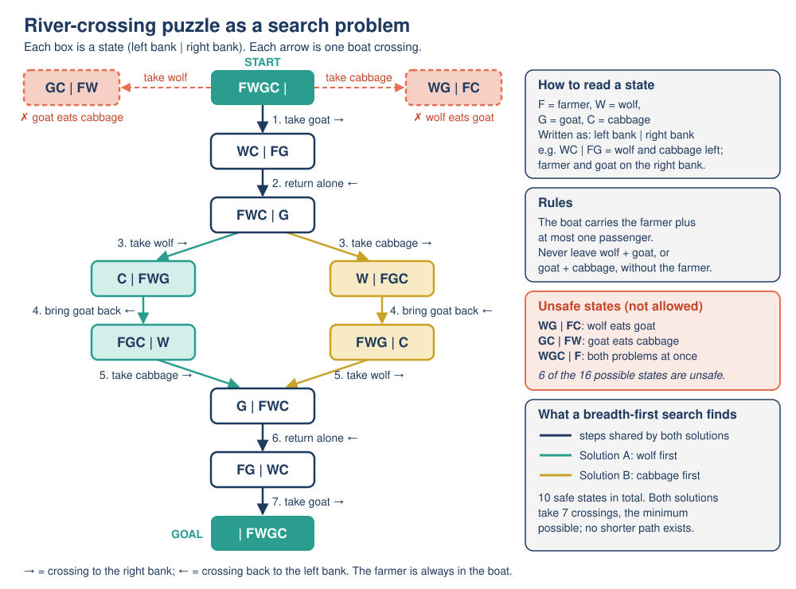

# Mission 02: The River Problem

**Pixel's AI Field Guide: Missions for Curious Humans** · Version 1.0 (2026-11-06)
**Covers:** Topic 02, [How AI operates](../../task-1/topics/02-how-ai-operates.md), part 1: rule-based AI and **search** · **Time:** about 60 minutes (core) + 30 minutes (optional side quest)
**Navigation:** [Start here](00-start-here.md) · Previous: [Mission 01](mission-01-is-it-ai.md) · Next: [Mission 03](mission-03-pixels-rulebook.md) · [Glossary](glossary.md)

**Supplement used:** [activities/river-crossing/](../activities/river-crossing/README.md) (interactive page `river-crossing.html`, works offline) · Optional: [activities/robot-maze/](../activities/robot-maze/README.md)

---

## [MISSION BRIEF] Wolf first?

Dr. Ada Okafor gives Pixel an old puzzle: a farmer must get a wolf, a goat and a cabbage across a river in a tiny boat. "The wolf is the most dangerous," says Pixel, "so it goes first!" Ten seconds later, back on the starting bank, the goat is eating the cabbage. Dr. Okafor smiles: "Don't guess, Pixel. **Search.**"

**The puzzle:** The boat holds the farmer (F) plus **at most one** passenger, and only the farmer can row. If the farmer is not on the same bank, the wolf (W) eats the goat (G), and the goat eats the cabbage (C). Get everyone safely from the left bank to the right bank.

### Learning goals

By the end of this mission you should be able to:

- **Describe** a problem as a search problem: **states**, allowed **actions**, **constraints** (rules) that make some states invalid, a **start state** and a **goal state**.
- **Explain** why tempting moves fail.
- **Trace** breadth-first search (BFS) with a **frontier** and a **visited** set, and explain why it finds a plan with the fewest crossings.
- **Explain** why this is rule-based (symbolic) AI: a person wrote the rules and nothing was learned from data.

---

## [PREDICT] Before you touch anything (3 minutes)

Write down:

1. Which passenger should the farmer take first? Why?
2. What is the **smallest** number of crossings you think a solution needs? (One crossing = one trip of the boat in either direction.)
3. Will the goat ever need to travel **back** to the left bank? Yes / No.

---

## [TRY IT] Activity 2.1: Solve the puzzle

**Goal:** Experience the puzzle as a sequence of **states**, and discover which moves are blocked by the rules.

**Preparation (choose one):**
- **Paper version (no device):** four small cards labeled **F**, **W**, **G**, **C**, and a sheet of paper with a river drawn down the middle. Put all four cards on the left.
- **Interactive version:** download [`river-crossing.html`](../activities/river-crossing/river-crossing.html) and open it in any modern browser (computer or tablet). It needs **no internet, account or installation**, and every button works with the keyboard (Tab, then Enter or Space).

**How we write a state:** `left bank | right bank`. The start is `FWGC | -` and the goal is `- | FWGC`. After taking the goat over, the state is `WC | FG`.

**Task:**

1. **Try Pixel's move first:** take the **wolf** across. Write the state. Is it safe? (On the page: in section **1. Play the puzzle**, click the wolf to put it in the boat, then click **Row the boat**, and read Pixel's message.)
2. Use **Undo last crossing** (or move your card back) and keep trying until everyone is on the right bank. **Start over** is allowed as often as you like.
3. Write every crossing and the state after it in a log like this. (The page's **Move history** panel keeps the same log for you.)

| Crossing | Who crosses | State after (`left \| right`) | Safe? |
|---|---|---|---|
| 1 | farmer + goat | `WC \| FG` | yes |
| 2 | | | |
| ... | | | |

**Observation:** How many crossings did your solution take? Which moves did you try that were rejected, and why?

**Reflection:** Did you solve it by planning ahead or by trial and error? How did you avoid going round in circles?

<details>
<summary>Hint 1 (only if stuck)</summary>
Only one first move is safe. Try each of the four options (alone, wolf, goat, cabbage) and check what is left behind on the left bank.
</details>

<details>
<summary>Hint 2 (only if stuck)</summary>
The trick is that the farmer may bring a passenger <b>back</b>. Which animal is the troublemaker that cannot be left with either of the others?
</details>

**Feedback:**

<details>
<summary>[DEBRIEF] One correct solution and why tempting moves fail</summary>

A 7-crossing solution:

| Crossing | Move | State after |
|---|---|---|
| 1 | Farmer takes the goat to the right | `WC \| FG` |
| 2 | Farmer returns alone | `FWC \| G` |
| 3 | Farmer takes the wolf to the right | `C \| FWG` |
| 4 | Farmer brings the **goat back** to the left | `FGC \| W` |
| 5 | Farmer takes the cabbage to the right | `G \| FWC` |
| 6 | Farmer returns alone | `FG \| WC` |
| 7 | Farmer takes the goat to the right | `- \| FWGC` |

**Why tempting moves fail:**
- **Wolf first (Pixel's move):** leaves `GC | FW`: the goat eats the cabbage.
- **Cabbage first:** leaves `WG | FC`: the wolf eats the goat.
- **Farmer alone first:** leaves all three together.
- So **only the goat can go first**.
- **In the middle:** after the wolf is across (`C | FWG`), rowing back alone would leave the wolf with the goat on the right bank. That is why the goat must come **back**.

If your solution has more than 7 crossings, it still works; it just includes a detour (often a move that undoes the previous one). Mistake to avoid: forgetting that the farmer must be in the boat for every crossing.
</details>

---

## [TRY IT] Activity 2.2: Map the state space

**Goal:** See the *whole* problem at once: every possible state, which ones are allowed, and how crossings connect them.

**Preparation:** Your log from Activity 2.1. Paper, or section **2. The state space** of the interactive page.

**Task:**

1. Each of F, W, G, C can be on the left or the right, so there are 2 × 2 × 2 × 2 = **16** possible placements. Here they are, listed by what is on the **left** bank:

| # | State | # | State |
|---|---|---|---|
| 1 | `FWGC \| -` | 9 | `GC \| FW` |
| 2 | `FWG \| C` | 10 | `WC \| FG` |
| 3 | `FWC \| G` | 11 | `WG \| FC` |
| 4 | `FGC \| W` | 12 | `F \| WGC` |
| 5 | `WGC \| F` | 13 | `W \| FGC` |
| 6 | `FW \| GC` | 14 | `G \| FWC` |
| 7 | `FG \| WC` | 15 | `C \| FWG` |
| 8 | `FC \| WG` | 16 | `- \| FWGC` |

2. **Cross out** every invalid state (where the wolf is with the goat, or the goat is with the cabbage, on a bank **without** the farmer). Count the valid states.
3. Draw each valid state as a box. Draw a line between two boxes if **one crossing** turns one into the other. (On the page, click **Show state space**: valid states have a solid border, invalid ones are red and dashed.)
4. Highlight your path from Activity 2.1.

**Observation:** How many states are valid? Which valid states did your solution visit?

**Reflection:** How does the map explain why the goat has to go back?

**Feedback:**

<details>
<summary>[DEBRIEF] The 10 valid states and the state graph</summary>

**10 states are valid:** `FWGC | -`, `FWG | C`, `FWC | G`, `FGC | W`, `FG | WC`, `WC | FG`, `W | FGC`, `G | FWC`, `C | FWG`, `- | FWGC`.

**6 are invalid** (numbers 5, 6, 8, 9, 11, 12 in the table): `WGC | F`, `GC | FW`, `WG | FC` and their mirror images `F | WGC`, `FW | GC`, `FC | WG`. In each, the farmer has left the wolf with the goat, or the goat with the cabbage.



*Figure: The state space. Safe states are linked by arrows (one arrow = one crossing); examples of unsafe states are shown in coral. From `FWC | G` the path splits into two shortest solutions (wolf first or cabbage first), which meet again at `G | FWC`.* (Original diagram created for this guide.)

The map shows that from `C | FWG` the only safe move forward is to bring the goat back: every other move leads to a red (invalid) state or back to where you were.
</details>

---

## [TRY IT] Activity 2.3: Watch Pixel search

**Goal:** Follow **breadth-first search (BFS)** step by step and see how a computer finds the shortest plan without guessing.

**Preparation:** The interactive page, section **3. Watch Pixel search (breadth-first search)**, or the paper trace below. You need two lists:
- the **frontier**: a queue (a waiting line) of states still to explore. New states join at the **back**; Pixel always takes the state at the **front**.
- the **visited** set: every state Pixel has already seen, so it never explores the same state twice.

**Pixel's rules for each step:**
1. Take the state at the **front** of the frontier. If it is the goal, stop.
2. Try all four actions: farmer **alone**, with the **wolf**, with the **goat**, with the **cabbage**.
3. For each result: **reject** it if the passenger is not on the farmer's bank or the new state is invalid; **skip** it if it is already visited; otherwise mark it **NEW**, add it to the visited set and to the **back** of the frontier.

**Task:**

1. **[PREDICT]** How many crossings will Pixel's plan need? How many states will Pixel take from the frontier before reaching the goal?
2. Fill in steps 1 to 4 yourself. Step 1 is done for you.

| Step | State taken from front | alone | wolf | goat | cabbage | Frontier after | Visited count |
|---|---|---|---|---|---|---|---|
| 1 | `FWGC \| -` | rejected (`WGC \| F` invalid) | rejected (`GC \| FW` invalid) | **NEW** `WC \| FG` | rejected (`WG \| FC` invalid) | `WC \| FG` | 2 |
| 2 | `WC \| FG` | | | | | | |
| 3 | | | | | | | |
| 4 | | | | | | | |

3. On the page, click **Next search step** to check each row (or **Play automatically**). Continue until Pixel reaches the goal. **Reset search** starts again.

**Observation:** At step 3, how many NEW states join the frontier? What does that mean for the number of solutions?

**Reflection:** What would go wrong if Pixel had no visited set? Why does exploring "all 1-crossing states, then all 2-crossing states, ..." guarantee the fewest crossings?

**Feedback:**

<details>
<summary>[DEBRIEF] The full BFS trace (from the tested solver output)</summary>

| Step | State taken | alone | wolf | goat | cabbage | Frontier after | Visited |
|---|---|---|---|---|---|---|---|
| 1 | `FWGC \| -` | rejected | rejected | **NEW** `WC \| FG` | rejected | `WC \| FG` | 2 |
| 2 | `WC \| FG` | **NEW** `FWC \| G` | rejected (wolf not on farmer's bank) | skipped (start, visited) | rejected (not on farmer's bank) | `FWC \| G` | 3 |
| 3 | `FWC \| G` | skipped (visited) | **NEW** `C \| FWG` | rejected (not on farmer's bank) | **NEW** `W \| FGC` | `C \| FWG`, `W \| FGC` | 5 |
| 4 | `C \| FWG` | rejected (`FC \| WG`: wolf eats goat on the right) | skipped | **NEW** `FGC \| W` | rejected | `W \| FGC`, `FGC \| W` | 6 |
| 5 | `W \| FGC` | rejected (`FW \| GC`: goat eats cabbage on the right) | rejected | **NEW** `FWG \| C` | skipped | `FGC \| W`, `FWG \| C` | 7 |
| 6 | `FGC \| W` | rejected (`GC \| FW`) | rejected | skipped | **NEW** `G \| FWC` | `FWG \| C`, `G \| FWC` | 8 |
| 7 | `FWG \| C` | rejected (`WG \| FC`) | skipped (`G \| FWC` already visited) | skipped | rejected | `G \| FWC` | 8 |
| 8 | `G \| FWC` | **NEW** `FG \| WC` | skipped | rejected | skipped | `FG \| WC` | 9 |
| 9 | `FG \| WC` | skipped | rejected | **NEW** `- \| FWGC` | rejected | `- \| FWGC` | 10 |
| 10 | `- \| FWGC` | **GOAL: search stops** | | | | | |

**Result:** Pixel takes **10 states** from the frontier; the 10th is the goal. The plan has **7 crossings** (the same as the solution in Activity 2.1). In this small puzzle, BFS happens to find every valid state before it reaches the goal.

**Step 3** is where the search **branches**: both the wolf and the cabbage can go next. That is why there are exactly **2** shortest plans.

**Reflection key points:** without the visited set, Pixel would row back and forth forever (goat over, goat back, goat over...). BFS explores in "rings": all states 1 crossing away, then all 2 crossings away, and so on, so the first time it reaches the goal it has used the fewest crossings.

**Common mistake:** adding a state to the frontier twice. In step 7, `G | FWC` is reachable again but is *skipped*, because it was already visited in step 6.

The complete printed trace is in [`solver-output.txt`](../activities/river-crossing/solver-output.txt).
</details>

---

## [OBSERVE] What did the computer actually do?

Answer from your experience in Activities 2.1 to 2.3:

1. Who decided what the states, actions and rules were: Pixel or a person?
2. Did Pixel get better at the puzzle by practicing? Did it use any data or examples?
3. Pixel never "guessed". What did it do instead?

---

## [EXPLAIN] Search: the rule-based way to solve problems

### Two ways to build AI

Every AI system has **data** (information it processes), **algorithms** (precise step-by-step procedures) and a **model** (the part that turns an input into an output). There are two broad ways to build the model:

1. **Rule-based (symbolic) AI:** people write the knowledge down as explicit rules and symbols, and the computer reasons or **searches** with them. This dominated AI research from the 1950s to the 1980s and is still used.
2. **Learning-based AI (machine learning):** a learning algorithm finds patterns in example data. That is Mission 04.

This mission is about the first kind; Mission 03 shows the other main rule-based technique (expert systems).

### What a search problem needs

| Part | Meaning | River puzzle |
|---|---|---|
| **State** | A snapshot of the situation | who is on which bank, e.g. `WC \| FG` |
| **Start state** | The situation now | `FWGC \| -` |
| **Actions** | What changes one state into another | farmer crosses alone, or with W, G or C |
| **Constraints (rules)** | Which states are allowed | never leave W with G, or G with C, without F |
| **Goal state** | What "solved" looks like | `- \| FWGC` |

The computer then explores states **systematically**. **Breadth-first search** checks every state reachable in 1 move, then every state reachable in 2 moves, and so on. It keeps a **frontier** (states waiting to be explored, first in, first out) and a **visited** set (states already seen). Because it works outward in rings, the first solution it finds uses the **fewest moves**.

> **Playful analogy:** BFS is like a drop of ink spreading on paper: it reaches everything 1 step away, then 2 steps away, and so on. The first time the ink touches the goal, you know there is no shorter route.
>
> **Technically speaking:** BFS stores the frontier as a first-in-first-out queue. Every action costs the same here (one crossing), so the order in which states leave the queue matches their distance from the start, and the first goal found is a shortest plan.

### Why this is AI, and why it is "rule-based"

A planning program that works out a safe plan for a situation it was never told the answer to is doing a task we would say needs intelligence. But notice: **the computer learned nothing**. A person described the states, actions and rules; the algorithm simply searched. That is **rule-based (symbolic) AI**. The same idea powers route-finding in map apps (Mission 01, card 9), puzzle solvers, scheduling and game-playing programs. One of the very first AI programs, the Logic Theorist (1956), proved theorems by searching through chains of logical steps (Mission 08).

### Where search runs out of road

This puzzle has only 16 placements and 10 valid states. A game like chess has more possible positions than anyone could ever list, so BFS would run out of time and memory. Real systems use **heuristics** (informed guesses about which states look promising, as in A* search), or combine search with learning. DeepMind's AlphaGo, which beat a top professional Go player in 2016, "combines deep neural networks with advanced search algorithms". So "old" rule-based AI and "new" learning-based AI are not rivals: many systems use both.

For more depth, including a second version of the trace, read [Topic 02, section 2](../../task-1/topics/02-how-ai-operates.md).

---

## [LAB NOTE] What the puzzle leaves out

- The river puzzle is a **toy model**: perfect information, instant crossings, animals that always behave the same way, one goal, and every crossing costs the same.
- Real planning problems (delivery routes, robot motion, games) have astronomically many states, uncertainty (the boat might leak) and different costs (some routes are longer). They need smarter search or other methods.
- Pixel is a fictional character. The search on the interactive page is a real BFS algorithm; the robot's personality is just for fun.

---

## [WATCH] No video this time

No curated video fits this mission well, so the interactive page is your demonstration. If you would like to see the next big idea coming, the video in Mission 04 contrasts rules with learning from data.

---

## [APPLY] Find the error in a plan

A classmate proposes this plan:

1. Farmer takes the goat across.
2. Farmer returns alone.
3. Farmer takes the cabbage across.
4. Farmer returns alone.
5. Farmer takes the wolf across.
6. Farmer returns alone.
7. Farmer takes the goat across.

a) Trace the plan, writing the state `left | right` after each step. At which step does it first fail, and why?
b) Correct the plan with the smallest possible change.
c) Is your corrected plan the same as the solution in Activity 2.1, or the *other* shortest solution?

<details>
<summary>[DEBRIEF] Apply: expected answers</summary>

a)

| After step | State | Safe? |
|---|---|---|
| 1 | `WC \| FG` | yes |
| 2 | `FWC \| G` | yes |
| 3 | `W \| FGC` | yes (the farmer is with the goat and cabbage) |
| 4 | `FW \| GC` | **no: the goat eats the cabbage** |

It first fails at **step 4**: the farmer leaves the goat and the cabbage alone on the right bank.

b) Change step 4 to "Farmer **brings the goat back**". Then: 4 `FWG | C`; 5 take the wolf: `G | FWC`; 6 return alone: `FG | WC`; 7 take the goat: `- | FWGC`. Solved in 7 crossings.

c) It is the **other** shortest solution: cabbage at crossing 3, wolf at crossing 5 (the BFS branch through `W | FGC`). Together with the Activity 2.1 plan, these are the only two 7-crossing plans.

**Common mistake:** spotting that "something goes wrong" but not naming the rule that is broken. Always say *which* bank and *which* pair.
</details>

---

## [OPTIONAL SIDE QUEST] Pixel in the Maze: fixed rule vs search vs learning

**Goal:** Compare three very different strategies on the same problem: a **fixed rule**, **search** (BFS again), and **reinforcement learning** (learning from rewards). You will meet reinforcement learning properly in Mission 04; this is a sneak preview.

**Preparation:** Open [`robot-maze.html`](../activities/robot-maze/robot-maze.html) in a browser (a single file; it loads nothing from the web; all buttons work with the keyboard). Its [README](../activities/robot-maze/README.md) has full instructions and a paper version. Or use the paper version with the two mazes below (`#` = wall, `.` = open square, `S` = start, `G` = charging station). Pixel moves one square north, east, south or west and cannot walk through walls. About 30 minutes.

```
Maze 1: corridors and dead ends      Maze 2: goal on an island
#########                            #########
#S..#...#                            #S......#
###.#.#.#                            #.#####.#
#.....#.#                            #.#...#.#
#.#####.#                            #.#.G.#.#
#.#...#.#                            #.#...#.#
#.#.#.#.#                            #.##.##.#
#.#.#..G#                            #.......#
#########                            #########
```

**The three strategies (as described on the page):**
- **A. Fixed rule (right-hand wall follower):** "If I can turn right, turn right. Otherwise go straight. Otherwise turn left. Otherwise turn back." No map, no memory, no learning.
- **B. Search (BFS):** Pixel is given the whole map and explores outward from S, one step further each round, until it reaches G.
- **C. Reinforcement learning (tabular Q-learning):** Pixel has **no map**. In each *episode* (attempt) it moves from S until it reaches G and gets a **reward** after every move: **-1** per move, **-5** for bumping into a wall, **+10** for reaching G. It keeps a table of scores for every square and move and updates it after each move.

**Task:**

1. **[PREDICT]** For each maze: will the wall follower reach G? Will its route be the shortest? How many moves is the shortest route?
2. On the page, choose **Maze 1** and press **Run the wall follower**, then **Run BFS**. Then press **Train 1 episode** a few times, then **Train 10 episodes**, and **Show Pixel's best route so far**. Try **Show learned arrows**.
3. Repeat for **Maze 2**.
4. *(Paper version)* Trace the wall follower with a finger. For BFS, write 0 in S, 1 in every open square next to it, 2 in every open square next to a 1, and so on, until you reach G.

**Observation:** Fill in the page's comparison table (or this one) for each maze: Did each strategy reach G? How many moves did its route take? How much "effort" did it need first (squares explored, or episodes of training)?

**Reflection:** Why does the wall follower get stuck in Maze 2? Why can BFS guarantee the shortest route? How does Pixel's Q-learning route get shorter even though nobody shows it the map?

<details>
<summary>[DEBRIEF] Side quest: expected results (from the page's tested results)</summary>

| | Maze 1 | Maze 2 |
|---|---|---|
| **A. Wall follower** | Reaches G after **28 moves**: it walks into the long dead-end corridor on the left and back. The shortest route is 16. | **Never reaches G.** G sits inside an "island" whose walls do not touch the outer wall, so Pixel keeps its right hand on the outer wall and goes round and round. The page stops it after **25 moves**. |
| **B. BFS** | Explores **23 squares** and finds the **16-move** route. | Explores **27 squares** and finds the **12-move** route. |
| **C. Q-learning** | Early episodes are long and look random (117 moves in episode 1). After 10 episodes there is still no complete best route. From about episode 20 onward, the best route is the shortest one, **16 moves**. | Learns a **12-move** route too (from about episode 22 onward), because it does not follow walls: it learns which move pays off in each square. |

The page always uses the same random seed, so pressing **Forget everything (reset)** replays exactly the same experiment.

**Key idea:**
- The **fixed rule** is cheap and needs no map, but it only works in some mazes. It is not search and not learning.
- **Search** needs the full map (like the river puzzle's rules) and guarantees the shortest route. It is rule-based AI.
- **Reinforcement learning** needs no map but many trial runs, and what it learns fits only this maze: move G and Pixel must learn again. It is learning-based AI.

**[LAB NOTE]** This is a toy world: a tiny grid, perfect sensors, moves that always work, and the same maze in every episode. Real robots face noisy sensors and slipping wheels, and real reinforcement-learning systems use far more trials and often neural networks instead of a table. The reward numbers (-1, -5, +10) were chosen by a human; different rewards can lead to different behavior.
</details>

---

## [CHECK] Quick self-check

1. Name the five parts you need to describe a search problem.
2. Why is `GC | FW` an invalid state?
3. True or false: "Breadth-first search learned how to solve the river puzzle from many examples."
4. What is the job of the **visited** set in BFS?
5. Why can't a computer simply use BFS to play perfect chess?

---

## [DEBRIEF] Check answers

<details>
<summary>Show answers with explanations</summary>

1. **States**, **start state**, **actions**, **constraints/rules** (which states are allowed), **goal state**.
2. The farmer, and only the wolf, are on the right bank, leaving the **goat with the cabbage** on the left bank without the farmer, so the goat eats the cabbage.
3. **False.** BFS learned nothing and used no examples. A person wrote the states, actions and rules; BFS explored them systematically. This is rule-based (symbolic) AI.
4. It records states already seen, so the search never explores the same state twice and cannot go round in circles.
5. Chess has far too many possible positions to list and explore one by one; BFS would run out of time and memory. Real game programs use heuristics and/or learning (AlphaGo combined deep neural networks with search).

**Now look back at your [PREDICT] answers.** Did you predict the goat first, 7 crossings, and a return trip for the goat?
</details>

---

## Mission summary

- Many problems can be solved by **search**: describe the **states**, **start**, **actions**, **constraints** and **goal**, then explore systematically.
- In the river puzzle, only 10 of the 16 placements are valid; the goat must go first and must come back once; the shortest plans take **7 crossings**, and there are exactly **2** of them.
- **Breadth-first search** uses a **frontier** (queue) and a **visited** set and explores in rings, so the first plan it finds has the fewest moves.
- This is **rule-based (symbolic) AI**: a person wrote the rules and the computer learned nothing from data.
- Plain search breaks down on huge problems (like chess), so real systems add heuristics or learning, and many combine rules and learning (AlphaGo).

## Next mission

Search is one rule-based technique. In [Mission 03: Pixel's Rulebook](mission-03-pixels-rulebook.md), you will write **facts and rules** in Prolog and watch Pixel reason with them, just as the expert systems of the 1970s and 1980s did.
