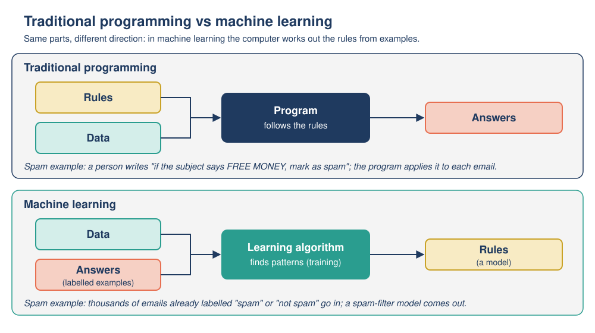

# Mission 04: Learning from Examples

**Pixel's AI Field Guide: Missions for Curious Humans** · Version 1.0 (2026-11-06)
**Covers:** Topic 02, [How AI operates](../../task-1/topics/02-how-ai-operates.md) (machine learning, training vs inference) and Topic 03, [ML, neural networks and deep learning](../../task-1/topics/03-ml-neural-networks-deep-learning.md) (kinds of learning, features and labels, train/test split, overfitting) · **Time:** about 80 minutes (core) + 30 minutes (optional side quest)
**Navigation:** [Start here](00-start-here.md) · Previous: [Mission 03](mission-03-pixels-rulebook.md) · Next: [Mission 05](mission-05-inside-the-neuron.md) · [Glossary](glossary.md)

**Supplement used:** [activities/spam-filter/](../activities/spam-filter/README.md) (Python script and notebook; all results printed below) · **Platform:** Google Teachable Machine (optional, needs a webcam or image files)

---

## [MISSION BRIEF] FR3E M0NEY!!!

Dr. Ada Okafor's inbox is drowning in junk, and her hand-written spam rules can't keep up: the moment she adds "IF subject contains FREE MONEY", the spammers switch to "FR3E M0NEY". So this time nobody writes rules for Pixel: Pixel must **learn** what spam looks like from labeled examples. After its first lesson, Pixel proudly announces that the most dangerous spam word in the world is ... "a".

### Learning goals

By the end of this mission you should be able to:

- **Distinguish** rule-based AI from machine learning (rules written by people vs a model learned from labeled data).
- **Trace** how a simple spam filter is **trained** (counting patterns, setting weights) and then used for **inference** on new emails.
- **Identify** features and labels, and **explain** why a model is tested on data kept aside from training.
- **Explain** false positives, false negatives and **overfitting**, and **recognize** them in results.
- **Distinguish** supervised, unsupervised and reinforcement learning.

---

## [PREDICT] Before you start (3 minutes)

1. You have 10,000 emails that people have already labeled "spam" or "not spam". Without writing any rules yourself, how could a computer use them to decide about a **new** email?
2. A model scores **100%** on the emails it was trained on. Does that prove it is a good spam filter? Yes / No / It depends. Why?

---

## [TRY IT] Activity 4.1: Be the spam filter (training and inference by hand)

**Goal:** Do the job of a learning algorithm yourself: turn counts from labeled data into weights, then use the finished model on new emails.

**Preparation:** Pen, paper, and a calculator if you like. About 20 minutes. All numbers here are **illustrative (made-up) figures** for teaching; they are not from any real email service.

**The data:** 12,000 emails already labeled by people. **2,000** are put aside as a **test set** (800 spam, 1,200 not spam) and the other **10,000** are the **training data** (4,000 spam, 6,000 not spam). Each email is turned into yes/no **features**: does it contain "free"? "urgent"? "meeting"? "invoice"? Does it have 3 or more links?

**Task, Part A: Train the model.** The learning algorithm has counted how often each feature appears:

| Feature | Spam emails with it (of 4,000) | Not-spam emails with it (of 6,000) | % of spam | % of not-spam | How many times more common, and where? | Weight |
|---|---|---|---|---|---|---|
| contains "free" | 2,400 | 300 | 60% | 5% | 12 times more common in spam | ? |
| contains "urgent" | 1,600 | 120 | ? | ? | ? | ? |
| contains "meeting" | 80 | 1,800 | ? | ? | ? | ? |
| contains "invoice" | 400 | 480 | ? | ? | ? | ? |
| 3 or more links | 2,000 | 1,200 | ? | ? | ? | ? |

Fill in the gaps, then turn each pattern into a **weight** using this recipe:

- at least 5 times more common in spam: **+2**
- 2 to 5 times more common in spam: **+1**
- less than 2 times more common either way: **0**
- 2 to 5 times more common in not-spam: **-1**
- at least 5 times more common in not-spam: **-2**

The designers choose a **threshold**: a total score of **2 or more** means "spam".

**Task, Part B: Inference.** Use your weights. For each new email, add up the weights of the features present (a word counts if it appears anywhere, in any capitals) and compare with the threshold.

| Email | Text | Links | Really... |
|---|---|---|---|
| E1 | "Urgent: meeting room changed to B12" | 0 | genuine |
| E2 | "Your invoice is attached. FREE delivery on your next order!" (from a shop you really used) | 3 | genuine |
| E3 | "Claim your prize now!!!" | 5 | a real scam |
| E4 | "FREE gift - URGENT, offer ends today" | 1 | spam |

**Task, Part C: Test.** On the 2,000 test emails it never saw, the model catches **720 of the 800** spam emails and wrongly sends **60 of the 1,200** genuine emails to spam. Work out its accuracy.

**Task, Part D: [PREDICT]** If the threshold were lowered from 2 to 1, which of E1 to E4 would change? What is the trade-off?

**Observation:** Record your weights, the four scores and outputs, and the accuracy. Which of E1 to E4 did the model get wrong?

**Reflection:** Did any person write the rule "emails about meetings are usually genuine"? Where did that knowledge come from?

**Feedback:**

<details>
<summary>[DEBRIEF] Activity 4.1: expected answers</summary>

**Part A (training):**

| Feature | % spam | % not-spam | Pattern | Weight |
|---|---|---|---|---|
| "free" | 60% | 5% | 12 times more common in spam | **+2** |
| "urgent" | 40% | 2% | 20 times more common in spam | **+2** |
| "meeting" | 2% | 30% | 15 times more common in not-spam | **-2** |
| "invoice" | 10% | 8% | about the same (1.25 times) | **0** |
| 3+ links | 50% | 20% | 2.5 times more common in spam | **+1** |

Common mistake: comparing raw counts (2,400 vs 300) instead of percentages. There are more not-spam emails (6,000) than spam (4,000), so raw counts are misleading.

**Part B (inference):**

| Email | Calculation | Score | Output | Correct? |
|---|---|---|---|---|
| E1 | urgent +2, meeting -2 | 0 | not spam | yes |
| E2 | free +2, invoice 0, 3+ links +1 | 3 | spam | **no: a false positive** (a genuine email sent to spam) |
| E3 | no listed words; 3+ links +1 | 1 | not spam | **no: a false negative** (a scam reaches the inbox, because "prize" is not one of the model's features) |
| E4 | free +2, urgent +2; only 1 link | 4 | spam | yes |

**Part C (test):** correct answers = 720 spam caught + 1,140 genuine emails left in the inbox = 1,860 of 2,000 = **93% accuracy**. It made 140 mistakes: 80 **false negatives** (spam that got through) and 60 **false positives** (genuine emails binned).

**Part D:** with threshold 1, E3 (score 1) becomes "spam", which fixes that false negative; E1, E2 and E4 do not change. The trade-off: a lower threshold catches more spam but also bins more genuine emails (any genuine email with 3 or more links and nothing else would now be blocked). More false positives, fewer false negatives. A higher threshold does the opposite.

**Reflection:** no person wrote the "meeting" rule: the **-2 weight came out of the data**. The weights and the threshold are the model's **parameters**. To fix E3 the machine-learning way, you would collect more labeled scams like it (for example from "Report spam" clicks), add a feature such as "contains *prize*", and **retrain**, rather than writing "IF prize THEN spam" by hand.
</details>

---

## [TRY IT] Activity 4.2: Pixel's tiny spam filter (12 emails)

**Goal:** See learning go wrong in an instructive way: a model trained on very little data **overgeneralizes**, and only a test on unseen emails reveals it.

**Preparation:** Paper. No computer needed for the core activity. (Running the real code is the optional side quest below.) All emails are **made-up examples**; all scores are **illustrative (made-up) figures** from a toy model.

**Pixel's training data (12 labeled emails):**

| # | Email | Label |
|---|---|---|
| 1 | WIN a FREE prize now! Click here | spam |
| 2 | Cheap pills, buy now, limited offer | spam |
| 3 | You are a winner! Claim your cash prize today | spam |
| 4 | Free money!!! Click the link to claim | spam |
| 5 | Limited time offer: win a free phone | spam |
| 6 | Urgent: your account wins cash, click now | spam |
| 7 | Lab meeting moved to Tuesday at 10 | not spam |
| 8 | Can you send me the robot battery report? | not spam |
| 9 | Lunch today? The cafe has soup | not spam |
| 10 | Dr. Okafor shared the meeting notes | not spam |
| 11 | Reminder: return the library book on Friday | not spam |
| 12 | Thanks for fixing the robot wheel today | not spam |

**How Pixel learns (a simplified "naive Bayes" idea):** for every word, Pixel counts how many spam emails and how many not-spam emails contain it, and turns the counts into a **word score**. With 6 spam and 6 not-spam emails, the score works out to:

> word score = (spam emails containing the word + 1) ÷ (not-spam emails containing the word + 1)

A score above 1 is **spammy**, below 1 is **safe**, and a word Pixel has never seen scores exactly 1 (no evidence). To judge a new email, Pixel **multiplies** the scores of its words (each word counted once). Final score **above 1 = spam**, otherwise not spam.

**Task:**

1. **[PREDICT]** Write down three words you expect to be "spammy" and three you expect to be "safe".
2. Work out these word scores yourself: **free**, **meeting**, **a**, **the**. (Hint: "a" appears in emails 1, 3 and 5.)
3. **[PREDICT]** Cover the results below and guess Pixel's answer (spam / not spam) for each of these 8 test emails it has never seen:

| Test email | True label |
|---|---|
| Claim your free prize now | spam |
| Click here for cheap cash | spam |
| Buy a cheap phone now, limited offer | spam |
| Congratulations, you have been selected | spam |
| Meeting notes for the robot lab | not spam |
| Please send the battery report by Friday | not spam |
| Are you free for lunch today? | not spam |
| You won a prize in the lab quiz | not spam |

4. Calculate by hand the final score of "Are you free for lunch today?" using these word scores: are 2, you 1, free 4, for 0.5, lunch 0.5, today 2/3 (about 0.67).

**Observation:** Compare your predictions with the results in the feedback. For each WRONG answer, find the words that pushed it the wrong way.

**Reflection:** Nobody told Pixel "the word *free* means spam". Where did this "rule" come from? Why is accuracy on the 8 **unseen** emails a more honest measure than accuracy on the 12 training emails?

**Feedback:**

<details>
<summary>[DEBRIEF] Activity 4.2: what Pixel learned and how it did (output of the tested script)</summary>

**Your hand calculations:** free = (3 + 1) ÷ (0 + 1) = **4**; meeting = (0 + 1) ÷ (2 + 1) = **0.33**; a = (3 + 1) ÷ (0 + 1) = **4**; the = (1 + 1) ÷ (5 + 1) = **0.33**.

**What Pixel learned (top 6 each way; score | in spam | in not-spam):**
```
Most SPAMMY words: a 4.00 | 3 | 0, click 4.00, free 4.00, now 4.00, cash 3.00, claim 3.00
Most SAFE words:   meeting 0.33 | 0 | 2, robot 0.33, the 0.33 | 1 | 5, at 0.50, battery 0.50, book 0.50
```
The surprise is **"a"**. By coincidence it appears in three spam emails and in no normal email, so Pixel treats an ordinary word as evidence of spam. This is **overgeneralizing from a small dataset**: Pixel's "most dangerous spam word in the world".

**Test results: 5 of 8 correct (62.5%).**

| Test email | True label | Pixel (score) | Why |
|---|---|---|---|
| Claim your free prize now | spam | spam (432.000) | many spammy words |
| Click here for cheap cash | spam | spam (24.000) | |
| Buy a cheap phone now, limited offer | spam | spam (1152.000) | |
| Congratulations, you have been selected | spam | **not spam (1.000), WRONG** | almost every word is new to Pixel (score 1): no evidence, so Pixel defaults to "not spam" |
| Meeting notes for the robot lab | not spam | not spam (0.005) | many safe words |
| Please send the battery report by Friday | not spam | not spam (0.021) | |
| Are you free for lunch today? | not spam | **spam (1.333), WRONG** | Pixel only ever saw "free" in spam; it cannot tell "free for lunch" from "free money" |
| You won a prize in the lab quiz | not spam | **spam (2.000), WRONG** | "prize" and "a" look spammy; to Pixel, "won" and "win" are unrelated strings of letters |

**Step 4:** 2 × 1 × 4 × 0.5 × 0.5 × 2/3 = **about 1.33** (1.34 if you used 0.67), above 1, so **spam** (wrong).

**Reflection key points:** the "rules" (word scores) came from **counting labeled examples** (learning-based AI), not from a human expert (rule-based AI, Mission 03). On its 12 training emails Pixel looks fine, but the unseen test emails reveal that it has learned accidental patterns ("a") and has no idea what words mean. Word scores ignore word order, meaning, context and word families ("won"/"win").

**Compare with Activity 4.1:** there, weights were *added* and compared with a threshold; here, scores are *multiplied* and compared with 1. Different recipes, same idea: **the numbers inside the model come from patterns counted in labeled data.**
</details>

### [OPTIONAL SIDE QUEST] Run Pixel's spam filter yourself

**Goal:** Change the training data and watch the model change.

**Preparation (choose one):**

| Option | Needs | Online? |
|---|---|---|
| A. Google Colab | A browser and a **Google account** (free; school accounts may have Colab switched off). Download [`tiny_spam_filter.ipynb`](../activities/spam-filter/tiny_spam_filter.ipynb), go to <https://colab.research.google.com/>, sign in, choose **File -> Upload notebook**. Your copy lives in your own Google Drive. Run cells with **Shift+Enter** or **Runtime -> Run all**. | Online |
| B. Jupyter on your computer | Jupyter already installed; open the same `.ipynb` file. | Offline |
| C. Plain Python | Python 3.8 or newer; run `python3 tiny_spam_filter.py` in the [spam-filter folder](../activities/spam-filter/). Edit only the **EXPERIMENT ZONE** near the top. | Offline |
| D. No computer | Use the results printed in this guide and in [`expected-output.txt`](../activities/spam-filter/expected-output.txt). | Offline |

**Task:**
- **Experiment A (better data):** add these two lines inside `TRAINING_DATA`, just before the closing `]`, then **[PREDICT]** the new accuracy and run again:
  ```python
      ("Congratulations! You have been selected to win cash", "spam"),
      ("Are you free for a chat on Friday?", "not spam"),
  ```
- **Experiment B (fool Pixel):** set `MY_MESSAGE` to a message you think Pixel will get wrong, and read the word-by-word scores.
- **Experiment C (a labeling mistake):** undo Experiment A, change one training email's label from `"not spam"` to `"spam"`, and see which word scores change.

<details>
<summary>[DEBRIEF] Side quest: expected results</summary>

- **Default `MY_MESSAGE`** ("Free lunch in the lab today, click here to sign up"): final score 1.778, so SPAM. "free" and "click" (4.00 each) outweigh "lab", "lunch", "the" and "today". Is it really spam? Even humans might disagree: a labeling problem too.
- **Experiment A:** accuracy rises to **8 of 8 (100.0%)**. But "You won a prize in the lab quiz" now scores **exactly 1.000**: a tie that only counts as correct because ties go to "not spam". And because we picked the new emails **after seeing the test mistakes**, the test set is no longer truly "unseen", so the 100% is less trustworthy. Real projects keep an untouched test set for exactly this reason.
- **Experiment B:** a message made only of words Pixel has never seen always scores 1.000 (not spam). Surrounding one spammy word with several safe words ("meeting", "robot", "the") usually gets it classed as not spam.
- **Experiment C:** every word in the relabeled email moves toward "spammy", because Pixel trusts its labels completely. Bad labels lead to bad learning ("garbage in, garbage out").
</details>

---

## [TRY IT] Activity 4.3: Teach Pixel to read thumbs (Teachable Machine)

**Goal:** Train a real image classifier in your browser, test it on examples it has never seen, find its mistakes, and improve it by improving the **training data**.

**Preparation:**
- **Platform:** Google Teachable Machine, <https://teachablemachine.withgoogle.com/> (version 2.4.18 observed on 2026-11-06). **No account or login needed.** According to its FAQ, your images **stay in your browser tab** and are not sent to any server, and nothing is saved when you close the tab. **Do not** click "Upload my model" or "Save to Drive" for this activity (uploading publishes the model to Google's servers).
- **Device:** a laptop or desktop with Chrome or Firefox is recommended; phones and tablets were not tested. A **webcam** (you will be asked for camera permission), or 15 to 20 photos per class on your computer (.png or .jpg).
- **Time:** about 25 minutes. Keep the tab open while it trains.
- **Can't use it?** Use the fallback results table in the feedback.

**Task:**

1. Open Teachable Machine and click **Get Started** → **Image Project** → **Standard image model**.
2. Rename "Class 1" to `thumbs up` and "Class 2" to `thumbs down` (pencil icon). Click **Add a class** and name it `nothing`.
3. **Part A (train).** For each class click **Webcam**, allow camera access, then press and hold **Hold to Record** for about 3 to 4 seconds (about 40 to 60 samples per class). For `nothing`, record the empty background. Keep the same room and lighting. *(No webcam: click **Upload** and drag in 15 to 20 photos per class.)*
4. Click **Train Model**. **Don't switch tabs** until it finishes.
5. In the **Preview** panel (with **Input** ON), show each gesture 5 times and record the **Output** percentages in a table.
6. **Part B (find the mistakes).** Without retraining, **[PREDICT]** and then test conditions the model never saw: a different background; your other hand; a sideways thumb; a classmate's hand (with their permission); an object such as a pen; dim light. Record which ones fail.
7. **Part D (fix it).** Add more **varied** examples (more backgrounds, hands and lighting) to the weakest class and retrain. Did the Part B failures improve?
8. *(Optional)* Open **Advanced** → **Under the hood** → **Calculate accuracy per class**. (Teachable Machine holds back 15% of your samples as test samples and trains on the other 85%.)

*(Part C of this experiment, what happens when one class has far fewer examples, is saved for Mission 10, where it becomes a case about bias.)*

**Observation:** Your results table: test condition | training-like? | % for each class | correct?

**Reflection:**
- Q1. Which test in Part B fooled the model most? What was different from the training data?
- Q2. When you showed something that was none of the three (a pen), what did the model output? Why can't it say "I don't know"?
- Q3. Did adding varied examples in Part D help? What does that tell you about where the model's "knowledge" comes from?
- Q4. Where did your webcam images go?

**Feedback:**

<details>
<summary>[DEBRIEF] Activity 4.3: typical results and explanations</summary>

**Typical observations** (results vary with camera, lighting and person; these are typical, not guaranteed):
- High confidence (often near 100%) on gestures made the same way as in training.
- Confidence drops, or answers are wrong, when the background, lighting, hand or angle changes.
- An object that fits no class is still forced into one of the three classes, sometimes with high confidence.
- The model may "cheat" by using the background or your face rather than the thumb.
- Adding varied examples usually improves robustness.

**Fallback results table** (illustrative (made-up) figures, for learners who cannot run the platform):

| Test | Training-like? | thumbs up | thumbs down | nothing |
|---|---|---|---|---|
| my thumb up, same room | yes | 98% | 1% | 1% |
| my thumb up, kitchen | no (background) | 41% | 12% | 47% |
| friend's thumb down | no (hand) | 55% | 40% | 5% |
| a pen | no (new object) | 70% | 20% | 10% |

Expected analysis: errors appear **exactly where the test differs from the training data** (new background, new hand), and the pen is forced into a class (here "thumbs up" at 70%).

**Answers:**
- **Q1.** Usually the change of background or lighting: the model learned from one room and one light, so it may have learned the background as part of the "pattern".
- **Q2.** It splits 100% among the classes you defined. It has no "none of these" option unless you create one, so it must pick something. Confidence is not the same as being right.
- **Q3.** Yes, usually. The model only knows what its training examples show; more varied examples teach it which differences don't matter. Better data, not cleverer code, fixed it.
- **Q4.** They stayed in your browser tab; according to the Teachable Machine FAQ, nothing is sent to a server unless you save to Drive or upload the model.

**Common mistake:** concluding "the AI is stupid" or "the AI is brilliant" from a few tries. A handful of informal tests on one camera is a demo, not a proper test set.
</details>

---

## [OBSERVE] Three activities, one pattern

Look back at Activities 4.1 to 4.3. Write one or two sentences for each question:

1. In all three, who supplied the **answers** (labels), and who worked out the **rules** (weights, scores)?
2. In all three, when did the model make mistakes: on examples like its training data, or on examples unlike it?
3. What fixed the mistakes: rewriting the program, or changing the data?

---

## [EXPLAIN] How machines learn from examples

### Rules versus learning



*Figure: Traditional programming versus machine learning.* (Original diagram created for this guide.)

- **Traditional programming (and rule-based AI):** a person writes the **rules**; the computer applies them to **data** to produce **answers**. (Missions 02 and 03.)
- **Machine learning (ML):** we give the computer **data together with the answers** (labeled examples); a **learning algorithm** works out the rules itself, in the form of a **model** whose **parameters (weights)** capture the patterns. The model then produces answers for new data.

Gmail made exactly this shift: after about a decade of rule-based filtering, Google began in 2014 to use machine learning to generate its spam-filtering rules, and today Gmail's filters use "machine learning powered by user feedback".

### Training, inference and the test set


*Figure: The machine learning pipeline. Training happens before use (and now and then afterwards); inference happens every time someone uses the model.* (Original diagram created for this guide.)

1. **Training:** the learning algorithm processes the **training data**. Each example has **features** (the values the model uses, such as "contains *free*") and a **label** (the correct answer, such as "spam"). The algorithm sets the model's parameters so its outputs match the labels as well as possible.
2. **Testing:** before use, the model is checked on a **test set**: labeled examples **kept aside** and never used in training.
3. **Inference (prediction):** the finished model receives a new input and produces an output. Using a model does **not** normally change it; improvements come from **retraining** with new data (such as "Report spam" clicks).

### Two kinds of mistake

- **False positive:** a wrong "yes" (a genuine email sent to spam).
- **False negative:** a wrong "no" (spam that reaches the inbox).

A **threshold** trades one for the other: lower it and you get more false positives and fewer false negatives. **High accuracy is not the whole story:** the 93% filter still made 140 mistakes in 2,000 emails, and binning a job offer may be much worse than letting one spam through.

### Generalization and overfitting

The goal is **generalization**: working well on **new** data, not just the training examples. **Overfitting** is when a model fits its training data so closely (even memorizing it) that it does badly on new data. The tell-tale sign is a big gap: **excellent on the training set, much worse on the test set.** **Underfitting** is the opposite: a model too simple to capture the real pattern, so it does poorly even on its training data.

> **Playful analogy:** an overfit model is like a student who memorizes the answers to last year's exam. Perfect on last year's paper, lost on this year's. The test set is this year's exam.
>
> **Technically speaking:** a flexible model can match its training examples (including their noise and coincidences, like Pixel's "a") instead of the general pattern. Evaluating on held-out data estimates how well it will do on new inputs. More, and more varied, data and simpler models reduce overfitting.

### Three ways to learn

| | Supervised | Unsupervised | Reinforcement |
|---|---|---|---|
| Training data | Examples **with** labels | Examples **without** labels | No fixed dataset; experience from acting |
| Feedback | The correct answer for each example | None; it finds structure itself | Rewards or penalties, often delayed |
| Typical tasks | **Classification** (a category, e.g. spam / not spam) and **regression** (a number, e.g. a house price) | **Clustering** (grouping similar items), finding unusual items | Games, robot control, step-by-step decisions |
| In this guide | Activities 4.1 to 4.3 | Grouping customers by buying habits | Pixel in the Maze (Mission 02 side quest): the Q-learning robot learned from **-1 / -5 / +10** rewards with no map |

"Unsupervised" does not mean "no humans": people still choose the data and interpret the groups. Reinforcement learning returns in Mission 06, where human feedback (RLHF) helps train chatbots.

For more depth, read [Topic 02, sections 3 and 4](../../task-1/topics/02-how-ai-operates.md) and [Topic 03, sections 2 to 4](../../task-1/topics/03-ml-neural-networks-deep-learning.md).

---

## [WATCH] AI: What is Machine Learning? (Code.org)

| | |
|---|---|
| **What** | *AI: What is Machine Learning?*, Code.org "How AI Works" series (YouTube channel "CodeAI"), 2019, 2:56. Link: <https://www.youtube.com/watch?v=OeU5m6vRyCk> |
| **Why** | Very short and beginner-pitched; it sets up this mission's key contrast: instead of writing rules, the computer finds patterns in data. |
| **Which part** | The whole video (2:56). Chapters: 0:43 "Understanding machine learning", 1:11 "How computers learn", 1:43 "Data and pattern recognition". |
| **What to do** | *While watching:* "What does a machine-learning system need lots of, and what does it look for in it?" *After:* explain to Pixel, using Activity 4.2, why "lots of data" alone was not enough. |
| **Watch out for** | An upbeat, promo-style tone. It calls ML "the most widely used form of AI" (broadly true), but skips the fact that a person still chooses the data, the goal and the evaluation, as you did in Activities 4.1 to 4.3. |
| **Captions and access** | About 48 caption languages. If YouTube is blocked, Code.org serves the same video as a direct MP4 file: [ai-02-machine-learning.mp4](https://contentful-videos.code.org/90t6bu6vlf76/5EavZqgaf5cKZ9dKyk9m2h/8f81c9c5cfa919e4ea2ecf9942af3c74/ai-02-machine-learning.mp4). |

<details>
<summary>Viewing question: expected answer</summary>
It needs lots of <b>data</b> (examples) and looks for <b>patterns</b> in them. Activity 4.2 shows the catch: with too few or unrepresentative examples, the patterns it finds can be accidental (the word "a").
</details>

---

## [APPLY] Apply 1: Which model really learned? (overfitting)

All data are **illustrative (made-up) figures**. A fruit sorter must say "apple" or "orange".

**Training set** (8 examples): 1: 150 g, smooth, red, apple · 2: 170 g, smooth, green, apple · 3: 130 g, smooth, red, apple · 4: 160 g, smooth, red, apple · 5: 200 g, bumpy, orange, orange · 6: 180 g, bumpy, orange, orange · 7: 220 g, bumpy, orange, orange · 8: 175 g, bumpy, green, orange.

**Test set** (kept aside): T1: 165 g, smooth, green, **apple** · T2: 185 g, bumpy, orange, **orange** · T3: 210 g, smooth, red, **apple** (a big apple) · T4: 160 g, bumpy, green, **orange** (a small, unripe orange).

Three models learned from the same training set:
- **Model A (skin rule):** bumpy = orange; smooth = apple.
- **Model B (memorizer):** if a new fruit has *exactly* the weight of a training fruit, copy that fruit's label; otherwise guess "apple".
- **Model C (weight rule):** heavier than 165 g = orange; otherwise apple.

a) Score each model on the **training** set (out of 8) and on the **test** set (out of 4).
b) Which model is **overfitting**? Which is **underfitting**? Which **generalizes**?
c) If you had looked only at training scores, which wrong conclusion might you draw?

## [APPLY] Apply 2: Which kind of learning?

Say **supervised**, **unsupervised** or **reinforcement**, and give the clue.

1. A model predicts the selling price of a house, trained on 20,000 past sales with their final prices.
2. A music service groups millions of listeners into "taste communities" without being given any community names.
3. A simulated robot dog gets +1 point for every meter it walks and -10 points when it falls over.
4. A photo app learns "beach" from 50,000 photos tagged "beach" or "not beach".
5. A bank's system looks through millions of transactions, with no fraud labels, and flags ones very unlike all the others for a human to check.

<details>
<summary>[DEBRIEF] Apply 1 and 2: expected answers</summary>

**Apply 1.**

| Model | Training | Test | Diagnosis |
|---|---|---|---|
| A (skin) | 8 / 8 | **4 / 4** | **Generalizes:** found a pattern that works on new fruit. |
| B (memorizer) | 8 / 8 | 2 / 4 (T2: 185 g not stored, guesses apple, wrong; T4: 160 g matches fruit 4, an apple, wrong) | **Overfitting:** perfect on training data, poor on new data. It memorized instead of learning. |
| C (weight > 165 g) | 7 / 8 (fruit 2, a 170 g apple, wrongly called orange) | 2 / 4 (T3 big apple wrong; T4 small orange wrong) | **Underfitting / weak feature:** weight alone does not separate apples from oranges well. |

c) Models A and B both score 8 / 8 on training, so you might think B is just as good. Only the test set reveals the difference. (A real test set would contain hundreds or thousands of examples; four is just enough to show the idea.)

**Apply 2.** 1 **supervised** (regression: every example has a label, the price, and the output is a number). 2 **unsupervised** (clustering: no labels; it discovers groups). 3 **reinforcement** (rewards and penalties from acting). 4 **supervised** (classification: human labels). 5 **unsupervised** (no fraud labels; it finds unusual items, which people then check).
</details>

---

## [LAB NOTE] What these activities leave out

- **Toy data:** 8 test emails is far too few: one email changes the accuracy by 12.5 percentage points. Real spam filters learn from millions of emails and use many more signals (sender reputation, links, attachments, user reports).
- **Simplified methods:** Activity 4.1 adds points; Activity 4.2 is a cut-down naive Bayes method that only checks whether a word is present and ignores word order and meaning. Real systems use more refined mathematics, but the idea of learning numbers from labeled data is the same.
- **Teachable Machine** is a small demo trained on a few dozen images from one camera. It uses *transfer learning*: your classes become the last layer of a network that was already trained on many other images. Its confidence bars are not calibrated probabilities, and your Part B "test" is informal. It shows supervised learning only.
- **Pixel's "a" mistake** is a cartoon of a real problem: models learn whatever patterns are in their data, including accidental ones. Missions 10 and 11 return to this.

---

## [CHECK] Quick self-check

1. In machine learning, what goes **in** to the learning algorithm, and what comes **out**?
2. A phone unlocks when it sees your face. Is that training or inference?
3. A genuine email from your bank lands in the spam folder. False positive or false negative?
4. A model scores 99% on its training data and 61% on its test data. What is the most likely problem?
5. Why did Pixel decide that "a" is a spam word, and what would reduce mistakes like this?

---

## [DEBRIEF] Check answers

<details>
<summary>Show answers with explanations</summary>

1. **In:** data together with the answers (labeled examples). **Out:** a model (the "rules", stored as parameters/weights) that can produce answers for new data.
2. **Inference:** an already-trained model is used on a new input. Training would be the company feeding labeled face images into a learning algorithm.
3. **False positive:** a wrong "yes, spam".
4. **Overfitting:** a big gap between training and test results means the model fits its training data (perhaps memorized it) but does not generalize.
5. By coincidence, "a" appeared in three spam emails and no normal ones in a tiny training set, so Pixel overgeneralized. More (and more varied) training data, and judging the model on unseen test data, would reduce this.

**Now look back at your [PREDICT] answers.** Did you describe counting patterns in labeled examples? And did you say "it depends" about the 100% training score? That was the right instinct.
</details>

---

## Mission summary

- **Machine learning** turns programming around: data **plus answers** (labels) go in, and a **model** (rules stored as weights) comes out.
- **Training** sets the model's parameters from labeled data; **inference** uses the fixed model on new inputs; a **test set** kept aside shows how well it works on unseen data.
- Mistakes come in two kinds, **false positives** and **false negatives**; a threshold trades one for the other, and accuracy alone hides which mistakes are made.
- **Overfitting** = great on training data, poor on new data (Pixel's "a"; the memorizer). Better, more varied data often helps more than a cleverer program.
- Learning comes in three styles: **supervised** (labels), **unsupervised** (no labels, find structure) and **reinforcement** (rewards and penalties).

## Next mission

Pixel has learned word scores and weights. But what is inside the models behind face unlock and chatbots? In [Mission 05: Inside the Neuron](mission-05-inside-the-neuron.md), you will compute an artificial neuron by hand and then train small neural networks in your browser.
