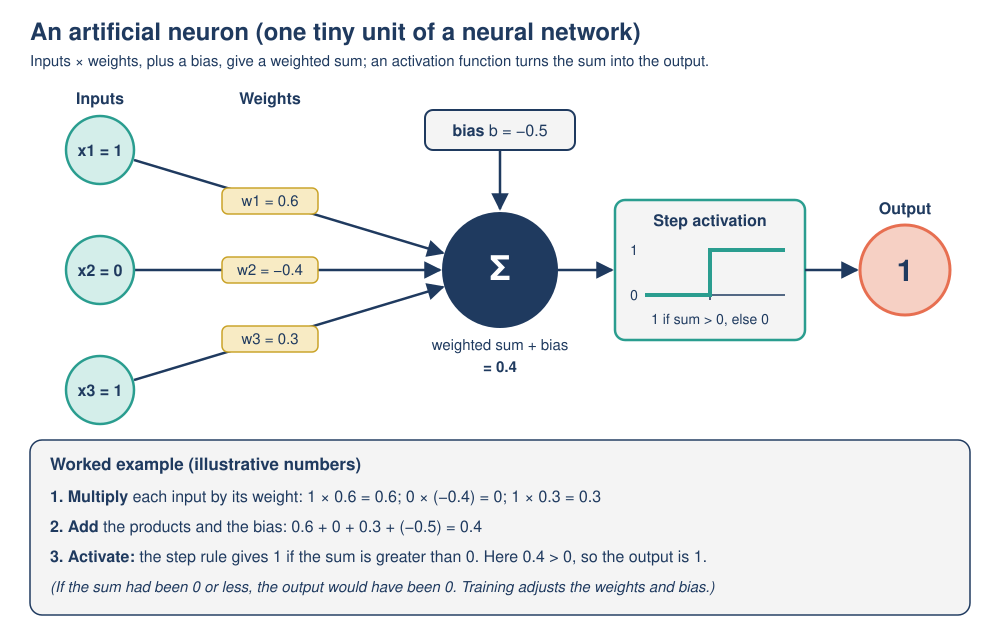
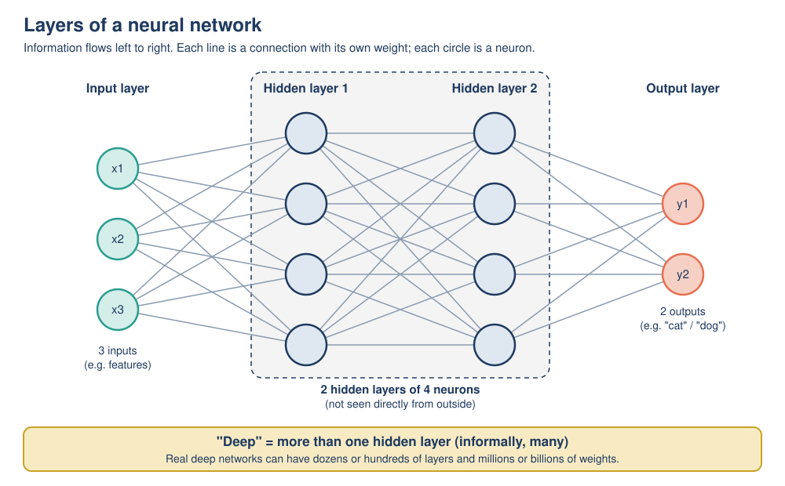

# Mission 05: Inside the Neuron

**Pixel's AI Field Guide: Missions for Curious Humans** · Version 1.0 (2026-11-06)
**Covers:** Topic 03, [ML, neural networks and deep learning](../../task-1/topics/03-ml-neural-networks-deep-learning.md) (artificial neuron, layers, "deep") · **Time:** about 70 minutes (core) + 30 minutes (optional)
**Navigation:** [Start here](00-start-here.md) · Previous: [Mission 04](mission-04-learning-from-examples.md) · Next: [Mission 06](mission-06-the-word-guessing-machine.md) · [Glossary](glossary.md)

**Platform:** TensorFlow Playground (browser, no account). Everything else is pen and paper.

---

## [MISSION BRIEF] Pixel opens its own head

Pixel has heard that it runs on a "neural network", so it unscrews its own access panel, hoping to see tiny glowing brain cells. Inside, it finds ... a long list of numbers. "So I am made of arithmetic?" it asks, slightly offended. "But I am *deep learning*, so I must understand things very deeply!" Dr. Ada Okafor hands Pixel a pencil: "Let's find out what one neuron actually does."

### Learning goals

By the end of this mission you should be able to:

- **Trace** the calculation of a single artificial neuron (inputs, weights, bias, activation) with small numbers.
- **Explain** what weights and a bias do, and why training means adjusting them.
- **Explain** what layers are and what makes learning "deep".
- **Predict and test** how adding hidden neurons, changing the learning rate, or training too long on noisy data changes a small network's behavior.
- **Recognize** overfitting from training and test loss.

---

## [PREDICT] Before you start (2 minutes)

1. An "artificial neuron" in a computer is: (a) a tiny model of a real brain cell, (b) a small calculation with numbers, (c) a computer chip shaped like a neuron? Choose one.
2. "Deep learning" is called *deep* because: (a) it understands things deeply, (b) its networks have many layers, (c) it uses very large computers?

---

## [TRY IT] Activity 5.1: Be the neuron

**Goal:** Compute a neuron's output by hand, and discover what weights and the bias do.

**Preparation:** Pen and paper. Only adding and multiplying small decimals. All numbers are **illustrative (made-up)**. *Group variant:* three people hold the input cards (x1, x2, x3) and call out "input × weight"; a fourth person is the neuron, adds everything up plus the bias and holds up 1 or 0.

*Figure: An artificial neuron, with the numbers used below.* (Original diagram created for this guide.)

**Pixel's neuron is a tiny spam detector:**

| Input | Meaning (1 = yes, 0 = no) | Weight |
|---|---|---|
| x1 | Email contains "free" | w1 = 0.6 |
| x2 | Sender is in your contacts | w2 = -0.4 |
| x3 | Email has 3 or more links | w3 = 0.3 |
| bias | | b = -0.5 |

**Activation (step function):** output **1 = spam** if the sum is **greater than 0**, otherwise **0 = not spam**.

**Worked example** (x1 = 1, x2 = 0, x3 = 1):
1. **Multiply** each input by its weight: 1 × 0.6 = 0.6; 0 × (-0.4) = 0; 1 × 0.3 = 0.3.
2. **Add** the products and the bias: 0.6 + 0 + 0.3 + (-0.5) = **0.4**.
3. **Activate:** 0.4 is greater than 0, so the output is **1: spam**.

**Task:**

a) Calculate the weighted sum and output for each email:

| Email | x1 (free) | x2 (contact) | x3 (links) | Sum | Output |
|---|---|---|---|---|---|
| O (worked example) | 1 | 0 | 1 | 0.4 | 1 |
| W | 1 | 1 | 1 | | |
| P | 0 | 1 | 1 | | |
| Q | 1 | 1 | 0 | | |
| R | 1 | 0 | 0 | | |
| S | 0 | 0 | 1 | | |

b) Email S is actually a scam (label: spam). **[PREDICT]** What is the smallest value of w3, to one decimal place, that would make the neuron output 1 for S (all other numbers unchanged)?
c) Training would make changes like the one in (b) automatically. Why should it **not** simply make w3 enormous, say 100? Think about email P.

**Observation:** Which input pushes toward "spam" and which pulls toward "not spam"? What does the negative bias do?

**Reflection:** Pixel says, "A neuron decides what an email *means*." Is that a fair description of what you just did?

**Feedback:**

[DEBRIEF] Activity 5.1: expected answers

a)

| Email | Calculation | Sum | Output |
|---|---|---|---|
| W | 0.6 + (-0.4) + 0.3 + (-0.5) | **0.0** | **0** (0.0 is not *greater* than 0: exactly on the boundary) |
| P | 0 + (-0.4) + 0.3 + (-0.5) | -0.6 | 0 (not spam) |
| Q | 0.6 + (-0.4) + 0 + (-0.5) | -0.3 | 0 (not spam) |
| R | 0.6 + 0 + 0 + (-0.5) | 0.1 | 1 (spam) |
| S | 0 + 0 + 0.3 + (-0.5) | -0.2 | 0 (not spam) |

b) The neuron output **0** for S: a **false negative**. We need w3 × 1 + (-0.5) > 0, so w3 must be greater than 0.5. To one decimal place, the smallest value is **w3 = 0.6** (sum 0.1, output 1).

c) A weight affects **every** email, not just S. With w3 = 100, any email with 3 or more links would be called spam whatever else is true: P (from a known contact) would get 0 - 0.4 + 100 - 0.5 = 99.1 and be wrongly flagged (a false positive). Training therefore makes **small** adjustments and checks the effect across many examples, aiming to reduce the total number of mistakes.

**Observation:** positive weights ("free", links) push toward spam; the negative weight (sender in contacts) pulls toward not spam; the negative bias means the neuron needs fairly strong evidence before it "fires".

**Reflection:** not really. The neuron multiplied and added numbers. It has no idea what "free" or "contacts" mean: the *meaning* was chosen by the people who defined the inputs. Common mistake: treating "greater than 0" as "0 or more" (email W).

---

## [TRY IT] Activity 5.2: Neural network experiments in TensorFlow Playground

**Goal:** Change **one thing at a time** in a small neural network and predict, then see, how its behavior changes: hidden layers, number of neurons, learning rate, and overfitting.

**Preparation:**
- **Platform:** TensorFlow Playground, <https://playground.tensorflow.org/> ("A Neural Network Playground"). **No account, no installation, no webcam.** Runs entirely in your browser. A laptop or desktop is recommended (the layout is wide; phones were not tested). Its code has not changed since June 2022.
- **Preset links:** each link below opens the Playground with the settings already chosen. If a link does not load the right settings, set them by hand using the description.
- **Screen tour:** the **dataset** picture (top left) has orange and blue points; the network must learn to color the background so that blue points sit on blue and orange points sit on orange. **FEATURES** are the inputs (X1 = horizontal position, X2 = vertical position). **HIDDEN LAYERS** shows the neurons (+/- buttons add layers or neurons). **OUTPUT** (right) shows **Test loss** and **Training loss**: the network's average error, so **lower is better**. The top bar has **Play/Pause**, **Reset**, **Step**, an **Epoch** counter (one epoch = one pass through the training points), **Learning rate** and **Activation**.
- **Randomness:** every run starts from **random starting weights** and randomly generated data, so your numbers will differ a little from a classmate's and from this guide. The *patterns* below are what to expect. **Reset** gives new random weights.
- **Time:** about 30 minutes. **Fallback:** the expected results table in the feedback.

**Task.** For each experiment: **[PREDICT]**, press **Play**, stop at about the epoch given, and record the **Test loss** and what the background looks like.

**Part A: Does the network need a hidden layer?** (dataset: "circle": blue points in the middle, orange points in a ring around them)

| Preset | What changes | Your prediction | Test loss (epoch ~200) | Shape of the boundary |
|---|---|---|---|---|
| [P1](https://playground.tensorflow.org/#activation=tanh&batchSize=10&dataset=circle&regDataset=reg-plane&learningRate=0.03&regularizationRate=0&noise=0&networkShape=&showTestData=false&discretize=false&percTrainData=50&x=true&y=true&xTimesY=false&xSquared=false&ySquared=false&cosX=false&sinX=false&cosY=false&sinY=false&collectStats=false&problem=classification&initZero=false&hideText=false) | inputs X1 and X2, **0 hidden layers** | | | |
| [P2](https://playground.tensorflow.org/#activation=tanh&batchSize=10&dataset=circle&regDataset=reg-plane&learningRate=0.03&regularizationRate=0&noise=0&networkShape=4&showTestData=false&discretize=false&percTrainData=50&x=true&y=true&xTimesY=false&xSquared=false&ySquared=false&cosX=false&sinX=false&cosY=false&sinY=false&collectStats=false&problem=classification&initZero=false&hideText=false) | **1 hidden layer of 4 neurons** (everything else the same) | | | |
| P2 + ReLU | open P2, change **Activation** from Tanh to **ReLU** | | | |
| [P3](https://playground.tensorflow.org/#activation=tanh&batchSize=10&dataset=circle&regDataset=reg-plane&learningRate=0.03&regularizationRate=0&noise=0&networkShape=2&showTestData=false&discretize=false&percTrainData=50&x=true&y=true&xTimesY=false&xSquared=false&ySquared=false&cosX=false&sinX=false&cosY=false&sinY=false&collectStats=false&problem=classification&initZero=false&hideText=false) | only **2 hidden neurons** | | | |

**Part B: The learning rate** (= how big each weight adjustment is). Same circle network as P2 (learning rate 0.03), about 300 epochs each:

| Preset | Learning rate | Your prediction | Final test loss | Did the boundary flicker or jump? |
|---|---|---|---|---|
| P2 | 0.03 | | | |
| [P5](https://playground.tensorflow.org/#activation=tanh&batchSize=10&dataset=circle&regDataset=reg-plane&learningRate=3&regularizationRate=0&noise=0&networkShape=4&showTestData=false&discretize=false&percTrainData=50&x=true&y=true&xTimesY=false&xSquared=false&ySquared=false&cosX=false&sinX=false&cosY=false&sinY=false&collectStats=false&problem=classification&initZero=false&hideText=false) | 3 (too high) | | | |
| [P6](https://playground.tensorflow.org/#activation=tanh&batchSize=10&dataset=circle&regDataset=reg-plane&learningRate=10&regularizationRate=0&noise=0&networkShape=4&showTestData=false&discretize=false&percTrainData=50&x=true&y=true&xTimesY=false&xSquared=false&ySquared=false&cosX=false&sinX=false&cosY=false&sinY=false&collectStats=false&problem=classification&initZero=false&hideText=false) | 10 (way too high) | | | |
| [P7](https://playground.tensorflow.org/#activation=tanh&batchSize=10&dataset=circle&regDataset=reg-plane&learningRate=0.0001&regularizationRate=0&noise=0&networkShape=4&showTestData=false&discretize=false&percTrainData=50&x=true&y=true&xTimesY=false&xSquared=false&ySquared=false&cosX=false&sinX=false&cosY=false&sinY=false&collectStats=false&problem=classification&initZero=false&hideText=false) | 0.0001 (too low) | | | |

**Part C: Overfitting.** Open [P10](https://playground.tensorflow.org/#activation=tanh&batchSize=10&dataset=circle&regDataset=reg-plane&learningRate=0.03&regularizationRate=0&noise=50&networkShape=8,8,8&showTestData=true&discretize=false&percTrainData=10&x=true&y=true&xTimesY=false&xSquared=false&ySquared=false&cosX=false&sinX=false&cosY=false&sinY=false&collectStats=false&problem=classification&initZero=false&hideText=false): circle data with **noise 50** (messy, overlapping points), **only 10% of the points used for training**, a big network (3 hidden layers of 8), and **Show test data** switched on. **[PREDICT]** What will happen to Training loss and Test loss if you train for a long time? Record both at about epoch 100 and about epoch 1000.

**Part D (optional): A harder shape.** Open [P8](https://playground.tensorflow.org/#activation=tanh&batchSize=10&dataset=spiral&regDataset=reg-plane&learningRate=0.03&regularizationRate=0&noise=0&networkShape=4&showTestData=false&discretize=false&percTrainData=50&x=true&y=true&xTimesY=false&xSquared=false&ySquared=false&cosX=false&sinX=false&cosY=false&sinY=false&collectStats=false&problem=classification&initZero=false&hideText=false) (spiral, 1 hidden layer of 4) and then [P9](https://playground.tensorflow.org/#activation=tanh&batchSize=10&dataset=spiral&regDataset=reg-plane&learningRate=0.03&regularizationRate=0&noise=0&networkShape=8,8&showTestData=false&discretize=false&percTrainData=50&x=true&y=true&xTimesY=false&xSquared=false&ySquared=false&cosX=false&sinX=true&cosY=false&sinY=true&collectStats=false&problem=classification&initZero=false&hideText=false) (spiral, 2 hidden layers of 8, extra inputs sin(X1) and sin(X2)). Run each for about 500 epochs. Also try [P4](https://playground.tensorflow.org/#activation=tanh&batchSize=10&dataset=circle&regDataset=reg-plane&learningRate=0.03&regularizationRate=0&noise=0&networkShape=&showTestData=false&discretize=false&percTrainData=50&x=false&y=false&xTimesY=false&xSquared=true&ySquared=true&cosX=false&sinX=false&cosY=false&sinY=false&collectStats=false&problem=classification&initZero=false&hideText=false): circle, **no hidden layer**, but inputs X1² and X2² instead of X1 and X2.

**Observation:** Complete the tables. Which **single** change fixed P1?

**Reflection:**
- Why do two learners with the same link get slightly different numbers?
- What does a too-large learning rate do to the loss graph? A too-small one?
- In Part C, when test loss goes **up** while training loss goes **down**, what is happening?

**Feedback:**

[DEBRIEF] Activity 5.2: expected results

These patterns come from re-running the Playground's own training algorithm (from its published source code) offline with several random starts. **Exact numbers in your browser will differ**; the pattern is what matters. "Accuracy" here = share of test points on the correct side.

| Preset | What learners typically see |
|---|---|
| **P1** (0 hidden layers) | Test loss gets stuck at about **0.5** and stops improving; accuracy about chance level (roughly 36 to 62%). The background splits the plane with **one straight boundary**. **A straight line cannot separate a circle.** |
| **P2** (1 layer × 4) | A round region forms around the blue center within about 100 epochs; test loss about **0.03 to 0.04** by epoch 100 and about 0.01 by 300; accuracy reached 100% in all simulated runs. |
| **P2 + ReLU** | Usually even faster (about 89 to 100% by epoch 10); the boundary looks more like a polygon. |
| **P3** (2 neurons) | Stalls at test loss about **0.24 to 0.33** (accuracy about 76 to 82%): not enough neurons; the boundary looks like a wedge or band, not a circle. |
| **P5** (rate 3) | **Unstable:** the loss graph is jagged, the boundary flickers or jumps; one simulated run got worse over time. |
| **P6** (rate 10) | **Fails:** chaotic or stuck; accuracy about 52 to 64% after 300 epochs, worse than rate 0.03. |
| **P7** (rate 0.0001) | **Painfully slow:** almost nothing changes for a long time; accuracy about 54 to 64% after 300 epochs. |
| **P10** (overfitting) | Between about epoch 100 and 1000, **training loss falls** (from about 0.31 to between 0.13 and 0.19) while **test loss rises** (from about 0.41 to between 0.50 and 0.76). With test data shown, the boundary wraps around individual noisy training points. |
| **P8** (spiral, small) | Stuck at about 55 to 60% accuracy after 500 epochs: it can't follow the spiral. |
| **P9** (spiral, bigger + sin inputs) | Spiral arms appear; about 92 to 98% by epoch 100 and 98 to 100% by 500. |
| **P4** (X1², X2², no hidden layer) | Often a perfect circle within a few epochs, **but** in half the simulated runs it got **stuck** at about 52%. If the loss stays high, press **Reset** for a new random start. Good input features can replace hidden neurons, yet training can still fail. |

**Answers:**
- **The single change that fixed P1:** adding a hidden layer (P2). Hidden neurons each draw a simple boundary, and the next layer combines them into a curved one.
- **Different numbers:** each run starts from random weights and, unless fixed, randomly generated data. The behaviors are **typical, not guaranteed**; a run that gets stuck is itself a lesson.
- **Learning rate:** too large = each adjustment overshoots, so the loss jumps around or gets worse; too small = progress is so slow it looks stuck. A moderate rate works best here.
- **Part C:** **overfitting**. The big network is memorizing the noise in the few training points; it fits them better and better while getting worse on new (test) points. Same idea as the memorizer model in Mission 04.

**Common mistake:** changing two settings at once and then not knowing which one caused the effect. Change one thing at a time.

---

## [OBSERVE] Numbers, not brain cells

From Activities 5.1 and 5.2, answer:

1. What actually changed inside the network when it "learned" in the Playground? (Look at the lines between neurons: their thickness and color show the weights.)
2. What could a network with **hidden** neurons do that a network without them could not?
3. Did a bigger network always do better?

---

## [EXPLAIN] Neurons, layers and depth

### The artificial neuron

A **neural network** is a model made of many simple connected units called **artificial neurons**, arranged in layers. The idea goes back to Frank Rosenblatt's **perceptron** (1958). Despite the name, an artificial neuron is just a small calculation, only **loosely** inspired by brain cells. It does three things:

1. **Multiply** each input by its **weight**. A weight says how much an input matters and in which direction: positive pushes toward "yes", negative toward "no", near 0 means "ignore this".
2. **Add** the results together, plus a **bias**. The bias shifts the starting point: a large negative bias means the neuron needs strong evidence before it "fires". (This "bias" is just a number. It is **not** the same as *unfair* bias, which is Mission 10's topic.)
3. Apply an **activation function** to the sum to get the output. The simplest is the **step function** (1 if the sum is greater than 0, otherwise 0). Modern networks usually use smoother ones: the **sigmoid** squashes any number into a value between 0 and 1 (for the sum 0.4 it gives about 0.60), and **ReLU** outputs 0 for negative sums and the sum itself otherwise (for 0.4 it gives 0.4).

The weights and bias are the neuron's **parameters**. **Training** means repeatedly nudging them, a small amount at a time, so the outputs get closer to the labels in the training data. The **learning rate** (the setting you changed in Part B) controls how big each nudge is.

> **Playful analogy:** a neuron is like a judge at a talent show with a score sheet: each act (input) gets points multiplied by how much the judge cares about it (weight), the judge starts from a grumpy or generous baseline (bias), and holds up a card only if the total clears the bar (activation).
>
> **Technically speaking:** output = activation(w1·x1 + w2·x2 + ... + b). There is no judge and no opinion, only arithmetic. Training uses an algorithm (in modern networks, *gradient descent*) to adjust w and b to reduce the error on training examples.

### Layers

*Figure: Layers of a small neural network. Each line is a connection with its own weight.* (Original diagram created for this guide.)

- The **input layer** receives the features (in the Playground: X1 and X2; for an image: the brightness of each pixel).
- **Hidden layers** sit in the middle. Each neuron takes all the outputs of the previous layer as inputs, with its own weights. "Hidden" because we never see their outputs directly.
- The **output layer** gives the final result.

One neuron can only draw one straight boundary (P1). Hidden neurons each draw a simple boundary, and later neurons **combine** them into curves (P2) and spirals (P9). The activation function's small "bend" at each neuron is what makes this possible: without it, as Google's machine learning course puts it, "linear operations performed on linear operations are still linear", and stacking layers would add nothing. In image networks, early layers tend to respond to simple patterns such as edges; later layers combine them into shapes and whole objects. Nobody programs these patterns: they **emerge** as training adjusts the weights.

### What makes learning "deep"?

**Deep learning** is machine learning using neural networks with **many layers**. This guide's rule of thumb: **more than one hidden layer** (IBM describes at least 4 layers counting input and output, which is the same thing). Real deep networks have dozens or hundreds of layers and millions or billions of weights. "Deep" means **many layers, not deep understanding**: sorry, Pixel.

Why depth matters:
- **Deep networks learn their own features.** For the spam filter in Mission 04, people chose the features ("contains *free*"). A deep network given raw pixels or text can discover useful features in its hidden layers.
- **They need lots of data and computing power** (specialized chips called GPUs). The growth of both is a big reason deep learning took off around 2012 (Mission 08).
- **They are hard to explain.** With millions of weights across many layers, it is very difficult to say exactly why a network gave an answer; deep models are often called **"black boxes"** (Mission 10). Compare the Prolog rules in Mission 03, which you could read line by line.

**Putting it together:** neural networks are one kind of machine learning model, and deep learning is machine learning with many-layered neural networks. Not all machine learning is deep (Pixel's word-score spam filter had no neural network), and not all AI is machine learning (the river search learned nothing).

For more depth, read [Topic 03, sections 5 to 7](../../task-1/topics/03-ml-neural-networks-deep-learning.md).

---

## [WATCH] How Neural Networks Work (Code.org)

| | |
|---|---|
| **What** | *How Neural Networks Work*, Code.org "How AI Works" series (YouTube channel "CodeAI"), 2020, 5:04. Link: <https://www.youtube.com/watch?v=JrXazCEACVo> |
| **Why** | It builds a single artificial neuron as a tiny recommender and shows training by adjusting weights: the same idea as Activity 5.1, with no maths. |
| **Which part** | **0:58–3:59** ("Artificial neurons" 0:58, "Building a recommender" 1:40, "Training the neuron" 2:33). The chapter at 3:59, "Complex networks", previews layers. Timestamps from YouTube's chapter list. |
| **What to do** | **Pause at 2:33** and predict: "If the neuron gives a wrong recommendation, what will change: the inputs, the weights, or the output?" Then watch on and check. |
| **Watch out for** | The "inspired by the brain" opening (0:30, "Biological neural networks") is an **analogy**: artificial neurons are simple arithmetic, not models of real brain cells. |
| **Captions and access** | About 43 caption languages. If YouTube is blocked, use the direct MP4 file: [ai-04-neural-networks.mp4](https://contentful-videos.code.org/90t6bu6vlf76/4cdk94NUYkFoA1MdwTiyKe/74bc6e261d1b1d522561f102eb25544c/ai-04-neural-networks.mp4). |

Prediction at 2:33: expected answer

The <b>weights</b> are adjusted. The inputs are the data (they stay the same), and the output changes only as a <i>result</i> of the new weights. That is exactly what Activity 5.1 (b) and (c) asked you to think about.

### [OPTIONAL SIDE QUEST] But what is a neural network? (3Blue1Brown)

| | |
|---|---|
| **What** | *But what is a neural network? Deep learning chapter 1*, 3Blue1Brown (Grant Sanderson), 2017, 18:40. Link: <https://www.youtube.com/watch?v=aircAruvnKk> |
| **Why** | The clearest visual explanation of layers: numbers flowing from layer to layer in a handwritten-digit example, and why layers might help. |
| **Which part** | **0:00–8:38 only** (about 8.5 minutes: "What are neurons?" 2:42, "Introducing layers" 3:35, "Why layers?" 5:31). **Stop at 8:38**: after that the video brings in the mathematics that this guide leaves out. |
| **What to do** | Answer: "In this video, what single thing does a 'neuron' hold?" and "What does the video *hope* the middle layers might pick up?" Then label the layers in the figure above as input / hidden / output. |
| **Watch out for** | The video itself says the "edges, then loops" story is what we *might hope for*; real trained networks often do not learn such neat parts. It shows a small, classic 2017 network, nothing like today's large models. |
| **Captions and access** | About 30 manual caption languages. Text alternative: <https://www.3blue1brown.com/lessons/neural-networks> |

Side quest viewing questions: expected answers

A neuron holds <b>a number between 0 and 1</b> (its activation). The video hopes the middle layers might pick up <b>pieces of shapes such as edges, loops and lines</b>, but presents this as a hope, not a guarantee.

---

## [APPLY] Find the errors in a start-up's claim

A start-up writes this in its report. Find **three** errors or misleading claims and correct each one.

> "We trained our deep learning model on 1,000 labeled chest X-rays and then tested it on **the same 1,000 X-rays**. It scored **100%**, so it will **never make mistakes** in hospitals. Because it is a neural network with many layers, it **understands X-rays the way a doctor does**."

[DEBRIEF] Apply: expected answer

1. **Tested on the training data.** Testing on the same 1,000 X-rays only shows how well the model *remembers* them; it may be overfitting (like P10 or the memorizer in Mission 04). *Fix:* keep a separate test set of X-rays it never saw in training (ideally from different hospitals and machines) and report that score.
2. **"Will never make mistakes."** Even a high test score is measured on a limited sample; new patients, scanners and conditions can differ from the test data, and no model is perfect. *Fix:* report the test accuracy and the kinds of errors (false negatives and false positives), and keep a qualified doctor reviewing the outputs.
3. **"Understands X-rays the way a doctor does."** "Deep" means many layers, not deep understanding. The network detects statistical patterns in pixels and has no medical knowledge. *Fix:* "It detects patterns in X-ray images that are associated with the labels it was trained on."

Also acceptable: "1,000 X-rays is a small dataset for a deep learning model", which makes overfitting more likely.

---

## [OPTIONAL SIDE QUEST] Watch a neuron learn (by hand)

**Goal:** See training as "small corrective nudges". (A little more arithmetic.)

The **perceptron learning rule** nudges each weight after a mistake: *new weight = old weight + (learning rate × error × input)*, where *error = correct label - output*. The bias is updated the same way, as if its input were always 1.

**Task:** Take the neuron from Activity 5.1 and email S (inputs 0, 0, 1; correct label 1), with a learning rate of 0.1. Do two rounds of updates. After each round, recompute S's sum and output. Finally, recheck the worked-example email O (1, 0, 1) and email P (0, 1, 1) with the new numbers.

[DEBRIEF] Side quest: expected answer

- **Round 1:** output 0, error = 1 - 0 = 1. w1 and w2 do not change (their inputs are 0). w3 = 0.3 + 0.1 × 1 × 1 = **0.4**; b = -0.5 + 0.1 × 1 × 1 = **-0.4**. New sum for S: 0.4 - 0.4 = 0.0, output still 0.
- **Round 2:** error is still 1. w3 = **0.5**, b = **-0.3**. New sum for S: 0.5 - 0.3 = 0.2, output **1**: correct.
- **Recheck:** O: 0.6 + 0 + 0.5 - 0.3 = 0.8, still spam. P: 0 - 0.4 + 0.5 - 0.3 = -0.2, still not spam.

Training on one example changed the neuron's answers in a controlled way. Real training repeats this over many examples, many times. (Modern networks use a more refined method, gradient descent, but the idea of small corrective nudges is the same.)

---

## [LAB NOTE] What the Playground and the neuron leave out

- The Playground uses **toy 2-D data** (500 points per dataset). Real networks have millions to billions of weights, work on images or text, and use more advanced training methods.
- The colored background shows the network's output over the **whole** plane. You can never see that for real data with thousands of dimensions.
- The loss shown is a simple squared error, used for teaching.
- Pixel's spam neuron has hand-picked weights so that you can follow the arithmetic. Real weights are found by training, and a real network has thousands to billions of them.
- "Neural" is a historical name. Real brain cells are far more complex; a neural network has no awareness of what it computes.

---

## [CHECK] Quick self-check

1. A neuron has inputs x1 = 1, x2 = 1, weights w1 = 0.5, w2 = -0.2, bias b = -0.1, and a step activation (1 if the sum is greater than 0). What is its output?
2. What does a **negative** weight do?
3. True or false: "Training a neural network means a programmer types in better weights."
4. What makes a neural network "deep"?
5. In the Playground, training loss keeps falling while test loss rises. What is happening, and why is it a problem?

---

## [DEBRIEF] Check answers

Show answers with explanations

1. 1 × 0.5 + 1 × (-0.2) + (-0.1) = **0.2**, which is greater than 0, so the output is **1**.
2. It pushes the output toward "no" (0) when that input is present; the bigger the negative number, the stronger the push.
3. **False.** A learning algorithm adjusts the weights automatically, in small steps, to reduce mistakes on the training data. (The learning rate sets how big each step is.)
4. **Many layers**: in this guide's rule of thumb, more than one hidden layer. "Deep" says nothing about understanding.
5. **Overfitting:** the network is fitting the noise in its training points instead of the general pattern, so it gets worse on new data, which is what matters in real use.

**Now look back at your [PREDICT] answers.** An artificial neuron is (b), a small calculation with numbers; and "deep" is (b), many layers.

---

## Mission summary

- An **artificial neuron** multiplies inputs by **weights**, adds a **bias**, and applies an **activation function** (step, sigmoid, ReLU). It is arithmetic, only loosely inspired by the brain.
- **Training** nudges weights and biases in small steps to reduce mistakes; the **learning rate** sets the step size (too big: unstable; too small: painfully slow).
- **Hidden layers** let a network combine simple boundaries into complex shapes; without them (and without activation functions) a network can only draw a straight line.
- **Deep learning** = neural networks with many layers (here: more than one hidden layer). Deep networks learn their own features, need lots of data and computing power, and are hard to explain.
- **Overfitting** shows up as training loss falling while test loss rises: the network memorizes noise instead of the pattern.

## Next mission

The biggest deep networks of all write text. In [Mission 06: The Word-Guessing Machine](mission-06-the-word-guessing-machine.md), you will become a tiny language model with a bag of word cards, and discover why chatbots can sound so sure and still be wrong.
