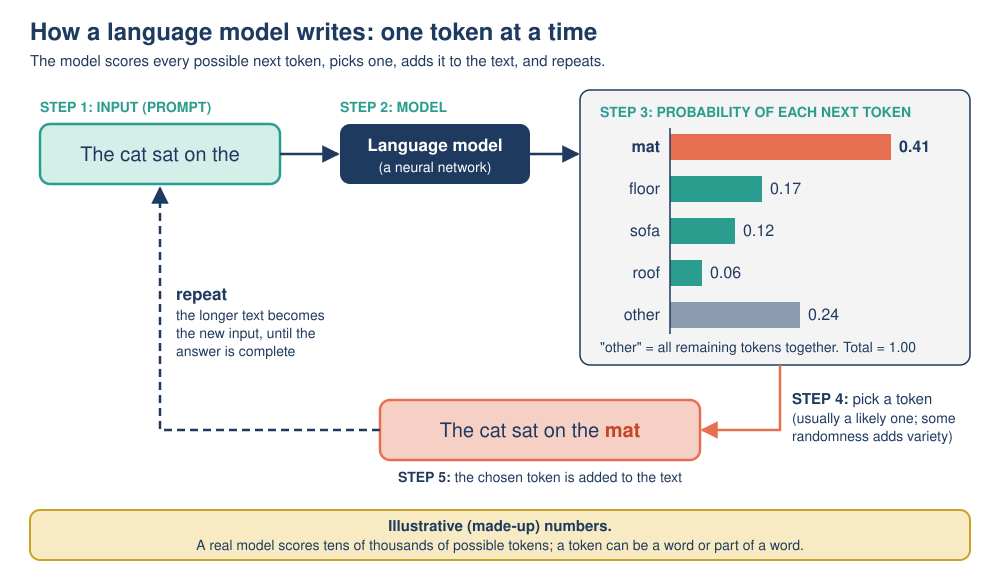

# Mission 06: The Word-Guessing Machine

**Pixel's AI Field Guide: Missions for Curious Humans** · Version 1.0 (2026-11-06)
**Covers:** Topic 04, [Generative AI and large language models](../../task-1/topics/04-generative-ai-and-llms.md) · **Time:** about 70 minutes (core) + 15 minutes (optional)
**Navigation:** [Start here](00-start-here.md) · Previous: [Mission 05](mission-05-inside-the-neuron.md) · Next: [Mission 07](mission-07-sorting-the-robots.md) · [Glossary](glossary.md)

**You need:** pen and paper, scissors (or sticky notes), and optionally one ordinary six-sided die. No device needed for the core path.

---

## [MISSION BRIEF] Where does the chatbot keep its answers?

Pixel is convinced that chatbots work like a giant library: you ask a question, and the chatbot looks up the matching answer in an enormous fact book. "That's why they're always right," says Pixel. Dr. Ada Okafor empties a bag of word cards onto the table: "Let's build a word-guessing machine and see how text really gets written, one small guess at a time."

### Learning goals

By the end of this mission you should be able to:

- **Distinguish** generative AI from discriminative (predictive) AI.
- **Explain** what a token is and **trace** how a language model builds text one token at a time (next-token prediction).
- **Explain** why the same prompt can give different answers (sampling, temperature) and **predict** the effect of a low or high temperature.
- **Describe** in plain language the stages of training a large language model (pre-training, fine-tuning, RLHF).
- **Explain** why "all generative AI is deep learning" is a simplification, and what a hallucination is.

---

## [PREDICT] Before you start (3 minutes)

1. Finish the sentence "The cat sat on the ___" with **three** possible words, and give each a rough chance (for example 50%, 20%, 10%).
2. If you ask a chatbot exactly the same question twice, will you get exactly the same answer? Why or why not?
3. Pixel says chatbots look answers up in a fact book. Agree or disagree?

---

## [TRY IT] Activity 6.1: The word-guessing card game (a Markov-chain text generator)

**Goal:** Build and run a real (tiny) generative model by hand: it learns which word follows which from a training text, then generates new sentences by random choices.

**Preparation:** Paper, and either scissors/sticky notes (card version) or one six-sided die (dice version). About 20 minutes. Works alone or in a small group.

**Training text** (treat "." as a word):

```
the cat sat on the mat . the dog sat on the rug . the cat ran .
```

**Task, Step 1: Train the model (count the followers).** For every word, list which words come straight after it in the training text, and how often. "the" appears 5 times, so it has 5 followers. Copy and complete:

| Word | Followers (count) |
|---|---|
| the | cat (2), mat (1), dog (1), rug (1) |
| cat | |
| sat | |
| on | |
| mat | |
| dog | |
| rug | |
| ran | |

**Task, Step 2: Make the model (follower piles).**
- **Card version:** for each word, make a small pile of cards, one card per follower occurrence. The "the" pile has **5 cards: cat, cat, mat, dog, rug**. The "cat" pile has 2 cards: sat, ran. Words with only one follower need just one card.
- **Dice version:** use the die only when there is a choice. For "the": **1–2 = cat, 3 = mat, 4 = dog, 5 = rug, 6 = roll again**. For "cat": **1–3 = sat, 4–6 = ran**.

**Task, Step 3: Generate.** Start with the word "the". Draw a card from the current word's pile (put it back afterwards) or roll the die, write the word down, and move to that word's pile. **Stop when you generate "."**. Generate **three** sentences.

**Task, Step 4: Check with fixed random numbers.** Real computers use random numbers between 0 and 1 instead of dice. Turn the counts into **probabilities** and lay them end to end (in the order the followers first appear in the training text):

| Word | Followers with cumulative ranges ("up to" = up to but not including) |
|---|---|
| the | cat 0.4 (0.00 up to 0.40); mat 0.2 (0.40 up to 0.60); dog 0.2 (0.60 up to 0.80); rug 0.2 (0.80 up to 1.00) |
| cat | sat 0.5 (0.00 up to 0.50); ran 0.5 (0.50 up to 1.00) |

Only use a random number when there is a choice. Generate:
- **Run 1** with random numbers 0.65, 0.90
- **Run 2** with random numbers 0.70, 0.30, 0.80

**Observation:** Write down your three dice/card sentences and the two checked runs. Which of them appear word for word in the training text? Which are new?

**Reflection:**
- Is this machine **generative**? Does it use a neural network?
- Why do some new sentences make no sense? How much of the earlier text does the machine "look at" when choosing the next word?

**Feedback:**

<details>
<summary>[DEBRIEF] Activity 6.1: expected answers</summary>

**Step 1, the follower table:**

| Word | Followers (count) | Probabilities |
|---|---|---|
| the | cat (2), mat (1), dog (1), rug (1) | cat 0.4, mat 0.2, dog 0.2, rug 0.2 |
| cat | sat (1), ran (1) | sat 0.5, ran 0.5 |
| sat | on (2) | on 1.0 |
| on | the (2) | the 1.0 |
| mat | . (1) | . 1.0 |
| dog | sat (1) | sat 1.0 |
| rug | . (1) | . 1.0 |
| ran | . (1) | . 1.0 |

The die's "6 = roll again" keeps the chances right: cat really gets 2 out of every 5 useful rolls, matching 0.4.

**Step 4, the checked runs:**
- **Run 1:** the → (0.65: dog) dog → sat → on → the → (0.90: rug) rug → . = **"the dog sat on the rug ."**
- **Run 2:** the → (0.70: dog) dog → sat → on → the → (0.30: cat) cat → (0.80: ran) ran → . = **"the dog sat on the cat ran ."**

**Observation:** Run 1's sentence is in the training text. Run 2's sentence, "the dog sat on the cat ran .", **never appears** in it: the model **generated something new**. Your dice sentences will vary; likely new ones include "the cat sat on the mat ." (new? no, it *is* in the text) and "the cat sat on the dog sat on the rug ." (new and odd). Sentences can even loop for a while ("... on the cat sat on the cat ...").

**Reflection:**
- Yes, it is **generative** (it creates new text), and it uses **no neural network**: just counts. This is why "all generative AI is deep learning" is a simplification. Claude Shannon demonstrated this kind of word-by-word generator in 1948.
- It looks at only **one** previous word. "the" can be followed by "cat", and "cat" can be followed by "ran", so "the cat ran" is allowed even in the middle of "the dog sat on the cat ran". It has no view of the sentence as a whole. A large language model is a deep neural network with billions of learned parameters that takes a long stretch of earlier text into account (its **context window**), not just one word.
</details>

---

## [TRY IT] Activity 6.2: Spin the next token, then turn up the temperature

**Goal:** See how a language model chooses each next token by **sampling** from probabilities, and how **temperature** changes those choices.

**Preparation:** Pen and paper, about 20 minutes. All probabilities are **illustrative (made-up) figures**; a real model scores tens of thousands of possible tokens.



*Figure: Next-token prediction. The model scores possible next tokens, one is picked, added to the text, and the longer text becomes the new input.* (Original diagram created for this guide.)

The model has read the prompt `The cat sat on the` and gives these probabilities at three temperature settings (cumulative ranges in brackets, "up to" = up to but not including):

| Next token | Low temperature | Normal | High temperature |
|---|---|---|---|
| mat | 0.80 (0.00 up to 0.80) | 0.41 (0.00 up to 0.41) | 0.26 (0.00 up to 0.26) |
| floor | 0.09 (0.80 up to 0.89) | 0.17 (0.41 up to 0.58) | 0.18 (0.26 up to 0.44) |
| sofa | 0.05 (0.89 up to 0.94) | 0.12 (0.58 up to 0.70) | 0.15 (0.44 up to 0.59) |
| roof | 0.01 (0.94 up to 0.95) | 0.06 (0.70 up to 0.76) | 0.09 (0.59 up to 0.68) |
| all other tokens | 0.05 (0.95 up to 1.00) | 0.24 (0.76 up to 1.00) | 0.32 (0.68 up to 1.00) |

Think of a spinner divided into slices, each as big as its probability: a random number between 0 and 1 says where the spinner stops.

**Task:**

a) At **normal** temperature, which token is chosen for each random number: 0.35, 0.72, 0.95, 0.50?
b) **[PREDICT]** Out of 20 spins at normal temperature, about how many "mat"? And at low temperature?
c) **Tally.** Use these 20 random numbers (one per spin), first with the **Normal** column, then with the **Low** column. Count how often each token is chosen.

```
0.14  0.71  0.27  0.82  0.18  0.95  0.25  0.98  0.65  0.68
0.42  0.26  0.94  0.30  0.59  0.06  0.49  0.11  0.76  0.49
```

| Token | Normal: tally | Low: tally | *(optional)* High: tally |
|---|---|---|---|
| mat | | | |
| floor | | | |
| sofa | | | |
| roof | | | |
| all other tokens | | | |

d) Choose **low** or **high** temperature for each task and justify: (i) summarizing a rental agreement for a friend; (ii) brainstorming 20 possible names for a new cafe.
e) A friend says: "I asked the chatbot the same question twice and got two different answers, so it's broken." Write a two- or three-sentence reply.

**Observation:** Compare your tallies with your prediction in (b). How many *different* tokens appeared at each temperature?

**Reflection:** If every later token depends on the earlier ones, what happens to the rest of an answer when one early spin lands on an unusual token?

**Feedback:**

<details>
<summary>[DEBRIEF] Activity 6.2: expected answers</summary>

a) 0.35 → **mat**; 0.72 → **roof**; 0.95 → **all other tokens** (some less likely token); 0.50 → **floor**.

b) Expected about **8 of 20** "mat" at normal temperature (0.41 × 20 = 8.2) and about **16 of 20** at low temperature (0.80 × 20).

c)

| Token | Normal | Low | High (optional) |
|---|---|---|---|
| mat | **8** | **16** | 5 |
| floor | 3 | 1 | 4 |
| sofa | 3 | 0 | 2 |
| roof | 1 | 1 | 2 |
| all other tokens | 5 | 2 | 7 |

Careful with the boundaries ("up to but not including"): **0.76** at normal temperature is "all other tokens", not roof; **0.94** at low temperature is roof, not sofa; **0.68** at high temperature is "all other tokens". At low temperature, "mat" dominates; at high temperature, the choices spread out and "all other tokens" (which includes odd choices such as "keyboard" or "moon") wins most often. With only 20 spins, counts are close to, but not exactly, the probabilities: randomness again.

d) (i) **Low**: you want accurate, predictable wording and no inventive additions in a legal summary (and you should still check it against the agreement). (ii) **High**: you want variety and unexpected ideas; odd suggestions are harmless because you will pick the best ones.

e) Example: "That's normal. The chatbot builds its answer one token at a time and usually picks each token with some randomness, weighted toward likely tokens, so different runs can take different paths. It isn't broken, but it does mean you should check important facts rather than trusting either version automatically."

**Reflection:** the unusual token becomes part of the input for every later step, so the rest of the answer can drift in a completely different direction (`... mat and purred` vs `... roof and the neighbors ...`).
</details>

### [OPTIONAL SIDE QUEST] Same prompt, three answers

If you have access to a chatbot that you are allowed to use (check your school's or workplace's rules and the service's age limits), open **three fresh conversations** and give each exactly the same prompt: *"Write a one-sentence opening for a mystery story."* Do not type any personal information.

**Record:** How similar are the three answers? Did any words repeat? **Expected:** the three openings are usually worded differently, because each token is sampled. Most chat apps don't let you change the temperature, so you are seeing their default setting. Answers can also differ because providers update their models. No chatbot available? Activity 6.2 shows the same effect on paper.

---

## [OBSERVE] So where are the answers kept?

Answer from your experience in Activities 6.1 and 6.2:

1. Did your word-guessing machine store any **sentences** or **facts**? What did it store instead?
2. What made two runs of the same machine produce different text?
3. Your machine produced "the dog sat on the cat ran ." with total confidence. Did it "know" this was nonsense?

---

## [EXPLAIN] How generative AI and large language models work

### Generative versus discriminative

Most AI you met in Missions 04 and 05 **sorts or scores** inputs (spam / not spam). Google's machine learning course calls this kind of model **discriminative**: "Discriminative models discriminate between different kinds of data instances." People also call these **predictive** models. A **generative** model does something different: "Generative models can generate new data instances."

| | Discriminative (predictive) | Generative |
|---|---|---|
| Question it answers | "Which category is this?" or "What number goes with this?" | "What new content fits this request?" |
| Output | A label, score or number | New text, images, audio, video or code |
| Example | Spam filter; face unlock; fraud alert | Chatbot writing an email; image generator |

**Generative AI** creates new content, usually in response to a **prompt** (the request you give it).

### A useful simplification

**Almost all of today's prominent generative AI systems use deep learning**: chatbots such as ChatGPT, Claude and Gemini are built on large language models, which are deep neural networks. But it is a **simplification** to say *all* generative AI is deep learning. Your card game (a Markov-chain generator, demonstrated by Claude Shannon in 1948) is generative with no neural network at all, and the rule-based chatbot ELIZA (1966) produced replies from hand-written pattern-matching scripts (you will investigate it in Mission 08).

### Large language models and tokens

A **language model** gives probabilities for what text comes next. A **large language model (LLM)** is a very large **deep neural network**, almost always using the **transformer** design introduced in 2017 in the paper "Attention Is All You Need" (Vaswani and colleagues). Its trick, *attention*, lets it weigh up all the earlier text, near and far, when predicting the next piece. "Large" means a huge number of **parameters (weights)** and a huge amount of training text: OpenAI's GPT-3 (2020) had **175 billion** parameters. Pixel's spam neuron in Mission 05 had 3 weights and a bias.

LLMs work with **tokens**: a token can be a whole word, part of a word, a punctuation mark or a single character. As a rule of thumb for English, one token is about **three-quarters of a word** (100 tokens ≈ 75 words). Illustrative example (real splits differ between models):

```
Text:    "Unbelievably, the cat sat."
Tokens:  [Un] [believ] [ably] [,] [ the] [ cat] [ sat] [.]      -> 8 tokens
```

### Next-token prediction: the loop

1. **Input:** all the text so far (your prompt plus anything already generated).
2. **Predict:** the network gives **every possible next token** in its vocabulary a **probability**.
3. **Choose:** the system usually **samples** one token: likely tokens are picked more often, but it is not always the most likely one.
4. **Append:** add it to the text.
5. **Repeat** with the longer text, until an "end" token or a length limit.

A 300-word answer takes roughly 400 of these steps. The model does **not** plan the whole answer first and does **not** look it up in a database. The **context window** limits how many tokens of earlier text it can take into account at once.

> **Playful analogy:** an LLM is like your word-guessing card game after an enormous upgrade: instead of piles for one previous word, it has learned, from a library-sized amount of text, how likely each next token is given the *whole* conversation so far.
>
> **Technically speaking:** there are no piles of cards. A transformer computes the probabilities fresh at every step from billions of learned weights, using attention over all tokens in the context window. What it stores is **patterns in numbers**, not sentences or facts, which is why it can be fluent and still wrong.

### How an LLM is trained

| Stage | What happens | Kind of learning (Mission 04) |
|---|---|---|
| **1. Pre-training** | The model predicts the next token across an enormous amount of text (books, websites, code). After each guess, the real next token is revealed, and the weights are nudged to make it more likely. The text supplies its own answers, so no hand labels are needed (*self-supervised*). Extremely expensive in computing power and energy. The result predicts text well but is not yet a helpful assistant. | the real next token acts as the label |
| **2. Fine-tuning** | Further training on a much smaller set of examples written or chosen by people: prompts paired with good responses. | supervised |
| **3. RLHF** (reinforcement learning from human feedback) | People compare and rank several answers to the same prompt; the model is trained to produce the kinds of answers people prefer (more helpful, more accurate, less harmful). In OpenAI's 2022 study, people preferred the outputs of a 1.3-billion-parameter model trained this way over the original 175-billion-parameter GPT-3. | reinforcement |

After training, every conversation is **inference**: the weights stay fixed while the model writes.

### Why outputs vary: sampling and temperature

Most systems **sample**: they choose the next token at random, weighted by the probabilities, like your spinner. Because each choice feeds into the next, two runs can drift apart. **Temperature** controls how adventurous sampling is: **low** temperature sharpens the probabilities (predictable, repetitive; useful for factual summaries or code); **high** temperature flattens them (varied and surprising, but more likely to wander off-topic or into errors). Answers can also change because the provider updated the model or the earlier conversation differs. **An LLM's answer is one sample from many possible answers, not the single "correct" output.**

### Hallucinations: plausible is not the same as true

Because an LLM generates text that is *likely* given the patterns it learned, it can produce statements that sound right but are false: made-up quotations, references or facts. IBM calls this a **hallucination**, and a well-known example is a lawyer who submitted made-up case citations produced by a generative AI tool. Human feedback and connecting models to trusted sources reduce hallucinations but do not eliminate them. Mission 11 practices spotting them.

For more depth, read [Topic 04](../../task-1/topics/04-generative-ai-and-llms.md).

---

## [WATCH] Large Language Models explained briefly (3Blue1Brown)

| | |
|---|---|
| **What** | *Large Language Models explained briefly*, 3Blue1Brown (Grant Sanderson), 2024, 7:58. Made for an exhibit at the Computer History Museum. Link: <https://www.youtube.com/watch?v=LPZh9BOjkQs> |
| **Why** | A short, accurate, beautifully animated account of next-token prediction, parameters, pre-training and RLHF: almost exactly this mission's content. |
| **Which part** | **Core: 0:00–4:15** ("How chatbots work", "Large language models" 0:35, "Training and parameters" 1:28, "Learning through refinement" 2:08, "Computational scale" 3:18, "Pre-training and RLHF" 3:46). Optional: 4:15–7:05 (GPUs, transformer, attention, "emergent behavior"). Timestamps from YouTube's chapter list. |
| **What to do** | *Before:* compare your [PREDICT] answer for "The cat sat on the ___". *While watching:* "Why can the same prompt give a different answer each time?" and "What are the two training stages the video describes?" *After:* explain to Pixel why "predicting the next word" is not the same as "looking up facts". |
| **Watch out for** | The pace is quick. "Parameters" and "attention" are named but only sketched. The phrase "emergent behavior" is debated among researchers. The video is about text LLMs only, not image generators. |
| **Captions and access** | 17 manual caption languages. Text version (no YouTube needed): <https://www.3blue1brown.com/lessons/mini-llm> |

**Gentler alternative:** *How Chatbots and Large Language Models Work*, Code.org (2023, 7:21), <https://www.youtube.com/watch?v=X-AWdfSFCHQ>. Watch **0:38–3:34** and **5:00–5:55**. Question: "Does the video say an LLM stores the answers to questions? If not, what does it learn?" Watch out: it features people who build AI products (for example Mira Murati, then OpenAI's CTO), who have their own perspective. About 35 caption languages; direct MP4 if YouTube is blocked: [HowAIWorks_LLM.mp4](https://contentful-videos.code.org/90t6bu6vlf76/5PAq7BvRs4dvpeDtdBeciP/fe736d8be47bf7a5982b95011bf41c88/HowAIWorks_LLM_SM_CoBrand__1_.mp4).

<details>
<summary>Viewing questions: expected answers</summary>

- **Different answers:** the model gives probabilities for the next word, and the chatbot sometimes picks less likely words (sampling).
- **Two training stages:** pre-training on huge amounts of text, then RLHF, where human feedback refines the behavior. (This guide also mentions fine-tuning on example responses, between the two.)
- **Code.org alternative:** no, it does not store answers; it learns patterns, i.e. probabilities of what comes next, from training text.
- **For Pixel:** the model produces text that is *likely* given patterns in its training data. Likely is not the same as true, and there is no fact book to check against inside the model.
</details>

---

## [APPLY] Apply 1: Generative or not?

Label each system **generative** or **discriminative (predictive)**, with a reason.

1. An email spam filter.
2. A tool that writes a product description from a list of features.
3. A photo app that tags whether a picture contains a dog.
4. A tool that creates an image from the text "a red bicycle on the moon".
5. A model that predicts tomorrow's maximum temperature.
6. A voice assistant that speaks its reply in a synthetic voice.

## [APPLY] Apply 2: Fix Pixel's statements

Find and correct the error in each:

1. "ChatGPT is generative AI, and all generative AI has always used deep learning."
2. "An LLM writes its whole answer at once, then shows it to you."
3. "Pre-training needs millions of people to label every sentence with the right answer."

## [APPLY] Apply 3: A hallucination preview

Pixel asks a chatbot: "Who won the Curiosity Lab robot race in 2025?" (The Curiosity Lab is fictional, and there has never been such a race.) The chatbot replies confidently with a winner's name, a finishing time and a quote from Dr. Okafor.

a) Using next-token prediction, explain how the chatbot could produce such a detailed answer.
b) What should Pixel do before repeating this answer to anyone?

<details>
<summary>[DEBRIEF] Apply 1 to 3: expected answers</summary>

**Apply 1.** 1 **Discriminative**: sorts emails into categories. 2 **Generative**: creates new text. 3 **Discriminative**: outputs a label (dog / no dog). 4 **Generative**: creates a new image. 5 **Discriminative (predictive)**: outputs a number, not new content (regression, Mission 04). 6 **Generative**: creates new audio. (The part that decides *what* to say may also be generative if it is an LLM.)

**Apply 2.**
1. "**Almost all of today's prominent** generative AI, including ChatGPT, uses deep learning; earlier generative methods such as Markov-chain text generators did not."
2. "An LLM generates its answer **one token at a time**, each time predicting the next token from the text so far." (Some apps show the text only when it is complete, but it was still generated token by token.)
3. "Pre-training needs **no hand labels**: the real next token in the text acts as the label (self-supervised). Human-written examples and rankings are used later, in fine-tuning and RLHF, on a much smaller scale."

**Apply 3.**
a) The model does not check a database of races. It generates tokens that are *likely* to follow a question shaped like "Who won the ... race in 2025?": a name, a time and a quote are exactly the kinds of tokens that follow such questions in its training text. Each token is fluent, so the whole answer sounds confident, but it is invented: a **hallucination**.
b) Check it against a trustworthy source (here, the lab itself) before using it, and treat a detailed, confident answer as *no* evidence of truth. Mission 11 turns this into a checking routine.
</details>

---

## [LAB NOTE] What the card game leaves out

- The card game looks at **one** previous word; an LLM considers thousands of previous tokens through attention.
- The card game's "model" is a small table of counts you can read; an LLM's knowledge is spread across billions of weights that nobody can read line by line.
- The probabilities in Activity 6.2 are **made up**, and the temperature columns show the *qualitative* effect (sharpen vs flatten), not the exact maths a real system uses. Real models score tens of thousands of tokens at every step.
- Tokens in the card game are whole words; real tokens are often pieces of words.
- Neither the card game nor an LLM checks facts. Real chat products may add tools (such as web search) on top of the model, but the core model still generates by next-token prediction.

---

## [CHECK] Quick self-check

1. Roughly how many English words are 200 tokens?
2. Put in order: append the token; predict probabilities for the next token; choose a token; take the text so far.
3. Which training stage uses people ranking the model's answers?
4. True or false: "At high temperature, the model always picks the most likely token."
5. Give one example of generative AI that does **not** use deep learning.

---

## [DEBRIEF] Check answers

<details>
<summary>Show answers with explanations</summary>

1. About **150 words** (one token is about three-quarters of a word).
2. **Take the text so far → predict probabilities → choose a token → append it** (then repeat).
3. **RLHF** (reinforcement learning from human feedback).
4. **False.** High temperature *flattens* the probabilities, so less likely tokens are picked **more** often. Always picking the most likely token is the "greedy" choice; low temperature comes close to it.
5. A **Markov-chain text generator** (like your card game; Shannon, 1948). The rule-based chatbot **ELIZA** (1966) is another example of a system that produced text without deep learning.

**Now look back at your [PREDICT] answers.** Did your three words look like the model's (mat, floor, sofa...)? And would you still agree with Pixel's "fact book"?
</details>

---

## Mission summary

- **Generative AI** creates new content; **discriminative (predictive)** AI sorts or scores. Almost all of today's prominent generative AI uses deep learning, but not all generative AI ever has (Markov chains, ELIZA).
- An **LLM** is a huge deep neural network (usually a **transformer**, 2017) that works with **tokens** (about three-quarters of an English word each).
- It writes by **next-token prediction**: predict probabilities, choose, append, repeat. It does not look answers up.
- Training has three stages: **pre-training** (the next token is the label), **fine-tuning** (supervised examples) and **RLHF** (human rankings, reinforcement learning).
- **Sampling** and **temperature** make outputs vary; fluent output can still be false (**hallucination**), so check important facts.

## Next mission

You have now seen rule-based AI, machine learning, neural networks and generative AI. But are any of them "general" AI, like robots in films? In [Mission 07: Sorting the Robots](mission-07-sorting-the-robots.md), you will sort AI systems through two very different lenses.
