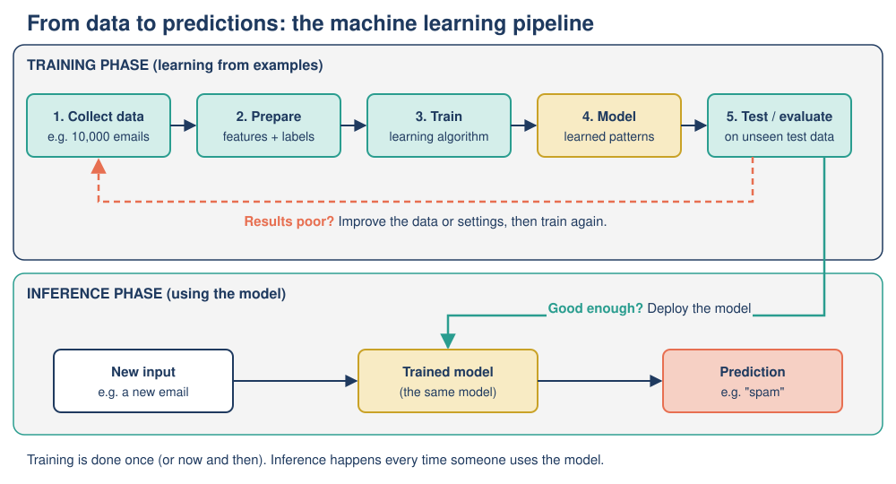

# Mission 09: AI in the Wild

**Pixel's AI Field Guide: Missions for Curious Humans** · Version 1.0 (2026-11-06)
**Covers:** Topic 07, [Real-World Applications of AI](../../task-1/topics/07-real-world-applications.md) · **Time:** about 70 minutes (core) + 10 minutes (optional)
**Navigation:** [Start here](00-start-here.md) · Previous: [Mission 08](mission-08-time-machine.md) · Next: [Mission 10](mission-10-the-fairness-files.md) · [Glossary](glossary.md) · [Resources](resources.md)

---

## [MISSION BRIEF] The six-pocket notebook

Dr. Ada Okafor sends Pixel on a field trip to observe AI "in the wild": in music apps, hospitals and city streets. She hands Pixel a notebook with six pockets, one for each question a good field researcher asks. Pixel's first entry reads: "Music app. Very clever. Probably generative. No risks. 10/10." Dr. Ada sighs and hands it back: "Every pocket, Pixel. Every time."

### Learning goals

By the end of this mission you should be able to:

- **Describe** how AI is used in recommendation systems, healthcare and transportation, naming the **input** and **output** of each.
- **Identify** the kind of AI an application uses (rule-based, machine learning, deep learning or generative AI) and justify it.
- **Trace** how a simple recommender turns past ratings into a recommendation.
- **Evaluate** benefits, risks and the right level of **human oversight**, based on the **stakes** of an error.
- **Apply** the six-part framework to an application you have never seen.

---

## [PREDICT] Before you start (3 minutes)

Write down your answers. You will check them at the end of the mission.

1. Which needs **more** human checking: a music app's "song you might like", or an AI that screens eye photos for disease? Why?
2. Is a navigation app that finds you the fastest route **generative AI**? (Yes / No / Not sure)
3. A streaming app recommends a show to you. Is it showing you what is **best for you**, or something else?

---

## [TRY IT] Activity 9.1: Be the recommender

**Goal:** Trace, by hand, how **collaborative filtering** turns past ratings into a recommendation, and spot two built-in risks (cold start and feedback loops).

**Preparation:** Paper, pen, and simple subtraction. About 20 minutes. No device needed. *All names and ratings are illustrative (made-up) figures.*

A tiny music service has four users and five songs. Ratings go from 1 (hated it) to 5 (loved it). A dash means "not listened yet".

| User | Rock Anthem | Lullaby | Jazz Night | Pop Hit | Space Synth |
|---|---|---|---|---|---|
| **Mo** | 5 | 1 | 2 | 4 | – |
| Zara | 5 | 2 | 1 | 5 | 5 |
| Ken | 1 | 5 | 4 | 2 | 1 |
| Ana | 3 | 3 | 3 | 3 | 2 |

**The rule Pixel uses** (the idea of collaborative filtering: people who agreed in the past will probably agree in future):

1. Compare Mo with each other user on the **four songs they have both rated**. For each song, take the difference between the two ratings and ignore minus signs. Add the differences. **Smaller total = more similar taste.**
2. Find Mo's **most similar** user.
3. Look at what that user gave **Space Synth**. If it is 4 or 5, recommend it to Mo.

**Task:**

- **Part A.** Fill in this table and decide: should the service recommend *Space Synth* to Mo?

| Comparison | Rock Anthem | Lullaby | Jazz Night | Pop Hit | Total difference |
|---|---|---|---|---|---|
| Mo vs Zara | | | | | |
| Mo vs Ken | | | | | |
| Mo vs Ana | | | | | |

- **Part B.** Ken rated *Space Synth* only 1. Should that worry the service before recommending it to Mo? Why or why not?
- **Part C (cold start).** Tomorrow a brand-new song, *Moon Disco*, is added. Nobody has rated it. Can Pixel's rule recommend it to anyone? What could the service use instead?
- **Part D (feedback loop).** Mo listens to *Space Synth* and rates it 5. Next week the service recommends another synth song, Mo rates it 5, and so on for ten weeks. What might Mo's recommendations look like after ten weeks? Who else is affected if many users go through the same loop?
- **Part E (the goal).** Suppose the company rewards the system for **total minutes listened**. Song X is a 3-minute track Mo would love. Playlist Y is a 3-hour "endless loop" Mo would leave playing in the background but not really enjoy. Which would the system learn to push? Who chose that goal?

**Observation:** Record your three totals, your decision, and one sentence for each of Parts B–E.

**Reflection:** Real recommenders compare millions of users and use watch time, skips and searches, not just star ratings. Which part of this hand trace is still true for them, and which part is very different?

**Feedback:**

[DEBRIEF] Worked answers

**Part A.**

| Comparison | Rock Anthem | Lullaby | Jazz Night | Pop Hit | Total difference |
|---|---|---|---|---|---|
| Mo vs Zara | 5 − 5 = 0 | 2 − 1 = 1 | 2 − 1 = 1 | 5 − 4 = 1 | **3** (very similar) |
| Mo vs Ken | 5 − 1 = 4 | 5 − 1 = 4 | 4 − 2 = 2 | 4 − 2 = 2 | **12** (very different) |
| Mo vs Ana | 5 − 3 = 2 | 3 − 1 = 2 | 3 − 2 = 1 | 4 − 3 = 1 | **6** (in between) |

Zara is Mo's most similar user (3). Zara rated *Space Synth* **5**, so **recommend Space Synth** to Mo, near the top of the list.

**Part B.** No. Ken's taste is almost the opposite of Mo's (difference 12), so Ken's low rating is not a warning for Mo. (A real system would combine several similar users, giving more weight to the most similar. Ana, at 6, gave it 2, which might lower the predicted rating a little, but Zara counts most.)

**Part C.** No: with no ratings, there is nothing to compare. This is the **cold-start problem**. Instead the service could use the song's **features** (genre, artist, tempo, length) to match it to people who like similar songs, or briefly show it to a few users to collect first ratings. Cold start is one reason popular items tend to get even more popular.

**Part D.** Mo's list could fill up with synth songs: a **filter bubble**, where you mainly see more of what you already saw. Each rating becomes new training data, so the loop strengthens itself (this is why recommenders are *learning* systems). If many users go through the same loop, popular songs get more exposure, collect more ratings and become even more popular, while new or niche artists struggle to be found.

**Part E.** The system would learn to push **Playlist Y**, because it earns more minutes, even though Mo enjoys Song X more. The AI is not "trying" to do harm; it pursues the measurable target it was given. **People at the company chose the goal**, and that choice has ethical consequences (more in Mission 10).

**Reflection:** Still true: the core idea, *find patterns in what similar people liked*, and the risks (cold start, feedback loops, goal choice). Very different: real systems use machine learning on many signals instead of our hand-written "add up the differences" rule, and they work at a scale of millions of users and items.

---

## [TRY IT] Activity 9.2: Fill the six pockets

**Goal:** Apply the six-part framework (input, output, AI type, benefit, risk, human oversight) to two new applications, and connect oversight to stakes.

**Preparation:** The six questions below. About 20 minutes. *SkinScan and BusBuddy are fictional apps made up for this activity.*

**Dr. Ada's six pockets:**

| # | Pocket | What to look for |
|---|---|---|
| 1 | **Input**: what data goes in? | Clicks, photos, sensor readings, text, numbers |
| 2 | **Output**: what comes out? | A prediction, a ranking, a label, a decision, new content |
| 3 | **AI type**: how does it work? | Rule-based, machine learning, deep learning, generative AI (choose the most specific that fits, and justify it) |
| 4 | **Benefit**: who gains, and how? | Time saved, accuracy, access, cost |
| 5 | **Risk**: what can go wrong, and for whom? | Errors, bias, privacy loss, over-reliance, safety |
| 6 | **Human oversight**: who checks it? | None? Spot checks? A human approves every decision? |

**Application 1: SkinScan.** A free phone app. You photograph a mole on your skin. The app was trained on 100,000 photos of skin marks, each labeled by skin specialists as "harmless" or "possibly dangerous". Most training photos were taken with clinic cameras and show lighter skin. The app outputs either "Low concern" or "See a doctor soon". Nobody reviews "Low concern" results.

**Application 2: BusBuddy.** A city bus app. It uses the live GPS positions of buses, traffic history for each time of day, and today's weather. It shows "Bus 12 arrives in 7 minutes" at each stop.

**Task:**

1. Copy the six pockets twice and fill them in for SkinScan and BusBuddy.
2. For each app, rate the **stakes** of one error as low, moderate, high or very high, and explain.
3. **Quick rank:** order these five from lowest to highest stakes: (a) BusBuddy, (b) SkinScan, (c) a music app's "song you might like", (d) a bank's AI that flags possibly fraudulent card payments, (e) a robotaxi with no human driver.

**Observation:** Compare your two "human oversight" pockets. Do they differ? Did the stakes rating drive the difference?

**Reflection:** SkinScan's training photos are described in detail. Which risk does that description point to, and who would be hurt?

**Feedback:**

[DEBRIEF] Model answers

**SkinScan**

| Pocket | Model answer |
|---|---|
| Input | A phone photo of a mole or skin mark |
| Output | A screening label: "Low concern" or "See a doctor soon" (a classification) |
| AI type | **Deep learning (computer vision), supervised learning**: it learned from 100,000 labeled photos. It is **not** generative: it picks a label, it does not create content. |
| Benefit | Free, fast screening; may get people with dangerous marks to a doctor sooner, especially where specialists are scarce |
| Risk | (1) **False negatives**: a dangerous mark labeled "Low concern" gives false reassurance and delays treatment. (2) **Unrepresentative training data**: mostly lighter skin, so it may be less accurate for people with darker skin. (3) **Distribution shift**: phone photos (blur, lighting) differ from clinic photos. (4) **Privacy**: health photos are sensitive personal data. (5) Over-trust. |
| Human oversight | **High stakes**, so: independent testing, including results **separately for different skin tones**, before release; treat it as a regulated medical device; "Low concern" should still say "see a doctor if it changes, itches or bleeds"; clear statement of what it was tested on; monitoring after release. |

**BusBuddy**

| Pocket | Model answer |
|---|---|
| Input | Live bus GPS positions, traffic history by time of day, weather |
| Output | A predicted arrival time (a number: this is a prediction, sometimes called regression) |
| AI type | **Machine learning**: it learns from past journeys how traffic, time and weather affect travel time. (A simple "distance ÷ average speed" rule would be rule-based; learning from historical patterns makes it ML.) |
| Benefit | Less waiting, better planning, more people using buses |
| Risk | Wrong predictions make people miss buses or wait in bad weather; this hurts most those who rely on buses and have few alternatives. Low privacy risk if it uses only bus positions. |
| Human oversight | **Low to moderate stakes**: no one needs to approve each prediction; the operator monitors accuracy, fixes systematic errors and lets riders report problems. |

**Stakes:** SkinScan **high** (a missed dangerous mark can cost a life); BusBuddy **low to moderate** (a missed bus is annoying, sometimes costly).

**Quick rank (lowest -> highest):** (c) music < (a) BusBuddy < (d) fraud flags < (b) SkinScan < (e) robotaxi. Accept SkinScan and the robotaxi in either order with a reason: a robotaxi error can kill instantly and affects people outside the car; SkinScan errors are silent and the user cannot check them.

**Observation answer:** yes. The rule of thumb is **the higher the stakes, the more human oversight is needed**. A wrong bus time wastes minutes; a missed skin cancer can cost a life.

**Reflection answer:** the training-data description points to **bias and distribution shift**: people with darker skin, and people using ordinary phone cameras, may get less accurate results, and they are the ones who would be falsely reassured. A model is only reliable on data similar to what it was trained on.

---

## [OBSERVE] What did the field trip show?

- **Most everyday AI is predictive, not generative.** Recommenders, screeners and arrival-time predictors pick, rank, label or estimate; they do not create new content.
- **Every application has an input, an output and a goal chosen by people.**
- **Risks come from the data and the goal**, not only from "bad code".
- **Stakes decide oversight**: what happens if it is wrong, and to whom.

---

## [EXPLAIN] Reading any AI application with six questions

AI is not one machine; it is many different systems doing very different jobs. The **six-part framework** (input, output, AI type, benefit, risk, human oversight) works on all of them. Two reminders: the AI types are **nested** (deep learning is a kind of machine learning, and nearly all current generative AI is deep learning), so choose the **most specific** type that fits; and real products often **combine** types (a self-driving car uses deep learning to see, rule-based safety limits, and search-style route planning).

> **Playful analogy:** a collaborative-filtering recommender is like asking the friend whose taste matches yours best: "You loved the same three films as me. What else did you love?"
>
> **Technically speaking:** a recommender learns from **behavioral data** (what you watched, how long, what you skipped, rated and searched, plus the behavior of millions of other users) and is trained to predict a **label** such as "will this user watch at least half of this show?". It then **ranks** the catalog so the items with the highest predicted scores appear first. Modern systems use machine learning, often deep learning, on many features at once.

### Recommendation systems

You meet them in streaming services, online shops, social feeds and news apps. They matter: in a 2015 paper, two Netflix leaders wrote that the recommender "influences choice for about 80% of hours streamed" and that personalization saves the company more than $1 billion a year by reducing cancellations (the company's own figures). **Key point about goals:** a recommender optimizes whatever it is told to optimize. If the goal is watch time or clicks, it may learn that sensational content keeps people watching. Risks: **filter bubbles**, goals that do not match your well-being, **privacy** (a detailed profile of your habits), popular items getting ever more popular, and the **cold-start** problem. Stakes per recommendation are low, so humans oversee the **goals** and test changes rather than checking each suggestion.

### Healthcare

The largest area is **medical imaging**: deep-learning models trained on thousands of labeled images (for example, retina photos labeled by eye specialists) predict whether a new image shows disease. The US Food and Drug Administration (FDA) keeps a public list of AI-enabled medical devices; by the end of 2025 it held well over a thousand devices, and independent analyses found about three-quarters are in **radiology**.

**A landmark:** in April 2018 the FDA authorized **IDx-DR**, which checks retina photos of adults with diabetes for diabetic retinopathy. It was the first AI device authorized to give a screening result **without a specialist interpreting the image**. In the FDA-reported study it correctly identified about **87%** of patients who had the disease (**sensitivity**) and about **90%** of those who did not (**specificity**). So roughly 13 in every 100 patients with the disease were missed: that is why it is a **screening** tool used to decide who sees a specialist, not a final diagnosis.

**A warning:** a widely used US algorithm (Obermeyer and colleagues, *Science*, 2019) predicted *healthcare costs* as a stand-in for *health needs*. Because less had historically been spent on Black patients with the same illness, it judged them healthier than they were and cut the number identified for extra care by more than half. **What you ask the AI to predict matters as much as the data** (Mission 10).

### Transportation

- **Navigation apps:** predicting travel time is **machine learning** (from anonymous phone locations, traffic history, incidents); finding the fastest route is **search**, the same idea as the river puzzle in Mission 02, only much bigger. Not generative AI.
- **Driver assistance** (emergency braking, lane-keeping) uses **deep learning** on camera and radar data; the human driver stays responsible.
- **Robotaxis:** Waymo reports about 271 million "rider-only" miles (no human driver on board) in five US metro areas by June 2026, and about 82% fewer crashes with any reported injury than human-driver benchmarks for the same areas. These are **company-reported figures** that depend on assumptions and on cities with little snow; independent studies are the best check.
- **Rare situations** are the hardest problem. In March 2018 a self-driving test car operated by Uber struck and killed pedestrian Elaine Herzberg in Tempe, Arizona. US investigators (NTSB) found the system failed to identify her correctly until about a second before impact, the safety driver was distracted, and the company's safety culture and regulators' oversight were inadequate. Responsibility was shared, which raises hard questions about **accountability**.

### Stakes and oversight at a glance

| | Streaming recommender | AI eye-disease screening | Robotaxi |
|---|---|---|---|
| **Input** | Viewing history, ratings, others' behavior | Retina photos | Camera, radar, lidar, maps |
| **Output** | Ranked list of titles | Refer / rescreen | Steering, braking, route |
| **AI type** | Machine learning (often deep learning) | Deep learning (computer vision) | Deep learning + planning + safety rules |
| **Main risk** | Filter bubbles, privacy | Missed disease | Rare situations, accountability |
| **Stakes of one error** | Low | High | Very high |
| **Human oversight** | Goal-setting and testing | Specialist follow-up, regulator | Permits, remote staff, incident reporting |

*Figure: The six-part framework applied to three applications; oversight rises with the stakes.* (Original table created for this module.)

*Figure: The machine-learning pipeline behind most applications here: training happens first on historical data; inference (prediction) happens each time the application is used.* (Original diagram created for this module.)

For more applications (fraud detection, translation, voice assistants, crop-disease apps) and the full worked example, read [Topic 07](../../task-1/topics/07-real-world-applications.md).

---

## [LAB NOTE] What the hand trace leaves out

- Pixel's "add up the differences" rule is a teaching simplification. Real recommenders **learn** how to combine thousands of signals; nobody writes the similarity rule by hand.
- Four users and five songs hide the real challenge: millions of users, millions of items, and most ratings missing.
- The six-part framework is a thinking tool for this guide, not an official standard. Real assessments (Mission 12) ask similar questions in much more detail.
- Company figures (Netflix, Waymo) are reported by the companies themselves. Treat them as claims to check, not as neutral facts.

---

## [WATCH] How recommenders choose for you

| | |
|---|---|
| **What** | *How YouTube knows what you should watch: Crash Course AI #15*, CrashCourse, host Jabril (2019, 10:51). Link: <https://www.youtube.com/watch?v=kiInh5STnyQ> |
| **Why** | Explains content-based, social and personalized recommendations and collaborative filtering, then covers drawbacks and privacy: exactly the input, output, benefit and risk pockets. |
| **Which part** | **0:47–6:07** ("How recommender systems work", "Recommendation approaches" 2:05, "Collaborative filtering" 3:35) and **6:43–9:24** ("Challenges and drawbacks", "Managing digital privacy" 8:26), from YouTube's chapter list. |
| **What to do** | *Before watching:* predict what data a video app uses to recommend to you. *While watching:* "What information does a recommender use as its input, and what is its output?" *After:* fill the six pockets for a music or video app you use, and name one risk the video mentions. |
| **Watch out for** | It is a YouTube video explaining YouTube. Real platform recommenders in 2026 are far more complex and change often: treat the video as the *idea*, not a description of today's system. Made in 2019. |
| **Captions and access** | en-US (manual) and Korean; English auto-captions. Can't open YouTube? Use Activity 9.1 and the "Recommendation systems" part of [EXPLAIN]; the Crash Course website embeds the same video. |

[DEBRIEF] Viewing question

Input: your history, ratings, clicks and watch time, plus the behavior of other people with similar tastes. Output: a **ranked list** of suggestions. Risks mentioned include filter bubbles / echo chambers and privacy.

---

## [APPLY] Activity 9.3: Fix Pixel's field notes

**Goal:** Use the framework critically by finding and correcting errors in an analysis.

**Preparation:** The six pockets and the [EXPLAIN] section. About 10 minutes.

**Task:** Pixel analyzed a bank's **card-fraud detection** system. Find **four** errors and correct each one, explaining why.

| Pocket | Pixel's notes |
|---|---|
| Input | Transaction details: amount, place, time, type of shop, and the card's usual spending pattern |
| Output | It arrests the criminal |
| AI type | Generative AI, because it creates alerts |
| Benefit | Stops theft quickly and saves customers money |
| Risk | None, because it is 99% accurate |
| Human oversight | A human must check every single card payment before it goes through |

**Observation:** Mark each row "correct" or "error".

**Reflection:** Pixel wrote "99% accurate". Why is a percentage alone never enough to judge risk?

**Feedback:**

[DEBRIEF] The four errors

1. **Output:** wrong. The system outputs a **suspicion score or alert** ("this payment looks unusual"); the bank may then block the payment and ask the customer to confirm. Arresting people is done by the police, not by the model.
2. **AI type:** wrong. It is **predictive machine learning**: trained on past transactions labeled "fraud" or "genuine", it scores new ones. Creating an alert is not "generating content"; it picks a label.
3. **Risk:** wrong. Banks process enormous numbers of payments, so even a 1% error rate means many mistakes: **genuine purchases blocked** (for example, while traveling), and fraud that slips through. Customers whose genuine spending is unusual may be flagged more often. Fraudsters also change tactics, so the data shifts.
4. **Human oversight:** wrong. Checking every payment is impossible at this scale and unnecessary for the stakes of one payment. Sensible oversight: customers can confirm or dispute alerts quickly; staff review flagged cases and complaints; the bank monitors false-alert rates, including for different groups of customers.

(The Input and Benefit rows are correct.)

**Reflection answer:** a percentage hides **how many** people are affected at scale, **what kind** of error happens (false alarms or missed cases), and **who** bears the errors. Always ask "99% of what, tested on whom, and what happens to the 1%?"

---

## [OPTIONAL SIDE QUEST] Why am I seeing this? (10 minutes)

Open a streaming, shopping or video app you already use. Find one recommendation and look for a "Why am I seeing this?" or similar explanation. Fill the six pockets for it. Which input data does the app admit to using? Does that match what you learned? (Don't change any privacy settings unless you want to; just look.)

---

## [CHECK] Quick self-check

1. Name the six parts of the framework.
2. Why is a navigation app's route-finding **not** generative AI? Which two techniques does a navigation app combine?
3. An eye-screening AI has about 87% sensitivity. Out of 100 people who really have the disease, about how many does it miss? Why does that make it a *screening* tool?
4. What is the cold-start problem?
5. A video recommender rewarded for watch time pushes sensational videos. The system is "working". Why is this still a problem, and whose decision caused it?

---

## [DEBRIEF] Check answers

Show answers with explanations

1. **Input, output, AI type, benefit, risk, human oversight.**
2. It **chooses among existing roads**; it does not create new content. It combines **machine learning** (predicting travel times from traffic data) with **search** (finding the fastest path through the road network).
3. About **13**. Because some patients are missed, the result is used to decide who needs a specialist, with positive results going to a specialist and use limited to the tested situation, rather than as a final diagnosis.
4. A recommender based on ratings cannot recommend a **new item nobody has rated** (or serve a new user with no history), because there is nothing to compare. Using item features (genre, artist) helps.
5. It is optimizing exactly the target it was given, but watch time is not the same as users' well-being or a healthy information diet. **People at the company chose the goal**, so responsibility lies with them, not with the AI.

**Now look back at your [PREDICT] answers.** Did you choose the eye-screening AI as higher stakes? Did you decide that navigation is search plus machine learning, not generative AI? Did you notice that recommendations show what you are *predicted to engage with*?

---

## Mission summary

- Analyze any application with **six questions: input, output, AI type, benefit, risk, human oversight**.
- **Recommenders** use collaborative filtering and machine learning on behavioral data to **rank** items; risks include filter bubbles, privacy, cold start and goals (like watch time) chosen by people.
- **Healthcare AI** is mostly deep-learning image analysis; IDx-DR (2018, about 87% sensitivity, about 90% specificity) shows why screening tools still need specialists.
- **Transportation** combines machine learning, deep learning, search and safety rules; company-reported robotaxi figures need independent checks, and rare situations remain the hardest problem.
- **The higher the stakes, the more human oversight is needed.**

## Next mission

Pixel's notebook is full of risks: bias, privacy, blame. Dr. Ada thinks they deserve a proper investigation. In [Mission 10: The Fairness Files](mission-10-the-fairness-files.md), Pixel turns detective and opens five real case files.
