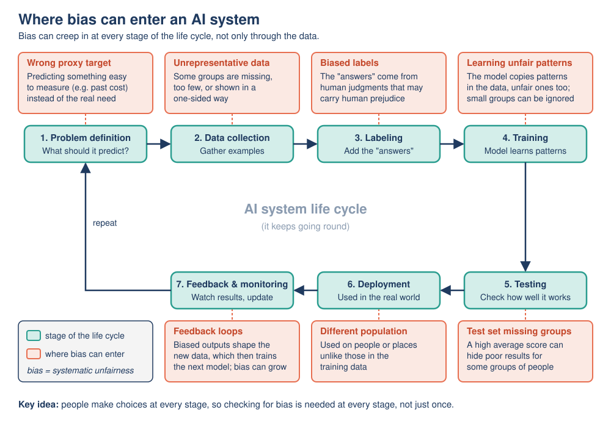

# Mission 10: The Fairness Files

**Pixel's AI Field Guide: Missions for Curious Humans** · Version 1.0 (2026-11-06)
**Covers:** Topic 08, [Ethics, Risks and Social Impact of AI](../../task-1/topics/08-ethics-risks-social-impact.md) · **Time:** about 100 minutes (core, can be split over two sessions) + 15 minutes (optional)
**Navigation:** [Start here](00-start-here.md) · Previous: [Mission 09](mission-09-ai-in-the-wild.md) · Next: [Mission 11](mission-11-myth-busters.md) · [Glossary](glossary.md) · [Resources](resources.md)

---

## [MISSION BRIEF] The locked filing cabinet

Dr. Ada Okafor unlocks a grey filing cabinet labeled **THE FAIRNESS FILES**. Inside are five folders, each about a real event in which an AI system helped or harmed real people. Pixel, wearing a detective hat two sizes too big, peeks in and declares: "Case closed. Computers are neutral, so AI cannot be unfair." Dr. Ada hands Pixel the first folder: "Detectives look at the evidence before they close a case."

### Learning goals

By the end of this mission you should be able to:

- **Explain** how bias can enter an AI system at different stages of its life cycle, using a real case as evidence.
- **Distinguish** six major ethical issues: **bias, privacy, jobs, accountability and transparency, environmental cost, and misinformation (including deepfakes)**.
- **Interpret** the World Economic Forum's 2025 job projections correctly, including what a "net" figure hides.
- **Investigate**, with a small experiment, how unbalanced training data changes a model's behavior.
- **Analyze** a case with a structured method and **propose** practical safeguards.

---

## [PREDICT] Before you start (3 minutes)

Write down your answers. You will check them at the end of the mission.

1. A face-analysis system is "96% accurate overall". Could it still be unfair to some people? (Yes / No / Not sure) How?
2. Between 2025 and 2030, will AI and other changes **destroy more jobs than they create**, according to the biggest employer survey? (Yes / No / Not sure)
3. A lawyer submits fake court cases that a chatbot invented. Who is responsible: the chatbot, the chatbot company or the lawyer?

---

## [TRY IT] Activity 10.1: Open the case files

**Goal:** Investigate five real cases, name the ethical issue in each, locate where things went wrong, and propose safeguards.

**Preparation:** Paper and pen. The **detective's questions** below. About 35 minutes (about 7 minutes per file). Works alone, or in a group where each person takes one or two files and reports back. No device needed. All facts you need are in the folders.

**The detective's questions (use them for every file):**
1. **What happened?** Describe the system: input -> output, who uses it, on whom.
2. **Which issue?** Bias, privacy, jobs, accountability/transparency, environmental cost, or misinformation/deepfakes. (Sometimes two.)
3. **Who was affected?** Include people who never chose to use the system.
4. **What would have helped?** Name at least one safeguard.

---

### Case File 1: The Missing Faces (2018)

> **Evidence.** Researchers **Joy Buolamwini and Timnit Gebru** tested three commercial **gender classification** systems (services that look at a face photo and output "male" or "female"), from IBM, Microsoft and Face++. They noticed that two popular face datasets used to build and test such systems were mostly lighter-skinned people (about 80% and 86%). So they built a new, balanced test set: **1,270 photos of members of parliament from three African and three European countries**, labeled by gender and skin type. All three systems were most accurate for **lighter-skinned men (worst error rate 0.8%)** and least accurate for **darker-skinned women (error rates up to 34.7%)**. The companies' overall accuracy figures had hidden this gap. The study was called **Gender Shades**.

**File 1 questions:**
- a) Answer the four detective questions.
- b) **Mini-calculation** *(illustrative made-up figures)*: a company tests its system on 1,000 photos: 900 lighter-skinned men (1% error, so 9 errors) and 100 darker-skinned women (30% error, so 30 errors). What overall accuracy does the company report? What does that number hide?
- c) Look at the life-cycle diagram in [EXPLAIN]. At which **two** stages did things go wrong?

### Case File 2: The Database Nobody Agreed To (2024)

> **Evidence.** The facial-recognition company **Clearview AI** built a database of **billions of face photos scraped from the internet** without people's knowledge or consent. In **September 2024** the Dutch Data Protection Authority fined it **€30.5 million** under European data-protection law (the **GDPR**). Separately, Dr. Ada reminds Pixel that conversations typed into AI chatbots may be stored and, depending on the provider's settings, used to improve models.

**File 2 questions:**
- a) Answer the four detective questions.
- b) Your photos are on a public website. Does "public" mean anyone may use them to build a face-recognition system? Explain using the word **consent**.
- c) Pixel wants to paste a classmate's medical notes into a public chatbot "to summarize them". What should Dr. Ada say?

### Case File 3: The Jobs Forecast (2025)

> **Evidence.** The **World Economic Forum (WEF) *Future of Jobs Report 2025*** (published January 2025) surveyed **more than 1,000 large employers**, representing **over 14 million workers in 55 economies**. Their combined expectation for **2025–2030**: about **170 million jobs created**, about **92 million jobs displaced**, a **net gain of about 78 million**. The WEF links these changes to **several trends together**: technology (including AI), the green energy transition, economic pressures and population changes. Around **22%** of jobs are expected to be affected by this churn (created or destroyed).

**File 3 questions:**
- a) Show the calculation for the net change.
- b) For every 10 jobs created, about how many are displaced? (Round to a whole number.)
- c) A headline says: **"AI to create 78 million new jobs by 2030."** Find **two** ways it is misleading.
- d) Explain why a net gain can still mean real hardship for some people. Use the idea that AI often automates **tasks**, not whole jobs.

### Case File 4: The Phantom Court Cases (2023)

> **Evidence.** In the US case ***Mata v. Avianca***, lawyers submitted a court brief citing **six court decisions that did not exist**. ChatGPT had generated them, complete with realistic names and citations. In **June 2023** a federal judge fined the lawyers and their firm **$5,000** in total. In a second folder, Pixel finds a note from a bank customer: "Your AI refused my loan. When I asked why, staff said nobody can tell, the model is too complicated."

**File 4 questions:**
- a) Answer the four detective questions for the court case. Who is responsible for the fake citations?
- b) The loan note describes a **black box**. Why is that an accountability problem for the customer?
- c) Name two safeguards that would help the bank customer.

### Case File 5: The Fake Video Call (2024)

> **Evidence.** In early 2024 an employee at the Hong Kong office of the engineering firm **Arup** joined a video call with people who looked and sounded like the company's chief financial officer and other colleagues. **All of them were deepfakes**: realistic fake video and audio made with generative AI. The employee made **15 transfers totaling HK$200 million (about US$25 million)** to the criminals.

**File 5 questions:**
- a) Answer the four detective questions.
- b) Write a simple **company rule** that would probably have stopped this fraud.
- c) Deepfakes can also give people "plausible deniability". What do you think that means?

---

**Observation:** Make a one-line "case board" for each file: *file -> main issue -> who was harmed -> one safeguard*.

**Reflection:** In which files did the harm come from the **AI's errors**, and in which from **people using AI on purpose** to deceive or to collect data? Does that change who should be held responsible?

**Feedback:**

[DEBRIEF] Case File 1: The Missing Faces

a) Input: a face photo; output: "male" / "female". Used by companies building products; applied to anyone photographed. **Issue: bias.** Affected: darker-skinned women most of all, who could be misclassified far more often, without knowing it. Safeguards: more representative training and test data; **report results separately for each group** (a **disaggregated evaluation**); independent audits; diverse teams.

b) Errors = 9 + 30 = 39 out of 1,000 = 3.9%, so the company reports **96.1% accuracy**. That hides a **30%** error rate for darker-skinned women, more than 30 times the 1% for lighter-skinned men. A high average can hide very poor results for a group that is small in the test set.

c) **Data collection** (datasets mostly lighter-skinned) and **testing** (accuracy checked only overall, so the gap stayed invisible). (Also acceptable: **labeling**, because gender was recorded as only two options, a simplification the authors acknowledged.)

*Note the study's own limits:* it tested gender *classification*, not recognizing individuals, and used a binary gender label.

[DEBRIEF] Case File 2: The Database Nobody Agreed To

a) Input: face photos scraped from the web; output: a searchable face-recognition database. **Issue: privacy** (also transparency: people were never told). Affected: billions of people who never agreed, including people who never use the service. Safeguards: collect only data that is needed (**data minimization**), clear **consent**, laws such as the GDPR, and enforcement (fines).

b) No. "Publicly visible" is not the same as **consent** to a new use. People posted photos for friends or work, not to be identified by a face-search system; European law treats faces used for identification as sensitive personal data.

c) "Don't paste other people's personal or confidential information into a public chatbot unless you know how it will be stored and used. It isn't yours to share, and it may be kept or used for training."

[DEBRIEF] Case File 3: The Jobs Forecast

a) 170 million − 92 million = **78 million** net new jobs.

b) 92 ÷ 170 ≈ 0.54, so about **5 displaced for every 10 created**.

c) Any two: (1) 78 million is a **net** figure: the report projects **170 million created and 92 million displaced**; (2) the change is driven by **several trends**, not AI alone; (3) it is a **projection** from employer surveys, not a fact.

d) The people who lose jobs are often not the people who get the new ones: new jobs may be in different sectors, places or skill levels. A cashier whose job disappears does not automatically become a data analyst. AI usually automates **tasks** (for example, routine data entry), so some jobs change while others, made mostly of automatable tasks, are at high risk. Without retraining and support, displaced workers can face unemployment or lower pay while the total grows. This is why "AI will take *all* jobs" is a misconception (Mission 11), while "AI will cause serious disruption for some workers" is a real concern.

[DEBRIEF] Case File 4: The Phantom Court Cases

a) Input: the lawyers' prompts; output: text with invented case citations (a **hallucination**, Mission 06). **Issue: accountability** (also misinformation). Affected: the court, the opposing side, the lawyers' own client. **The lawyers were responsible**: the human who uses an AI output remains responsible for it. "The AI said so" is not a defense, and AI systems are not legal persons.

b) The customer cannot find out **why** they were refused, so they cannot spot a mistake, correct wrong data, or challenge the decision. Large neural networks contain huge numbers of learned weights, so even their designers cannot simply read off a reason (**black box**). **Explainability** means being able to give a human-understandable reason for a specific output.

c) Any two: a right to a **human review** of important automated decisions; a clear explanation of the main reasons; keeping **logs** of how decisions were made; independent audits; clear rules on who is responsible.

[DEBRIEF] Case File 5: The Fake Video Call

a) Input: video and voice of real people (used to train or drive the fake); output: realistic fake video and audio. **Issue: misinformation and deepfakes** (deliberate **disinformation** used for fraud). Affected: the employee, the company, and the real people whose faces and voices were faked.

b) For example: "Any request to move money that arrives by video call, email or message must be confirmed through a **second channel**: call the person back on a number already in the company directory, and get a second manager's approval for large amounts."

c) If convincing fakes are common, someone caught on a **real** recording can claim "that's a deepfake" and escape responsibility. Deepfakes damage trust in genuine evidence too.

[DEBRIEF] Case board and reflection

| File | Main issue | Harmed | One safeguard |
|---|---|---|---|
| 1 Missing Faces | Bias | Darker-skinned women | Test results separately for each group |
| 2 Database | Privacy | Billions of people photographed | Consent and data minimization |
| 3 Jobs Forecast | Jobs | Displaced workers | Retraining and safety nets |
| 4 Phantom Cases | Accountability / transparency | Court, client, loan customer | Human stays responsible; right to review |
| 5 Fake Call | Misinformation / deepfakes | Company, employee, faked people | Verify through a second channel |

**Reflection:** Files 1 and 4 (the hallucination part) involve **AI errors**; Files 2 and 5 involve **people using AI deliberately** (to collect data without consent, or to deceive); File 3 is about the **effects** of AI and other trends. In every case, responsibility lies with **people and organizations**, but different ones: builders and testers (File 1), the company collecting data (File 2), users who rely on outputs (File 4), criminals plus organizations that need better checks (File 5), and employers and governments managing change (File 3). Pixel's "computers are neutral" theory does not survive File 1.

---

## [TRY IT] Activity 10.2: The lopsided training lab (Teachable Machine)

**Goal:** See for yourself how **unbalanced training data** changes a model's behavior, and why results must be **checked separately for different people** (the lesson of Case File 1).

**Preparation:**
- **This builds on Mission 04, Activity 4.3** ("Teach Pixel to read thumbs"), which saved its "Part C" for this mission. Teachable Machine saves nothing when you close the tab, so you will quickly rebuild that model in step 1.
- **Platform:** Google **Teachable Machine** (version observed: 2.4.18), <https://teachablemachine.withgoogle.com/>. External resource by Google. **No account needed.** According to its FAQ, training happens **inside your browser tab** and your images are not sent to any server unless you save to Google Drive or upload your model. **Do not click "Export Model" / "Upload my model"** in this activity.
- **Device:** a laptop or desktop with **Chrome or Firefox** (recommended by the app; phones and tablets were not tested), with a **webcam**, or 15–20 photos per class (.png or .jpg) to upload.
- **People:** step 4 needs a second person's hand. Ask first and film hands only. Nothing needs deleting afterwards: closing the tab discards everything.
- **Time:** about 30 minutes. *No device or webcam, or the site is blocked?* Use the **fallback results table** at the end of this activity.

**Task:**

1. **Rebuild the balanced model (5 minutes).** Open <https://teachablemachine.withgoogle.com/> -> **Get Started** -> **Image Project** -> **Standard image model**. Rename "Class 1" to `thumbs up`, "Class 2" to `thumbs down` (pencil icon), click **Add a class** and name it `nothing`. For each class click **Webcam**, allow camera access and press and hold **Hold to Record** for 3–4 seconds (about 40–60 samples; for `nothing`, film the empty background). *(No webcam: **Upload** 15–20 photos per class.)* Keep the default training settings and click **Train Model**; **don't switch tabs** until it finishes.
2. **Baseline test.** In **Preview** (Input ON), do **10 clear thumbs-down** gestures and **10 ambiguous** gestures (a flat hand, a half-raised thumb). Record how many thumbs-down were labeled correctly, and which class "won" each ambiguous gesture.
3. **Make it lopsided.** **[PREDICT]** first: what will happen to the thumbs-down results? Then open the menu on the `thumbs down` class, choose **Remove All Samples**, record only about **8** new samples, and click **Train Model** again (`thumbs up` and `nothing` keep about 50 each). Repeat the step 2 tests exactly.
4. **Test by person.** Ask a second person (with permission) to do **10 thumbs-down** gestures. Record their correct count separately from yours. Then compute the combined accuracy for all 20.
5. **Fix it.** Add samples to `thumbs down` until it is about as big as the other classes, using **varied** examples: both people's hands, different angles and backgrounds. Retrain and repeat steps 2 and 4.

**Observation:** Fill in this table:

| Test | Balanced model | Lopsided model | Fixed model |
|---|---|---|---|
| My thumbs-down: correct out of 10 | | | |
| Second person's thumbs-down: correct out of 10 | | | |
| Combined thumbs-down accuracy (out of 20) | | | |
| Ambiguous gestures labeled `thumbs up` (out of 10) | | | |

**Reflection:**
- Q1. With the lopsided model, where did the ambiguous gestures tend to go? Why?
- Q2. Whose thumbs-down results dropped more: yours or the second person's? Why might that be?
- Q3. If you had reported only the **combined** accuracy, what would you have hidden? Connect this to Case File 1.
- Q4. In step 5, would adding 50 more photos of **only your** hand, in the same room, have fixed the problem for the second person?

**Feedback:**

[DEBRIEF] What usually happens, and why

Results vary with your camera, lighting and hands, so these are **typical** outcomes, not guarantees.

- **Q1.** Ambiguous inputs often lean towards the **larger** class (`thumbs up`). With only 8 examples, the model has a poor picture of what thumbs-down can look like, so borderline cases go elsewhere. This is a common tendency, not a rule: a shortcut such as the background can matter more.
- **Q2.** Usually the **second person's** results drop more. The 8 new samples (and most of the earlier ones) show *your* hand, so the model learned "thumbs-down looks like this particular hand in this room". People who differ from the training examples (hand size, skin tone, sleeve, jewelry, angle) are the first to be misread.
- **Q3.** The combined figure averages the two people together, so a fairly good result for you can hide a poor one for the other person. This is exactly how the companies' overall accuracy hid the 34.7% error rate for darker-skinned women in Gender Shades. **Breaking results down by group** (a disaggregated evaluation) is the only way to see the gap.
- **Q4.** Probably not. More of the **same** data makes the model more confident about the same narrow pattern. **Varied** data that includes the people the model will be used on is what helps. (Mission 11 calls the opposite belief a misconception: "more data always fixes it".)

**Fallback (no webcam, blocked site or device restrictions).** Analyze these results. *Illustrative (made-up) figures*, from imagined runs of the steps above:

| Test | Balanced model | Lopsided model (8 thumbs-down samples) | Fixed model (varied samples) |
|---|---|---|---|
| Trainer's thumbs-down: correct out of 10 | 10 | 7 | 10 |
| Second person's thumbs-down: correct out of 10 | 8 | 3 | 9 |
| Combined thumbs-down accuracy (out of 20) | 90% | 50% | 95% |
| Ambiguous gestures labeled `thumbs up` (out of 10) | 4 | 8 | 5 |

Answer Q1–Q4 using the table. Then answer: if the lopsided model were reported as "about 70% accurate on thumbs-down for the trainer", what would that hide?

[DEBRIEF] Fallback answers

- **Q1:** ambiguous gestures labeled `thumbs up` rose from 4 to 8 out of 10: they went to the bigger class.
- **Q2:** the second person dropped from 8 to 3 (a fall of 5), the trainer only from 10 to 7. The person least like the training data was hurt most.
- **Q3:** the combined 50% hides a split of 70% for the trainer and 30% for the second person.
- **Q4:** the fixed model used *varied* samples and brought the second person up to 9 out of 10. Same-hand photos would not have taught the model what the second person's hand looks like.
- **Extra question:** "70% for the trainer" hides that the system works far worse (30%) for someone else, the same pattern as a vendor quoting accuracy measured mainly on one group.

> **[LAB NOTE] Limits of this experiment:** Teachable Machine trains a tiny model on a few dozen images from one camera, using **transfer learning** (it reuses a model pre-trained on many images and retrains only its last layer on your classes). Two people and ten tries each is far too small to measure fairness properly; real audits use large, carefully designed test sets for many groups. The confidence bars are not calibrated probabilities, and the activity shows supervised learning only. It demonstrates the *mechanism* of data-driven bias, not its size in any real product.

---

## [OBSERVE] What do the files and the lab have in common?

- **The model reflects its data.** Who is in the data, and how much, shapes who the system works for.
- **Averages hide groups.** 96% overall can hide 30% error for one group, until you break the results down.
- **Not every harm is an error.** Some harms come from people using AI to collect data without consent or to deceive.
- **People remain responsible**: the builders, the deployers, the users, and the people who set the rules.

---

## [EXPLAIN] Six issues and where bias comes from

An AI system is built by people who choose **what problem to solve, what data to use, what to predict and where to deploy it**. AI raises special concerns because it works at **massive scale**, learns from **historical data** that can carry past unfairness, can be **hard to inspect** (a black box), and can **create convincing content**. Start any analysis with four questions: **Who benefits? Who could be harmed? What could go wrong? Who is responsible if it does?**

> **Playful analogy:** a model trained on the past is like a very fast photocopier of the past: it copies the page, including the smudges, and makes a million copies before anyone checks.
>
> **Technically speaking:** a supervised model learns statistical patterns linking features to labels in its training data. If the data under-represent a group, or the labels record past unfair decisions, the model learns those patterns too and applies them **consistently and at scale** during inference. "Bias" here means outputs that are **systematically less accurate or less fair for some groups** (not the same as the "bias" number inside an artificial neuron from Mission 05).

### Bias can enter at every stage

*Figure: Bias can enter an AI system at every stage of its life cycle, not only through the training data.* (Original diagram created for this module.)

| Stage | How bias can enter | Example |
|---|---|---|
| 1. Problem definition | A convenient **proxy** is chosen instead of the real goal | Predicting healthcare *cost* instead of health *need* (Obermeyer et al., 2019; Mission 09) |
| 2. Data collection | Some groups missing or under-represented | Face datasets mostly of lighter-skinned people (Gender Shades) |
| 3. Labeling | "Answers" come from human judgments that may carry prejudice | Past hiring decisions used as the label "good candidate" |
| 4. Training | The model copies unfair patterns; small groups can be ignored | A resume model learning that "women's" predicts "not hired" (Amazon's experimental tool, reported by Reuters in 2018; Amazon said recruiters never used it on its own to evaluate candidates) |
| 5. Testing | Only overall accuracy checked | 96% overall hiding 30% error for one group (illustrative made-up figures, File 1) |
| 6. Deployment | Used on different people or settings than it was built for | A model trained in one country used in another |
| 7. Feedback and monitoring | Biased outputs shape the next round of training data | Popular items shown more, so they get even more popular (Mission 09) |

**What helps:** more representative data; **testing separately for different groups**; choosing targets carefully; diverse teams; independent audits; and the ability for affected people to challenge decisions.

### The six issues at a glance

| Issue | Core question | Real example | One safeguard |
|---|---|---|---|
| **Bias** | Is it equally accurate and fair for everyone? | Gender Shades (2018): up to 34.7% vs 0.8% error | Test results separately for each group |
| **Privacy** | Whose data, with what consent? | Clearview AI fined €30.5M (Sept 2024) | Data minimization and consent |
| **Jobs** | Who loses work, who gains it? | WEF 2025: 170M created, 92M displaced, net +78M (2025–2030) | Retraining and safety nets |
| **Accountability & transparency** | Who is responsible, and can we see why? | *Mata v. Avianca* (2023): lawyers fined $5,000 for fake AI citations | Human stays responsible; logs; right to review |
| **Environmental cost** | What energy and water does it use? | IEA (April 2025): data-center electricity projected to more than double to ~945 TWh a year by 2030 | Efficient models, renewable power |
| **Misinformation & deepfakes** | Can people tell what is real? | Arup deepfake video call (2024): HK$200M (~US$25M) | Verify through a second channel; labeling |

A few points the table can't hold:

- **Jobs, read carefully:** the WEF figures are **projections** from employers, cover **several trends** (not only AI) and are **net** figures that hide real losses. AI usually automates **tasks**, not whole jobs. Employers also expect nearly two-fifths of workers' core skills to change by 2030.
- **Environmental cost:** the International Energy Agency projects that demand from data centers built specially for AI will more than quadruple by 2030. One query is small; the impact comes from billions of queries and ever-larger models, and it falls on the places where data centers are built (local electricity grids and water supplies).
- **Misinformation** can be accidental (hallucinations repeated as fact) or deliberate (**disinformation**, such as deepfakes of politicians or fraud).

### A structured way to analyze any case

1. **Describe** the system (input -> output, AI type, who uses it, on whom).
2. List the **stakeholders**, including people who don't use the system but are affected.
3. **Benefits**: who gains, how much?
4. **Harms**: check all six issues.
5. **Evidence**: data (such as error rates by group) or a similar real case?
6. **Safeguards**: what would reduce the harms? Who is accountable?
7. **Judgment**: use as is, use with conditions, or don't use? Justify.

For the full worked example (how bias enters a hiring model and how to fix it), read [Topic 08](../../task-1/topics/08-ethics-risks-social-impact.md).

---

## [WATCH] The coded gaze, and why data matters

| | |
|---|---|
| **What** | *How I'm fighting bias in algorithms*, Joy Buolamwini, TED (TEDxBeaconStreet, recorded 2016; 8:44 on YouTube). Link: <https://www.youtube.com/watch?v=UG_X_7g63rY> |
| **Why** | A first-person, memorable demonstration: face-detection software only "sees" her face when she wears a white mask. She then explains the root cause. It is the story behind Case File 1. |
| **Which part** | **0:00–4:13** ("The coded gaze", "Personal experiences of bias" 1:18, "How bias spreads" 2:34, "The root cause in machine learning" 3:15). Optional: 6:20–8:44 (what we can do). Timestamps from YouTube's chapter list. |
| **What to do** | *While watching:* "Why did the software fail to detect her face? Was the program 'prejudiced', or was something else going on?" *After:* on the life-cycle diagram, mark the stage where this bias entered, and name one other stage where bias could enter. |
| **Watch out for** | This 2016 talk is about face **detection**; her later Gender Shades study (2018) was about gender **classification**. Statistics quoted in the talk (such as "117 million" US adults in face-recognition networks) come from a 2016 report and are dated. |
| **Captions and access** | Subtitles in 22 languages plus English auto-captions. Can't open YouTube? Watch on TED.com: <https://www.ted.com/talks/joy_buolamwini_how_i_m_fighting_bias_in_algorithms> (the full transcript is on the same page under "Transcript"). |

[DEBRIEF] Viewing question

Not "prejudice" in the program: the **training sets were not diverse enough**, so faces that differ from the training examples were harder to detect. This is the **data collection** stage. Other possible stages: **testing** (if results are not broken down by group, nobody notices) or **deployment** (using the system on people unlike the training data). She calls for more inclusive, "full-spectrum" training sets, diverse teams and auditing.

| | |
|---|---|
| **What** | *AI: Training Data & Bias*, Code.org "How AI Works" series (2019, 2:40). Link: <https://www.youtube.com/watch?v=x2mRoFNm22g> |
| **Why** | In under three minutes: a model's predictions depend on its training data, and biased data can lead to biased decisions. A good primer just before Activity 10.2. |
| **Which part** | The whole video (it has no chapter list). |
| **What to do** | Finish the sentence: "A machine-learning model is only as good as ___." Then predict what will happen in step 3 of Activity 10.2. |
| **Watch out for** | Very short: it names the problem but not the fixes, and bias can also enter through labeling, design and deployment (see the life-cycle table). |
| **Captions and access** | About 49 caption languages. Can't open YouTube? Code.org's own copy: <https://contentful-videos.code.org/90t6bu6vlf76/RDlu9sZfdQPEojHL9IgOc/98b496b4347091c6bdb64c5de301db28/ai-03-training-data.mp4> |

[DEBRIEF] Viewing question

"... its **training data**." (A fuller version: "... its training data, its labels, the goal it is given, and how carefully it is tested.")

---

## [APPLY] Activity 10.3: Write your own case file

**Goal:** Use the seven-step method to analyze a new case and reach a justified judgment.

**Preparation:** The seven steps from [EXPLAIN]. About 20 minutes. *TenantCheck is fictional, made up for this activity; use only the facts given.*

> A property company wants to use **TenantCheck**, an AI that scores people applying to rent flats. Facts: (a) it was trained on the company's own decisions from the last 10 years, with the label "accepted" or "rejected"; (b) its features include the **postcode** of the applicant's current address and the number of years in their current job; (c) the vendor reports "92% agreement with past decisions", with no breakdown by group; (d) applicants with low scores are rejected automatically, and nobody at the company looks at them; (e) rejected applicants get no reason; (f) the tool also collects applicants' public social-media posts "to check personality", without asking them.

**Task:** Work through all seven steps. In step 4, link each harm to a specific fact (a–f). In step 7, give your judgment in 3–4 sentences.

**Observation:** Count how many of the six issues you found. Which fact did you link to the most issues?

**Reflection:** "92% agreement with past decisions" sounds good. Why might it actually be a warning sign?

**Feedback:**

[DEBRIEF] Model case file

1. **Describe:** input = application details, postcode, job history, social-media posts; output = a score, with automatic rejection below a cut-off; AI type = **predictive machine learning** (supervised, trained on past labeled decisions). Used by the company, on applicants.
2. **Stakeholders:** applicants (especially rejected ones), the company and its staff, current tenants, neighborhoods whose postcodes are scored down, regulators, the vendor.
3. **Benefits:** faster, cheaper processing of many applications; more consistent scoring.
4. **Harms:**
   - **Bias** (a, b): the labels are **past human decisions**, which may contain past unfairness; **postcode** can act as a **proxy** for ethnicity or income, so the model can discriminate without anyone writing "discriminate".
   - **Testing gap** (c): no breakdown by group, so unequal results stay hidden (like Gender Shades).
   - **Accountability and transparency** (d, e): automatic rejection with no human check and no reasons, so wrong decisions cannot be noticed or challenged.
   - **Privacy** (f): personal posts collected for a new purpose without consent.
   - (Jobs: some staff work may be automated; environment and deepfakes are not central here.)
5. **Evidence:** the Amazon hiring tool learned bias from past decisions; Gender Shades showed that overall figures hide group gaps; Obermeyer et al. showed how a poor proxy creates bias.
6. **Safeguards:** test outcomes **separately by group** before use; remove or examine proxy features such as postcode; have a **human review** every rejection; give applicants **reasons** and a way to appeal; stop collecting social-media posts (or ask for clear consent); independent audits; keep logs.
7. **Judgment (example):** "Do not deploy as is. It copies ten years of past decisions that were never checked for fairness, uses postcode as a likely proxy, rejects people automatically with no reasons and collects personal posts without consent. It could be considered only as a tool that assists human staff, after group-by-group testing, removal of proxy features and social-media collection, and with reasons and appeals for applicants." (Other judgments, including "use with strict conditions", earn credit if justified with the facts.)

**Reflection answer:** "92% agreement" only means the model is good at **copying the past**. If past decisions were unfair, high agreement means it copies the unfairness faithfully, and fast.

---

## [OPTIONAL SIDE QUEST] Survival of the Best Fit (about 10 minutes)

**What:** *Survival of the Best Fit*, an educational browser game about hiring bias in AI, by Gabor Csapo, Jihyun Kim, Miha Klasinc and Alia ElKattan (supported by a Mozilla Creative Media Award, 2019). <https://www.survivalofthebestfit.com/> (external resource). No account; the game says it takes about 6 minutes; best on a laptop or desktop (other devices not tested).

**What to do:** You first hire candidates yourself; then the company builds a hiring algorithm that learns from past CVs and whether those people were hired. Play once, then answer: **Where did the algorithm's bias come from?** Connect your answer to the TenantCheck case and the Amazon example.

**Watch out for:** a simplified story with fictional data.

**Can't play it?** Imagine the game's setup: you hire 10 people quickly, mostly from one kind of background because those CVs "looked familiar", and then the company trains an AI on your decisions. Answer the same question.

[DEBRIEF] Side quest

The algorithm learned from **past hiring decisions**, including your own. Whatever patterns were in those choices (for example, favoring candidates from one background) became the "answers" (labels) the model learned to copy. Nobody had to program it to be unfair. This is bias entering at the **labeling** and **training** stages, exactly as in the Amazon case and in TenantCheck.

---

## [CHECK] Quick self-check

1. Name the **six** ethical issues covered in this mission.
2. What did Gender Shades find, and what testing practice does it show is essential?
3. Give two reasons why "AI to create 78 million new jobs by 2030" is misleading.
4. In *Mata v. Avianca*, who was held responsible for the fake citations, and what is the general lesson?
5. "Bias only comes from bad training data." Correct this statement by naming two **other** stages where bias can enter.

---

## [DEBRIEF] Check answers

Show answers with explanations

1. **Bias; privacy; jobs; accountability and transparency; environmental cost; misinformation and deepfakes.**
2. Three commercial gender classifiers had error rates **up to 34.7% for darker-skinned women** but **at most 0.8% for lighter-skinned men**. Results must be **broken down by group** (disaggregated evaluation); overall accuracy hid the gap.
3. Any two: it is a **net** figure (170M created minus 92M displaced); it covers **several trends**, not AI alone; it is a **projection**, not a fact.
4. **The lawyers** (and their firm) were fined $5,000. The **human who uses an AI output remains responsible** for it; AI systems are not legal persons.
5. Any two: **problem definition** (a poor proxy target, such as cost instead of need), **labeling** (biased human judgments), **training** (copying unfair patterns), **testing** (only overall accuracy), **deployment** (different population), **feedback loops**.

**Now look back at your [PREDICT] answers.** Did you see how 96% overall can hide a large gap? Did you expect the WEF to project a net *gain*? Who did you blame for the fake court cases?

---

## Mission summary

- **Six issues** to check in any AI system: bias, privacy, jobs, accountability and transparency, environmental cost, misinformation and deepfakes.
- **Bias can enter at every life-cycle stage**, not only through data. Gender Shades (2018: up to 34.7% vs 0.8% error) shows why results must be **tested separately for each group**.
- **Read job numbers carefully:** WEF 2025 projects **170 million created, 92 million displaced, net +78 million** (2025–2030), from several trends, and net figures hide real losses.
- **People stay responsible** for AI outputs (*Mata v. Avianca*); black-box decisions need explanations and human review. Deepfakes call for **second-channel checks**.
- Your own experiment showed it: **a model reflects its training data**, and **more varied** data, not just more data, makes it fairer and more robust.

## Next mission

Pixel has closed five case files and now thinks it knows everything about AI. Dr. Ada isn't so sure: some popular beliefs about AI are simply wrong. In [Mission 11: Myth Busters](mission-11-myth-busters.md), Pixel presides over the Misconception Court.
