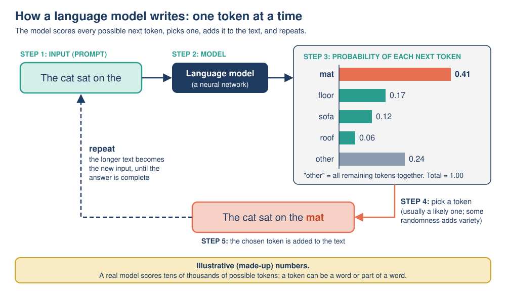

# Mission 11: Myth Busters

**Pixel's AI Field Guide: Missions for Curious Humans** · Version 1.0 (2026-11-06)
**Covers:** Topic 09, [Limitations and Common Misconceptions](../../task-1/topics/09-limitations-and-misconceptions.md) · **Time:** about 75 minutes (core) + 15 minutes (optional)
**Navigation:** [Start here](00-start-here.md) · Previous: [Mission 10](mission-10-the-fairness-files.md) · Next: [Mission 12](mission-12-tomorrows-rulebook.md) · [Glossary](glossary.md) · [Resources](resources.md)

---

## [MISSION BRIEF] Order in the court!

The Curiosity Lab's meeting room has been turned into a courtroom, and Pixel is wearing a very small wig. Nine popular statements about AI stand accused of being myths. Pixel has already decided the verdicts ("If lots of people believe it, it must be true"), so Dr. Ada Okafor has a rule for today: **no verdict without evidence**.

### Learning goals

By the end of this mission you should be able to:

- **Distinguish** a **limitation** (a real weakness of AI) from a **misconception** (a false belief about AI).
- **Explain** in plain language why large language models (LLMs) can produce fluent but false text (**hallucinations**).
- **Identify and correct** six common misconceptions, supporting each correction with evidence.
- **Predict** when an AI system is likely to fail because a situation differs from its training data (**brittleness**).
- **Apply** a four-step routine to spot hallucinations in a chatbot answer.

---

## [PREDICT] Before you start (3 minutes)

Write down your answers. You will check them at the end of the mission.

1. When a chatbot invents a fake book title, is it **lying**? (Yes / No / Not sure)
2. Are hallucinations rare bugs that will soon be fixed completely? (Yes / No / Not sure)
3. If a chatbot answer includes an author, a title and a page number, how sure can you be that the fact is real?

---

## [TRY IT] Activity 11.1: The Misconception Court

**Goal:** Sort statements about AI into **misconceptions** (false beliefs to correct) and **limitations** (real weaknesses to manage), and back every verdict with evidence.

**Preparation:** Paper and pen. The **evidence locker** below contains everything you need. About 25 minutes. Works alone (you are judge and jury) or in a group (one person argues "true", one argues "myth", the rest decide).

**The evidence locker** (all from earlier missions):

| Exhibit | Evidence |
|---|---|
| **E1** | **ELIZA (1966)** used simple pattern-matching rules and had no understanding, yet some users became emotionally attached to it (the **ELIZA effect**; Mission 08). |
| **E2** | **How LLMs write:** one token at a time, by working out probabilities for each possible next token and picking one (usually a likely one). They are trained to produce *likely* text, not to check whether it is *true*; there is no built-in fact database (Mission 06). |
| **E3** | ***Mata v. Avianca* (2023):** lawyers were fined $5,000 for submitting six non-existent court cases, with realistic names and citations, generated by ChatGPT (Mission 10). |
| **E4** | **Gender Shades (2018):** commercial gender classifiers had error rates of up to 34.7% for darker-skinned women but at most 0.8% for lighter-skinned men (Mission 10). |
| **E5** | **Amazon's experimental hiring tool** (reported 2018) learned to penalize the word "women's" from about ten years of mostly male resumes (Mission 10). |
| **E6** | **A healthcare algorithm (2019)** used past *costs* as a stand-in for health *needs* and under-identified Black patients for extra care; the fix was **changing what was predicted** (Missions 09–10). |
| **E7** | **WEF *Future of Jobs Report 2025*:** 2025–2030, about 170 million jobs created, 92 million displaced, net gain about 78 million, from several trends; AI mostly automates **tasks**, not whole jobs (Mission 10). |
| **E8** | **Adversarial examples (Szegedy and colleagues, 2013):** tiny changes to an image, invisible to humans, made neural networks misclassify it. Your Teachable Machine model also failed on new backgrounds and hands (Mission 10). |
| **E9** | **Why models guess (Kalai and colleagues, 2025):** training and testing often reward a confident guess over "I don't know", so models learn to guess. |

**The nine statements on trial:**

1. "The chatbot told me it feels lonely, so it must have feelings."
2. "Chatbots can produce references to books and articles that do not exist."
3. "AI is always objective, because computers have no opinions."
4. "AI will take all our jobs by 2030."
5. "A model trained only on daytime photos may fail badly on night-time photos."
6. "To fix a biased model, just feed it much more of the same data."
7. "If an AI answer sounds confident and detailed, it must be correct."
8. "AI understands things the way humans do."
9. "A chatbot without internet access may know nothing about events after its training data ends, but may still answer confidently."

**Task:** For each statement:

1. Give a **verdict**: **MYTH** (a misconception) or **REAL** (an accurate statement of a limitation).
2. Cite at least **one exhibit** (E1–E9) as evidence.
3. For every MYTH, **rewrite** the statement so it is accurate.

**Observation:** Count your MYTH and REAL verdicts. Which exhibit did you use most often?

**Reflection:** Some myths make people **over-trust** AI; at least one makes people **fear** it in the wrong way. Which is which? Why do both matter?

**Feedback:**

[DEBRIEF] The court's verdicts

| # | Verdict | Evidence | Accurate version |
|---|---|---|---|
| 1 | **MYTH** ("AI is alive, conscious or has feelings") | E1, E2 | "The chatbot produced 'I feel lonely' because that is a likely continuation of human-written text. There is no scientific evidence that current AI systems are conscious or have feelings." |
| 2 | **REAL** (limitation: hallucination) | E2, E3, E9 | Already accurate. Manage it by checking that sources exist and say what is claimed. |
| 3 | **MYTH** ("AI is objective") | E4, E5, E6 | "AI learns from data made by people and is designed by people, so it can reflect and scale up human bias. Applying a biased pattern consistently is not the same as being fair." |
| 4 | **MYTH** ("AI will take all jobs") | E7 | "AI is likely to change most jobs and displace some. The WEF projects about 92 million jobs displaced and 170 million created (2025–2030); the outcome for workers depends a lot on retraining, policy and how organizations use AI." |
| 5 | **REAL** (limitation: brittleness / distribution shift) | E8 | Already accurate. Test a model on the conditions where it will actually be used. |
| 6 | **MYTH** ("more data always fixes it") | E5, E6 | "More data helps only if it is the **right** data: representative, accurately labeled, up to date, and aimed at the right target. More of the same biased data makes the model more confident in the same bias." |
| 7 | **MYTH** ("confident means correct") | E2, E3 | "A hallucination sounds just as confident as a true answer. When it matters, verify with an independent, reliable source." |
| 8 | **MYTH** ("AI understands like humans") | E8, E2 | "AI learns statistical patterns from huge amounts of data rather than from experience of the world, so it can be fooled in ways a person never would. Whether it 'understands' anything is debated; judge it by how reliably it does the task you need, and check its outputs." |
| 9 | **REAL** (limitation: knowledge cutoff, plus hallucination) | E2, E9 | Already accurate. |

**Observation:** six myths (1, 3, 4, 6, 7, 8) and three real limitations (2, 5, 9). E2 (how LLMs write) is usually the most-used exhibit: many myths and limitations follow from next-token prediction.

**Reflection:** Myths 1, 3, 7 and 8 lead to **over-trust** (believing the AI cares, is fair, is right, or understands). Myth 4 leads to **misplaced fear** (expecting total replacement) and can hide the real, specific problem: some workers face serious disruption and need support. Overestimating AI leads to over-trust; underestimating it ("it's just autocomplete, it can't do anything") leads people to ignore real benefits and real risks. Both are mistakes.

**Common slip:** marking statement 2 or 9 as a myth because it sounds negative. A limitation is a *true* statement about a weakness. The test is: *is the statement accurate?*, not *is it good news?*

---

## [TRY IT] Activity 11.2: Spot the hallucinations

**Goal:** Use the **four-step check** (split, prioritize, verify, decide) to find false claims hidden among true ones.

**Preparation:** The fact box below (your "independent, reliable source" for this activity). About 20 minutes. No device needed.

> **Reference fact box** (from Missions 08 and 10):
> - **Gender Shades (2018)** by Joy Buolamwini and Timnit Gebru tested three commercial **gender classification** systems (IBM, Microsoft, Face++) on a balanced set of **1,270 photos of members of parliament** from three African and three European countries. Error rates: up to **34.7%** for darker-skinned women; at most **0.8%** for lighter-skinned men.
> - **WEF *Future of Jobs Report 2025*** (January 2025): for **2025–2030**, about **170 million jobs created**, about **92 million displaced**, a net gain of about **78 million**, driven by **several trends** including, but not only, technology and AI.
> - ***Mata v. Avianca***: in **June 2023** lawyers and their firm were fined **$5,000** in total for submitting **six** non-existent court cases generated by **ChatGPT**.

A student asked a chatbot: *"Summarize what we know about bias and accountability in AI."* Here is the answer. *(It was written for this activity and contains exactly **three** problem claims.)*

> "Bias and accountability in AI have been widely studied. In 2018, Joy Buolamwini and Timnit Gebru's Gender Shades study tested three commercial gender classification systems from IBM, Microsoft and Face++, using 12,700 photos of celebrities. It found error rates of up to 34.7% for darker-skinned women but at most 0.8% for lighter-skinned men. According to the World Economic Forum's *Future of Jobs Report 2025*, AI alone will destroy 170 million jobs by 2030, although the report also expects a net gain of about 78 million jobs. In 2023, lawyers in *Mata v. Avianca* were fined $5,000 for citing six court cases invented by ChatGPT. The problem is not new: as Professor Hilda Brackenbury showed in her 2019 book *Machines Without Prejudice*, 9 out of 10 AI systems contain hidden bias."

**Task:**

1. **Split:** list every separate factual claim (names, dates, numbers, sources). Number them C1, C2, ...
2. **Prioritize:** star the claims most likely to be hallucinated (exact numbers, named sources, quotations, statistics).
3. **Verify:** check each claim against the fact box. Label it *correct*, *false* or *cannot be verified*.
4. **Decide:** rewrite the answer, keeping verified claims, correcting false ones, and removing (or clearly labeling) anything you cannot verify.
5. Which problem claim is the **most dangerous**, and why?

**Observation:** Note where the problem claims sit: at the start, in the middle, next to true claims? Do they sound any less confident?

**Reflection:** One sentence in the answer contradicts itself. Which one, and how could noticing that help you even without a fact box?

**Feedback:**

[DEBRIEF] Worked four-step check

**Steps 1–3: split, prioritize (starred), verify.**

| # | Claim | Verdict |
|---|---|---|
| C1 | Gender Shades was published in 2018 by Buolamwini and Gebru | Correct |
| C2 | It tested three commercial gender classifiers from IBM, Microsoft and Face++ | Correct |
| C3* | It used **12,700 photos of celebrities** | **False**: 1,270 photos of members of parliament |
| C4* | Error rates up to 34.7% for darker-skinned women, at most 0.8% for lighter-skinned men | Correct |
| C5* | WEF 2025: **AI alone will destroy 170 million jobs** by 2030 | **False**: 170 million is jobs **created**; about 92 million **displaced**; and the drivers are **several trends**, not AI alone |
| C6* | The report expects a net gain of about 78 million jobs | Correct |
| C7* | *Mata v. Avianca*, 2023: lawyers fined $5,000 for six ChatGPT-invented cases | Correct |
| C8* | Professor Hilda Brackenbury's **2019 book *Machines Without Prejudice*** showed **9 out of 10** AI systems contain hidden bias | **Cannot be verified, so remove it.** (In fact, the professor, the book and the statistic were **invented** for this activity, which is exactly what a hallucinated source looks like.) |

**Step 4: decide and rewrite.**

> "Bias and accountability in AI have been widely studied. In 2018, Joy Buolamwini and Timnit Gebru's Gender Shades study tested three commercial gender classification systems from IBM, Microsoft and Face++ on 1,270 photos of members of parliament from three African and three European countries. It found error rates of up to 34.7% for darker-skinned women but at most 0.8% for lighter-skinned men. The World Economic Forum's *Future of Jobs Report 2025* projects that between 2025 and 2030 about 170 million jobs will be created and 92 million displaced, a net gain of about 78 million, driven by several trends including AI. In 2023, lawyers in *Mata v. Avianca* were fined $5,000 for citing six court cases invented by ChatGPT."

**5. Most dangerous: C8, the invented source.** A named professor, a book title and a precise statistic make a claim *look* checked, so readers are less likely to question it, and it may be copied into essays and spread. This is what happened in *Mata v. Avianca*.

**Observation:** the false claims sit right next to true ones, in exactly the same confident tone. C3 even comes immediately after correct names and is followed by correct percentages. Fluency gives no warning.

**Reflection:** C5 and C6 contradict each other: if 170 million jobs were *destroyed*, a *net gain* of 78 million would need 248 million new jobs, which the answer never mentions. **Internal contradictions** are a useful warning sign, but most hallucinations are not contradictory, so you still need step 3 (independent verification).

---

## [OBSERVE] What did the court and the fact-check show?

- **Many myths make AI seem more human, fair or reliable than it is.** At least one (total job loss) makes it seem scarier in the wrong way.
- **Real limitations are true statements to manage**, not myths to reject.
- **Hallucinations hide among true claims** and sound exactly as confident.
- **Invented sources are the most dangerous**, because they look like evidence.

---

## [EXPLAIN] Why AI gets things wrong, and why people get AI wrong

### Limitations versus misconceptions

- **Limitations** are real weaknesses of the technology: problems to **manage** (check outputs, add human oversight, choose suitable tasks).
- **Misconceptions** are false beliefs held by people: problems to **correct**.

### Hallucinations: fluent but false

A **hallucination** is content from a generative AI system, especially an LLM, that sounds confident and fluent but is false or made up: a fake quotation, a statistic with no source, a non-existent book or court case. Why it happens, step by step:

1. In **training**, the model reads enormous amounts of text and learns which tokens tend to follow which.
2. In **inference** (use), it writes one token at a time: it works out the probability of each possible next token, picks one (usually a likely one), adds it and repeats (Mission 06).
3. It is trained to produce text that is **likely**, not to check whether it is **true**. There is no built-in fact database.
4. For **common** facts, the likely answer and the true answer are usually the same.
5. For **rare** facts (an obscure book, an exact page number), the model has seen little or no data, but it still produces the *kind* of text that fits: a title-shaped title, a year-shaped number. Fluent, confident, invented.
6. Training and testing often **reward a confident guess over "I don't know"** (Kalai and colleagues, 2025), so models learn to guess.

> **Playful analogy:** an LLM is like a student who has read a whole library but has no notes in the exam. When they remember, they answer well. When they don't, they write something that *sounds like* an answer, because a blank page scores nothing.
>
> **Technically speaking:** the model generates text by repeatedly sampling from a probability distribution over next tokens, learned from training data. Nothing in that loop compares the output with a source of truth, so plausibility and accuracy can come apart, especially for facts that were rare in the training data.

**Hallucination is not lying.** Lying requires intending to deceive; the model has no intention. It is a side effect of how text is generated. **What reduces it (but does not remove it):** **grounding** (connecting the model to search results or trusted documents and asking it to answer only from them), asking for sources **and checking them**, and using AI where errors are easy to spot (brainstorming, drafting) rather than for unchecked facts in high-stakes situations.

### Brittleness and other limitations

- **Brittleness and distribution shift:** a model is reliable mainly on inputs **similar** to its training data. When the data it meets in use differ (night photos for a day-trained model, a different hospital's scanner), performance can drop sharply, often **confidently** and without warning. You saw this in the Teachable Machine lab.
- **Adversarial examples:** inputs deliberately altered, often invisibly to humans, to make a system give a wrong answer (Szegedy and colleagues, 2013).
- **Knowledge cutoff:** an LLM has no information about events after its training data ends unless connected to current sources, yet may still answer confidently.
- **Token-level blind spots:** LLMs see text as tokens (chunks), not individual letters, so tasks like counting letters or reversing a word can trip them up.
- **Black box:** it is hard to know *why* a large network produced an output. If you ask an LLM to explain its reasoning, the explanation is itself generated text and may not reflect what happened inside.
- **Data quality:** garbage in, garbage out.

### Six misconceptions, corrected

| Misconception | Correction | Key evidence |
|---|---|---|
| "AI is alive, conscious or has feelings" | People naturally treat things that talk like a person as if they had human thoughts and feelings (**anthropomorphism**; the ELIZA effect is one form of it). Human-like words come from human-written training text; there is **no scientific evidence** current AI is conscious. Whether future machines *could* be is an open question. "Self-aware AI" is a hypothetical category (Mission 07). | ELIZA effect (1966); next-token prediction |
| "AI understands things the way humans do" | It learns statistical patterns, not from experience of the world; it can ace a hard question yet fail a slightly changed familiar puzzle. Whether it "understands" is **debated**; judge it by reliability on your task. | Adversarial examples; hallucinations |
| "AI is always objective" | It can learn and scale human bias. | Gender Shades; Amazon tool; healthcare proxy |
| "AI will take all our jobs" | Large disruption, not total replacement. **Nuance:** 92 million displaced means real people losing work; projections can be wrong. | WEF 2025: 170M created, 92M displaced, net +78M |
| "More data always fixes it" | Only the **right** data helps: representative, well labeled, up to date, with the right target. | Amazon tool; healthcare proxy fixed by changing the target |
| "Confident and detailed means correct" | Hallucinations sound exactly as confident as true answers. | *Mata v. Avianca* |

### The four-step check

When an AI answer matters:

1. **Split** it into separate factual claims (names, dates, numbers, quotes, sources).
2. **Prioritize** the claims that matter most and those most likely to be hallucinated: rare facts, exact numbers, quotations, references.
3. **Verify** each important claim in an independent, reliable source (an official site, a textbook, the original paper). Check that cited sources **exist** and **say what is claimed**.
4. **Decide:** keep verified claims, correct wrong ones, and remove anything you cannot verify, or clearly label it as unverified.

**Don't** ask the same chatbot whether its answer is correct and trust the reply: its check is produced by the same process and can be wrong too.

*Figure: An LLM chooses each next token by probability. It picks what is likely given its training data, not what is verified as true, which is why fluent text can still be false.* (Original diagram created for this module.)

For the full explanation and more practice, read [Topic 09](../../task-1/topics/09-limitations-and-misconceptions.md).

---

## [LAB NOTE] About this mission's activities

- The chatbot answer in Activity 11.2 was **written by hand** for teaching. Real hallucinations vary: some are tiny (a wrong year), some are whole invented documents.
- The fact box made verification easy. In real life, step 3 means finding a reliable source yourself, which takes time; that is why step 2 (prioritize) matters.
- Pixel's courtroom is a game. Real scientific questions, such as whether a future machine could be conscious, cannot be settled by a verdict; the court only rules on what the **current evidence** supports.

---

## [WATCH] The danger of AI is weirder than you think

| | |
|---|---|
| **What** | *The danger of AI is weirder than you think*, Janelle Shane (AI researcher, *AI Weirdness* blog), TED2019 (10:29 on YouTube). Link: <https://www.youtube.com/watch?v=OhCzX0iLnOc> |
| **Why** | Genuinely funny and full of concrete failures: AI-invented ice-cream flavors, a "robot" that builds itself into a tower and falls over to reach its goal. Her core line: the danger is not that AI will rebel, but that it will do *exactly* what we ask. |
| **Which part** | **Short version: 0:00–4:41** ("AI in ice cream", "The reality of AI" 1:06, "AI literal interpretation" 2:16, "Training AI to move" 3:28). Full version adds paint colors, a fish classifier that learned to look for human fingers, and real failures (a 2016 car crash, a hiring tool, recommenders). Timestamps from YouTube's chapter list. |
| **What to do** | *Before watching:* "An AI learns from a list of about 1,600 real ice-cream flavors and invents new ones. Predict three names." *While watching:* "Did the AI 'want' to make horrible flavors? What went wrong instead?" *After (full version):* explain why the fish classifier highlighted fingers, and link it to one misconception from the court. |
| **Watch out for** | Her "earthworm... maybe a honeybee" computing comparison (about 1:06) is a 2019 figure of speech, not a measurement; today's models are far bigger, but her main point still holds. **Content note:** after about 5:29, some AI-generated paint-color names on screen are mildly crude, so use the short version with younger learners. The full version mentions a fatal 2016 car accident (no graphic content), and her account of that crash is her own hedged reading. |
| **Captions and access** | Subtitles in about 25 languages. Can't open YouTube? Watch on TED.com: <https://www.ted.com/talks/janelle_shane_the_danger_of_ai_is_weirder_than_you_think> (transcript on the same page). |

[DEBRIEF] Viewing questions

- **Ice cream:** the AI did not "want" anything. It copied letter and word patterns from its training list with no idea what the words mean, so names like "Pumpkin Trash Break" came out. Its whole world was the training data.
- **Fish and fingers:** in the training photos, the fish (a tench, a trophy fish) was usually held by people, so fingers became a **shortcut pattern** (a spurious correlation). This busts "AI understands like humans" (a person knows fingers are not part of a fish) and "more data always fixes it" (more of the same trophy photos would teach the same shortcut).

---

## [APPLY] Activity 11.3: Predict the failure

**Goal:** Use what you know about limitations to **predict** where AI will struggle, before it happens.

**Preparation:** The limitations list in [EXPLAIN]. About 10 minutes.

**Task:** For each situation, predict whether the AI is likely to perform **well** or **poorly**, name the **limitation** involved (if any), and explain in one or two sentences.

1. A plant-identification app trained on photos of green summer leaves is used in autumn on brown, curled leaves.
2. An LLM with no internet access is asked: "What is the top news story today?"
3. An LLM is asked to retell the story of Cinderella in five simple sentences.
4. An LLM is asked to write the word "unbelievable" backwards, letter by letter.
5. An image classifier is shown a photo of a panda that someone has deliberately altered in tiny ways, invisible to people.
6. An LLM is asked for the opening hours and phone number of a small local bakery.

**Observation:** Mark which predictions you were most and least sure about.

**Reflection:** For which situations would you still use the AI, and with what checking?

**Feedback:**

[DEBRIEF] Predictions

1. **Poorly** (likely). **Distribution shift / brittleness**: autumn leaves look very different from the summer training photos.
2. **Poorly.** **Knowledge cutoff**: it has no information about today. It may say it doesn't know, or it may confidently invent a story (a hallucination).
3. **Well (usually).** A very common story, seen many times in training data, so the likely answer and the true answer match. A quick check is still wise if it matters.
4. **Risky.** **Token-level blind spot**: the model sees chunks, not letters, so letter-by-letter tasks can trip it up even though they are trivial for people. Some systems handle this well; check the result.
5. **Poorly.** **Adversarial example**: changes invisible to people can make a network misclassify an image (Szegedy and colleagues, 2013).
6. **Poorly (high hallucination risk).** A **rare fact** about a small business: the model may produce a phone-number-shaped answer. Check the bakery's own website or call directory.

**Reflection:** reasonable uses: situation 3 (low stakes, easy to check) and perhaps 1 or 4 with a check. For 2 and 6, use a current, reliable source instead. Match the amount of checking to the stakes, as in Mission 09.

---

## [OPTIONAL SIDE QUEST] The library test (15 minutes)

If you have access to a chatbot (follow your school's or workplace's rules; don't enter personal information), ask it for **three books, with authors and years**, about a narrow topic you know well. Then check each one in a library catalog or a bookshop's website. Record how many were real, partly wrong, or invented. Apply the four-step check to the answer. *(Use low-stakes topics only. No chatbot? Use the Activity 11.2 answer instead and write what a library check would involve.)*

---

## [CHECK] Quick self-check

1. What is the difference between a **limitation** and a **misconception**? Give one example of each.
2. Explain in two or three sentences why an LLM can produce a confident but false answer.
3. True or false: "A hallucination is the AI lying to you." Correct it if false.
4. A spam filter puts a real email in the spam folder. Is that a hallucination? What is it?
5. List the four steps of the check, in order.

---

## [DEBRIEF] Check answers

Show answers with explanations

1. A **limitation** is a real weakness of current AI, to be managed (for example, hallucinations, brittleness, knowledge cutoff). A **misconception** is a false belief people hold about AI, to be corrected (for example, "AI is conscious", "AI is always objective", "AI will take all jobs").
2. An LLM generates text one token at a time, picking likely next tokens based on patterns from training. It is trained to produce **likely** text, not to check **truth**, and has no built-in fact database. For rare facts it still produces the *kind* of text that fits, so the result can be fluent, confident and invented; training that rewards guessing makes this worse.
3. **False.** Lying requires an intention to deceive; the model has no intention. A hallucination is a side effect of how the text is generated.
4. **No.** "Hallucination" is used mainly for generative AI inventing content. A spam filter misclassifying a genuine email is an ordinary prediction error: a **false positive**.
5. **Split, prioritize, verify, decide.**

**Now look back at your [PREDICT] answers.** Did you think hallucination was lying? Did you expect it to be fixed soon? How much do author, title and page number now convince you?

---

## Mission summary

- **Limitations** are real weaknesses to manage; **misconceptions** are false beliefs to correct. Overestimating and underestimating AI are both mistakes.
- **Hallucinations** happen because LLMs produce **likely** text one token at a time, not checked facts; rare facts and training that rewards guessing make them worse. They are **not lies**, and grounding plus checking reduce them.
- **Brittleness:** models are reliable mainly on inputs like their training data; distribution shift, adversarial examples, knowledge cutoffs and token blind spots cause confident failures.
- **Six misconceptions busted:** AI is conscious; AI understands like humans; AI is objective; AI will take all jobs (disruption, not total replacement); more data always fixes it; confident means correct.
- When it matters, use the **four-step check: split, prioritize, verify, decide**, with an **independent** source.

## Next mission

Pixel's wig is back in the cupboard. One question remains: what happens next? In [Mission 12: Tomorrow's Rulebook](mission-12-tomorrows-rulebook.md), Pixel learns how the law sorts AI by risk, joins a debate about "general AI", and faces the **final capstone challenge**.
